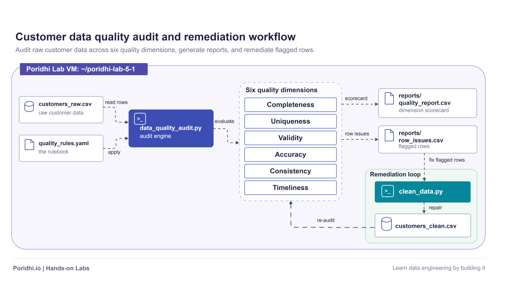

## Introduction

This lab, **Data Quality Fundamentals**, teaches you how to judge whether a dataset is fit for machine learning by auditing it against six quality dimensions: accuracy, completeness, consistency, timeliness, uniqueness, and validity. You will build a small, self-contained audit on a deliberately messy customer dataset, read the scorecard it produces, repair the defects, and re-audit to prove the same six checks can all pass.

A model is only as good as the data it learns from. Silent quality defects such as a missing age, a duplicated customer, or a record that is two years stale rarely crash a training job, but they quietly poison the model, the metrics, and every decision made from them. Data quality checks turn those silent defects into a loud, repeatable report.



The value of this lab is the habit, not the size of the dataset. Once you can name the six dimensions and attach a concrete rule to each one, you can audit a spreadsheet, a Parquet table, or a production warehouse with the same reasoning. The sample here is small enough to inspect by hand and large enough to trigger every dimension at least once.

Everything runs on the Poridhi Lab VM using Python, pandas, and PyYAML on local files. No AWS account or cloud service is required, and the generated data disappears with the VM at the end of the session.

## Architecture

### Architecture Structure

```text
Sample data (data/customers_raw.csv)
        |
        v
Audit engine (data_quality_audit.py)  <- rules (quality_rules.yaml)
        |
        v
Six dimension checks: Completeness | Uniqueness | Validity | Accuracy | Consistency | Timeliness
        |
        +-> reports/quality_report.csv (scorecard)
        |
        +-> reports/row_issues.csv (flagged rows)
                |
                v
Remediation (clean_data.py) -> data/customers_clean.csv
                |
                v
Re-audit through the same engine
```

### Draw.io Diagram

```xml
<mxfile host="app.diagrams.net" type="device">
  <diagram id="lab51" name="Lab 5.1 architecture">
    <mxGraphModel dx="1600" dy="900" grid="0" gridSize="10" guides="1" tooltips="1" connect="1" arrows="1" fold="1" page="1" pageScale="1" pageWidth="1600" pageHeight="900" background="#FFFFFF" math="0" shadow="0">
      <root>
        <mxCell id="0"/>
        <mxCell id="1" parent="0"/>
        <mxCell id="frame" value="" style="rounded=1;absoluteArcSize=1;arcSize=20;fillColor=#FFFFFF;strokeColor=#7C8BA1;strokeWidth=2;" vertex="1" parent="1">
          <mxGeometry x="20" y="20" width="1560" height="860" as="geometry"/>
        </mxCell>
        <mxCell id="vm" value="" style="rounded=1;absoluteArcSize=1;arcSize=14;fillColor=#F2F5FA;strokeColor=#C9D3E2;strokeWidth=1.5;dashed=1;dashPattern=8 6;" vertex="1" parent="1">
          <mxGeometry x="50" y="50" width="1500" height="800" as="geometry"/>
        </mxCell>
        <mxCell id="vm_label" value="Poridhi Lab VM: ~/poridhi-lab-5-1" style="text;html=1;fillColor=none;strokeColor=none;align=left;verticalAlign=middle;fontFamily=Helvetica;fontSize=18;fontStyle=1;fontColor=#1F2937;" vertex="1" parent="1">
          <mxGeometry x="70" y="36" width="560" height="28" as="geometry"/>
        </mxCell>
        <mxCell id="dims" value="" style="rounded=1;absoluteArcSize=1;arcSize=14;fillColor=#F2F5FA;strokeColor=#C9D3E2;strokeWidth=1.5;dashed=1;dashPattern=8 6;" vertex="1" parent="1">
          <mxGeometry x="800" y="145" width="340" height="430" as="geometry"/>
        </mxCell>
        <mxCell id="dims_label" value="Six quality dimensions" style="text;html=1;fillColor=none;strokeColor=none;align=left;verticalAlign=middle;fontFamily=Helvetica;fontSize=18;fontStyle=1;fontColor=#1F2937;" vertex="1" parent="1">
          <mxGeometry x="820" y="131" width="300" height="28" as="geometry"/>
        </mxCell>
        <mxCell id="rem" value="" style="rounded=1;absoluteArcSize=1;arcSize=14;fillColor=#F2F5FA;strokeColor=#C9D3E2;strokeWidth=1.5;dashed=1;dashPattern=8 6;" vertex="1" parent="1">
          <mxGeometry x="1200" y="505" width="320" height="250" as="geometry"/>
        </mxCell>
        <mxCell id="rem_label" value="Remediation loop" style="text;html=1;fillColor=none;strokeColor=none;align=left;verticalAlign=middle;fontFamily=Helvetica;fontSize=18;fontStyle=1;fontColor=#1F2937;" vertex="1" parent="1">
          <mxGeometry x="1210" y="491" width="240" height="28" as="geometry"/>
        </mxCell>
        <mxCell id="raw" value="&lt;b&gt;customers_raw.csv&lt;/b&gt;&lt;br&gt;&lt;font style='font-size:16px' color='#6B7280'&gt;raw customer data&lt;/font&gt;" style="rounded=1;absoluteArcSize=1;arcSize=12;fillColor=#FFFFFF;strokeColor=#7C8BA1;strokeWidth=1.5;fontFamily=Helvetica;fontSize=20;fontStyle=1;fontColor=#1F2937;align=left;verticalAlign=middle;spacingLeft=52;spacingRight=16;html=1;whiteSpace=wrap;" vertex="1" parent="1">
          <mxGeometry x="70" y="175" width="270" height="100" as="geometry"/>
        </mxCell>
        <mxCell id="raw_icon" style="shape=image;aspect=fixed;imageAspect=1;image=data:image/svg+xml,PHN2ZyB4bWxucz0iaHR0cDovL3d3dy53My5vcmcvMjAwMC9zdmciIHZpZXdCb3g9IjAgMCAyNCAyNCIgZmlsbD0ibm9uZSIgc3Ryb2tlPSIjMkY0QUE2IiBzdHJva2Utd2lkdGg9IjIiIHN0cm9rZS1saW5lY2FwPSJyb3VuZCIgc3Ryb2tlLWxpbmVqb2luPSJyb3VuZCI+PGVsbGlwc2UgY3g9IjEyIiBjeT0iNSIgcng9IjgiIHJ5PSIzIi8+PHBhdGggZD0iTTQgNXYxNGMwIDEuNyAzLjYgMyA4IDNzOC0xLjMgOC0zVjUiLz48cGF0aCBkPSJNNCAxMmMwIDEuNyAzLjYgMyA4IDNzOC0xLjMgOC0zIi8+PC9zdmc+;" vertex="1" parent="raw">
          <mxGeometry x="16" y="16" width="32" height="32" as="geometry"/>
        </mxCell>
        <mxCell id="rules" value="&lt;b&gt;quality_rules.yaml&lt;/b&gt;&lt;br&gt;&lt;font style='font-size:16px' color='#6B7280'&gt;the rulebook&lt;/font&gt;" style="rounded=1;absoluteArcSize=1;arcSize=12;fillColor=#FFFFFF;strokeColor=#7C8BA1;strokeWidth=1.5;fontFamily=Helvetica;fontSize=20;fontStyle=1;fontColor=#1F2937;align=left;verticalAlign=middle;spacingLeft=52;spacingRight=16;html=1;whiteSpace=wrap;" vertex="1" parent="1">
          <mxGeometry x="70" y="315" width="270" height="100" as="geometry"/>
        </mxCell>
        <mxCell id="rules_icon" style="shape=image;aspect=fixed;imageAspect=1;image=data:image/svg+xml,PHN2ZyB4bWxucz0iaHR0cDovL3d3dy53My5vcmcvMjAwMC9zdmciIHZpZXdCb3g9IjAgMCAyNCAyNCIgZmlsbD0ibm9uZSIgc3Ryb2tlPSIjMkY0QUE2IiBzdHJva2Utd2lkdGg9IjIiIHN0cm9rZS1saW5lY2FwPSJyb3VuZCIgc3Ryb2tlLWxpbmVqb2luPSJyb3VuZCI+PHBhdGggZD0iTTE0IDJIN2EyIDIgMCAwIDAtMiAydjE2YTIgMiAwIDAgMCAyIDJoMTBhMiAyIDAgMCAwIDItMlY4eiIvPjxwb2x5bGluZSBwb2ludHM9IjE0LDIgMTQsOCAxOSw4Ii8+PC9zdmc+;" vertex="1" parent="rules">
          <mxGeometry x="16" y="16" width="32" height="32" as="geometry"/>
        </mxCell>
        <mxCell id="audit" value="&lt;b&gt;data_quality_audit.py&lt;/b&gt;&lt;br&gt;&lt;font style='font-size:16px' color='#E8EDF7'&gt;audit engine&lt;/font&gt;" style="rounded=1;absoluteArcSize=1;arcSize=12;fillColor=#2F4AA6;strokeColor=#2F4AA6;strokeWidth=1.5;fontFamily=Helvetica;fontSize=20;fontStyle=1;fontColor=#FFFFFF;align=left;verticalAlign=middle;spacingLeft=52;spacingRight=16;html=1;whiteSpace=wrap;" vertex="1" parent="1">
          <mxGeometry x="420" y="220" width="300" height="140" as="geometry"/>
        </mxCell>
        <mxCell id="audit_icon" style="shape=image;aspect=fixed;imageAspect=1;image=data:image/svg+xml,PHN2ZyB4bWxucz0iaHR0cDovL3d3dy53My5vcmcvMjAwMC9zdmciIHZpZXdCb3g9IjAgMCAyNCAyNCIgZmlsbD0ibm9uZSIgc3Ryb2tlPSIjRkZGRkZGIiBzdHJva2Utd2lkdGg9IjIiIHN0cm9rZS1saW5lY2FwPSJyb3VuZCIgc3Ryb2tlLWxpbmVqb2luPSJyb3VuZCI+PHJlY3QgeD0iMyIgeT0iNCIgd2lkdGg9IjE4IiBoZWlnaHQ9IjE2IiByeD0iMyIvPjxwb2x5bGluZSBwb2ludHM9IjcsMTAgMTAsMTMgNywxNiIvPjxsaW5lIHgxPSIxMiIgeTE9IjE2IiB4Mj0iMTciIHkyPSIxNiIvPjwvc3ZnPg==;" vertex="1" parent="audit">
          <mxGeometry x="16" y="16" width="32" height="32" as="geometry"/>
        </mxCell>
        <mxCell id="report" value="&lt;b&gt;reports/&lt;br&gt;quality_report.csv&lt;/b&gt;&lt;br&gt;&lt;font style='font-size:16px' color='#6B7280'&gt;dimension scorecard&lt;/font&gt;" style="rounded=1;absoluteArcSize=1;arcSize=12;fillColor=#FFFFFF;strokeColor=#7C8BA1;strokeWidth=1.5;fontFamily=Helvetica;fontSize=20;fontStyle=1;fontColor=#1F2937;align=left;verticalAlign=middle;spacingLeft=52;spacingRight=16;html=1;whiteSpace=wrap;" vertex="1" parent="1">
          <mxGeometry x="1230" y="165" width="290" height="100" as="geometry"/>
        </mxCell>
        <mxCell id="report_icon" style="shape=image;aspect=fixed;imageAspect=1;image=data:image/svg+xml,PHN2ZyB4bWxucz0iaHR0cDovL3d3dy53My5vcmcvMjAwMC9zdmciIHZpZXdCb3g9IjAgMCAyNCAyNCIgZmlsbD0ibm9uZSIgc3Ryb2tlPSIjMkY0QUE2IiBzdHJva2Utd2lkdGg9IjIiIHN0cm9rZS1saW5lY2FwPSJyb3VuZCIgc3Ryb2tlLWxpbmVqb2luPSJyb3VuZCI+PHBhdGggZD0iTTE0IDJIN2EyIDIgMCAwIDAtMiAydjE2YTIgMiAwIDAgMCAyIDJoMTBhMiAyIDAgMCAwIDItMlY4eiIvPjxwb2x5bGluZSBwb2ludHM9IjE0LDIgMTQsOCAxOSw4Ii8+PC9zdmc+;" vertex="1" parent="report">
          <mxGeometry x="16" y="16" width="32" height="32" as="geometry"/>
        </mxCell>
        <mxCell id="issues" value="&lt;b&gt;reports/&lt;br&gt;row_issues.csv&lt;/b&gt;&lt;br&gt;&lt;font style='font-size:16px' color='#6B7280'&gt;flagged rows&lt;/font&gt;" style="rounded=1;absoluteArcSize=1;arcSize=12;fillColor=#FFFFFF;strokeColor=#7C8BA1;strokeWidth=1.5;fontFamily=Helvetica;fontSize=20;fontStyle=1;fontColor=#1F2937;align=left;verticalAlign=middle;spacingLeft=52;spacingRight=16;html=1;whiteSpace=wrap;" vertex="1" parent="1">
          <mxGeometry x="1230" y="335" width="290" height="100" as="geometry"/>
        </mxCell>
        <mxCell id="issues_icon" style="shape=image;aspect=fixed;imageAspect=1;image=data:image/svg+xml,PHN2ZyB4bWxucz0iaHR0cDovL3d3dy53My5vcmcvMjAwMC9zdmciIHZpZXdCb3g9IjAgMCAyNCAyNCIgZmlsbD0ibm9uZSIgc3Ryb2tlPSIjMkY0QUE2IiBzdHJva2Utd2lkdGg9IjIiIHN0cm9rZS1saW5lY2FwPSJyb3VuZCIgc3Ryb2tlLWxpbmVqb2luPSJyb3VuZCI+PHBhdGggZD0iTTE0IDJIN2EyIDIgMCAwIDAtMiAydjE2YTIgMiAwIDAgMCAyIDJoMTBhMiAyIDAgMCAwIDItMlY4eiIvPjxwb2x5bGluZSBwb2ludHM9IjE0LDIgMTQsOCAxOSw4Ii8+PC9zdmc+;" vertex="1" parent="issues">
          <mxGeometry x="16" y="16" width="32" height="32" as="geometry"/>
        </mxCell>
        <mxCell id="clean" value="&lt;b&gt;clean_data.py&lt;/b&gt;" style="rounded=1;absoluteArcSize=1;arcSize=12;fillColor=#0E7C95;strokeColor=#0E7C95;strokeWidth=1.5;fontFamily=Helvetica;fontSize=20;fontStyle=1;fontColor=#FFFFFF;align=left;verticalAlign=middle;spacingLeft=52;spacingRight=16;html=1;whiteSpace=wrap;" vertex="1" parent="1">
          <mxGeometry x="1230" y="540" width="290" height="85" as="geometry"/>
        </mxCell>
        <mxCell id="clean_icon" style="shape=image;aspect=fixed;imageAspect=1;image=data:image/svg+xml,PHN2ZyB4bWxucz0iaHR0cDovL3d3dy53My5vcmcvMjAwMC9zdmciIHZpZXdCb3g9IjAgMCAyNCAyNCIgZmlsbD0ibm9uZSIgc3Ryb2tlPSIjRkZGRkZGIiBzdHJva2Utd2lkdGg9IjIiIHN0cm9rZS1saW5lY2FwPSJyb3VuZCIgc3Ryb2tlLWxpbmVqb2luPSJyb3VuZCI+PHJlY3QgeD0iMyIgeT0iNCIgd2lkdGg9IjE4IiBoZWlnaHQ9IjE2IiByeD0iMyIvPjxwb2x5bGluZSBwb2ludHM9IjcsMTAgMTAsMTMgNywxNiIvPjxsaW5lIHgxPSIxMiIgeTE9IjE2IiB4Mj0iMTciIHkyPSIxNiIvPjwvc3ZnPg==;" vertex="1" parent="clean">
          <mxGeometry x="16" y="16" width="32" height="32" as="geometry"/>
        </mxCell>
        <mxCell id="cleancsv" value="&lt;b&gt;customers_clean.csv&lt;/b&gt;" style="rounded=1;absoluteArcSize=1;arcSize=12;fillColor=#FFFFFF;strokeColor=#7C8BA1;strokeWidth=1.5;fontFamily=Helvetica;fontSize=20;fontStyle=1;fontColor=#1F2937;align=left;verticalAlign=middle;spacingLeft=52;spacingRight=16;html=1;whiteSpace=wrap;" vertex="1" parent="1">
          <mxGeometry x="1230" y="655" width="290" height="85" as="geometry"/>
        </mxCell>
        <mxCell id="cleancsv_icon" style="shape=image;aspect=fixed;imageAspect=1;image=data:image/svg+xml,PHN2ZyB4bWxucz0iaHR0cDovL3d3dy53My5vcmcvMjAwMC9zdmciIHZpZXdCb3g9IjAgMCAyNCAyNCIgZmlsbD0ibm9uZSIgc3Ryb2tlPSIjMkY0QUE2IiBzdHJva2Utd2lkdGg9IjIiIHN0cm9rZS1saW5lY2FwPSJyb3VuZCIgc3Ryb2tlLWxpbmVqb2luPSJyb3VuZCI+PGVsbGlwc2UgY3g9IjEyIiBjeT0iNSIgcng9IjgiIHJ5PSIzIi8+PHBhdGggZD0iTTQgNXYxNGMwIDEuNyAzLjYgMyA4IDNzOC0xLjMgOC0zVjUiLz48cGF0aCBkPSJNNCAxMmMwIDEuNyAzLjYgMyA4IDNzOC0xLjMgOC0zIi8+PC9zdmc+;" vertex="1" parent="cleancsv">
          <mxGeometry x="16" y="16" width="32" height="32" as="geometry"/>
        </mxCell>
        <mxCell id="dim0" value="Completeness" style="rounded=1;absoluteArcSize=1;arcSize=12;fillColor=#FFFFFF;strokeColor=#2F4AA6;strokeWidth=1.5;fontFamily=Helvetica;fontSize=20;fontStyle=1;fontColor=#1F2937;align=center;verticalAlign=middle;spacingLeft=12;spacingRight=12;html=1;whiteSpace=wrap;" vertex="1" parent="1">
          <mxGeometry x="820" y="187" width="300" height="48" as="geometry"/>
        </mxCell>
        <mxCell id="dim1" value="Uniqueness" style="rounded=1;absoluteArcSize=1;arcSize=12;fillColor=#FFFFFF;strokeColor=#2F4AA6;strokeWidth=1.5;fontFamily=Helvetica;fontSize=20;fontStyle=1;fontColor=#1F2937;align=center;verticalAlign=middle;spacingLeft=12;spacingRight=12;html=1;whiteSpace=wrap;" vertex="1" parent="1">
          <mxGeometry x="820" y="247" width="300" height="48" as="geometry"/>
        </mxCell>
        <mxCell id="dim2" value="Validity" style="rounded=1;absoluteArcSize=1;arcSize=12;fillColor=#FFFFFF;strokeColor=#2F4AA6;strokeWidth=1.5;fontFamily=Helvetica;fontSize=20;fontStyle=1;fontColor=#1F2937;align=center;verticalAlign=middle;spacingLeft=12;spacingRight=12;html=1;whiteSpace=wrap;" vertex="1" parent="1">
          <mxGeometry x="820" y="307" width="300" height="48" as="geometry"/>
        </mxCell>
        <mxCell id="dim3" value="Accuracy" style="rounded=1;absoluteArcSize=1;arcSize=12;fillColor=#FFFFFF;strokeColor=#2F4AA6;strokeWidth=1.5;fontFamily=Helvetica;fontSize=20;fontStyle=1;fontColor=#1F2937;align=center;verticalAlign=middle;spacingLeft=12;spacingRight=12;html=1;whiteSpace=wrap;" vertex="1" parent="1">
          <mxGeometry x="820" y="367" width="300" height="48" as="geometry"/>
        </mxCell>
        <mxCell id="dim4" value="Consistency" style="rounded=1;absoluteArcSize=1;arcSize=12;fillColor=#FFFFFF;strokeColor=#2F4AA6;strokeWidth=1.5;fontFamily=Helvetica;fontSize=20;fontStyle=1;fontColor=#1F2937;align=center;verticalAlign=middle;spacingLeft=12;spacingRight=12;html=1;whiteSpace=wrap;" vertex="1" parent="1">
          <mxGeometry x="820" y="427" width="300" height="48" as="geometry"/>
        </mxCell>
        <mxCell id="dim5" value="Timeliness" style="rounded=1;absoluteArcSize=1;arcSize=12;fillColor=#FFFFFF;strokeColor=#2F4AA6;strokeWidth=1.5;fontFamily=Helvetica;fontSize=20;fontStyle=1;fontColor=#1F2937;align=center;verticalAlign=middle;spacingLeft=12;spacingRight=12;html=1;whiteSpace=wrap;" vertex="1" parent="1">
          <mxGeometry x="820" y="487" width="300" height="48" as="geometry"/>
        </mxCell>
        <mxCell id="e_read" edge="1" parent="1" source="raw" target="audit" style="edgeStyle=orthogonalEdgeStyle;rounded=1;html=1;strokeColor=#1F2937;strokeWidth=1.5;endArrow=block;endFill=1;startArrow=oval;startFill=0;startSize=8;endSize=8;jettySize=auto;exitX=1;exitY=0.5;exitDx=0;exitDy=0;entryX=0;entryY=0.36;entryDx=0;entryDy=0;">
          <mxGeometry relative="1" as="geometry"/>
        </mxCell>
        <mxCell id="e_read_label" value="read rows" style="text;html=1;fillColor=none;strokeColor=none;align=center;verticalAlign=middle;fontFamily=Helvetica;fontSize=17;fontStyle=1;fontColor=#1F2937;" vertex="1" connectable="0" parent="1">
          <mxGeometry x="290.0" y="199.0" width="180" height="24" as="geometry"/>
        </mxCell>
        <mxCell id="e_read_flow" style="shape=image;aspect=fixed;imageAspect=1;image=data:image/svg+xml,PHN2ZyB4bWxucz0iaHR0cDovL3d3dy53My5vcmcvMjAwMC9zdmciIHZpZXdCb3g9IjAgMCAyNCAyNCI+PGNpcmNsZSBjeD0iMTIiIGN5PSIxMiIgcj0iMTAiIGZpbGw9IiNGRkZGRkYiLz48cGF0aCBkPSJNOSA2IEwxNSAxMiBMOSAxOCIgZmlsbD0ibm9uZSIgc3Ryb2tlPSIjMUYyOTM3IiBzdHJva2Utd2lkdGg9IjIuNSIgc3Ryb2tlLWxpbmVjYXA9InJvdW5kIiBzdHJva2UtbGluZWpvaW49InJvdW5kIi8+PC9zdmc+;rotation=90;" vertex="1" parent="1">
          <mxGeometry x="372" y="239.7" width="16" height="16" as="geometry"/>
        </mxCell>
        <mxCell id="e_apply" edge="1" parent="1" source="rules" target="audit" style="edgeStyle=orthogonalEdgeStyle;rounded=1;html=1;strokeColor=#1F2937;strokeWidth=1.5;endArrow=block;endFill=1;startArrow=oval;startFill=0;startSize=8;endSize=8;jettySize=auto;exitX=1;exitY=0.5;exitDx=0;exitDy=0;entryX=0;entryY=0.72;entryDx=0;entryDy=0;">
          <mxGeometry relative="1" as="geometry"/>
        </mxCell>
        <mxCell id="e_apply_label" value="apply" style="text;html=1;fillColor=none;strokeColor=none;align=center;verticalAlign=middle;fontFamily=Helvetica;fontSize=17;fontStyle=1;fontColor=#1F2937;" vertex="1" connectable="0" parent="1">
          <mxGeometry x="292.0" y="339.0" width="180" height="24" as="geometry"/>
        </mxCell>
        <mxCell id="e_apply_flow" style="shape=image;aspect=fixed;imageAspect=1;image=data:image/svg+xml,PHN2ZyB4bWxucz0iaHR0cDovL3d3dy53My5vcmcvMjAwMC9zdmciIHZpZXdCb3g9IjAgMCAyNCAyNCI+PGNpcmNsZSBjeD0iMTIiIGN5PSIxMiIgcj0iMTAiIGZpbGw9IiNGRkZGRkYiLz48cGF0aCBkPSJNOSA2IEwxNSAxMiBMOSAxOCIgZmlsbD0ibm9uZSIgc3Ryb2tlPSIjMUYyOTM3IiBzdHJva2Utd2lkdGg9IjIuNSIgc3Ryb2tlLWxpbmVjYXA9InJvdW5kIiBzdHJva2UtbGluZWpvaW49InJvdW5kIi8+PC9zdmc+;rotation=270;" vertex="1" parent="1">
          <mxGeometry x="372" y="322" width="16" height="16" as="geometry"/>
        </mxCell>
        <mxCell id="e_evaluate" edge="1" parent="1" source="audit" target="dims" style="edgeStyle=orthogonalEdgeStyle;rounded=1;html=1;strokeColor=#1F2937;strokeWidth=1.5;endArrow=block;endFill=1;startArrow=oval;startFill=0;startSize=8;endSize=8;jettySize=auto;exitX=1;exitY=0.5;exitDx=0;exitDy=0;entryX=0;entryY=0.5;entryDx=0;entryDy=0;">
          <mxGeometry relative="1" as="geometry"/>
        </mxCell>
        <mxCell id="e_evaluate_label" value="evaluate" style="text;html=1;fillColor=none;strokeColor=none;align=center;verticalAlign=middle;fontFamily=Helvetica;fontSize=17;fontStyle=1;fontColor=#1F2937;" vertex="1" connectable="0" parent="1">
          <mxGeometry x="670.0" y="264.0" width="180" height="24" as="geometry"/>
        </mxCell>
        <mxCell id="e_evaluate_flow" style="shape=image;aspect=fixed;imageAspect=1;image=data:image/svg+xml,PHN2ZyB4bWxucz0iaHR0cDovL3d3dy53My5vcmcvMjAwMC9zdmciIHZpZXdCb3g9IjAgMCAyNCAyNCI+PGNpcmNsZSBjeD0iMTIiIGN5PSIxMiIgcj0iMTAiIGZpbGw9IiNGRkZGRkYiLz48cGF0aCBkPSJNOSA2IEwxNSAxMiBMOSAxOCIgZmlsbD0ibm9uZSIgc3Ryb2tlPSIjMUYyOTM3IiBzdHJva2Utd2lkdGg9IjIuNSIgc3Ryb2tlLWxpbmVjYXA9InJvdW5kIiBzdHJva2UtbGluZWpvaW49InJvdW5kIi8+PC9zdmc+;rotation=90;" vertex="1" parent="1">
          <mxGeometry x="752" y="317" width="16" height="16" as="geometry"/>
        </mxCell>
        <mxCell id="e_scorecard" edge="1" parent="1" source="dims" target="report" style="edgeStyle=orthogonalEdgeStyle;rounded=1;html=1;strokeColor=#1F2937;strokeWidth=1.5;endArrow=block;endFill=1;startArrow=oval;startFill=0;startSize=8;endSize=8;jettySize=auto;exitX=1;exitY=0.16279069767441862;exitDx=0;exitDy=0;entryX=0;entryY=0.5;entryDx=0;entryDy=0;">
          <mxGeometry relative="1" as="geometry"/>
        </mxCell>
        <mxCell id="e_scorecard_label" value="scorecard" style="text;html=1;fillColor=none;strokeColor=none;align=center;verticalAlign=middle;fontFamily=Helvetica;fontSize=17;fontStyle=1;fontColor=#1F2937;" vertex="1" connectable="0" parent="1">
          <mxGeometry x="1095.0" y="185.0" width="180" height="24" as="geometry"/>
        </mxCell>
        <mxCell id="e_scorecard_flow" style="shape=image;aspect=fixed;imageAspect=1;image=data:image/svg+xml,PHN2ZyB4bWxucz0iaHR0cDovL3d3dy53My5vcmcvMjAwMC9zdmciIHZpZXdCb3g9IjAgMCAyNCAyNCI+PGNpcmNsZSBjeD0iMTIiIGN5PSIxMiIgcj0iMTAiIGZpbGw9IiNGRkZGRkYiLz48cGF0aCBkPSJNOSA2IEwxNSAxMiBMOSAxOCIgZmlsbD0ibm9uZSIgc3Ryb2tlPSIjMUYyOTM3IiBzdHJva2Utd2lkdGg9IjIuNSIgc3Ryb2tlLWxpbmVjYXA9InJvdW5kIiBzdHJva2UtbGluZWpvaW49InJvdW5kIi8+PC9zdmc+;rotation=0;" vertex="1" parent="1">
          <mxGeometry x="1177" y="207" width="16" height="16" as="geometry"/>
        </mxCell>
        <mxCell id="e_flagged" edge="1" parent="1" source="dims" target="issues" style="edgeStyle=orthogonalEdgeStyle;rounded=1;html=1;strokeColor=#1F2937;strokeWidth=1.5;endArrow=block;endFill=1;startArrow=oval;startFill=0;startSize=8;endSize=8;jettySize=auto;exitX=1;exitY=0.5581395348837209;exitDx=0;exitDy=0;entryX=0;entryY=0.5;entryDx=0;entryDy=0;">
          <mxGeometry relative="1" as="geometry"/>
        </mxCell>
        <mxCell id="e_flagged_label" value="row issues" style="text;html=1;fillColor=none;strokeColor=none;align=center;verticalAlign=middle;fontFamily=Helvetica;fontSize=17;fontStyle=1;fontColor=#1F2937;" vertex="1" connectable="0" parent="1">
          <mxGeometry x="1097.0" y="355.0" width="180" height="24" as="geometry"/>
        </mxCell>
        <mxCell id="e_flagged_flow" style="shape=image;aspect=fixed;imageAspect=1;image=data:image/svg+xml,PHN2ZyB4bWxucz0iaHR0cDovL3d3dy53My5vcmcvMjAwMC9zdmciIHZpZXdCb3g9IjAgMCAyNCAyNCI+PGNpcmNsZSBjeD0iMTIiIGN5PSIxMiIgcj0iMTAiIGZpbGw9IiNGRkZGRkYiLz48cGF0aCBkPSJNOSA2IEwxNSAxMiBMOSAxOCIgZmlsbD0ibm9uZSIgc3Ryb2tlPSIjMUYyOTM3IiBzdHJva2Utd2lkdGg9IjIuNSIgc3Ryb2tlLWxpbmVjYXA9InJvdW5kIiBzdHJva2UtbGluZWpvaW49InJvdW5kIi8+PC9zdmc+;rotation=0;" vertex="1" parent="1">
          <mxGeometry x="1177" y="377" width="16" height="16" as="geometry"/>
        </mxCell>
        <mxCell id="e_fix" edge="1" parent="1" source="issues" target="clean" style="edgeStyle=orthogonalEdgeStyle;rounded=1;html=1;strokeColor=#1F2937;strokeWidth=1.5;endArrow=block;endFill=1;startArrow=oval;startFill=0;startSize=8;endSize=8;jettySize=auto;exitX=0.5;exitY=1;exitDx=0;exitDy=0;entryX=0.5;entryY=0;entryDx=0;entryDy=0;">
          <mxGeometry relative="1" as="geometry"/>
        </mxCell>
        <mxCell id="e_fix_label" value="fix flagged rows" style="text;html=1;fillColor=none;strokeColor=none;align=left;verticalAlign=middle;fontFamily=Helvetica;fontSize=17;fontStyle=1;fontColor=#1F2937;" vertex="1" connectable="0" parent="1">
          <mxGeometry x="1390" y="463.0" width="180" height="24" as="geometry"/>
        </mxCell>
        <mxCell id="e_fix_flow" style="shape=image;aspect=fixed;imageAspect=1;image=data:image/svg+xml,PHN2ZyB4bWxucz0iaHR0cDovL3d3dy53My5vcmcvMjAwMC9zdmciIHZpZXdCb3g9IjAgMCAyNCAyNCI+PGNpcmNsZSBjeD0iMTIiIGN5PSIxMiIgcj0iMTAiIGZpbGw9IiNGRkZGRkYiLz48cGF0aCBkPSJNOSA2IEwxNSAxMiBMOSAxOCIgZmlsbD0ibm9uZSIgc3Ryb2tlPSIjMUYyOTM3IiBzdHJva2Utd2lkdGg9IjIuNSIgc3Ryb2tlLWxpbmVjYXA9InJvdW5kIiBzdHJva2UtbGluZWpvaW49InJvdW5kIi8+PC9zdmc+;rotation=90;" vertex="1" parent="1">
          <mxGeometry x="1367" y="479.5" width="16" height="16" as="geometry"/>
        </mxCell>
        <mxCell id="e_repair" edge="1" parent="1" source="clean" target="cleancsv" style="edgeStyle=orthogonalEdgeStyle;rounded=1;html=1;strokeColor=#1F2937;strokeWidth=1.5;endArrow=block;endFill=1;startArrow=oval;startFill=0;startSize=8;endSize=8;jettySize=auto;exitX=0.5;exitY=1;exitDx=0;exitDy=0;entryX=0.5;entryY=0;entryDx=0;entryDy=0;">
          <mxGeometry relative="1" as="geometry"/>
        </mxCell>
        <mxCell id="e_repair_label" value="repair" style="text;html=1;fillColor=none;strokeColor=none;align=left;verticalAlign=middle;fontFamily=Helvetica;fontSize=17;fontStyle=1;fontColor=#1F2937;" vertex="1" connectable="0" parent="1">
          <mxGeometry x="1390" y="628.0" width="180" height="24" as="geometry"/>
        </mxCell>
        <mxCell id="e_repair_flow" style="shape=image;aspect=fixed;imageAspect=1;image=data:image/svg+xml,PHN2ZyB4bWxucz0iaHR0cDovL3d3dy53My5vcmcvMjAwMC9zdmciIHZpZXdCb3g9IjAgMCAyNCAyNCI+PGNpcmNsZSBjeD0iMTIiIGN5PSIxMiIgcj0iMTAiIGZpbGw9IiNGRkZGRkYiLz48cGF0aCBkPSJNOSA2IEwxNSAxMiBMOSAxOCIgZmlsbD0ibm9uZSIgc3Ryb2tlPSIjMUYyOTM3IiBzdHJva2Utd2lkdGg9IjIuNSIgc3Ryb2tlLWxpbmVjYXA9InJvdW5kIiBzdHJva2UtbGluZWpvaW49InJvdW5kIi8+PC9zdmc+;rotation=90;" vertex="1" parent="1">
          <mxGeometry x="1367" y="632" width="16" height="16" as="geometry"/>
        </mxCell>
        <mxCell id="e_reaudit" edge="1" parent="1" source="cleancsv" target="dims" style="edgeStyle=orthogonalEdgeStyle;rounded=1;html=1;strokeColor=#1F2937;strokeWidth=1.5;endArrow=block;endFill=1;startArrow=oval;startFill=0;startSize=8;endSize=8;jettySize=auto;exitX=0;exitY=0.5;exitDx=0;exitDy=0;entryX=0.5;entryY=1;entryDx=0;entryDy=0;dashed=1;dashPattern=8 6;">
          <mxGeometry relative="1" as="geometry"/>
        </mxCell>
        <mxCell id="e_reaudit_label" value="re-audit" style="text;html=1;fillColor=none;strokeColor=none;align=center;verticalAlign=middle;fontFamily=Helvetica;fontSize=17;fontStyle=1;fontColor=#1F2937;" vertex="1" connectable="0" parent="1">
          <mxGeometry x="970.0" y="669.0" width="180" height="24" as="geometry"/>
        </mxCell>
        <mxCell id="e_reaudit_flow" style="shape=image;aspect=fixed;imageAspect=1;image=data:image/svg+xml,PHN2ZyB4bWxucz0iaHR0cDovL3d3dy53My5vcmcvMjAwMC9zdmciIHZpZXdCb3g9IjAgMCAyNCAyNCI+PGNpcmNsZSBjeD0iMTIiIGN5PSIxMiIgcj0iMTAiIGZpbGw9IiNGRkZGRkYiLz48cGF0aCBkPSJNOSA2IEwxNSAxMiBMOSAxOCIgZmlsbD0ibm9uZSIgc3Ryb2tlPSIjMUYyOTM3IiBzdHJva2Utd2lkdGg9IjIuNSIgc3Ryb2tlLWxpbmVjYXA9InJvdW5kIiBzdHJva2UtbGluZWpvaW49InJvdW5kIi8+PC9zdmc+;rotation=270;" vertex="1" parent="1">
          <mxGeometry x="962" y="628" width="16" height="16" as="geometry"/>
        </mxCell>
      </root>
    </mxGraphModel>
  </diagram>
</mxfile>
```

### Architecture Explanation

The dataset is the single input. `customers_raw.csv` is intentionally messy: it carries missing values, a duplicate key, an invalid email, out-of-range ages, mixed casing, a non-standard date, and a stale purchase. Nothing in the file is fixed for you, because the point of the lab is to let the audit find the defects.

`quality_rules.yaml` is the rulebook. It names the required fields, the unique key, the thresholds each dimension must clear, and the concrete rules for validity, accuracy, consistency, and timeliness. Keeping the rules in one declarative file means the logic is visible and editable without touching Python.

`data_quality_audit.py` is the audit engine. It reads the data and the rulebook, evaluates the six dimensions, and writes two outputs: `reports/quality_report.csv` holds one scorecard row per metric, and `reports/row_issues.csv` lists each customer that failed at least one dimension with the names of the dimensions it failed. The console summary is built from the same scorecard, so the terminal and the file never disagree.

The remediation loop is deliberately separate. `clean_data.py` reads the raw file, applies the repairs the audit pointed at, and writes `data/customers_clean.csv`. Running the same audit engine against the cleaned file closes the loop and proves the fixes worked.

## Learning Objectives

- Define the six data quality dimensions in your own words and explain the question each one answers.
- Express business rules as a declarative rulebook that a script can read.
- Compute a per-dimension quality ratio and a pass or fail status against a threshold.
- Produce a scorecard and a per-row issue list from a single audit run.
- Distinguish defects that can be repaired from records that must be dropped.
- Re-audit a repaired dataset and confirm that every dimension now passes.

### Folder Structure

```text
~/poridhi-lab-5-1/
├── data/
│   ├── customers_raw.csv
│   └── customers_clean.csv
├── reports/
│   ├── quality_report.csv
│   └── row_issues.csv
├── clean_data.py
├── data_quality_audit.py
├── quality_rules.yaml
└── venv/
```

## Prerequisites

- A Poridhi Lab VM session, which provides a Linux shell and a graphical VS Code editor in the lab UI.
- Python 3.10 or newer. pandas and PyYAML are installed inside the lab virtual environment.
- Basic familiarity with the terminal and with reading a CSV file.
- No prior data quality tooling is required. This lab builds the audit from first principles.
- **Region:** `ap-southeast-1` (Asia Pacific, Singapore). This lab creates no AWS resources; the region is recorded so the environment matches the rest of the series.
- **Environment:** the Poridhi Lab VM runs Linux. Files are created and edited in the VS Code editor available in the lab UI. The lab installs the `code` command once in Step 1.1 and never uses `nano` or `vim`.
- **Storage:** local disk only. The dataset and reports live under `~/poridhi-lab-5-1/` and are destroyed with the VM session.
- **Cost:** none. No billable cloud resource is created.

## Prologue

Picture a marketing team that trains a churn model on a customer table. The table looks fine in a spreadsheet preview, so it ships. Weeks later the model keeps over-scoring a segment of customers, and the investigation finds the cause: a duplicated account, a handful of impossible ages, one email that no system can deliver to, and a set of customers whose last purchase was recorded two years ago. Every one of those defects was detectable in seconds with a simple rule.

That is the problem this lab solves. You will not learn a heavy framework in this lab. You will learn the reasoning that every framework encodes: decide what "good" means for each dimension, encode it as a rule, measure the data against the rule, and report the result in a form a human can act on.

By the end you will have a working audit, a scorecard that names the weakest dimension, a list of the exact rows that need attention, and a cleaned dataset that passes all six checks.

## Step-by-Step Implementation

### Step 1: Create the project directory and virtual environment

> Note: this step creates the project tree and the Python virtual environment, then installs the two libraries the audit needs.

Create the project root with its `data/` and `reports/` folders, create the virtual environment, and install pandas and PyYAML. All of these commands belong to the single task of preparing the environment, so they run together:

```bash
mkdir -p ~/poridhi-lab-5-1/data ~/poridhi-lab-5-1/reports
cd ~/poridhi-lab-5-1
python3 -m venv ~/poridhi-lab-5-1/venv
source ~/poridhi-lab-5-1/venv/bin/activate
pip install --upgrade pip
pip install "pandas>=2" "pyyaml>=6"
```

The virtual environment keeps the lab's libraries separate from the system Python. The prompt shows `(venv)` at the start of the line once activation succeeds.

**Expected output**

```text
Successfully installed pandas-2.3.3 pyyaml-6.0.2 ...
```

**Would I get an error if I ran this?**
Possibly: `python3: command not found` means the VM image is missing Python 3, which is not expected on the standard Poridhi VM. `pip: command not found` almost always means `source ~/poridhi-lab-5-1/venv/bin/activate` did not run or did not complete. Re-run the `source` line and confirm the prompt shows `(venv)`.

### Step 1.1: Make VS Code see the project folder (one-time setup)

> Note: this step opens the project in the VS Code Explorer so every folder and file you create later appears automatically.

VS Code's Explorer only shows the folder that was opened in it, and the `code` shell command is not on `PATH` on the default lab VM. Do this once at the start of the lab:

1. In the VS Code window, press **`Ctrl+Shift+P`** to open the Command Palette.
2. Type `Shell Command: Install 'code' command in PATH` and press **`Enter`**. A small notification at the bottom right confirms `Shell command 'code' successfully installed in PATH`. This is a one-time operation.
3. Press **`Ctrl+Shift+P`** again and run **`File: Open Folder`**, then pick `~/poridhi-lab-5-1`. You can also type `code ~/poridhi-lab-5-1` in the integrated terminal once the install finishes.
4. The Explorer label changes from `CODE` or `Welcome` to `PORIDHI-LAB-5-1`, and you can see `data/`, `reports/`, and every file you create in later steps.

If you skip this sub-step you can still finish the lab by creating each file through `File > New File...` in the Welcome tab, but the install makes every later step easier.

### Step 2: Create the raw sample dataset

> Note: this step writes a deliberately messy customer dataset so every dimension has something to find.

Create a new file called `customers_raw.csv` in `~/poridhi-lab-5-1/data` and paste the CSV below into it. Right-click the `data` folder in the Explorer, choose `New File...`, name it `customers_raw.csv`, paste, and save.

```csv
customer_id,name,email,age,country,signup_date,last_purchase_date,lifetime_value,marketing_opt_in
C001,Alice Tan,alice.tan@example.com,34,SG,2026-01-15,2026-11-01,1250.00,true
C002,Ben Lim,ben.lim@example.com,29,SG,2026-02-20,2026-10-28,980.50,false
C003,Carla Gomez,carla.gomez@example,41,SG,2026-03-05,2026-09-30,2100.00,true
C004,David Ong,david.ong@example.com,,SG,2026-04-11,2026-11-03,450.00,true
C005,Elena Rossi,elena.rossi@example.com,150,IT,2026-05-02,2026-08-15,3200.00,false
C006,Farid Hasan,farid.hasan@example.com,37,SG,2026-06-18,2026-11-05,780.00,true
C006,Farid Hasan,farid.hasan@example.com,37,SG,2026-06-18,2026-11-05,780.00,true
C008,Grace Lee,grace.lee@example.com,44,sg,2026-07-22,2026-10-30,1500.00,false
C009,Hassan Ali,hassan.ali@example.com,31,SG,,2026-10-01,600.00,true
C010,Ivy Chen,ivy.chen@example.com,26,SG,2026-03-14,2025-12-01,300.00,true
C011,Jack Wong,JACK.WONG@example.com,52,SG,2026-09-09,2026-11-06,4100.00,true
C012,Kenji Sato,kenji.sato@example.com,38,JP,2026-10-30,2026-11-02,2200.00,true
C013,Lina Patel,lina.patel@example.com,-5,IN,2026-11-11,2026-11-04,900.00,true
C014,Maria Silva,maria.silva@example.com,47,BR,2026-01-05,2026-10-20,1700.00,false
C015,Noah Kim,noah.kim@example.com,33,KR,2026-02-17,2026-11-07,1300.00,true
,Olivia Brown,olivia.brown@example.com,28,SG,2026-03-03,2026-10-25,550.00,false
C017,Peter Muller,peter.muller@example.com,45,DE,19/05/2026,2026-09-12,1950.00,true
C018,Quinn Ng,quinn.ng@example.com,300,SG,2026-04-01,2026-11-08,2600.00,false
```

Do not repair anything in this file yet. The audit in Step 5 is what names every defect, and seeing the defects appear from a rule is the lesson.

### Step 3: Create the quality rulebook

> Note: this step puts every rule the audit needs in one declarative YAML file so the logic is not buried in code.

Create a new file called `quality_rules.yaml` in `~/poridhi-lab-5-1` and paste the YAML below into it. Right-click the project root in the Explorer, choose `New File...`, name it `quality_rules.yaml`, paste, and save.

```yaml
reference_date: "2026-11-09"

required_fields:
  - customer_id
  - name
  - email
  - age
  - country
  - signup_date
  - last_purchase_date

unique_key: customer_id

thresholds:
  completeness_ratio: 0.95
  uniqueness_ratio: 1.0
  validity_ratio: 0.95
  accuracy_ratio: 0.95
  consistency_ratio: 0.95
  timeliness_ratio: 0.95

validity:
  customer_id_pattern: "^C[0-9]{3}$"
  email_pattern: "^[A-Za-z0-9._%+-]+@[A-Za-z0-9.-]+\\.[A-Za-z]{2,}$"
  age_min: 0
  age_max: 120

accuracy:
  age_min: 18
  age_max: 100
  min_lifetime_value: 0

consistency:
  upper_case_fields:
    - country
  lower_case_fields:
    - email

timeliness:
  date_field: last_purchase_date
  max_age_days: 90
```

Read the file top to bottom as a sentence. The reference date is the "today" the audit measures freshness against. `required_fields` lists every column that must be present. `unique_key` says which column identifies one customer. The `thresholds` block sets the bar each ratio must clear. The last four blocks map directly to the validity, accuracy, consistency, and timeliness dimensions.

**Would I get an error if I ran this?**
Not by running it, but a YAML parser will reject tabs and misaligned indentation. Use spaces only, two spaces per level, and keep the list dashes aligned as shown.

### Step 4: Create the audit engine

> Note: this step writes the Python script that reads the data and the rulebook and scores all six dimensions.

Create a new file called `data_quality_audit.py` in `~/poridhi-lab-5-1` and paste the Python below into it. Right-click the project root in the Explorer, choose `New File...`, name it `data_quality_audit.py`, paste, and save.

```python
"""Audit a customer dataset against the six data quality dimensions.

The rulebook lives in quality_rules.yaml. The script writes a scorecard and a
per-row issue list under reports/, then prints a short summary.
"""
import argparse
from pathlib import Path

import pandas as pd
import yaml


def load_rules(path):
    with open(path, "r", encoding="utf-8") as fh:
        return yaml.safe_load(fh)


def load_data(path):
    return pd.read_csv(path, dtype=str, keep_default_na=False, na_values=[""])


def as_int(series):
    return pd.to_numeric(series, errors="coerce")


def row(dimension, metric, value, threshold, passed):
    return {
        "dimension": dimension,
        "metric": metric,
        "value": value,
        "threshold": threshold,
        "status": "PASS" if passed else "FAIL",
    }


def check_completeness(df, rules):
    required = rules["required_fields"]
    missing = df[required].isna()
    total_cells = len(df) * len(required)
    missing_cells = int(missing.values.sum())
    ratio = 1 - missing_cells / total_cells if total_cells else 1.0
    threshold = rules["thresholds"]["completeness_ratio"]

    rows = [row("Completeness", "completeness_ratio", round(ratio, 4), threshold, ratio >= threshold)]
    for column in required:
        count = int(missing[column].sum())
        if count:
            rows.append(row("Completeness", f"missing_{column}", count, 0, count == 0))
    return missing.any(axis=1), rows


def check_uniqueness(df, rules):
    key = rules["unique_key"]
    present = df[key].dropna()
    duplicates = present.duplicated(keep="first")
    duplicate_rows = int(duplicates.sum())
    ratio = 1 - duplicate_rows / len(present) if len(present) else 1.0
    threshold = rules["thresholds"]["uniqueness_ratio"]

    failed = pd.Series(False, index=df.index)
    failed.loc[duplicates[duplicates].index] = True
    rows = [
        row("Uniqueness", "duplicate_key_rows", duplicate_rows, 0, duplicate_rows == 0),
        row("Uniqueness", "uniqueness_ratio", round(ratio, 4), threshold, ratio >= threshold),
    ]
    return failed, rows


def check_validity(df, rules):
    spec = rules["validity"]
    failed = pd.Series(False, index=df.index)

    ids = df["customer_id"].dropna()
    bad = ~ids.str.match(spec["customer_id_pattern"])
    failed.loc[bad[bad].index] = True

    emails = df["email"].dropna()
    bad = ~emails.str.match(spec["email_pattern"])
    failed.loc[bad[bad].index] = True

    age = as_int(df["age"])
    bad = age.notna() & ((age < spec["age_min"]) | (age > spec["age_max"]))
    failed.loc[bad[bad].index] = True

    for column in ["signup_date", "last_purchase_date"]:
        text = df[column].dropna()
        is_iso = text.str.match(r"^\d{4}-\d{2}-\d{2}$")
        parses = pd.to_datetime(text, errors="coerce", format="%Y-%m-%d").notna()
        bad = ~(is_iso & parses)
        failed.loc[bad[bad].index] = True

    ratio = 1 - int(failed.sum()) / len(df) if len(df) else 1.0
    threshold = rules["thresholds"]["validity_ratio"]
    rows = [
        row("Validity", "invalid_rows", int(failed.sum()), 0, int(failed.sum()) == 0),
        row("Validity", "validity_ratio", round(ratio, 4), threshold, ratio >= threshold),
    ]
    return failed, rows


def check_accuracy(df, rules):
    spec = rules["accuracy"]
    reference = pd.Timestamp(rules["reference_date"])
    failed = pd.Series(False, index=df.index)

    age = as_int(df["age"])
    bad = age.notna() & ((age < spec["age_min"]) | (age > spec["age_max"]))
    failed.loc[bad[bad].index] = True

    value = pd.to_numeric(df["lifetime_value"], errors="coerce")
    bad = value.notna() & (value < spec["min_lifetime_value"])
    failed.loc[bad[bad].index] = True

    signup = pd.to_datetime(df["signup_date"], errors="coerce", format="%Y-%m-%d")
    purchase = pd.to_datetime(df["last_purchase_date"], errors="coerce", format="%Y-%m-%d")

    bad = signup.notna() & (signup > reference)
    failed.loc[bad[bad].index] = True

    bad = signup.notna() & purchase.notna() & (purchase < signup)
    failed.loc[bad[bad].index] = True

    ratio = 1 - int(failed.sum()) / len(df) if len(df) else 1.0
    threshold = rules["thresholds"]["accuracy_ratio"]
    rows = [
        row("Accuracy", "implausible_rows", int(failed.sum()), 0, int(failed.sum()) == 0),
        row("Accuracy", "accuracy_ratio", round(ratio, 4), threshold, ratio >= threshold),
    ]
    return failed, rows


def check_consistency(df, rules):
    spec = rules["consistency"]
    failed = pd.Series(False, index=df.index)

    for column in spec["upper_case_fields"]:
        values = df[column].dropna()
        bad = values.ne(values.str.upper())
        failed.loc[bad[bad].index] = True

    for column in spec["lower_case_fields"]:
        values = df[column].dropna()
        bad = values.ne(values.str.lower())
        failed.loc[bad[bad].index] = True

    ratio = 1 - int(failed.sum()) / len(df) if len(df) else 1.0
    threshold = rules["thresholds"]["consistency_ratio"]
    rows = [
        row("Consistency", "inconsistent_rows", int(failed.sum()), 0, int(failed.sum()) == 0),
        row("Consistency", "consistency_ratio", round(ratio, 4), threshold, ratio >= threshold),
    ]
    return failed, rows


def check_timeliness(df, rules):
    spec = rules["timeliness"]
    reference = pd.Timestamp(rules["reference_date"])
    dates = pd.to_datetime(df[spec["date_field"]], errors="coerce", format="%Y-%m-%d")
    age_days = (reference - dates).dt.days
    failed = dates.notna() & (age_days > spec["max_age_days"])

    with_date = int(dates.notna().sum())
    ratio = 1 - int(failed.sum()) / with_date if with_date else 1.0
    threshold = rules["thresholds"]["timeliness_ratio"]
    rows = [
        row("Timeliness", "stale_rows", int(failed.sum()), 0, int(failed.sum()) == 0),
        row("Timeliness", "timeliness_ratio", round(ratio, 4), threshold, ratio >= threshold),
    ]
    return failed, rows


def main():
    parser = argparse.ArgumentParser(description="Audit a customer dataset for data quality.")
    parser.add_argument("--data", default="data/customers_raw.csv", help="CSV file to audit")
    parser.add_argument("--rules", default="quality_rules.yaml", help="YAML rulebook")
    parser.add_argument("--report", default="reports/quality_report.csv", help="scorecard output")
    parser.add_argument("--issues", default="reports/row_issues.csv", help="per-row issue output")
    args = parser.parse_args()

    rules = load_rules(args.rules)
    df = load_data(args.data)

    checks = [
        ("Completeness", check_completeness),
        ("Uniqueness", check_uniqueness),
        ("Validity", check_validity),
        ("Accuracy", check_accuracy),
        ("Consistency", check_consistency),
        ("Timeliness", check_timeliness),
    ]

    all_rows = []
    flags = pd.DataFrame(index=df.index)
    for name, function in checks:
        failed, rows = function(df, rules)
        all_rows.extend(rows)
        flags[name] = failed

    report = pd.DataFrame(all_rows)
    Path(args.report).parent.mkdir(parents=True, exist_ok=True)
    report.to_csv(args.report, index=False)

    issues = df[["customer_id"]].copy()
    issues["customer_id"] = issues["customer_id"].fillna("<missing>")
    issues["failed_dimensions"] = flags.apply(
        lambda r: ",".join([c for c in flags.columns if r[c]]) or "none", axis=1
    )
    issues = issues[issues["failed_dimensions"] != "none"]
    issues.to_csv(args.issues, index=False)

    line = "=" * 78
    print(line)
    print("DATA QUALITY AUDIT")
    print(line)
    print(f"dataset : {args.data}")
    print(f"rows    : {len(df)}")
    print(f"rules   : {args.rules}")
    print("-" * 78)
    print(f"{'DIMENSION':<14}{'RATIO':>8}  {'STATUS':<6}  DETAIL")
    for name, _ in checks:
        subset = report[report["dimension"] == name]
        ratio_row = subset[subset["metric"].str.endswith("_ratio")].iloc[0]
        details = subset[~subset["metric"].str.endswith("_ratio")]
        detail_text = ", ".join(
            f"{r.metric}={r.value:g}" for r in details.itertuples() if r.value != 0
        ) or "clean"
        print(f"{name:<14}{ratio_row['value']:>8g}  {ratio_row['status']:<6}  {detail_text}")
    print("-" * 78)
    failing = int((report["status"] == "FAIL").sum())
    print(f"scorecard : {args.report}  ({failing} failing checks)")
    print(f"issues    : {args.issues}  ({len(issues)} rows with at least one issue)")
    print(line)


if __name__ == "__main__":
    main()
```

The script is organized as one function per dimension. Each function returns two things: a boolean mask marking the rows that failed, and a list of scorecard rows. `main()` collects every dimension's result, writes the two report files, and prints the summary.

**Would I get an error if I ran this?**
Possibly: `ModuleNotFoundError: No module named 'yaml'` means PyYAML is not installed in the active environment. Re-activate the virtual environment and re-run the `pip install` line from Step 1. `IndentationError` means the paste lost its leading spaces; re-copy the whole block from the top.

### Step 5: Run the audit on the raw dataset

> Note: this step runs the audit and prints one line per dimension.

Your terminal is already inside `~/poridhi-lab-5-1` with the virtual environment active from Step 1. Run the audit with its default paths:

```bash
python data_quality_audit.py
```

**Expected output**

```text
==============================================================================
DATA QUALITY AUDIT
==============================================================================
dataset : data/customers_raw.csv
rows    : 18
rules   : quality_rules.yaml
------------------------------------------------------------------------------
DIMENSION        RATIO  STATUS  DETAIL
Completeness    0.9762  PASS    missing_customer_id=1, missing_age=1, missing_signup_date=1
Uniqueness      0.9412  FAIL    duplicate_key_rows=1
Validity        0.7222  FAIL    invalid_rows=5
Accuracy        0.7778  FAIL    implausible_rows=4
Consistency     0.8889  FAIL    inconsistent_rows=2
Timeliness      0.9444  FAIL    stale_rows=1
------------------------------------------------------------------------------
scorecard : reports/quality_report.csv  (13 failing checks)
issues    : reports/row_issues.csv  (12 rows with at least one issue)
==============================================================================
```

Five dimensions fail on the raw file. Completeness passes its 0.95 threshold even though three cells are missing, which is exactly the kind of nuance a threshold makes visible: a high ratio can still hide real defects.

**Would I get an error if I ran this?**
Yes, if you are not in the project folder: `python: can't open file 'data_quality_audit.py': [Errno 2]` means the shell is somewhere else. Run `cd ~/poridhi-lab-5-1` and `source ~/poridhi-lab-5-1/venv/bin/activate`, then retry. `FileNotFoundError: data/customers_raw.csv` means the CSV was saved under a different name or folder; confirm it is at `~/poridhi-lab-5-1/data/customers_raw.csv`.

### Step 6: Read the scorecard and the flagged rows

> Note: this step opens both report files so you can see the score per metric and the exact rows that failed.

Print the two reports the audit just wrote:

```bash
python -c "import pandas as pd; print(pd.read_csv('reports/quality_report.csv').to_string(index=False))"
python -c "import pandas as pd; print(pd.read_csv('reports/row_issues.csv').to_string(index=False))"
```

**Expected output**

```text
   dimension              metric  value  threshold status
Completeness  completeness_ratio 0.9762       0.95   PASS
Completeness missing_customer_id 1.0000       0.00   FAIL
Completeness         missing_age 1.0000       0.00   FAIL
Completeness missing_signup_date 1.0000       0.00   FAIL
  Uniqueness  duplicate_key_rows 1.0000       0.00   FAIL
  Uniqueness    uniqueness_ratio 0.9412       1.00   FAIL
    Validity        invalid_rows 5.0000       0.00   FAIL
    Validity      validity_ratio 0.7222       0.95   FAIL
    Accuracy    implausible_rows 4.0000       0.00   FAIL
    Accuracy      accuracy_ratio 0.7778       0.95   FAIL
 Consistency   inconsistent_rows 2.0000       0.00   FAIL
 Consistency   consistency_ratio 0.8889       0.95   FAIL
  Timeliness          stale_rows 1.0000       0.00   FAIL
  Timeliness    timeliness_ratio 0.9444       0.95   FAIL
customer_id   failed_dimensions
       C003            Validity
       C004        Completeness
       C005   Validity,Accuracy
       C006          Uniqueness
       C008         Consistency
       C009        Completeness
       C010 Accuracy,Timeliness
       C011         Consistency
       C013   Validity,Accuracy
  <missing>        Completeness
       C017            Validity
       C018   Validity,Accuracy
```

Now read the results as answers to six business questions:

| Dimension | Question it answers | Rule used in this lab |
|-----------|---------------------|-----------------------|
| Accuracy | Does the value reflect the real world? | Age is 18 to 100, signup is not in the future, last purchase is not before signup |
| Completeness | Are all required values present? | Every required field is non-null |
| Consistency | Is the same fact stored the same way? | Country is uppercase, email is lowercase |
| Timeliness | Is the data fresh enough to act on? | Last purchase is within 90 days of `2026-11-09` |
| Uniqueness | Is each entity recorded exactly once? | `customer_id` has no duplicates |
| Validity | Does the value follow the agreed format and range? | ID pattern, email pattern, age 0 to 120, ISO dates |

The `row_issues.csv` output makes the dimensions concrete. C003 fails validity because its email has no top-level domain. C005 and C018 fail validity and accuracy because their ages are impossible. C010 fails accuracy because its last purchase predates its signup, and it also fails timeliness because that purchase is far in the past. The row with `<missing>` has no customer ID at all.

**Would I get an error if I ran this?**
Possibly: `FileNotFoundError: reports/quality_report.csv` means Step 5 did not complete. Re-run Step 5 first, then repeat this step.

### Step 7: Create the remediation script

> Note: this step writes a small repair script that fixes what can be fixed and removes records that cannot be trusted.

Create a new file called `clean_data.py` in `~/poridhi-lab-5-1` and paste the Python below into it. Right-click the project root in the Explorer, choose `New File...`, name it `clean_data.py`, paste, and save.

```python
"""Repair the raw customer dataset and write a clean copy.

Reads data/customers_raw.csv, applies the same rules as the audit
(quality_rules.yaml), and writes the repaired rows to data/customers_clean.csv.
"""
import pandas as pd
import yaml


def load_rules(path="quality_rules.yaml"):
    with open(path, "r", encoding="utf-8") as fh:
        return yaml.safe_load(fh)


def main():
    rules = load_rules()
    reference = pd.Timestamp(rules["reference_date"])
    df = pd.read_csv("data/customers_raw.csv", dtype=str, keep_default_na=False, na_values=[""])

    df["email"] = df["email"].str.lower()
    df["country"] = df["country"].str.upper()

    for column in ["signup_date", "last_purchase_date"]:
        iso = pd.to_datetime(df[column], format="%Y-%m-%d", errors="coerce")
        dmy = pd.to_datetime(df[column], format="%d/%m/%Y", errors="coerce")
        df[column] = iso.fillna(dmy).dt.strftime("%Y-%m-%d")

    df = df.dropna(subset=rules["required_fields"])
    df = df.drop_duplicates(subset=[rules["unique_key"]], keep="first")

    df["age"] = pd.to_numeric(df["age"], errors="coerce")
    df = df[df["age"].between(rules["accuracy"]["age_min"], rules["accuracy"]["age_max"])]

    df = df[df["email"].str.match(rules["validity"]["email_pattern"])]

    signup = pd.to_datetime(df["signup_date"], errors="coerce")
    purchase = pd.to_datetime(df["last_purchase_date"], errors="coerce")
    df = df[(signup <= reference) & (purchase >= signup)]

    purchase = pd.to_datetime(df["last_purchase_date"], errors="coerce")
    df = df[(reference - purchase).dt.days <= rules["timeliness"]["max_age_days"]]

    df["age"] = df["age"].astype(int)
    df.to_csv("data/customers_clean.csv", index=False)
    print(f"clean dataset written to data/customers_clean.csv ({len(df)} rows kept)")


if __name__ == "__main__":
    main()
```

Each block in the script maps to one repair. Casing is standardized so equal values compare equal. Dates are parsed in either ISO or day-first format and rewritten as ISO. Rows with missing required fields are dropped because a missing key or a missing age cannot be invented. Duplicate keys keep the first occurrence. Ages outside the plausible range are dropped. Emails that still fail the pattern are dropped. Impossible date relationships are dropped. Finally, stale records are dropped from the current snapshot.

**Would I get an error if I ran this?**
Not on the sample data. If you edited the CSV and introduced a new date format, the two `to_datetime` calls turn the unparseable value into `NaT` and the row is dropped by the missing-field step, which is the intended safe behavior.

### Step 8: Repair the data and re-audit

> Note: this step produces the cleaned dataset and re-runs the audit to confirm every dimension passes.

Run the repair script, then point the same audit engine at the cleaned file:

```bash
python clean_data.py
python data_quality_audit.py --data data/customers_clean.csv
```

The second command reuses the default report paths, so `reports/quality_report.csv` and `reports/row_issues.csv` are rewritten with the results for the cleaned data.

**Expected output**

```text
clean dataset written to data/customers_clean.csv (9 rows kept)
==============================================================================
DATA QUALITY AUDIT
==============================================================================
dataset : data/customers_clean.csv
rows    : 9
rules   : quality_rules.yaml
------------------------------------------------------------------------------
DIMENSION        RATIO  STATUS  DETAIL
Completeness         1  PASS    clean
Uniqueness           1  PASS    clean
Validity             1  PASS    clean
Accuracy             1  PASS    clean
Consistency          1  PASS    clean
Timeliness           1  PASS    clean
------------------------------------------------------------------------------
scorecard : reports/quality_report.csv  (0 failing checks)
issues    : reports/row_issues.csv  (0 rows with at least one issue)
==============================================================================
```

Every dimension now passes. Nine of the original eighteen rows survived: the duplicate, the unrepairable emails and dates, the impossible ages, the incomplete records, and the stale record were removed, while the casing and date-format defects were repaired in place.

**Would I get an error if I ran this?**
Possibly: a warning about date parsing means pandas saw a format it did not expect. The cleanup handles ISO and day-first dates only; if you add another format to the raw file, extend the two `to_datetime` calls to match.

## Epilogue

You have built a complete data quality loop: a rulebook, an audit engine that scores six dimensions, a scorecard and a per-row issue list, a repair script, and a re-audit that proves the repairs worked. The dataset is small, but the shape of the work is exactly what a production data team does before a training job is allowed to run.

The bigger picture is that data quality is declarative. Every rule you wrote in `quality_rules.yaml` is a promise about what "good" means, and the audit is the mechanism that holds the data to that promise. The same pattern scales from this CSV to a warehouse table, and the same six names stay with you even when the tool underneath changes.

## Next Steps

- Add a seventh check for schema drift, so the audit fails when an expected column disappears.
- Replace the CSV rulebook with a shared config and run the audit as a scheduled job before every training run.
- Compare the audit output over time and alert when a dimension ratio drops below its threshold.
- Move the sample into a Great Expectations or Pandera suite and confirm the same six ideas map onto their expectation names.
- Extend the scorecard with the business owner of each column so failed checks route to the right person.

## Additional Resources

- pandas documentation for `read_csv`, `to_datetime`, and `DataFrame.pipe`: https://pandas.pydata.org/docs/
- PyYAML documentation: https://pyyaml.org/wiki/PyYAMLDocumentation
- Great Expectations, a full-featured data quality framework built on the same ideas: https://greatexpectations.io/
- Pandera, schema-based validation for pandas DataFrames: https://pandera.readthedocs.io/
- The Poridhi Labs series on data quality for ML, with the next labs covering Great Expectations, Pandera, and drift detection.

## Conclusion

This lab turned the six data quality dimensions from vocabulary into a working audit: a declarative rulebook, a Python engine that scores completeness, uniqueness, validity, accuracy, consistency, and timeliness, and two report files that name every defect. You then repaired the dataset and re-audited it to show all six dimensions passing. The takeaway is simple: decide what good looks like, encode it as rules, and let the audit repeat the judgment every time the data changes.
