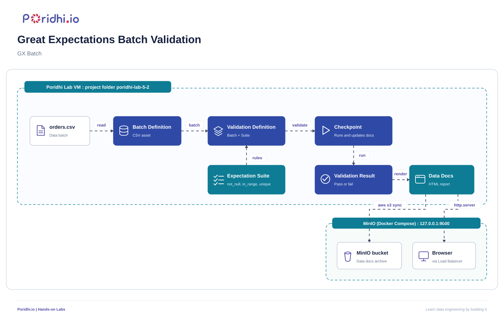

## Introduction

This lab, **Great Expectations Batch Validation**, builds a complete data quality gate around a batch of order data. Bad data rarely fails loudly: a null customer ID, a negative quantity, or a repeated order ID flows quietly through a pipeline and shows up weeks later as a wrong dashboard or a broken model. The fix is to treat data like code: write down what "good" looks like, and check every batch against those rules before anyone uses it.

Great Expectations (GX) is the most widely used open source framework for this. You describe your rules as **expectations**, group them into an **expectation suite**, and run the suite against a batch of data through a **checkpoint**. GX then produces **Data Docs**, a static HTML report that shows exactly which rules passed, which failed, and which rows broke them.



In this lab you write three kinds of rules (`not_null`, `in_range`, `unique`), wire a checkpoint, watch it fail on dirty data, fix the data, watch it pass, and publish the HTML report. The report is served from inside the VM through the Cloud Tray Load Balancer and archived to a MinIO bucket that runs as a Docker Compose stack on the same VM. The same pattern is used in production data pipelines to stop bad batches before they reach a warehouse or a feature store.

## Architecture

### Architecture Structure

```text
Poridhi Lab VM (Python venv, project folder ~/poridhi-lab-5-2)
    orders.csv (Data batch)
        → Batch Definition (CSV asset)
            → Validation Definition (Batch + Suite)
                ← Expectation Suite (not_null, in_range, unique)
                → Checkpoint
                    → Validation Result (pass or fail)
                        → Data Docs (HTML report)
                            → MinIO bucket (Data docs archive) at 127.0.0.1:9000
                            → Browser (via Cloud Tray Load Balancer)
```

### Draw.io Diagram

Paste this into Draw.io using Arrange, Insert, Advanced, XML.

```xml
<mxfile host="app.diagrams.net">
  <diagram id="gx-batch" name="GX Batch">
    <mxGraphModel dx="1700" dy="800" grid="0" gridSize="10" guides="1" tooltips="1" connect="1" arrows="1" fold="1" page="1" pageScale="1" pageWidth="1720" pageHeight="800" background="#FFFFFF" math="0" shadow="0">
      <root>
        <mxCell id="0"/>
        <mxCell id="1" parent="0"/>
        <mxCell id="outer" value="" style="rounded=1;arcSize=2;whiteSpace=wrap;html=1;fillColor=none;strokeColor=#2F4AA6;strokeWidth=3;" vertex="1" parent="1">
          <mxGeometry x="20" y="20" width="1660" height="740" as="geometry"/>
        </mxCell>
        <mxCell id="vm" value="Poridhi Lab VM : project folder poridhi-lab-5-2" style="rounded=1;arcSize=3;whiteSpace=wrap;html=1;fillColor=none;strokeColor=#0E7C95;strokeWidth=2;dashed=1;fontSize=20;fontStyle=1;fontColor=#0E7C95;verticalAlign=top;align=left;spacingLeft=20;spacingTop=10;" vertex="1" parent="1">
          <mxGeometry x="50" y="80" width="1500" height="400" as="geometry"/>
        </mxCell>
        <mxCell id="minio" value="MinIO (Docker Compose) : 127.0.0.1:9000" style="rounded=1;arcSize=6;whiteSpace=wrap;html=1;fillColor=none;strokeColor=#0E7C95;strokeWidth=2;dashed=1;fontSize=18;fontStyle=1;fontColor=#0E7C95;verticalAlign=bottom;align=center;spacingBottom=10;" vertex="1" parent="1">
          <mxGeometry x="1090" y="540" width="300" height="200" as="geometry"/>
        </mxCell>
        <mxCell id="csv" value="orders.csv&lt;br&gt;&lt;font style=&quot;font-size: 16px; font-weight: normal;&quot;&gt;Data batch&lt;/font&gt;" style="rounded=1;arcSize=12;whiteSpace=wrap;html=1;strokeWidth=2;fontSize=20;fontStyle=1;fillColor=#2F4AA6;strokeColor=#2F4AA6;fontColor=#FFFFFF;" vertex="1" parent="1">
          <mxGeometry x="90" y="150" width="200" height="110" as="geometry"/>
        </mxCell>
        <mxCell id="batch" value="Batch Definition&lt;br&gt;&lt;font style=&quot;font-size: 16px; font-weight: normal;&quot;&gt;CSV asset&lt;/font&gt;" style="rounded=1;arcSize=12;whiteSpace=wrap;html=1;strokeWidth=2;fontSize=20;fontStyle=1;fillColor=#2F4AA6;strokeColor=#2F4AA6;fontColor=#FFFFFF;" vertex="1" parent="1">
          <mxGeometry x="390" y="150" width="200" height="110" as="geometry"/>
        </mxCell>
        <mxCell id="valdef" value="Validation Definition&lt;br&gt;&lt;font style=&quot;font-size: 16px; font-weight: normal;&quot;&gt;Batch + Suite&lt;/font&gt;" style="rounded=1;arcSize=12;whiteSpace=wrap;html=1;strokeWidth=2;fontSize=20;fontStyle=1;fillColor=#2F4AA6;strokeColor=#2F4AA6;fontColor=#FFFFFF;" vertex="1" parent="1">
          <mxGeometry x="690" y="150" width="200" height="110" as="geometry"/>
        </mxCell>
        <mxCell id="checkpoint" value="Checkpoint&lt;br&gt;&lt;font style=&quot;font-size: 16px; font-weight: normal;&quot;&gt;Runs and updates docs&lt;/font&gt;" style="rounded=1;arcSize=12;whiteSpace=wrap;html=1;strokeWidth=2;fontSize=20;fontStyle=1;fillColor=#2F4AA6;strokeColor=#2F4AA6;fontColor=#FFFFFF;" vertex="1" parent="1">
          <mxGeometry x="990" y="150" width="200" height="110" as="geometry"/>
        </mxCell>
        <mxCell id="suite" value="Expectation Suite&lt;br&gt;&lt;font style=&quot;font-size: 16px; font-weight: normal;&quot;&gt;not_null, in_range, unique&lt;/font&gt;" style="rounded=1;arcSize=12;whiteSpace=wrap;html=1;strokeWidth=2;fontSize=20;fontStyle=1;fillColor=#0E7C95;strokeColor=#0E7C95;fontColor=#FFFFFF;" vertex="1" parent="1">
          <mxGeometry x="670" y="340" width="240" height="110" as="geometry"/>
        </mxCell>
        <mxCell id="result" value="Validation Result&lt;br&gt;&lt;font style=&quot;font-size: 16px; font-weight: normal;&quot;&gt;Pass or fail&lt;/font&gt;" style="rounded=1;arcSize=12;whiteSpace=wrap;html=1;strokeWidth=2;fontSize=20;fontStyle=1;fillColor=#2F4AA6;strokeColor=#2F4AA6;fontColor=#FFFFFF;" vertex="1" parent="1">
          <mxGeometry x="990" y="340" width="200" height="110" as="geometry"/>
        </mxCell>
        <mxCell id="docs" value="Data Docs&lt;br&gt;&lt;font style=&quot;font-size: 16px; font-weight: normal;&quot;&gt;HTML report&lt;/font&gt;" style="rounded=1;arcSize=12;whiteSpace=wrap;html=1;strokeWidth=2;fontSize=20;fontStyle=1;fillColor=#0E7C95;strokeColor=#0E7C95;fontColor=#FFFFFF;" vertex="1" parent="1">
          <mxGeometry x="1290" y="340" width="200" height="110" as="geometry"/>
        </mxCell>
        <mxCell id="s3" value="MinIO bucket&lt;br&gt;&lt;font style=&quot;font-size: 16px; font-weight: normal;&quot;&gt;Data docs archive&lt;/font&gt;" style="rounded=1;arcSize=12;whiteSpace=wrap;html=1;strokeWidth=2;fontSize=20;fontStyle=1;fillColor=#FFFFFF;strokeColor=#374151;fontColor=#111827;" vertex="1" parent="1">
          <mxGeometry x="1140" y="570" width="200" height="100" as="geometry"/>
        </mxCell>
        <mxCell id="browser" value="Browser&lt;br&gt;&lt;font style=&quot;font-size: 16px; font-weight: normal;&quot;&gt;via Load Balancer&lt;/font&gt;" style="rounded=1;arcSize=12;whiteSpace=wrap;html=1;strokeWidth=2;fontSize=20;fontStyle=1;fillColor=#FFFFFF;strokeColor=#374151;fontColor=#111827;" vertex="1" parent="1">
          <mxGeometry x="1440" y="570" width="200" height="100" as="geometry"/>
        </mxCell>
        <mxCell id="e1" value="read" style="edgeStyle=orthogonalEdgeStyle;rounded=0;html=1;endArrow=classic;endFill=1;strokeColor=#374151;strokeWidth=3;fontSize=18;fontColor=#1F2937;labelBackgroundColor=none;exitX=1;exitY=0.5;exitDx=0;exitDy=0;entryX=0;entryY=0.5;entryDx=0;entryDy=0;" edge="1" parent="1" source="csv" target="batch">
          <mxGeometry relative="1" as="geometry"><mxPoint x="0" y="-22" as="offset"/></mxGeometry>
        </mxCell>
        <mxCell id="e2" value="batch" style="edgeStyle=orthogonalEdgeStyle;rounded=0;html=1;endArrow=classic;endFill=1;strokeColor=#374151;strokeWidth=3;fontSize=18;fontColor=#1F2937;labelBackgroundColor=none;exitX=1;exitY=0.5;exitDx=0;exitDy=0;entryX=0;entryY=0.5;entryDx=0;entryDy=0;" edge="1" parent="1" source="batch" target="valdef">
          <mxGeometry relative="1" as="geometry"><mxPoint x="0" y="-22" as="offset"/></mxGeometry>
        </mxCell>
        <mxCell id="e3" value="rules" style="edgeStyle=orthogonalEdgeStyle;rounded=0;html=1;endArrow=classic;endFill=1;strokeColor=#374151;strokeWidth=3;fontSize=18;fontColor=#1F2937;labelBackgroundColor=none;exitX=0.5;exitY=0;exitDx=0;exitDy=0;entryX=0.5;entryY=1;entryDx=0;entryDy=0;" edge="1" parent="1" source="suite" target="valdef">
          <mxGeometry relative="1" as="geometry"><mxPoint x="35" y="0" as="offset"/></mxGeometry>
        </mxCell>
        <mxCell id="e4" value="validate" style="edgeStyle=orthogonalEdgeStyle;rounded=0;html=1;endArrow=classic;endFill=1;strokeColor=#374151;strokeWidth=3;fontSize=18;fontColor=#1F2937;labelBackgroundColor=none;exitX=1;exitY=0.5;exitDx=0;exitDy=0;entryX=0;entryY=0.5;entryDx=0;entryDy=0;" edge="1" parent="1" source="valdef" target="checkpoint">
          <mxGeometry relative="1" as="geometry"><mxPoint x="0" y="-22" as="offset"/></mxGeometry>
        </mxCell>
        <mxCell id="e5" value="run" style="edgeStyle=orthogonalEdgeStyle;rounded=0;html=1;endArrow=classic;endFill=1;strokeColor=#374151;strokeWidth=3;fontSize=18;fontColor=#1F2937;labelBackgroundColor=none;exitX=0.5;exitY=1;exitDx=0;exitDy=0;entryX=0.5;entryY=0;entryDx=0;entryDy=0;" edge="1" parent="1" source="checkpoint" target="result">
          <mxGeometry relative="1" as="geometry"><mxPoint x="30" y="0" as="offset"/></mxGeometry>
        </mxCell>
        <mxCell id="e6" value="render" style="edgeStyle=orthogonalEdgeStyle;rounded=0;html=1;endArrow=classic;endFill=1;strokeColor=#374151;strokeWidth=3;fontSize=18;fontColor=#1F2937;labelBackgroundColor=none;exitX=1;exitY=0.5;exitDx=0;exitDy=0;entryX=0;entryY=0.5;entryDx=0;entryDy=0;" edge="1" parent="1" source="result" target="docs">
          <mxGeometry relative="1" as="geometry"><mxPoint x="0" y="-22" as="offset"/></mxGeometry>
        </mxCell>
        <mxCell id="e7" value="aws s3 sync" style="edgeStyle=orthogonalEdgeStyle;rounded=0;html=1;endArrow=classic;endFill=1;strokeColor=#374151;strokeWidth=3;fontSize=18;fontColor=#1F2937;labelBackgroundColor=none;exitX=0.25;exitY=1;exitDx=0;exitDy=0;entryX=0.5;entryY=0;entryDx=0;entryDy=0;" edge="1" parent="1" source="docs" target="s3">
          <mxGeometry relative="1" as="geometry"><mxPoint x="0" y="-22" as="offset"/></mxGeometry>
        </mxCell>
        <mxCell id="e8" value="http.server" style="edgeStyle=orthogonalEdgeStyle;rounded=0;html=1;endArrow=classic;endFill=1;strokeColor=#374151;strokeWidth=3;fontSize=18;fontColor=#1F2937;labelBackgroundColor=none;exitX=0.75;exitY=1;exitDx=0;exitDy=0;entryX=0.5;entryY=0;entryDx=0;entryDy=0;" edge="1" parent="1" source="docs" target="browser">
          <mxGeometry relative="1" as="geometry"><mxPoint x="0" y="-22" as="offset"/></mxGeometry>
        </mxCell>
      </root>
    </mxGraphModel>
  </diagram>
</mxfile>
```

### Architecture Explanation

Everything starts with `orders.csv`, the batch of data you want to check. A **Batch Definition** tells GX how to find that file, and a **Validation Definition** pairs that batch with an **Expectation Suite**, the list of rules written with `not_null`, `in_range`, and `unique` expectations.

The **Checkpoint** is the runnable unit. When you call it, it executes the Validation Definition, produces a **Validation Result** (pass or fail, with counts of bad rows), and then runs an action that rebuilds the **Data Docs** HTML report.

The report is plain static HTML. You view it in a browser by serving it from the VM with `python3 -m http.server` and exposing port `8080` through the Cloud Tray Load Balancer. A copy is archived to a MinIO bucket that runs in a Docker Compose stack inside the VM, so no AWS account or credentials are needed. The Data Docs live under the project folder until the VM session ends, so the archive is a convenience for inspecting the report later in the same session.

## Learning Objectives

- Explain the GX 1.x building blocks: data context, data source, batch definition, expectation suite, validation definition, and checkpoint.
- Write `not_null`, `in_range`, and `unique` expectations and group them into a reusable suite.
- Wire a checkpoint that validates a batch and automatically updates Data Docs.
- Read a failed validation result and trace it back to the exact rule and row count that broke.
- Generate, serve, and archive an HTML Data Docs report.
- Re-run the same checkpoint on cleaned data and confirm the batch now passes.

### Folder Structure

```text
~/poridhi-lab-5-2/
├── compose.yaml
├── data/
│   └── orders.csv
├── gx/
│   ├── checkpoints/
│   │   └── orders_checkpoint.json
│   ├── expectations/
│   │   └── orders_suite.json
│   ├── great_expectations.yml
│   ├── validation_definitions/
│   │   └── orders_validation.json
│   └── uncommitted/
│       ├── data_docs/
│       │   └── local_site/
│       │       └── index.html
│       └── validations/
├── make_data.py
├── run_checkpoint.py
├── setup_gx.py
└── venv/
```

## Prerequisites

- **Region:** `ap-southeast-1` (Asia Pacific, Singapore). The MinIO container is configured with this region; no other region or availability zone is used.
- **Environment:** a Poridhi Lab VM running Linux with VS Code available in the lab UI. The lab installs the `code` command once in Step 1.1 and never uses `nano` or `vim`. The Cloud Tray **Load Balancer** is used to expose the Data Docs site on port `8080`.
- **Storage:** MinIO container from Docker Hub, started with `docker compose up -d` and running on the Poridhi Lab VM at `http://127.0.0.1:9000` (access key `minioadmin`, secret key `minioadmin` for the lab). Data is lost when the VM is destroyed.
- **Knowledge:** basic Python and pandas, comfortable with a Linux terminal.
- **Tools:** Python 3.10 or newer and Docker with the Compose plugin, both already on the lab VM.
- **Time:** about 45 minutes.
- **Cost:** none. All resources run inside the lab VM.

## Prologue

Lab 5.1 defined six data quality dimensions: accuracy, completeness, consistency, timeliness, uniqueness, and validity. Knowing the dimensions is useful, but a team cannot check them by eye on every batch. This lab turns three of them into code: completeness as `not_null`, validity as `in_range`, and uniqueness as `unique`.

You will start from a clean VM. The lab builds its own virtual environment, starts a local MinIO bucket, generates a deliberately dirty batch of 200 orders, and builds the full GX project from scratch. If you completed Lab 5.1, the setup steps simply repeat things you already know.

## Step-by-Step Implementation

### Step 1: Create the project directory and virtual environment

> Note: this step creates the project tree, builds the Python virtual environment, and installs the packages GX needs.

```bash
mkdir -p ~/poridhi-lab-5-2/data
cd ~/poridhi-lab-5-2
python3 -m venv ~/poridhi-lab-5-2/venv
source ~/poridhi-lab-5-2/venv/bin/activate
python -m pip install -U pip
pip install "great-expectations>=1.24,<2" "numpy>=2,<3" "pandas>=2" awscli boto3
python -c "import great_expectations as gx; print('GX version:', gx.__version__)"
```

The version printed must start with `1.`. This lab uses the GX 1.x API, which differs from the older 0.x releases. The `numpy>=2,<3` floor is pinned first so the resolver does not pick a `numpy` build that conflicts with `pandas` or `pyarrow` on newer Python versions. GX releases before 1.24 do not support Python 3.13 or 3.14, so the pin guarantees a working install whichever interpreter the lab VM ships.

**Expected output**

```text
GX version: 1.24.1
```

Your exact patch version can differ; only the leading `1.` matters.

**Would I get an error if I ran this?**
Possibly: `python3: command not found` means the VM image is missing Python 3, which is not expected on the standard Poridhi VM. `pip: command not found` almost always means `source ~/poridhi-lab-5-2/venv/bin/activate` did not run or did not complete, so re-run the `source` line and confirm the prompt shows `(venv)`. `ERROR: Could not find a version that satisfies the requirement` for `great-expectations` means the VM runs Python 3.13 or 3.14 and pip picked an older GX that does not support it, which the `>=1.24` pin already prevents.

### Step 1.1: Make VS Code see the project folder (one-time setup)

> Note: this step opens the project in the VS Code Explorer so every folder and file you create later appears automatically.

VS Code's Explorer only shows the folder that was opened in it, and the `code` shell command is not on `PATH` on the default lab VM. Do this once at the start of the lab:

1. In the VS Code window, press **`Ctrl+Shift+P`** to open the Command Palette.
2. Type `Shell Command: Install 'code' command in PATH` and press **`Enter`**. A small notification at the bottom right confirms `Shell command 'code' successfully installed in PATH`. This is a one-time operation.
3. Press **`Ctrl+Shift+P`** again and run **`File: Open Folder`**, then pick `~/poridhi-lab-5-2`. You can also type `code ~/poridhi-lab-5-2` in the integrated terminal once the install finishes.
4. The Explorer label changes from `CODE` or `Welcome` to `PORIDHI-LAB-5-2`, and you can see `data/` and every file you create in later steps.

If you skip this sub-step you can still finish the lab by creating each file through `File > New File...` in the Welcome tab, but the install makes every later step easier.

### Step 2: Start MinIO with Docker Compose

> Note: this step creates the Compose file for MinIO and starts the local S3-compatible store that will hold the report archive.

Create a new file called `compose.yaml` in `~/poridhi-lab-5-2` and paste the YAML below into it. Right-click the project root in the Explorer, choose `New File...`, name it `compose.yaml`, paste, and save.

```yaml
services:
  minio:
    image: minio/minio:latest
    container_name: minio
    ports:
      - "9000:9000"
      - "9001:9001"
    environment:
      MINIO_ROOT_USER: minioadmin
      MINIO_ROOT_PASSWORD: minioadmin
      MINIO_REGION: ap-southeast-1
    volumes:
      - minio-data:/data
    command: server /data --console-address ":9001"

volumes:
  minio-data:
```

If Docker Hub no longer serves the community tag, change only the `image:` line to `docker.io/pgsty/silo:RELEASE.2026-10-26T00-00-00Z`; the service name, volume, ports, and every later command stay the same.

Start the stack and wait for the health endpoint. Your terminal is already inside `~/poridhi-lab-5-2` from Step 1:

```bash
docker compose up -d
until curl -s -o /dev/null -w "%{http_code}" http://127.0.0.1:9000/minio/health/ready | grep -q 200; do sleep 1; done
docker compose ps
```

**Expected output**

```text
NAME    IMAGE                COMMAND                  SERVICE   CREATED         STATUS                   PORTS
minio   minio/minio:latest   "/usr/bin/docker-entr…"   minio     9 seconds ago   Up 9 seconds (healthy)   0.0.0.0:9000-9001->9000-9001/tcp
```

**Would I get an error if I ran this?**
Possibly: `Cannot connect to the Docker daemon` means the Docker service is not running, so run `sudo systemctl start docker` and try again. `docker: 'compose' is not a docker command` means the Compose plugin is missing, so run `sudo apt update && sudo apt install -y docker-compose-plugin`. `bind: address already in use` on port 9000 means something else holds the port, so run `docker compose down` and start again. If the `until` loop never exits, MinIO is unhealthy, so check `docker compose logs minio` for the reason.

### Step 3: Point the AWS CLI at the local MinIO endpoint

> Note: this step exports the MinIO credentials so `aws s3` commands talk to the bucket on the VM instead of to AWS.

```bash
export AWS_ACCESS_KEY_ID="minioadmin"
export AWS_SECRET_ACCESS_KEY="minioadmin"
export AWS_DEFAULT_REGION="ap-southeast-1"
echo 'export AWS_ACCESS_KEY_ID=minioadmin' >> ~/.bashrc
echo 'export AWS_SECRET_ACCESS_KEY=minioadmin' >> ~/.bashrc
echo 'export AWS_DEFAULT_REGION=ap-southeast-1' >> ~/.bashrc
aws --endpoint-url http://127.0.0.1:9000 s3 ls
```

The last command lists the buckets on the MinIO endpoint. It prints nothing on a fresh MinIO instance, which means the endpoint is reachable and the credentials work.

**Would I get an error if I ran this?**
Possibly: `Unable to locate credentials` means the `export` lines did not run in this shell, so re-run them and confirm with `aws configure list`. `EndpointConnectionError` means the `--endpoint-url http://127.0.0.1:9000` flag was dropped and the CLI tried to reach real AWS, so put the flag back. `InvalidAccessKeyId` means the `minioadmin` credentials do not match the running container, so check the `environment` block in `compose.yaml` and run `docker compose up -d` again.

### Step 4: Create the Data Docs bucket in MinIO

> Note: this step creates a uniquely named bucket and records the name, because every archive command later uses it.

```bash
export GX_BUCKET="gx-data-docs-$(date +%s)"
aws --endpoint-url http://127.0.0.1:9000 s3 mb "s3://$GX_BUCKET"
echo "$GX_BUCKET"
```

**Expected output**

```text
make_bucket: gx-data-docs-1731264000
gx-data-docs-1731264000
```

**Write this down:** the bucket name printed by `echo "$GX_BUCKET"`. A worked example is `gx-data-docs-1731264000`. If the variable is gone later, re-export it from the bucket list:

```bash
export GX_BUCKET=$(aws --endpoint-url http://127.0.0.1:9000 s3 ls | awk '{print $3}' | grep '^gx-data-docs-' | tail -n1)
echo "$GX_BUCKET"
```

**Would I get an error if I ran this?**
Possibly: `make_bucket: ... BucketAlreadyOwnedByYou` means a bucket with a similar name already exists, which is harmless because the name carries a timestamp, so just run `echo "$GX_BUCKET"` to confirm the name you actually have. `Unable to locate credentials` means the MinIO exports from Step 3 are gone from this shell, so re-run those three `export` lines.

### Step 5: Generate a deliberately dirty batch of orders

> Note: this step writes a small Python generator and uses it to plant the exact defects the suite will catch.

Create a new file called `make_data.py` in `~/poridhi-lab-5-2` and paste the Python below into it. Right-click the project root in the Explorer, choose `New File...`, name it `make_data.py`, paste, and save.

```python
import sys
from pathlib import Path

import numpy as np
import pandas as pd

mode = sys.argv[1] if len(sys.argv) > 1 else "bad"
rng = np.random.default_rng(42)
n = 200

df = pd.DataFrame(
    {
        "order_id": np.arange(1001, 1001 + n),
        "customer_id": pd.array(rng.integers(1, 51, n), dtype="Int64"),
        "quantity": rng.integers(1, 21, n),
        "unit_price": np.round(rng.uniform(5, 500, n), 2),
        "order_date": pd.date_range("2026-11-01", periods=n, freq="h").strftime("%Y-%m-%d %H:%M:%S"),
    }
)

if mode == "bad":
    df.loc[[5, 17, 42], "customer_id"] = pd.NA
    df.loc[7, "quantity"] = 0
    df.loc[31, "quantity"] = -3
    df.loc[88, "quantity"] = 250
    df.loc[12, "unit_price"] = 0.0
    df.loc[64, "unit_price"] = 99999.0
    df.loc[10, "order_id"] = df.loc[9, "order_id"]

Path("data").mkdir(exist_ok=True)
df.to_csv("data/orders.csv", index=False)
print(f"Wrote data/orders.csv in {mode} mode with {len(df)} rows")
```

Run it in `bad` mode and peek at the first rows. Your terminal is already inside `~/poridhi-lab-5-2`:

```bash
python make_data.py bad
head -n 5 data/orders.csv
```

**Expected output**

```text
Wrote data/orders.csv in bad mode with 200 rows
order_id,customer_id,quantity,unit_price,order_date
1001,39,16,326.14,2026-11-01 00:00:00
1002,6,12,179.91,2026-11-01 01:00:00
1003,38,17,304.91,2026-11-01 02:00:00
1004,45,8,125.89,2026-11-01 03:00:00
```

Your values can differ slightly because the generator is seeded; the row count and the column names are what matter.

**Would I get an error if I ran this?**
Possibly: `ModuleNotFoundError: No module named 'numpy'` means the virtual environment is not active, so run `source ~/poridhi-lab-5-2/venv/bin/activate` and repeat the command. `FileNotFoundError` for `data/orders.csv` means the script was run from a directory other than `~/poridhi-lab-5-2`, so `cd` back there and run it again.

### Step 6: Write the GX project script

> Note: this step defines the data context, the CSV asset, the expectation suite, the validation definition, and the checkpoint in one rerunnable script.

Create a new file called `setup_gx.py` in `~/poridhi-lab-5-2` and paste the Python below into it. Right-click the project root in the Explorer, choose `New File...`, name it `setup_gx.py`, paste, and save.

```python
from pathlib import Path

import great_expectations as gx
from great_expectations.checkpoint import UpdateDataDocsAction
from great_expectations.core.result_format import ResultFormat

# 1. Data context stored on disk in the gx/ folder next to this script
project_root = Path(__file__).resolve().parent
context = gx.get_context(mode="file", project_root_dir=str(project_root))

# 2. Data source, CSV asset, and batch definition for data/orders.csv
datasource = context.data_sources.add_or_update_pandas_filesystem(
    name="orders_source",
    base_directory=project_root / "data",
)

try:
    asset = datasource.get_asset("orders_csv")
except LookupError:
    asset = datasource.add_csv_asset(name="orders_csv")

try:
    batch_definition = asset.get_batch_definition("orders_file")
except KeyError:
    batch_definition = asset.add_batch_definition_path(
        name="orders_file", path="orders.csv"
    )

# 3. Expectation suite: not_null, in_range, unique
suite = gx.ExpectationSuite(name="orders_suite")
suite.add_expectation(gx.expectations.ExpectColumnValuesToNotBeNull(column="order_id"))
suite.add_expectation(gx.expectations.ExpectColumnValuesToNotBeNull(column="customer_id"))
suite.add_expectation(
    gx.expectations.ExpectColumnValuesToBeBetween(column="quantity", min_value=1, max_value=100)
)
suite.add_expectation(
    gx.expectations.ExpectColumnValuesToBeBetween(column="unit_price", min_value=1, max_value=1000)
)
suite.add_expectation(gx.expectations.ExpectColumnValuesToBeUnique(column="order_id"))
suite = context.suites.add_or_update(suite)

# 4. Validation definition: this batch checked against this suite
validation_definition = context.validation_definitions.add_or_update(
    gx.ValidationDefinition(
        name="orders_validation",
        data=batch_definition,
        suite=suite,
    )
)

# 5. Checkpoint: run the validation, then rebuild Data Docs
checkpoint = context.checkpoints.add_or_update(
    gx.Checkpoint(
        name="orders_checkpoint",
        validation_definitions=[validation_definition],
        actions=[UpdateDataDocsAction(name="update_data_docs")],
        result_format=ResultFormat.COMPLETE,
    )
)

print("Suite expectations:", len(suite.expectations))
print("Checkpoint ready:", checkpoint.name)
```

### Step 7: Build the GX project

> Note: this step materializes the suite, validation definition, and checkpoint on disk under `gx/`.

```bash
python setup_gx.py
```

**Expected output**

```text
Suite expectations: 5
Checkpoint ready: orders_checkpoint
```

After this step the folder tree has a `gx/great_expectations.yml`, a `gx/expectations/orders_suite.json`, a `gx/validation_definitions/orders_validation.json`, and a `gx/checkpoints/orders_checkpoint.json`.

**Would I get an error if I ran this?**
Possibly: `AttributeError: module 'great_expectations' has no attribute 'expectations'` means a 0.x release is installed, so run `pip install -U "great-expectations>=1.24,<2"` inside the venv. `DataContextError: Cannot add ExpectationSuite with name orders_suite because it already exists` is avoided here by `add_or_update`, so if you see it, an older `setup_gx.py` is still in place. A `FileNotFoundError` for `data/orders.csv` means the batch definition points at a missing file, so run `python make_data.py bad` and then `python setup_gx.py` again.

### Step 8: Run the checkpoint on the dirty batch

> Note: this step runs the checkpoint and prints one line per rule so you can see exactly which ones fail and how many rows they flag.

Create a new file called `run_checkpoint.py` in `~/poridhi-lab-5-2` and paste the Python below into it. Right-click the project root in the Explorer, choose `New File...`, name it `run_checkpoint.py`, paste, and save.

```python
from pathlib import Path

import great_expectations as gx

project_root = Path(__file__).resolve().parent
context = gx.get_context(mode="file", project_root_dir=str(project_root))
checkpoint = context.checkpoints.get("orders_checkpoint")
result = checkpoint.run()

print("Checkpoint success:", result.success)
for validation_result in result.run_results.values():
    for r in validation_result.results:
        config = r.expectation_config
        status = "PASS" if r.success else "FAIL"
        bad = r.result.get("unexpected_count", 0)
        print(f"{status}  {config.type:<42} {config.kwargs.get('column'):<12} bad_rows={bad}")
```

Run it. Your terminal is already inside `~/poridhi-lab-5-2`:

```bash
python run_checkpoint.py
```

**Expected output**

```text
Checkpoint success: False
PASS  expect_column_values_to_not_be_null        order_id     bad_rows=0
FAIL  expect_column_values_to_be_unique          order_id     bad_rows=2
FAIL  expect_column_values_to_not_be_null        customer_id  bad_rows=3
FAIL  expect_column_values_to_be_between         quantity     bad_rows=3
FAIL  expect_column_values_to_be_between         unit_price   bad_rows=2
```

The unique check reports 2 bad rows because both rows that share the repeated order ID are flagged. GX groups the expectations by type when it reports them, so the `be_unique` line lands directly after the `order_id` rules and the two `be_between` lines come last. The order of the lines can differ slightly between GX versions, but the counts and the pass or fail verdict do not.

**Would I get an error if I ran this?**
Possibly: `KeyError` or "not found" when loading `orders_checkpoint` means `setup_gx.py` has not been run yet, or it was run from a different folder. Run `python setup_gx.py` from `~/poridhi-lab-5-2` and try again. A `ModuleNotFoundError` for `great_expectations` means the virtual environment is not active, so run `source ~/poridhi-lab-5-2/venv/bin/activate`. If `Checkpoint success` is `True` on the dirty batch, the batch was overwritten by a previous `make_data.py good` run, so run `python make_data.py bad` and then `python run_checkpoint.py` again.

### Step 9: Serve the Data Docs and open them through the Load Balancer

> Note: this step starts a static file server for the HTML report and exposes it to your browser through the Cloud Tray.

The checkpoint already rebuilt the report. Start the server and confirm it answers on the VM. Your terminal is already inside `~/poridhi-lab-5-2`:

```bash
nohup python3 -m http.server 8080 --directory gx/uncommitted/data_docs/local_site > /dev/null 2>&1 &
curl -s -o /dev/null -w "%{http_code}\n" http://127.0.0.1:8080/index.html
```

**Expected output**

```text
200
```

Now get the VM's internal IP:

```bash
hostname -I
```

Take the first address (ignore `172.17.0.1` from Docker's bridge). Open the Cloud Tray, click **Load Balancer**, enter that IP and port `8080`, then click **Expose**. Do not enter `127.0.0.1`: the Load Balancer runs outside the VM and cannot route to its loopback.

**Record this:** the exposed URL shown in the Load Balancer panel, which looks like `http://<hash>.lb.poridhi.io`. If you lose it, reopen **Load Balancer** in the Cloud Tray; the entry is listed until you remove it.

Open the URL and click **Validation Results**, then the latest run. The page lists each failed rule with the count of unexpected values and a sample of the rows that broke it.

**Would I get an error if I ran this?**
Possibly: `OSError: [Errno 98] Address already in use` means a server is already running on port 8080, so run `pkill -f "http.server 8080"` and start it again. A `404` from the `curl` check means the Data Docs folder does not exist yet, so run `python run_checkpoint.py` first to build the report. A page that loads but shows an empty report usually means the browser cached the page, so hard refresh.

### Step 10: Fix the data and run the checkpoint again

> Note: this step regenerates the batch without defects and proves the same checkpoint now passes with no code changes.

Your terminal is already inside `~/poridhi-lab-5-2`:

```bash
python make_data.py good
python run_checkpoint.py
```

**Expected output**

```text
Checkpoint success: True
PASS  expect_column_values_to_not_be_null        order_id     bad_rows=0
PASS  expect_column_values_to_be_unique          order_id     bad_rows=0
PASS  expect_column_values_to_not_be_null        customer_id  bad_rows=0
PASS  expect_column_values_to_be_between         quantity     bad_rows=0
PASS  expect_column_values_to_be_between         unit_price   bad_rows=0
```

Refresh the browser. The Validation Results list now shows both runs, one failed and one passed, side by side in the same report.

**Would I get an error if I ran this?**
Possibly: `Checkpoint success: False` on clean data means the generator still planted defects, so confirm `python make_data.py good` printed `Wrote data/orders.csv in good mode with 200 rows`. If a rule still fails, read the `bad_rows` count: a nonzero count on a rule you expect to pass means the suite needs a wider range, not that the data is dirty.

### Step 11: Archive the Data Docs report in MinIO

> Note: this step copies the whole static site into the MinIO bucket so the report is stored with the lab artifacts.

Your terminal is already inside `~/poridhi-lab-5-2`. The bucket name comes from Step 4, where `echo "$GX_BUCKET"` printed it. If the variable is empty, the first two commands below re-derive it from the bucket list before the sync runs:

```bash
export GX_BUCKET=$(aws --endpoint-url http://127.0.0.1:9000 s3 ls | awk '{print $3}' | grep '^gx-data-docs-' | tail -n1)
echo "$GX_BUCKET"
```

Then copy the site into the bucket:

```bash
aws --endpoint-url http://127.0.0.1:9000 s3 sync gx/uncommitted/data_docs/local_site "s3://$GX_BUCKET/data_docs/"
aws --endpoint-url http://127.0.0.1:9000 s3 ls "s3://$GX_BUCKET/data_docs/"
```

**Expected output**

```text
upload: gx/uncommitted/data_docs/local_site/index.html to s3://gx-data-docs-1731264000/data_docs/index.html
...
                           PRE expectations/
                           PRE static/
                           PRE validations/
2026-11-10 09:41:02       4213 index.html
```

The `PRE` prefixes are folders inside the copied site. `index.html` is the report entry page.

**Would I get an error if I ran this?**
Possibly: `NoSuchBucket` means `GX_BUCKET` is empty or holds the wrong name, so re-run the recovery command in Step 11 that re-derives it from the bucket list. `EndpointConnectionError` means the `--endpoint-url` flag was dropped, so add it back. `fatal error: upload failed` on a large file usually means MinIO is still starting, so wait a few seconds and re-run the `sync` command.

## Troubleshooting

| Error | Cause | Fix |
|:-|:-|:-|
| `AttributeError: module 'great_expectations' has no attribute 'expectations'` | An older 0.x release is installed | Run `pip install -U "great-expectations>=1.24,<2"` inside the venv |
| `ModuleNotFoundError: No module named 'great_expectations'` | The virtual environment is not active | Run `source ~/poridhi-lab-5-2/venv/bin/activate` |
| `KeyError` or "not found" when loading `orders_checkpoint` | `setup_gx.py` was not run from the project folder | `cd ~/poridhi-lab-5-2` and run `python setup_gx.py` again |
| Checkpoint fails with a file or path error | `data/orders.csv` is missing, or the project was moved | Run `python make_data.py bad`, then `python setup_gx.py` so the base directory is re-registered |
| Data Docs page looks stale after a run | Browser cache, or the server points at the wrong folder | Hard refresh, then restart the server with the `--directory gx/uncommitted/data_docs/local_site` flag |
| `OSError: [Errno 98] Address already in use` | A server is already running on port 8080 | Run `pkill -f "http.server 8080"` and start the server again |
| `Cannot connect to the Docker daemon` | The Docker service is not running | Run `sudo systemctl start docker`, then `docker compose up -d` again |
| `docker: 'compose' is not a docker command` | The Compose plugin is missing | Run `sudo apt update && sudo apt install -y docker-compose-plugin` |
| `docker compose up -d` fails on port 9000 | Another process or container already uses the port | Run `docker compose down`, then `docker compose up -d` |
| `EndpointConnectionError` or the CLI tries to reach AWS | The `--endpoint-url` flag is missing | Re-run the command with `--endpoint-url http://127.0.0.1:9000` |
| `NoSuchBucket` when syncing | `GX_BUCKET` is empty or holds the wrong name | Re-export it with the recovery command in Step 4 |
| Exposed Load Balancer URL does not load | Wrong IP or port, or the server is not running | Check the `curl` result in Step 9, use the first address from `hostname -I`, not `127.0.0.1`, and re-expose port `8080` |

## Epilogue

You built a complete data quality gate. A checkpoint now stands between a batch of orders and anything downstream, and it answers a simple question every time: does this data meet the rules we agreed on? When it does not, the Data Docs report shows which rule failed and how many rows broke it, so the fix is a targeted data correction rather than a guessing game.

The same structure scales. Add more expectations to the suite, point the batch definition at a warehouse table instead of a CSV, and run the checkpoint from a scheduler or a pipeline step. The next labs in the data quality series build on this pattern to gate data before it reaches a feature store.

## Principles

- **Validate at the boundary:** check data when it enters a pipeline, not after it has spread.
- **Rules as code:** expectations live in version-controlled files, so quality standards are reviewable and repeatable.
- **Fail loudly and specifically:** a result that names the rule and the bad row count is actionable, a vague failure is not.
- **Separate definition from execution:** the suite describes what good means, the checkpoint decides when and how to check.
- **Idempotent setup:** scripts that can be rerun safely make labs and pipelines restartable.
- **Local-first and low cost:** keep the whole quality gate inside the VM, with a local S3-compatible bucket, so nothing billable leaves the lab.

## What You Learned

- How a GX 1.x project is organized: data context, data source, batch definition, suite, validation definition, and checkpoint.
- How to express completeness, validity, and uniqueness as `not_null`, `in_range`, and `unique` expectations.
- How a checkpoint turns a suite into a pass or fail decision and rebuilds Data Docs through an action.
- How to read a validation result to find which rule failed and how many rows broke it.
- How to serve a static HTML report through the Cloud Tray Load Balancer and archive it to a local MinIO bucket.

## Next Steps

- Add a `mostly` threshold to an expectation so a small share of bad rows is tolerated instead of failing the batch.
- Add expectations for a regex pattern on IDs and a set of allowed values for a status column.
- Point the batch definition at the managed PostgreSQL table in the Cloud Tray instead of a CSV file.
- Run the checkpoint on a schedule and stop a pipeline step when `result.success` is `False`.
- Add a Slack or email notification action to the checkpoint for failed runs.

## Additional Resources

- Great Expectations documentation: https://docs.greatexpectations.io
- GX Core overview and quickstart: https://docs.greatexpectations.io/docs/core/introduction/
- Expectation Gallery: https://greatexpectations.io/expectations/
- MinIO documentation: https://min.io/docs/minio/linux/index.html
- Docker Compose documentation: https://docs.docker.com/compose/
- Poridhi Lab 5.1: Data Quality Fundamentals

## Conclusion

This lab set out to stop bad data before it reaches downstream systems. You built a GX expectation suite with `not_null`, `in_range`, and `unique` rules, wired a checkpoint that validates a CSV batch, and generated an HTML Data Docs report that you served through the Load Balancer and archived in MinIO. The key takeaway is that a quality check is just a repeatable function: the same checkpoint failed on dirty data and passed on clean data without a single code change.
