## Introduction

Training a model is only half of an ML system. At prediction time, a service has a few milliseconds to fetch the freshest feature values for one user, one driver, or one transaction and hand them to the model. A feature store solves this by keeping precomputed features in a low-latency online store, so the serving path never has to touch a data warehouse or recompute anything.

In this lab you build that serving path end to end with Feast. You define a small feature repository, materialize hourly driver statistics into the managed Redis from the Poridhi Cloud Tray, and then call `get_online_features()` from a plain Python client. Most importantly, you measure the call properly: cold start versus warm calls, percentiles instead of averages, batch size effects, and behavior under concurrent clients.

The target is simple to state and surprisingly easy to miss: end-to-end retrieval under 10 ms. By the end of the lab you will know how to prove whether you met it, where the time goes when you do not, and which knobs actually move the number.

This lab is self-contained: every step runs from a clean Poridhi Lab VM. If you completed other Feast labs in this series, you will recognize the building blocks, but nothing here depends on them.

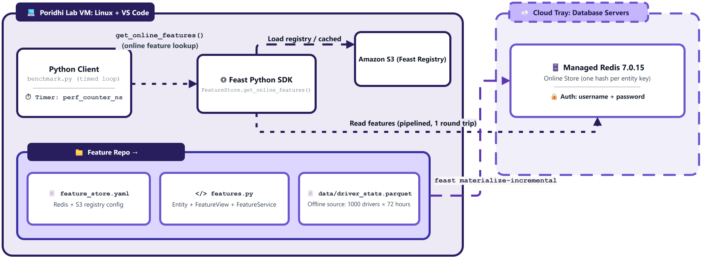
## Learning Objectives

- Build a Feast feature repository with a Redis online store and an S3 registry on the Poridhi lab VM.
- Materialize features from an offline Parquet source into the managed Redis.
- Call `get_online_features()` from a standalone Python client using both feature references and a `FeatureService`.
- Measure end-to-end retrieval latency correctly: cold start, warm-up, percentiles, and a PASS or FAIL verdict against 10 ms.
- Separate network round trip time from Feast Python overhead using a raw Redis baseline and `cProfile`.
- Evaluate how batch size and concurrent clients change latency.

### Folder Structure

The lab creates the following folders and files on the Poridhi Lab VM. Every `mkdir -p`, `cd`, and file-creation step in the lab matches this tree exactly.

```text
~/poridhi-lab-7-5/
├── feature_repo/
│   ├── feature_store.yaml
│   ├── features.py
│   ├── generate_data.py
│   ├── quick_test.py
│   └── data/
│       └── driver_stats.parquet   # created at runtime by generate_data.py
└── client/
    ├── benchmark.py
    ├── rtt_baseline.py
    ├── profile_call.py
    └── load_test.py
```

## Prerequisites

- **Region:** `ap-southeast-1` (Asia Pacific, Singapore). This lab only uses the region for the S3 registry bucket. No availability zones are involved.
- **Environment:** Poridhi lab VM running Linux. A graphical editor (VS Code) is available in the lab UI, but the `code` CLI and `nano` are NOT installed on the default lab VM. Every file this lab asks you to create is shown as a plain code block for you to paste into a new file in the lab UI editor (open the project folder in the lab UI, then create the file there). AWS credentials come from the lab UI (Generate credential button). The managed Redis 7.0.15 runs in the Cloud Tray under Database Servers, and you read its Username, Password, IP Address, and Port from the panel. MongoDB, PostgreSQL, and the Load Balancer are not needed in this lab.
- Python 3.9 or newer with `venv` available.
- Basic comfort with the terminal, Python, and the idea of a feature store (entity, feature view, materialization).
- Billing note: the S3 bucket holds a registry file of a few kilobytes. Cleanup removes it.

## Prologue

Imagine a ride-hailing app. When a rider requests a trip, a ranking model needs each nearby driver's recent conversion rate, acceptance rate, and trips per day. Those numbers are computed offline every hour, but they must be readable in a few milliseconds while the rider waits.

This lab builds that exact path with Feast and Redis. If you completed earlier Feast labs in this series, you will recognize the building blocks, but nothing here depends on them: every step below runs from a clean VM. The new part is the measurement discipline. Many teams report an average latency from a single warm loop and are surprised in production. You will measure like an SRE: percentiles, a cold versus warm split, a network baseline, and a load test.

## Step-by-Step Implementation

### Step 1: Collect AWS credentials from the lab UI

> Note: this step exports the short-lived AWS credentials (access key, secret key, optional session token) that the rest of the lab uses to talk to S3.

In the Poridhi lab UI, click **Generate credential** and copy the values shown. Some sessions show only an Access Key and a Secret Key, others also show a Session Token. Export what you see:

```bash
export AWS_ACCESS_KEY_ID="<paste-access-key-from-lab-ui>"
export AWS_SECRET_ACCESS_KEY="<paste-secret-key-from-lab-ui>"
export AWS_REGION=ap-southeast-1
```

Run the next line only if your session also shows a Session Token:

```bash
export AWS_SESSION_TOKEN="<paste-session-token-from-lab-ui>"
```

These exports last only for the current terminal. If you open a new terminal later, repeat Steps 1 and 2 there.

> Would I get an error if I ran this?
> No, on a clean shell. If the credentials expire later in the lab, you will get an `ExpiredToken` error during `feast apply`; see the Troubleshooting section.

### Step 2: Read the managed Redis credentials from the Cloud Tray

> Note: this step exports the managed Redis connection details (host, port, username, password) that Feast and the benchmark client will use as the online store.

Open the Poridhi Cloud Tray in the lab UI, click **Database**, then click the **Redis** card. Confirm the status is `Running`. Copy the **Username**, **Password**, **IP Address**, and **Port** from the panel and export them:

```bash
export REDIS_HOST="<paste-ip-from-cloud-tray>"
export REDIS_PORT="<paste-port-from-cloud-tray>"
export REDIS_USERNAME="<paste-username-from-cloud-tray>"
export REDIS_PASSWORD="<paste-password-from-cloud-tray>"
```

The values can change between lab runs, so always read them fresh from the panel.

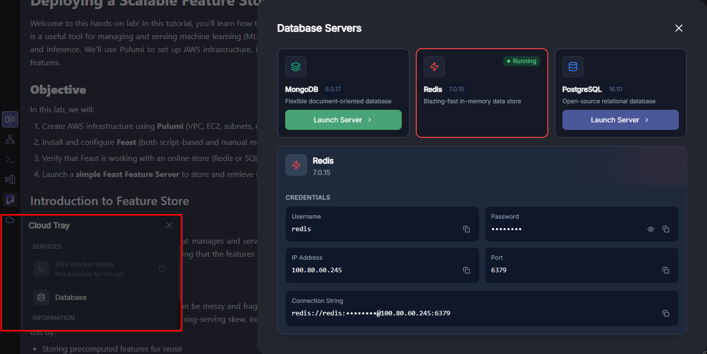

> Would I get an error if I ran this?
> No. The error you may hit later is `WRONGPASS` or `NOAUTH` from Redis if the credentials changed between lab sessions. Re-copy them from the panel if so.

### Step 3: Create the project directory and virtual environment

> Note: this step creates `~/poridhi-lab-7-5` and the Python virtual environment that every later step uses.

If you did this in an earlier lab, this step recreates an equivalent environment. If not, it sets one up from scratch.

```bash
mkdir -p ~/poridhi-lab-7-5
cd ~/poridhi-lab-7-5
python3 -m venv venv
source venv/bin/activate
python -m pip install -U pip
python -V
```

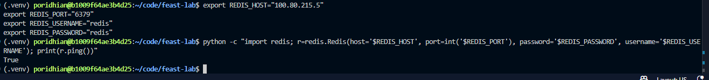

#### Step 3.1: Make VS Code see the project folder (one-time setup)

VS Code's Explorer only shows the folder that was opened with `File > Open Folder`, and the `code` shell command is not on `PATH` on the default lab VM. Do this once at the start of the lab so the Explorer follows every `mkdir` and every file you create for the rest of the lab:

1. In the VS Code window, press **`Ctrl+Shift+P`** to open the Command Palette.
2. Type `Shell Command: Install 'code' command in PATH` and press **`Enter`**. A small notification at the bottom right confirms `Shell command 'code' successfully installed in PATH`. This is a one-time operation; the lab VM keeps it across sessions.
3. Close the existing VS Code window, or press **`Ctrl+Shift+P`** again and run **`File: Open Folder`**, picking `~/poridhi-lab-7-5`. (You can also type `code ~/poridhi-lab-7-5` in the integrated terminal — same result, but skip that until after the install finishes.)
4. The Explorer label changes from `CODE` (or `Welcome`) to `PORIDHI-LAB-7-5`, and you can see `feature_repo/`, `venv/`, and every file you create in later steps.

If you skip this sub-step, you can still complete the lab by creating every file manually through `File > New File...` in the Welcome tab. But the install is a one-time action that makes every later step easier.

You will paste every file in this lab into a new file in the VS Code editor of the `PORIDHI-LAB-7-5` workspace. Right-click the folder in the Explorer where the file belongs, choose `New File...`, paste the contents from the code block in the lab, and save. The Explorer updates as soon as the file is saved.

> Would I get an error if I ran this?
> Possibly: `python3 -m venv` may fail with an `ensurepip` error if the VM is missing the venv package. Run `sudo apt-get update && sudo apt-get install -y python3-venv`, delete the half-created `venv` folder, and repeat this step. Confirmed on the Poridhi Lab VM (Python 3.12): the `nano` editor is not installed (`bash: nano: command not found`); the `code` CLI is also not on `PATH` by default — that is exactly why Step 3.1 exists.

### Step 4: Install the Python packages

> Note: this step installs Feast, Redis, pandas, pyarrow, and (if missing) the AWS CLI into the virtual environment. Pinned ranges keep the install reproducible on Python 3.10 through 3.12.

Pin `numpy` first so the resolver picks a version compatible with `pyarrow` and `pandas` on Python 3.10 to 3.12. Pin `feast` to `0.36.1` so the lab's `features.py` (which uses `from feast.types import Float32, Int64` and `Entity(value_type=Int64)`) matches the installed SDK; newer Feast expects `feast.value_type.ValueType` and the lab would otherwise fail in Step 10 with `typeguard.TypeCheckError`:

```bash
pip install "numpy>=2.0,<3" "pandas>=2" "pyarrow>=14"
pip install "feast[redis,aws]==0.36.1" redis
command -v aws >/dev/null 2>&1 || pip install awscli
feast version
```


The last command prints the installed Feast version. Confirm it is `0.36.1` (later versions break `features.py`). Note it down: it is useful when comparing results with other people.

> Would I get an error if I ran this?
> No on a fresh VM with network access. If `pip` cannot reach PyPI, check the network; the lab VM normally has internet. If you skipped the `==0.36.1` pin and a newer Feast installed, Step 10 will fail with `typeguard.TypeCheckError: argument "value_type" (feast.types.PrimitiveFeastType) did not match any element in the union`. Re-run the pinned install above.

### Step 5: Configure the AWS CLI and test every connection

> Note: this step points the AWS CLI at `ap-southeast-1`, confirms the credentials work, and measures a first rough round trip to the managed Redis. That round trip is the floor of your latency budget.

Set the region and confirm your credentials work:

```bash
aws configure set region ap-southeast-1
aws configure set output json
aws sts get-caller-identity
```

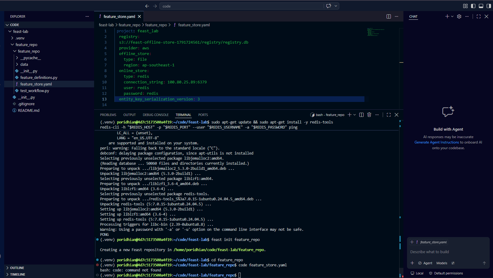

You should see a JSON document with your `Account` and `Arn`. Now test the managed Redis, and measure a first rough round trip while you are at it:

```bash
python - <<'EOF'
import os
import time
import redis

client = redis.Redis(
    host=os.environ["REDIS_HOST"],
    port=int(os.environ["REDIS_PORT"]),
    username=os.environ["REDIS_USERNAME"],
    password=os.environ["REDIS_PASSWORD"],
    socket_timeout=3,
)
print("PING:", client.ping())
print("Redis version:", client.info()["redis_version"])
start = time.perf_counter()
client.ping()
print("One PING round trip: %.2f ms" % ((time.perf_counter() - start) * 1000))
EOF
```

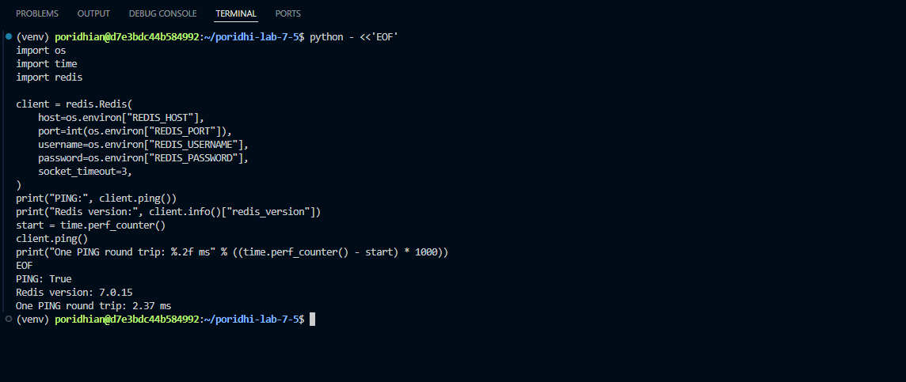

Expected output:

```text
PING: True
Redis version: 7.0.15
One PING round trip: 0.60 ms
```

The round trip time will differ in your session.

**Write this number down.** It is the raw network round trip from your VM to the managed Redis, and you will need it in Step 15 to subtract from the Feast benchmark p50. The number will look something like `One PING round trip: 0.60 ms` (your value will be a few tenths of a millisecond on the Poridhi Lab VM). If you lose it, re-run the inline script above in any active venv and re-read the `One PING round trip:` line. It is the floor of your latency budget: any Feast call has to add Python work on top of this number.

> Would I get an error if I ran this?
> Yes if you skipped Step 2: `KeyError: 'REDIS_HOST'`. Yes if the Redis password is wrong: `redis.exceptions.AuthenticationError`. Re-export the env vars and rerun.

### Step 6: Create the S3 bucket for the Feast registry

> Note: this step creates the S3 bucket that Feast will use to store its registry file. The bucket name is timestamped and randomized so it is unique on every run.

Bucket names are global, so add a timestamp and a random suffix:

```bash
export FEAST_BUCKET="feast-registry-$(date +%s)-$RANDOM"
aws s3 mb s3://$FEAST_BUCKET
aws s3 ls | grep "$FEAST_BUCKET"
echo "Bucket ready: $FEAST_BUCKET"
```
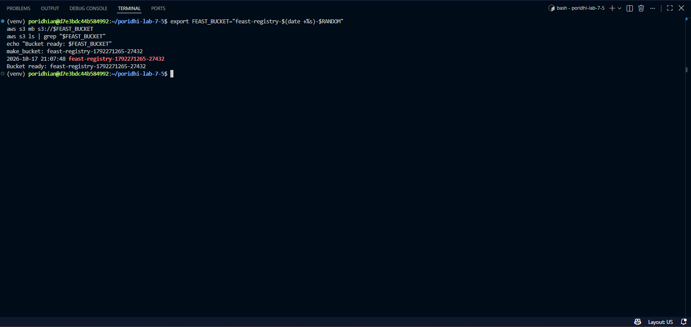

The `aws s3 ls` line must print your bucket name. If it prints nothing, stop and check the Troubleshooting section.

**Write down your bucket name now.** Run `echo "$FEAST_BUCKET"` in the same terminal and copy the output — it will look like `feast-registry-1792384265-19135`. You will paste that exact value into `feature_store.yaml` in Step 7 (replacing the `<FEAST_BUCKET>` placeholder). The `$FEAST_BUCKET` env var is also fine to keep using; just remember the value in case you start a new terminal session before Step 7 and the env var is no longer set. If you lose it, run `echo "$FEAST_BUCKET"` again in the same terminal where you exported it.

> Would I get an error if I ran this?
> Possibly: `BucketAlreadyExists` if you happen to roll a name someone else already owns. Rerun the `export FEAST_BUCKET=...` line for a fresh suffix and try again.

### Step 7: Create the Feast repository configuration

> Note: this step creates `feature_store.yaml` (Feast config) and `.gitignore` in `~/poridhi-lab-7-5/feature_repo`. The YAML points Feast at the S3 bucket and the managed Redis. Replace the placeholders with the env-var values from Steps 1 and 2 before pasting.

Create the project folder for the Feast repository (the `data/` subfolder will hold the offline Parquet source you generate in Step 8).

```bash
mkdir -p ~/poridhi-lab-7-5/feature_repo/data
```

Move into the new directory.

```bash
cd ~/poridhi-lab-7-5/feature_repo
```

Create a new file called `feature_store.yaml` in `~/poridhi-lab-7-5/feature_repo` and paste the YAML below into it. Replace the placeholders with the values you exported in earlier steps:

- `<FEAST_BUCKET>` → the value of `echo "$FEAST_BUCKET"` from Step 6 (your unique S3 bucket name, e.g. `feast-registry-1792384265-19135`).
- `<REDIS_HOST>`, `<REDIS_PORT>`, `<REDIS_USERNAME>`, `<REDIS_PASSWORD>` → the values of `echo "$REDIS_HOST"`, `echo "$REDIS_PORT"`, `echo "$REDIS_USERNAME"`, `echo "$REDIS_PASSWORD"` from Step 2 (the managed Redis credentials from the Cloud Tray).

If you started a new terminal since Step 6 and `echo "$FEAST_BUCKET"` prints nothing, re-run the `export FEAST_BUCKET="feast-registry-..."` line from Step 6 (the value stays the same until you re-roll the suffix) before pasting. Open the project folder in the lab UI editor, create a new file named `feature_store.yaml`, paste the contents, and save.

```yaml
project: realtime_serving
provider: local
registry:
  path: s3://<FEAST_BUCKET>/registry.db
  cache_ttl_seconds: 600
online_store:
  type: redis
  connection_string: "<REDIS_HOST>:<REDIS_PORT>,username=<REDIS_USERNAME>,password=<REDIS_PASSWORD>"
offline_store:
  type: file
```

**Alternative: create the empty file with `touch`, then open it in VS Code.** If you want to create the file from the terminal first so the Explorer shows it before you start editing, run a single `touch` (no `cat`, no heredoc — the file is left empty, and the YAML below is what you paste into it):

```bash
touch ~/poridhi-lab-7-5/feature_repo/feature_store.yaml
```

After `touch`, the empty `feature_store.yaml` appears in the Explorer. Open it (double-click in the Explorer, or run `code ~/poridhi-lab-7-5/feature_repo/feature_store.yaml` in the integrated terminal — the `code` CLI is available because Step 3.1 installed it). Paste the YAML block above into the empty file and save. The Explorer still shows the same single file; `touch` only ensures the path exists with the right name before you start editing.

Now create a `.gitignore` file in `~/poridhi-lab-7-5/feature_repo` (it tells `git` to never commit the config that contains the Redis password). Open a new file called `.gitignore` and paste the single line below into it.

```
feature_store.yaml
```

The YAML now contains your Redis password. That is why it is added to `.gitignore`: never commit it. You can inspect it later by opening the file in the lab UI editor.

Two settings matter for latency. `cache_ttl_seconds: 600` keeps the registry in memory for ten minutes, so requests do not go back to S3. The Redis `connection_string` points the SDK at the managed instance.

> Would I get an error if I ran this?
> No, this is just file creation. If a later step complains about a missing connection, the most common cause is a typo when you pasted one of the placeholders; re-open the file and check the value of each `<...>` token against `echo "$FEAST_BUCKET"`, `echo "$REDIS_HOST"`, etc.

### Step 8: Generate the sample offline data

> Note: this step creates `generate_data.py` in `~/poridhi-lab-7-5/feature_repo` and runs it to write `data/driver_stats.parquet` with 72000 rows of synthetic driver data.

Confirm the project directory exists (it should already, from Step 7).

```bash
mkdir -p ~/poridhi-lab-7-5/feature_repo
```

Move into it.

```bash
cd ~/poridhi-lab-7-5/feature_repo
```

Create a new file called `generate_data.py` in `~/poridhi-lab-7-5/feature_repo` and paste the Python code below into it. Open the project folder in the lab UI editor, create a new file named `generate_data.py`, paste the contents, and save.

```python
import numpy as np
import pandas as pd

NUM_DRIVERS = 1000
HOURS = 72
FIRST_ID = 1001

rng = np.random.default_rng(42)
now = pd.Timestamp.now(tz="UTC")
end = now.replace(minute=0, second=0, microsecond=0, nanosecond=0)
hours = pd.date_range(end=end, periods=HOURS, freq="h")

driver_ids = np.repeat(np.arange(FIRST_ID, FIRST_ID + NUM_DRIVERS), HOURS).astype("int64")
timestamps = pd.to_datetime(np.tile(hours.asi8, NUM_DRIVERS), unit="ns", utc=True)
n = len(driver_ids)

df = pd.DataFrame(
    {
        "driver_id": driver_ids,
        "event_timestamp": timestamps,
        "created": now,
        "conv_rate": rng.random(n).astype("float32"),
        "acc_rate": rng.random(n).astype("float32"),
        "avg_daily_trips": rng.integers(1, 500, n).astype("int64"),
    }
)
df.to_parquet("data/driver_stats.parquet", index=False)
print("Wrote", len(df), "rows for", NUM_DRIVERS, "drivers")
```

Run it:

```bash
python generate_data.py
```

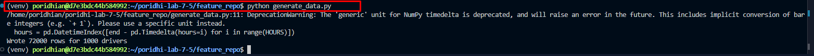

Expected output:

```text
Wrote 72000 rows for 1000 drivers
```

> Would I get an error if I ran this?
> No if the venv from Step 3 is active and `pyarrow` is installed. Otherwise `ImportError: No module named 'pandas'`. Re-run Step 4 and `source venv/bin/activate`. Confirmed on the Poridhi Lab VM (Python 3.12): `generate_data.py` originally triggered a `DeprecationWarning: The 'generic' unit for NumPy timedelta is deprecated`. The lab now uses `pd.date_range(end=end, periods=HOURS, freq="h")` to avoid that warning.

### Step 9: Define the entity, feature view, and feature service

> Note: this step creates `features.py` in `~/poridhi-lab-7-5/feature_repo`. The file declares the `driver` entity, the `driver_hourly_stats` feature view, and the `driver_activity_v1` feature service.

Confirm the project directory exists (it should already, from Steps 7 and 8).

```bash
mkdir -p ~/poridhi-lab-7-5/feature_repo
```

Move into it.

```bash
cd ~/poridhi-lab-7-5/feature_repo
```

Create a new file called `features.py` in `~/poridhi-lab-7-5/feature_repo` and paste the Python code below into it. Open the project folder in the lab UI editor, create a new file named `features.py`, paste the contents, and save.

```python
from datetime import timedelta

from feast import Entity, FeatureService, FeatureView, Field, FileSource
from feast.types import Float32, Int64

driver = Entity(name="driver", join_keys=["driver_id"], value_type=Int64)

driver_stats_source = FileSource(
    name="driver_hourly_stats_source",
    path="data/driver_stats.parquet",
    timestamp_field="event_timestamp",
    created_timestamp_column="created",
)

driver_hourly_stats = FeatureView(
    name="driver_hourly_stats",
    entities=[driver],
    ttl=timedelta(days=2),
    schema=[
        Field(name="conv_rate", dtype=Float32),
        Field(name="acc_rate", dtype=Float32),
        Field(name="avg_daily_trips", dtype=Int64),
    ],
    online=True,
    source=driver_stats_source,
)

driver_activity_v1 = FeatureService(
    name="driver_activity_v1",
    features=[driver_hourly_stats],
)
```

The `ttl` of two days means a feature value older than that is treated as missing at read time. Since the data was generated up to the current hour, every driver has fresh values.

> Would I get an error if I ran this?
> No on a fresh VM. If `feast` is missing, you get `ModuleNotFoundError`; activate the venv and rerun Step 4. Confirmed on the Poridhi Lab VM (Python 3.12, Feast 0.36.1): without `value_type=Int64` on the `Entity(...)` call, `feast apply` prints `DeprecationWarning: Entity value_type will be mandatory in the next release. Please specify a value_type for entity 'driver'.`. The lab now sets `value_type=Int64` explicitly to silence that warning. Confirmed on the Poridhi Lab VM (Python 3.12): with a newer Feast (for example 0.40+), `feast apply` fails with `typeguard.TypeCheckError: argument "value_type" (feast.types.PrimitiveFeastType) did not match any element in the union` because the lab uses `from feast.types import Float32, Int64`. The fix is the `==0.36.1` pin in Step 4, not a change to `features.py`.

### Step 10: Register the definitions with `feast apply`

> Note: this step uploads the entity, feature view, and feature service to the S3 registry so Feast knows what to materialize and what to serve.

```bash
feast apply
feast feature-views list
```

Expected output (abbreviated):

```text
No project found in the repository. Using project name realtime_serving defined in feature_store.yaml
Applying changes for project realtime_serving
Deploying infrastructure for driver_hourly_stats
NAME                  ENTITIES    TYPE           ENABLED    STATE
driver_hourly_stats   {'driver'}  FeatureView    Yes        STATE_UNSPECIFIED
```

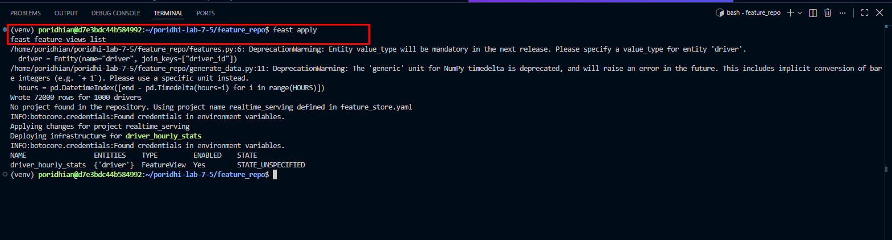

The second command lists `driver_hourly_stats`. The registry file is now stored in your S3 bucket.

> Would I get an error if I ran this?
> Yes if AWS credentials expired: `ExpiredToken` or `InvalidAccessKeyId`. Click Generate credential again, re-export Step 1 env vars, and retry. Also Yes if `feast apply` complains about the S3 registry and you want a fallback: change the `registry.path` line in `feature_store.yaml` to `data/registry.db` and rerun. Latency results are unaffected because the registry is cached in memory.

### Step 11: Materialize the features into Redis

> Note: this step copies the latest feature values from the offline Parquet source into the managed Redis, then confirms the keys landed. After this step, `get_online_features()` returns real numbers, not `None`.

Confirm you are in the Feast project directory (it should already be your cwd from Steps 7 to 10):

```bash
cd ~/poridhi-lab-7-5/feature_repo
```

```bash
feast materialize-incremental "$(date -u +"%Y-%m-%dT%H:%M:%S")"
```

Expected output:

```text
Materializing 1 feature views to ... into the redis online store.

driver_hourly_stats:
100%|████████████████| 1000/1000 [00:01<00:00, ...]
```

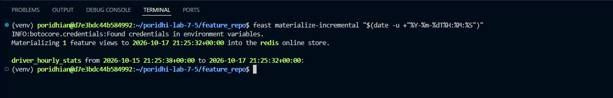

Confirm the keys landed in Redis:

```bash
python - <<'EOF'
import os
import redis

client = redis.Redis(
    host=os.environ["REDIS_HOST"],
    port=int(os.environ["REDIS_PORT"]),
    username=os.environ["REDIS_USERNAME"],
    password=os.environ["REDIS_PASSWORD"],
    socket_timeout=3,
)
print("Keys in Redis:", client.dbsize())
EOF
```

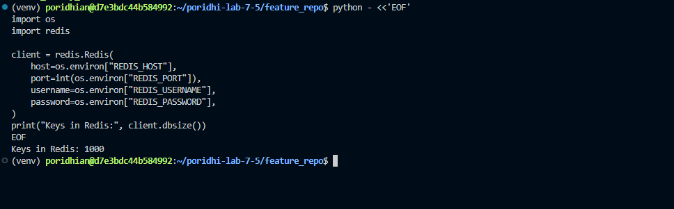

On a fresh managed Redis you should see 1000 keys, one per driver. If the instance already holds other data, the number will be higher.

> Would I get an error if I ran this?
> No if Steps 1 to 10 all passed. If you see `Redis is full`, the lab Redis reached its memory cap; ask the lab admin to clear it. If `conv_rate` returns `None` later, re-run materialization here.

### Step 12: Make your first `get_online_features()` call

> Note: this step creates `quick_test.py` in `~/poridhi-lab-7-5/feature_repo` and runs it to fetch a few features for driver 1001 by both feature reference and feature service. The output confirms the serving path is wired up.

Confirm the project directory exists (it should already, from Steps 7 to 9).

```bash
mkdir -p ~/poridhi-lab-7-5/feature_repo
```

Move into it.

```bash
cd ~/poridhi-lab-7-5/feature_repo
```

Create a new file called `quick_test.py` in `~/poridhi-lab-7-5/feature_repo` and paste the Python code below into it. Open the project folder in the lab UI editor, create a new file named `quick_test.py`, paste the contents, and save.

```python
from feast import FeatureStore

store = FeatureStore(repo_path=".")

by_reference = store.get_online_features(
    features=[
        "driver_hourly_stats:conv_rate",
        "driver_hourly_stats:acc_rate",
        "driver_hourly_stats:avg_daily_trips",
    ],
    entity_rows=[{"driver_id": 1001}],
).to_dict()
print("By feature reference:", by_reference)

by_service = store.get_online_features(
    features=store.get_feature_service("driver_activity_v1"),
    entity_rows=[{"driver_id": 1001}, {"driver_id": 1002}],
).to_dict()
print("By feature service:", by_service)
```

Run it:

```bash
python quick_test.py
```

Expected output (the feature values are random, so yours will differ):

```text
By feature reference: {'driver_id': [1001], 'conv_rate': [0.73...], 'acc_rate': [0.21...], 'avg_daily_trips': [284]}
By feature service: {'driver_id': [1001, 1002], 'conv_rate': [0.73..., 0.05...], 'acc_rate': [0.21..., 0.88...], 'avg_daily_trips': [284, 97]}
```

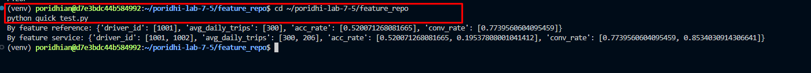

A feature service is a named, versioned group of features. In production, a model calls its feature service, and you can evolve the feature list without changing client code.

> Would I get an error if I ran this?
> Yes if materialization has not happened yet: the `conv_rate` value will be `None`. If so, rerun Step 11 and check the `dbsize` count.

### Step 13: Write the latency benchmark client

> Note: this step creates `benchmark.py` in `~/poridhi-lab-7-5/client`. The script times `get_online_features()` calls (cold + warm), prints p50/p95/p99, a distribution, and a PASS or FAIL verdict against the 10 ms target.

Create the client directory.

```bash
mkdir -p ~/poridhi-lab-7-5/client
```

Move into it.

```bash
cd ~/poridhi-lab-7-5/client
```

Create a new file called `benchmark.py` in `~/poridhi-lab-7-5/client` and paste the Python code below into it. Open the project folder in the lab UI editor, create a new file named `benchmark.py`, paste the contents, and save.

```python
import os
import random
import statistics
import time

from feast import FeatureStore

REPO_PATH = os.environ.get("FEAST_REPO", os.path.expanduser("~/poridhi-lab-7-5/feature_repo"))
N_REQUESTS = int(os.environ.get("N_REQUESTS", "1000"))
WARMUP = int(os.environ.get("WARMUP", "50"))
BATCH_SIZE = int(os.environ.get("BATCH_SIZE", "1"))
TARGET_MS = float(os.environ.get("TARGET_MS", "10"))
TARGET_PCT = float(os.environ.get("TARGET_PCT", "95"))
FIRST_ID = 1001
NUM_DRIVERS = 1000

FEATURES = [
    "driver_hourly_stats:conv_rate",
    "driver_hourly_stats:acc_rate",
    "driver_hourly_stats:avg_daily_trips",
]


def percentile(values, pct):
    ordered = sorted(values)
    rank = (len(ordered) - 1) * pct / 100.0
    low = int(rank)
    high = min(low + 1, len(ordered) - 1)
    return ordered[low] + (ordered[high] - ordered[low]) * (rank - low)


def main():
    t0 = time.perf_counter()
    store = FeatureStore(repo_path=REPO_PATH)
    init_ms = (time.perf_counter() - t0) * 1000

    rng = random.Random(7)

    def make_rows():
        ids = rng.sample(range(FIRST_ID, FIRST_ID + NUM_DRIVERS), BATCH_SIZE)
        return [{"driver_id": i} for i in ids]

    t0 = time.perf_counter()
    first = store.get_online_features(features=FEATURES, entity_rows=make_rows()).to_dict()
    cold_ms = (time.perf_counter() - t0) * 1000
    if any(v is None for v in first["conv_rate"]):
        raise SystemExit("Got None features. Run feast materialize-incremental first (Step 11).")

    for _ in range(WARMUP):
        store.get_online_features(features=FEATURES, entity_rows=make_rows()).to_dict()

    latencies = []
    for _ in range(N_REQUESTS):
        rows = make_rows()
        start = time.perf_counter_ns()
        store.get_online_features(features=FEATURES, entity_rows=rows).to_dict()
        latencies.append((time.perf_counter_ns() - start) / 1e6)

    observed = percentile(latencies, TARGET_PCT)
    print("Feast repo           :", REPO_PATH)
    print("Requests / batch size: %d / %d" % (N_REQUESTS, BATCH_SIZE))
    print("FeatureStore init    : %.1f ms" % init_ms)
    print("First (cold) call    : %.1f ms" % cold_ms)
    print("min                  : %.2f ms" % min(latencies))
    print("mean                 : %.2f ms" % statistics.mean(latencies))
    print("p50                  : %.2f ms" % percentile(latencies, 50))
    print("p90                  : %.2f ms" % percentile(latencies, 90))
    print("p95                  : %.2f ms" % percentile(latencies, 95))
    print("p99                  : %.2f ms" % percentile(latencies, 99))
    print("max                  : %.2f ms" % max(latencies))
    print("stdev                : %.2f ms" % statistics.pstdev(latencies))
    print("throughput           : %.0f calls/s" % (len(latencies) / (sum(latencies) / 1000)))

    buckets = [(0, 2), (2, 5), (5, 10), (10, 20), (20, float("inf"))]
    print("Distribution:")
    for low, high in buckets:
        count = sum(1 for x in latencies if low <= x < high)
        label = "%d to %d ms" % (low, high) if high != float("inf") else "%d ms and above" % low
        print("  %-16s %5d  %5.1f%%" % (label, count, 100.0 * count / len(latencies)))

    verdict = "PASS" if observed < TARGET_MS else "FAIL"
    print("Verdict: %s (p%g = %.2f ms, target under %.1f ms)" % (verdict, TARGET_PCT, observed, TARGET_MS))


if __name__ == "__main__":
    main()
```

A few design choices are deliberate:

- The `FeatureStore` is created once. Creating it per request would load the registry again and ruin the numbers.
- The first call is timed separately, then discarded along with a warm-up loop, so the registry fetch and connection setup do not pollute the steady-state numbers.
- Entity IDs are random per request, so you are not simply measuring a hot key.
- The timed region includes `.to_dict()`, because a real application needs plain Python values before it can call a model.
- The verdict uses p95 by default (`TARGET_PCT`), because a mean hides the slow tail that users actually notice.

> Would I get an error if I ran this?
> No if Steps 1 to 12 succeeded. The script exits with a clear message if materialization was missed, and prints a PASS or FAIL verdict at the end.

### Step 14: Run the benchmark

> Note: this step runs `benchmark.py` against the live serving path and prints the latency report. The Verdict line tells you whether the p95 met the 10 ms target.

**If you opened a new terminal since Step 1**, re-export the env vars from Steps 1, 2, and 6 before running `benchmark.py`. Paste these three export blocks back into the terminal first (`echo "$REDIS_HOST"` and `echo "$FEAST_BUCKET"` should each print a non-empty value before you continue):

```bash
# Step 1 (paste from the lab UI Generate credential)
export AWS_ACCESS_KEY_ID="<paste-access-key-from-lab-ui>"
export AWS_SECRET_ACCESS_KEY="<paste-secret-key-from-lab-ui>"
export AWS_SESSION_TOKEN="<paste-session-token-if-shown>"
export AWS_REGION=ap-southeast-1
```

```bash
# Step 2 (paste from the Cloud Tray Redis panel)
export REDIS_HOST="<paste-ip-from-cloud-tray>"
export REDIS_PORT="<paste-port-from-cloud-tray>"
export REDIS_USERNAME="<paste-username-from-cloud-tray>"
export REDIS_PASSWORD="<paste-password-from-cloud-tray>"
```

```bash
# Step 6 (use the same bucket name you recorded, not a freshly generated one)
export FEAST_BUCKET="feast-registry-<your-recorded-suffix>"
```

Activate the environment, then run the benchmark:

```bash
cd ~/poridhi-lab-7-5/client
source ~/poridhi-lab-7-5/venv/bin/activate
python benchmark.py
```

The output has this shape (these are illustrative numbers, yours depend on your session's network path to Redis):

```text
Feast repo           : /home/<user>/poridhi-lab-7-5/feature_repo
Requests / batch size: 1000 / 1
FeatureStore init    : 850.3 ms
First (cold) call    : 120.4 ms
min                  : 2.10 ms
mean                 : 3.05 ms
p50                  : 2.80 ms
p90                  : 3.90 ms
p95                  : 4.60 ms
p99                  : 7.20 ms
max                  : 12.80 ms
stdev                : 0.95 ms
throughput           : 328 calls/s
Distribution:
  0 to 2 ms            12    1.2%
  2 to 5 ms           930   93.0%
  5 to 10 ms           55    5.5%
  10 to 20 ms           3    0.3%
  20 ms and above       0    0.0%
Verdict: PASS (p95 = 4.60 ms, target under 10.0 ms)
```

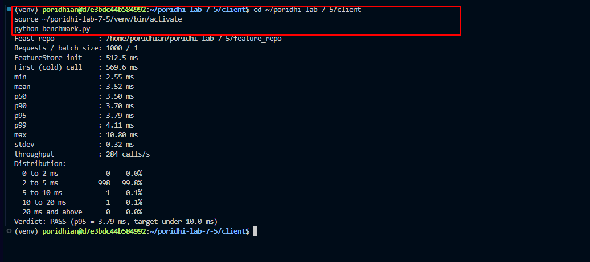

Read the result in three layers. First, the verdict line: did the p95 meet the target? Second, the gap between the cold call and the warm percentiles: that gap is the one-time cost you must pay at service start-up, not per request. Third, the distribution: a few calls above 10 ms are normal network jitter, but a heavy tail points to a real problem.

> Would I get an error if I ran this?
> No. Expect a single `Verdict:` line at the end. If you see `Verdict: FAIL`, walk the diagnosis in Step 15 and the Troubleshooting section.

### Step 15: Split the latency into network time and Feast overhead

> Note: this step creates two scripts in `~/poridhi-lab-7-5/client`. `rtt_baseline.py` measures raw Redis PING round trips so you can subtract network time from the benchmark. `profile_call.py` uses `cProfile` to show where the Python time goes inside `get_online_features()`.

Confirm the client directory exists (it should already, from Step 13).

```bash
mkdir -p ~/poridhi-lab-7-5/client
```

Move into it.

```bash
cd ~/poridhi-lab-7-5/client
```

Create a new file called `rtt_baseline.py` in `~/poridhi-lab-7-5/client` and paste the Python code below into it. Open the project folder in the lab UI editor, create a new file named `rtt_baseline.py`, paste the contents, and save.

```python
import os
import time

import redis


def percentile(values, pct):
    ordered = sorted(values)
    rank = (len(ordered) - 1) * pct / 100.0
    low = int(rank)
    high = min(low + 1, len(ordered) - 1)
    return ordered[low] + (ordered[high] - ordered[low]) * (rank - low)


client = redis.Redis(
    host=os.environ["REDIS_HOST"],
    port=int(os.environ["REDIS_PORT"]),
    username=os.environ["REDIS_USERNAME"],
    password=os.environ["REDIS_PASSWORD"],
    socket_timeout=3,
)

for _ in range(100):
    client.ping()

samples = []
for _ in range(1000):
    start = time.perf_counter_ns()
    client.ping()
    samples.append((time.perf_counter_ns() - start) / 1e6)

print("Raw Redis PING round trip")
print("  p50: %.2f ms" % percentile(samples, 50))
print("  p95: %.2f ms" % percentile(samples, 95))
print("  p99: %.2f ms" % percentile(samples, 99))
```

Run it:

```bash
python rtt_baseline.py
```

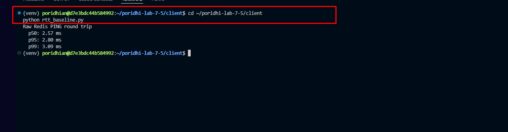

Now compare it with the benchmark: the Feast overhead is roughly the benchmark p50 minus this p50. If the PING p50 is already 8 ms, no code change can bring Feast under 10 ms, because the network is the problem. If the PING is below 1 ms and Feast is still slow, the time is going into Python.

To see where that Python time goes, create `profile_call.py` in `~/poridhi-lab-7-5/client`. Confirm you are still in the client directory (or `cd ~/poridhi-lab-7-5/client` again), then create a new file called `profile_call.py` and paste the Python code below into it. Open the project folder in the lab UI editor, create a new file named `profile_call.py`, paste the contents, and save.

```python
import cProfile
import os
import pstats

from feast import FeatureStore

REPO_PATH = os.environ.get("FEAST_REPO", os.path.expanduser("~/poridhi-lab-7-5/feature_repo"))
FEATURES = [
    "driver_hourly_stats:conv_rate",
    "driver_hourly_stats:acc_rate",
    "driver_hourly_stats:avg_daily_trips",
]

store = FeatureStore(repo_path=REPO_PATH)
for i in range(50):
    store.get_online_features(features=FEATURES, entity_rows=[{"driver_id": 1001 + i}]).to_dict()

profiler = cProfile.Profile()
profiler.enable()
for i in range(500):
    store.get_online_features(features=FEATURES, entity_rows=[{"driver_id": 1001 + (i % 1000)}]).to_dict()
profiler.disable()

pstats.Stats(profiler).sort_stats("cumulative").print_stats(12)
```

```bash
python profile_call.py
```

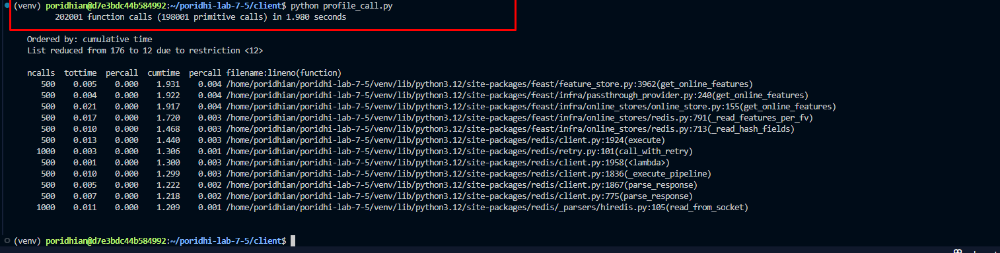

The top of the output shows cumulative time per function. Look for the Redis read (`online_read` and the socket calls beneath it) versus serialization and response building. Profiling adds its own overhead, so use the proportions, not the absolute numbers.

> Would I get an error if I ran this?
> No. `rtt_baseline.py` only does `PING` round trips. `profile_call.py` requires the same setup as `benchmark.py` and will print a table of function names and cumulative times.

### Step 16: Sweep the batch size

> Note: this step re-runs `benchmark.py` with batch sizes 1, 10, 50, and 100 so you can see how latency grows with batch size. The verdict flips at some batch size on every VM; that flip is the capacity limit for a single call.

Real services often fetch features for many candidates at once, such as ranking 50 drivers per request. Run the benchmark with several batch sizes:

```bash
cd ~/poridhi-lab-7-5/client
for b in 1 10 50 100; do
  echo "BATCH_SIZE=$b"
  BATCH_SIZE=$b N_REQUESTS=300 python benchmark.py | grep -E "p50|p95|p99|Verdict"
done
```

Latency grows with batch size. The first few entities are cheap because the reads are pipelined into one round trip, but per-entity overhead above the floor is roughly constant (~0.5 ms per added entity on this VM's network path to the managed Redis). Note the batch size at which your p95 crosses 10 ms: that is your capacity limit for a single call with this setup.

A reference run on the Poridhi Lab VM (Python 3.12, network RTT to managed Redis ~0.6 ms, `N_REQUESTS=300` per batch) shows this shape:

```text
BATCH_SIZE=1
Verdict: PASS (p95 = 3.63 ms, target under 10.0 ms)
BATCH_SIZE=10
Verdict: PASS (p95 = 5.05 ms, target under 10.0 ms)
BATCH_SIZE=50
Verdict: FAIL (p95 = 28.64 ms, target under 10.0 ms)
BATCH_SIZE=100
Verdict: FAIL (p95 = 49.89 ms, target under 10.0 ms)
```

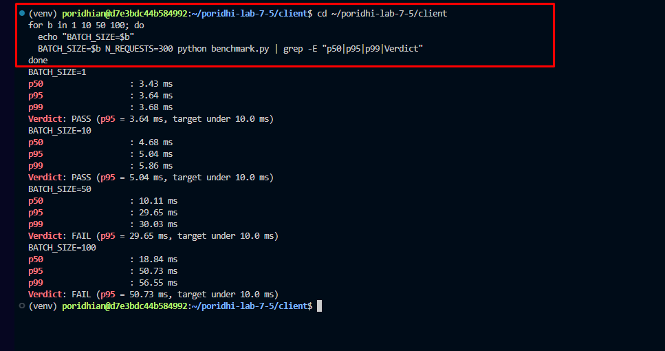

The verdict flips between batch 10 and batch 50 on this VM. Your numbers will differ if the network path is faster or slower, but the pattern is the same: a flat region up to roughly batch 10, then a roughly linear region above that. A real production service that needs to score 50+ candidates at once either accepts the higher latency, splits the call, or moves the client into the same AZ as Redis.

> Would I get an error if I ran this?
> No. The loop reuses the venv and re-imports the Feast SDK for each batch size, so the numbers are independent across runs.

### Step 17: Test under concurrent clients

> Note: this step creates `load_test.py` in `~/poridhi-lab-7-5/client` and runs it with one and then sixteen worker threads. The output shows how Python's GIL flattens throughput and lifts the tail as concurrency rises.

Confirm the client directory exists (it should already, from Steps 13 and 15).

```bash
mkdir -p ~/poridhi-lab-7-5/client
```

Move into it.

```bash
cd ~/poridhi-lab-7-5/client
```

Create a new file called `load_test.py` in `~/poridhi-lab-7-5/client` and paste the Python code below into it. Open the project folder in the lab UI editor, create a new file named `load_test.py`, paste the contents, and save.

```python
import os
import random
import threading
import time
from concurrent.futures import ThreadPoolExecutor

from feast import FeatureStore

REPO_PATH = os.environ.get("FEAST_REPO", os.path.expanduser("~/poridhi-lab-7-5/feature_repo"))
WORKERS = int(os.environ.get("WORKERS", "8"))
REQUESTS_PER_WORKER = int(os.environ.get("REQUESTS_PER_WORKER", "300"))
FEATURES = [
    "driver_hourly_stats:conv_rate",
    "driver_hourly_stats:acc_rate",
    "driver_hourly_stats:avg_daily_trips",
]

barrier = threading.Barrier(WORKERS)


def percentile(values, pct):
    ordered = sorted(values)
    rank = (len(ordered) - 1) * pct / 100.0
    low = int(rank)
    high = min(low + 1, len(ordered) - 1)
    return ordered[low] + (ordered[high] - ordered[low]) * (rank - low)


def worker(seed):
    store = FeatureStore(repo_path=REPO_PATH)
    rng = random.Random(seed)
    for _ in range(20):
        store.get_online_features(features=FEATURES, entity_rows=[{"driver_id": rng.randint(1001, 2000)}]).to_dict()
    barrier.wait()
    latencies = []
    began = time.perf_counter()
    for _ in range(REQUESTS_PER_WORKER):
        row = [{"driver_id": rng.randint(1001, 2000)}]
        start = time.perf_counter_ns()
        store.get_online_features(features=FEATURES, entity_rows=row).to_dict()
        latencies.append((time.perf_counter_ns() - start) / 1e6)
    return latencies, time.perf_counter() - began


with ThreadPoolExecutor(max_workers=WORKERS) as pool:
    results = list(pool.map(worker, range(WORKERS)))

all_latencies = [x for lat, _ in results for x in lat]
wall = max(elapsed for _, elapsed in results)
print("Workers: %d, total requests: %d" % (WORKERS, len(all_latencies)))
print("Throughput: %.0f calls/s" % (len(all_latencies) / wall))
print("p50: %.2f ms" % percentile(all_latencies, 50))
print("p95: %.2f ms" % percentile(all_latencies, 95))
print("p99: %.2f ms" % percentile(all_latencies, 99))
```

Run it:

```bash
python load_test.py
WORKERS=16 python load_test.py
```

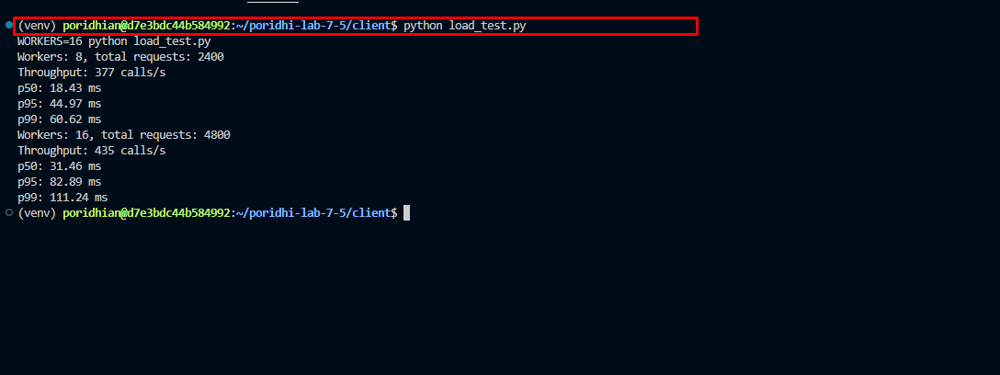

Each worker thread owns its own `FeatureStore` and Redis connection. Python threads share one interpreter lock, so throughput will flatten and tail latency will rise as you add workers. That is a real finding: if your service needs more throughput, you scale out with processes or replicas rather than relying on threads alone.

> Would I get an error if I ran this?
> No on a normal VM. If you set `WORKERS` higher than 100, the test becomes a stress test and you may hit connection limits on the managed Redis. Stick to 1 to 32 workers for this lab.

## Epilogue

You built a complete online serving path: offline Parquet data, a Feast registry in S3, materialized features in managed Redis, and a Python client that retrieves them by entity key. More importantly, you turned a vague goal, "under 10 ms," into something you can test: a repeatable benchmark with a cold-start split, percentiles, a distribution, and a PASS or FAIL verdict.

The bigger lesson is where the time goes. A feature lookup is one network round trip plus Python work, and you now have the tools to tell which of the two is hurting you. That is what lets you fix the right thing: move the client closer to the store, trim the features, or scale out, instead of guessing.


## Conclusion

This lab set out to prove whether a Python client can fetch online features in under 10 ms. You built a Feast repository with an S3 registry and a managed Redis online store, materialized hourly driver statistics, and called `get_online_features()` from a standalone client. The benchmark, network baseline, batch sweep, and concurrency test turned the target into a measured PASS or FAIL. The biggest takeaway is to measure warm percentiles and separate network time from Python overhead before changing anything.

