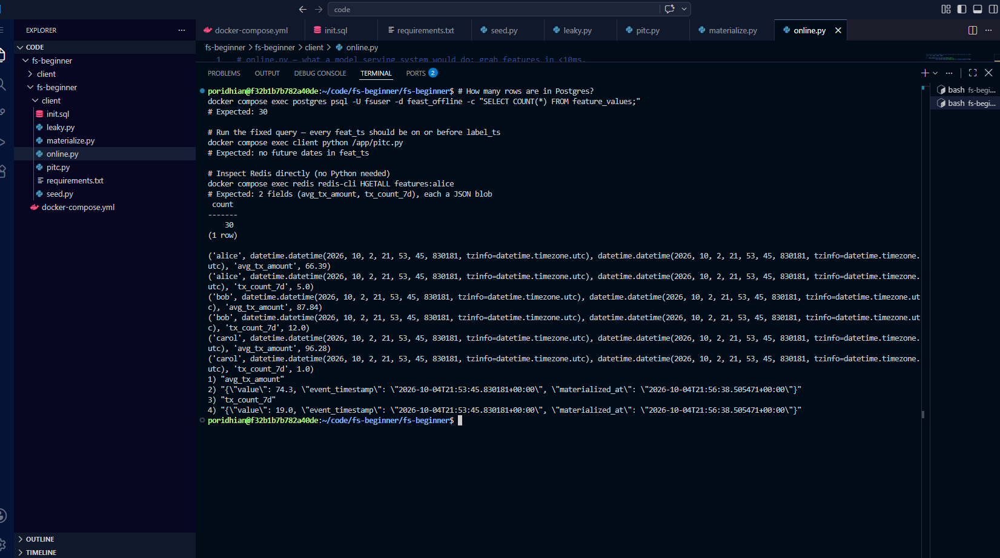

# Lab 7.1: Feature Store Concepts (Beginner Friendly)


## What is a feature store, in plain English?

Imagine you bake cookies (your ML model) and you need flour (your features). You have two problems:

1. **When you are testing recipes** (training): you want a big pantry with months of flour shipments so you can study how each batch affected past cookies.
2. **When a customer walks in** (serving/predicting): you want *that customer's* flour ready in 1 second, not 1 minute.

A **feature store** is just "the pantry + the grab-bag". It is two databases:

- **Offline store** = the pantry (PostgreSQL in this lab). Big, slow, holds history. Good for training.
- **Online store** = the grab-bag (Redis in this lab). Small, fast, holds only the latest flour per customer. Good for serving.

The cleverest part of a feature store is that it stops you from cheating. You will see how in this lab.


## Glossary (read this first!)

| Word | What it really means |
|------|----------------------|
| **Feature** | One column of input for a model. Example: "user's transaction count last 7 days". |
| **Entity** | The "thing" the features are about. Usually a user, a product, a session. |
| **Event timestamp** | *When* the feature value was true. Very important — this is how we stop cheating. |
| **Label** | The answer the model is trying to predict (e.g. `0` = not fraud, `1` = fraud). |
| **Offline store** | Big database with full history. Used for training. |
| **Online store** | Tiny fast database with only the latest snapshot per entity. Used for serving. |
| **Materialize** | "Copy the latest snapshot from offline to online." |
| **Leakage** | When the model accidentally sees data from the future during training. Bad. |
| **PITC (point-in-time correctness)** | The rule: at training time, only use features that were known *on or before* the label's timestamp. |

## Learning Objectives

By the end of this lab you will be able to:

- Tell a friend what an offline store and an online store do.
- Show what feature leakage looks like using a small SQL example.
- Fix the leakage with one extra line in a SQL query.
- Run a "materialize" script that copies data from offline to online.
- Read features back from the online store in milliseconds.

## Prerequisites

You only need:

- **Docker Desktop** (or Docker Engine + Compose) installed and running. [Get it here](https://www.docker.com/products/docker-desktop/) if you don't have it.
- **30 minutes** of your time.
- That's it. Everything else (Python, Postgres, Redis) runs inside Docker.

> 💡 **Tip:** You don't need to install Python or Postgres or Redis yourself. Docker containers carry their own copies.

## The whiteboard sketch (the "key focus" of this lab)


**Three ideas this picture captures (the entire lab in one diagram):**

1. **Two stores** — left is history (Postgres), right is latest snapshot (Redis). They have different jobs.
2. **One bridge** — the `materialize` arrow copies the newest row per user from left to right.
3. **One rule** — the PITC arrow only lets feature rows from *before* the label's time through. That single rule is what stops leakage.

Keep this picture in mind as you build each step.

## The story (1 minute, worth reading)

You trained a fraud model. It looked great. Six months later it started getting worse. Why?

During training, you joined "the *latest* user info" with "fraud labels from 5 days ago." Problem: that "latest user info" included things that happened *after* the fraud. Your model learned from the future — it learned that "users who look like this got flagged as fraud," without realizing those features were collected *because* of the fraud.

This is **feature leakage**. It makes your offline metrics look amazing and your production model look terrible.

A feature store, with **point-in-time joins**, prevents this. You will reproduce the bug, then fix it.

---

## Step-by-Step Implementation

### Step 1: Create the project folder

Open a terminal (PowerShell, bash, zsh — any will do) and run:

```bash
mkdir fs-beginner && cd fs-beginner
```


Now create **three files** inside this folder:

```
fs-beginner/
├── docker-compose.yml      ← tells Docker what to run
└── client/
    ├── requirements.txt    ← Python libraries we need
    └── init.sql            ← creates the database tables
```


Run these to make the folders:

**Option A: use the auto-setup script (recommended for beginners)**

From the `Feature_store_labs/` folder (the one that contains this lab file), run:

```bash
bash setup.sh
cd fs-beginner
```

That single command creates the 3 starter files shown above. If `docker-compose.yml` already exists in `fs-beginner/`, the script refuses to overwrite so your work is safe.

**Option B: create everything by hand**

```bash
mkdir fs-beginner && cd fs-beginner
mkdir client
```

### Step 2: `docker-compose.yml`

Create the file `docker-compose.yml` (in the `fs-beginner` folder) with this content. **Don't worry about understanding every line yet** — the comments explain each block.

```yaml
# We are running 3 "services" (containers):
#   1. postgres  - the offline store (history)
#   2. redis     - the online store (latest snapshot, fast)
#   3. client    - a Python playground where we run our scripts

services:
  postgres:
    image: postgres:16-alpine       # a small Postgres image
    environment:                    # login + database name
      POSTGRES_USER: fsuser
      POSTGRES_PASSWORD: fspass
      POSTGRES_DB: feast_offline
    ports:
      - "5432:5432"                 # exposed on your laptop
    volumes:
      - ./client/init.sql:/docker-entrypoint-initdb.d/init.sql:ro
                                     # auto-run init.sql on first start
    healthcheck:                     # is it ready yet?
      test: ["CMD-SHELL", "pg_isready -U fsuser -d feast_offline"]
      interval: 5s
      timeout: 3s
      retries: 10

  redis:
    image: redis:7-alpine
    ports:
      - "6379:6379"
    healthcheck:
      test: ["CMD", "redis-cli", "ping"]
      interval: 5s
      timeout: 3s
      retries: 10

  client:
    image: python:3.11-slim          # a small Python image
    working_dir: /app
    volumes:
      - ./client:/app               # your scripts appear inside the container
    command: sleep infinity          # keep the container alive
    environment:                     # so scripts know how to reach Postgres/Redis
      PG_HOST: postgres
      PG_PORT: "5432"
      PG_USER: fsuser
      PG_PASSWORD: fspass
      PG_DB: feast_offline
      REDIS_HOST: redis
      REDIS_PORT: "6379"
```

### Step 3: `client/init.sql` (the table schemas)

Create `client/init.sql`. This is what makes our two tables. Think of these as two spreadsheets:

- **`feature_values`** — rows like "Alice, tx_count_7d = 12, on 2026-10-01"
- **`labels`** — rows like "Alice, fraud = 1, on 2026-09-30"

```sql
-- One row per (user, feature, day)
CREATE TABLE feature_values (
    entity_id       TEXT        NOT NULL,   -- the user, e.g. 'alice'
    feature_name    TEXT        NOT NULL,   -- the feature, e.g. 'tx_count_7d'
    feature_value   DOUBLE PRECISION NOT NULL, -- the number
    event_timestamp TIMESTAMPTZ NOT NULL,   -- WHEN this value was true
    PRIMARY KEY (entity_id, feature_name, event_timestamp)
);

-- One row per (user, day) for the answer we are trying to predict
CREATE TABLE labels (
    entity_id       TEXT NOT NULL,
    label           INT  NOT NULL,          -- 0 or 1 (e.g. 1 = fraud)
    event_timestamp TIMESTAMPTZ NOT NULL,
    PRIMARY KEY (entity_id, event_timestamp)
);
```

### Step 4: `client/requirements.txt`

Create `client/requirements.txt`:

```
psycopg2-binary
redis
```

These are the two Python libraries we will use:
- `psycopg2-binary` — talks to Postgres
- `redis` — talks to Redis

### Step 5: Start everything

In the `fs-beginner` folder:

```bash
docker compose up -d
```


This downloads and starts the 3 containers. Wait ~10 seconds, then check that they are healthy:


```bash
docker compose ps
```


You should see all three with `(healthy)` in the STATUS column. If Postgres or Redis show `starting`, wait a few more seconds and run it again.

Now install the Python libraries inside the client container:

```bash
docker compose exec client pip install -r /app/requirements.txt
```

> 💡 **What does `exec` mean?** It runs a command *inside* a running container. So we are asking the `client` container to run `pip install`.

### Step 6: Seed some fake data

Create `client/seed.py`. This script pretends 3 users existed for 5 days, with 2 features each, plus 1 fraud label per user from 2 days ago.

```python
# seed.py — fill our database with a tiny bit of fake data
import os, random
from datetime import datetime, timedelta, timezone
import psycopg2

# Read connection info from environment variables (set by docker-compose)
PG = dict(
    host=os.environ["PG_HOST"],
    port=os.environ["PG_PORT"],
    user=os.environ["PG_USER"],
    password=os.environ["PG_PASSWORD"],
    dbname=os.environ["PG_DB"],
)

now = datetime.now(timezone.utc)        # current time in UTC
conn = psycopg2.connect(**PG)           # open Postgres connection
cur = conn.cursor()

users = ["alice", "bob", "carol"]       # three fake users

# Build a row per (user, day, feature)
rows = []
for u in users:
    for d in range(5):                  # 5 days of history
        ts = now - timedelta(days=4-d)  # walk back 4,3,2,1,0 days
        rows.append((u, "tx_count_7d",   random.randint(1, 20), ts))
        rows.append((u, "avg_tx_amount", round(random.uniform(10, 100), 2), ts))

# Insert all rows at once. ON CONFLICT DO NOTHING = no error if rerun.
cur.executemany(
    "INSERT INTO feature_values VALUES (%s,%s,%s,%s) ON CONFLICT DO NOTHING",
    rows,
)

# One label per user, dated 2 days ago. This is the "fraud happened on day X" we want to predict.
labels = [(u, random.randint(0, 1), now - timedelta(days=2)) for u in users]
cur.executemany(
    "INSERT INTO labels VALUES (%s,%s,%s) ON CONFLICT DO NOTHING",
    labels,
)

conn.commit()                          # save changes to disk
print(f"Inserted {len(rows)} feature rows and {len(labels)} labels.")
conn.close()
```

Run it:

```bash
docker compose exec client python /app/seed.py
```

**Expected output:**

```
Inserted 30 feature rows and 3 labels.
```


✅ If you see that, your database now has data.

> 💡 **Why 30 rows?** 3 users × 5 days × 2 features = 30.

### Step 7: The leaky query (the bug)

Now the fun part. We are going to write a query that **looks correct** but is broken.

Create `client/leaky.py`:

```python
# leaky.py — THIS IS THE BUG. Don't write queries like this.
import os, psycopg2

PG = dict(host=os.environ["PG_HOST"], port=os.environ["PG_PORT"],
          user=os.environ["PG_USER"], password=os.environ["PG_PASSWORD"],
          dbname=os.environ["PG_DB"])
conn = psycopg2.connect(**PG); cur = conn.cursor()

# For each label, we "join" the LATEST feature values for that user.
# The problem: "latest" means "most recent in the table", which might be
# *after* the label's timestamp. That is leakage.
cur.execute("""
    SELECT l.entity_id,
           l.event_timestamp AS label_ts,    -- when the fraud (or not) happened
           f.event_timestamp AS feat_ts,     -- when the feature was true
           f.feature_name, f.feature_value
    FROM labels l
    JOIN LATERAL (
        SELECT feature_name, feature_value, event_timestamp
        FROM feature_values
        WHERE entity_id = l.entity_id
        ORDER BY event_timestamp DESC        -- newest first
        LIMIT 2                              -- just 2 features
    ) f ON TRUE
    ORDER BY l.entity_id, f.feature_name;
""")

for row in cur.fetchall():
    print(row)
conn.close()
```

Run it:

```bash
docker compose exec client python /app/leaky.py
```

**Expected output (yours will differ — what matters is the dates):**

```
('alice', datetime.datetime(2026, 10, 3, ...), datetime.datetime(2026, 10, 4, ...), 'avg_tx_amount', 47.81)
('alice', datetime.datetime(2026, 10, 3, ...), datetime.datetime(2026, 10, 4, ...), 'tx_count_7d', 14)
...
```


Notice the **second date (`feat_ts`) is AFTER the first (`label_ts`)**. That's the leak. We are using data from the future to "predict" a past event.

If the dates look the same to you because of timezone formatting, focus on the *order*: if `feat_ts` > `label_ts`, that's leakage. The PITC fix below will guarantee `feat_ts <= label_ts`.

### Step 8: The fix — point-in-time join

Add one line and the bug disappears. Create `client/pitc.py`:

```python
# pitc.py — the CORRECT version. The only difference from leaky.py is the
# extra WHERE clause: event_timestamp <= l.event_timestamp
import os, psycopg2

PG = dict(host=os.environ["PG_HOST"], port=os.environ["PG_PORT"],
          user=os.environ["PG_USER"], password=os.environ["PG_PASSWORD"],
          dbname=os.environ["PG_DB"])
conn = psycopg2.connect(**PG); cur = conn.cursor()

cur.execute("""
    SELECT l.entity_id,
           l.event_timestamp AS label_ts,
           f.event_timestamp AS feat_ts,
           f.feature_name, f.feature_value
    FROM labels l
    JOIN LATERAL (
        SELECT feature_name, feature_value, event_timestamp
        FROM feature_values
        WHERE entity_id = l.entity_id
          AND event_timestamp <= l.event_timestamp   -- 👈 THE FIX
        ORDER BY event_timestamp DESC
        LIMIT 2
    ) f ON TRUE
    ORDER BY l.entity_id, f.feature_name;
""")

for row in cur.fetchall():
    print(row)
conn.close()
```

Run it:

```bash
docker compose exec client python /app/pitc.py
```

**Expected output:**

```
('alice', datetime.datetime(2026, 10, 3, ...), datetime.datetime(2026, 10, 3, ...), 'avg_tx_amount', 52.13)
('alice', datetime.datetime(2026, 10, 3, ...), datetime.datetime(2026, 10, 2, ...), 'tx_count_7d', 11)
...
```

Notice that now every `feat_ts` is **on or before** `label_ts`. The model can only see information that existed at the time of the event. That is the PITC rule. This is the entire "magic" of a feature store for training.

### Step 9: Materialize (offline → online)

Now we copy the *latest snapshot per user* from Postgres into Redis, so that when a real user shows up we can get their features in 1 millisecond.

Create `client/materialize.py`:

```python
# materialize.py — copy the LATEST feature value per (user, feature) into Redis.
import os, json
from datetime import datetime, timezone
import psycopg2, redis

PG = dict(host=os.environ["PG_HOST"], port=os.environ["PG_PORT"],
          user=os.environ["PG_USER"], password=os.environ["PG_PASSWORD"],
          dbname=os.environ["PG_DB"])
r = redis.Redis(host=os.environ["REDIS_HOST"],
                port=int(os.environ["REDIS_PORT"]), decode_responses=True)

conn = psycopg2.connect(**PG); cur = conn.cursor()

# For each (user, feature) keep only the row with the newest event_timestamp.
cur.execute("""
    SELECT entity_id, feature_name, feature_value, event_timestamp
    FROM (
        SELECT *, ROW_NUMBER() OVER (
            PARTITION BY entity_id, feature_name
            ORDER BY event_timestamp DESC
        ) AS rn
        FROM feature_values
    ) t
    WHERE rn = 1;
""")

now_iso = datetime.now(timezone.utc).isoformat()
n = 0
for entity_id, feature_name, feature_value, event_ts in cur.fetchall():
    payload = {
        "value": feature_value,
        "event_timestamp": event_ts.isoformat(),
        "materialized_at": now_iso,   # when we put it into Redis
    }
    # Redis hash: one per user, one field per feature
    r.hset(f"features:{entity_id}", feature_name, json.dumps(payload))
    n += 1

print(f"Materialized {n} features into Redis.")
conn.close()
```

Run it:

```bash
docker compose exec client python /app/materialize.py
```

**Expected output:**

```
Materialized 6 features into Redis.
```


> 💡 **Why 6?** 3 users × 2 features = 6.

### Step 10: Online read (the fast path)

Now read features back from Redis — the same way a real model would in production.

Create `client/online.py`:

```python
# online.py — what a model serving system would do: grab features in <10ms.
import os, json, time, redis

r = redis.Redis(host=os.environ["REDIS_HOST"],
                port=int(os.environ["REDIS_PORT"]), decode_responses=True)

entity_id = "alice"   # try "bob" or "carol" too

t0 = time.perf_counter()
blob = r.hgetall(f"features:{entity_id}")
elapsed_ms = (time.perf_counter() - t0) * 1000

print(f"\nOnline read for {entity_id}: {elapsed_ms:.2f} ms\n")
for feature_name, raw_value in blob.items():
    payload = json.loads(raw_value)
    print(f"  {feature_name:15s} value={payload['value']}")
    print(f"  {' ':15s} feat_ts = {payload['event_timestamp']}")
    print(f"  {' ':15s} mat_ts  = {payload['materialized_at']}")
    print()
```

Run it:

```bash
docker compose exec client python /app/online.py
```

**Expected output (numbers will vary):**

```
Online read for alice: 0.42 ms

  avg_tx_amount   value=58.43
                 feat_ts = 2026-10-04T...
                 mat_ts  = 2026-10-04T...

  tx_count_7d     value=17
                 feat_ts = 2026-10-04T...
                 mat_ts  = 2026-10-04T...
```


Two things to notice:

1. **Latency is sub-millisecond.** That's why online stores are needed.
2. **`mat_ts` is very close to `feat_ts`.** That gap is your **freshness** — how recent your features are. In production this could be 5 seconds, 5 minutes, or 5 hours depending on the pipeline.

---

## Verification (sanity checks)

Run each of these. The output should match what's written after "Expected".

```bash
# How many rows are in Postgres?
docker compose exec postgres psql -U fsuser -d feast_offline -c "SELECT COUNT(*) FROM feature_values;"
# Expected: 30

# Run the fixed query — every feat_ts should be on or before label_ts
docker compose exec client python /app/pitc.py
# Expected: no future dates in feat_ts

# Inspect Redis directly (no Python needed)
docker compose exec redis redis-cli HGETALL features:alice
# Expected: 2 fields (avg_tx_amount, tx_count_7d), each a JSON blob
```

## Testing (prove the bug and the fix)

### Test 1: Confirm leakage is real (without our fix)

```bash
docker compose exec postgres psql -U fsuser -d feast_offline -c "
SELECT COUNT(*) AS leaky_rows
FROM labels l
JOIN feature_values f
  ON f.entity_id = l.entity_id
 AND f.event_timestamp > l.event_timestamp;"
```

**Expected:** A non-zero number. That is the bug we want to fix.



### Test 2: Confirm PITC fix gives zero leakage

```bash
docker compose exec postgres psql -U fsuser -d feast_offline -c "
SELECT COUNT(*) AS still_leaky
FROM labels l
JOIN LATERAL (
    SELECT 1 FROM feature_values
    WHERE entity_id = l.entity_id AND event_timestamp > l.event_timestamp
    LIMIT 1
) f ON TRUE;"
```

**Expected:** `0`. Bug fixed.

### Test 3: Materialize is safe to re-run

```bash
docker compose exec client python /app/materialize.py
docker compose exec client python /app/materialize.py
docker compose exec redis redis-cli HGET features:alice tx_count_7d
```

**Expected:** No errors, the value is the same after both runs. Re-running the materialize script does not duplicate anything — it just overwrites with the latest snapshot.

---

## What you should have learned

In one sentence: a feature store is **a history database for training + a snapshot database for serving, joined in a way that respects time**.

If you remember nothing else, remember these three phrases:

1. **Offline for training, online for serving.** Different jobs need different tools.
2. **Always join with `event_timestamp <= label_ts`.** One line of SQL prevents leakage.
3. **Materialize keeps the online store fresh.** It is just a "copy the latest" script.

## Troubleshooting

**Containers won't start / `connection refused`**
- Wait 10 seconds. Run `docker compose ps`. Both `postgres` and `redis` should say `(healthy)`.
- If stuck, run `docker compose logs postgres` or `docker compose logs redis` to see the error.

**`psycopg2.OperationalError: could not connect to server`**
- The Postgres container is still starting up. Wait, then retry.

**`redis.exceptions.ConnectionError: Error 111`**
- The Redis container failed. Run `docker compose logs redis` to see why.

**`seed.py` says `Inserted 0 ...`**
- Postgres wasn't ready. Re-run the command after a few seconds, or do `docker compose down -v && docker compose up -d` to start fresh.

**`online.py` shows nothing**
- You probably forgot to run `materialize.py` first. Redis is empty until you materialize.

**`docker compose exec` says "container is not running"**
- Run `docker compose ps`. If a container is `Exit 1`, check its logs with `docker compose logs <name>`.

**Still stuck?**
- Nuclear option: `docker compose down -v && docker compose up -d`. This wipes Postgres data and restarts everything.

## Cleanup

When you are done:

```bash
docker compose down -v
cd .. && rm -rf fs-beginner
```

No cloud bill — all of this ran locally in Docker on your machine.

## Where to go next

- **Lab 7.2**: do the exact same thing using **Feast** (a real open-source feature store) and see how it packages these ideas.
- **Add a timer**: run `materialize.py` every minute and watch the freshness gap shrink.
- **Add more features**: edit `seed.py` to add a third feature like `failed_login_24h`.
- **Train a real model**: take the `pitc.py` output, put it into pandas, and train a tiny scikit-learn classifier. Compare AUC between the leaky version and the PITC version — you will see leakage inflate offline metrics.

## Additional Resources

- Feast docs: <https://docs.feast.dev/>
- "What is a feature store?" (Tecton blog): <https://www.tecton.ai/blog/what-is-a-modern-feature-store/>
- PostgreSQL `JOIN LATERAL` (the trick behind our PITC query): <https://www.postgresql.org/docs/current/queries-lateral.html>

## Conclusion

You built the smallest possible feature store — 3 users, 2 features, 4 Python scripts, 1 Docker Compose file. You saw what leakage looks like, fixed it with one extra SQL clause, and copied data from a slow database to a fast one. The same three ideas (offline/online split, point-in-time correctness, freshness) are the heart of every production feature store. You now have the mental model to learn Feast, Tecton, or any other feature store much faster.