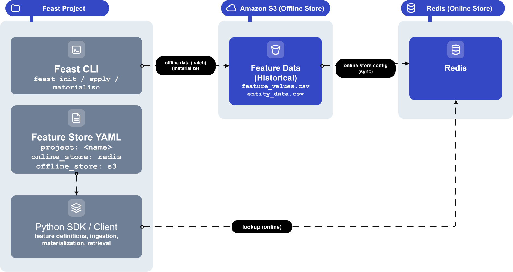

## Introduction

This lab, **Feast Setup on AWS S3 with Managed Redis**, walks through standing up a feature store on the Poridhi lab VM so that training jobs and inference services stop disagreeing about feature values.

In production ML systems, training and inference often compute the same features in two different ways, a problem called the **training-serving skew**. Feast is an open-source feature store that fixes this by giving training and serving a single shared definition backed by two stores: an **offline store** (S3, for historical reads) and an **online store** (Redis, for low-latency inference).

In this beginner-friendly lab, you will install Feast on the Poridhi lab VM, wire it to S3 (offline) and the Poridhi managed Redis (online), define a `driver_stats` feature view, and run `feast apply` to register it. By the end you will have a working feature store ready to feed both training jobs and inference services.




## Learning Objectives

By the end of this lab, you will be able to:

- Install Feast in a Python virtual environment on the Poridhi lab VM and verify the CLI works.
- Generate AWS credentials from the Poridhi Cloud Playground and configure the AWS CLI for `ap-southeast-1`.
- Create an S3 bucket and use it as a Feast offline store and registry.
- Point Feast at the Poridhi managed Redis (endpoint and credentials from the Cloud Tray panel) and confirm the connection.
- Write a `feature_store.yaml` that wires Feast to S3 (offline) and managed Redis (online).
- Define a feature set in Python using `Entity`, `FeatureView`, and `FileSource`.
- Apply the feature definition and confirm the registry was updated on S3.

### Folder Structure

The lab creates the following folders and files on the Poridhi Lab VM. Every `mkdir -p`, `cd`, and file-creation step in the lab matches this tree exactly.

```text
~/code/feast-lab/
└── feature_repo/
    ├── feature_store.yaml
    ├── driver_repo.py            # written directly under this name in Step 9
    └── data/
        └── driver_stats.parquet  # generated in Step 10
```

## Prerequisites

- **Region:** `ap-southeast-1` (Asia Pacific, Singapore). All AWS resources (S3 bucket, IAM, CLI default) are pinned to this region.
- **Environment:** Poridhi Cloud lab VM running Linux (Debian/Ubuntu shell), with VS Code pre-installed and an active Poridhi Cloud Playground session. The lab creates its files in `~/code/feast-lab/` — Step 2.1 shows the one-time VS Code Command Palette step (`Shell Command: Install 'code' command in PATH`) so the Explorer can open that folder. After that, every file in this lab is created by right-clicking the folder in the VS Code Explorer and choosing `New File…`; no shell-level text editors are used.
- **Storage:** Managed AWS S3 bucket in `ap-southeast-1`, created with `aws s3api create-bucket` in Step 5. Credentials are short-lived and come from the Poridhi Cloud Playground lab UI. The bucket is destroyed with the lab session and is not torn down explicitly.
- **Cloud Tray: Redis (managed, already running):** Open the Cloud Tray in the Poridhi lab UI, click **Database**, then click the **Redis** card. The panel shows the actual credentials for this lab session: **Username**, **Password**, **IP Address**, **Port**, and a copy-able **Connection String**. The values can change between lab runs, so always read them from the panel instead of hard-coding them. You will use these in Step 6 and in the `feature_store.yaml` in Step 8.
- **AWS credentials:** Generate a credential from the Poridhi Cloud Playground lab UI (Generate credential button). Region is `ap-southeast-1` (Singapore). The SessionToken field may or may not appear — treat it as optional.
- **Tools already on the VM:** `python3` (3.9+), `pip`, `aws` CLI. The `redis` Python client is installed in Step 3 if missing. `redis-cli` is also NOT pre-installed; use the Python fallback in Step 6. The lab never invokes `vim`, `nano`, `cat`, `tee`, `xdg-open`, or any shell-level write to create files.

## Prologue

Imagine you work at a ride-hailing company. Your ML team has built a model that predicts whether a driver is likely to accept the next ride offer. The model uses features like average rating, completed trips last 7 days, and current online hours. Right now, the training pipeline computes these features by reading raw data from a data lake, and the inference service computes them again from a different data source. The numbers almost never match, and the model performs worse in production than it did in evaluation.

The fix is to make features a first-class artifact with one definition and two access paths. Feast is the tool that makes this possible. In this lab you will set up that foundation on the Poridhi lab VM: a central feature registry on S3, an offline store on S3 for training, and an online store on the Poridhi managed Redis for inference. Once this is in place, the training pipeline and the inference service will read the exact same definitions, and the training-serving skew problem will be largely solved.

## Step-by-Step Implementation

### Step 1: Collect all credentials from the Poridhi lab UI

> Note: this step collects two sets of credentials (AWS and managed Redis) once and stores them locally. Every later step references them as shell variables, so the values never need to be pasted again.

Before you start, collect two sets of credentials from the Poridhi lab UI. You will paste them once, and the rest of the lab will use the resulting env vars.

**A. AWS credential (for S3)**

1. In the Poridhi Cloud Playground, click **Generate credential**.
2. Copy the fields shown: `AccessKey`, `SecretKey`, and `SessionToken` if one is shown.

**B. Managed Redis credential (for the online store)**

1. Open the **Cloud Tray** in the Poridhi lab UI.
2. Click **Database** to open the Database Servers panel.
3. Click the **Redis** card. The panel shows the **Username**, **Password**, **IP Address**, **Port**, and **Connection String** for the current lab session.
4. Copy the **Username**, **Password**, **IP Address**, and **Port** values.

Keep the Cloud Tray panel open in another tab. The endpoint and password can rotate between lab sessions, so always re-read them from the panel if you start a new session.

Treat these credentials like a password: do not paste them into shared documents or commit them to git. The lab session credentials are short-lived and stop working when the lab ends.

### Step 2: Create a project directory and Python virtual environment

> Note: this step creates the project directory `~/code/feast-lab` and the Python virtual environment that Step 3 onward uses.

Open a terminal on the lab VM and run:

```bash
mkdir -p ~/code/feast-lab
cd ~/code/feast-lab
python3 -m venv .venv
source .venv/bin/activate
python -m pip install --upgrade pip
```

You should now be inside an isolated Python environment. Anything you install will only affect this folder.


#### Step 2.1: Make VS Code see the project folder (one-time setup)

The lab creates files inside `~/code/feast-lab/` using the VS Code Explorer (right-click → `New File…`) instead of a shell editor. Before that works, you need the `code` CLI on `PATH` so Step 8 and Step 9 can rely on `code ~/code/feast-lab` to open the folder, and the Explorer label needs to point at this folder.

1. **Open the VS Code Command Palette.** Press `Ctrl+Shift+P` (Linux) inside any VS Code window — or open VS Code and use `View → Command Palette`.
2. **Install the `code` CLI.** Type `Shell Command: Install 'code' command in PATH` and press `Enter`. Wait for the small "Shell Command successfully installed in PATH" notification at the bottom-right of VS Code.
3. **Trust the new PATH.** Open a fresh terminal (or `source ~/.bashrc`) so the shell picks up the new `code` binary.
4. **Open the project folder.** Run:

   ```bash
   code ~/code/feast-lab
   ```

   Confirm the Explorer panel on the left shows the path `FEAST-LAB` (or `feast-lab`) and is now rooted at `~/code/feast-lab`. If the label did not flip, use `File → Open Folder…` from the VS Code menu and pick `~/code/feast-lab` manually.

After this one-time setup, every later step that creates a file just tells you to right-click a folder in the Explorer and choose `New File…`.

### Step 3: Install Feast with AWS and Redis support

> Note: this step installs Feast plus its AWS and Redis extras, then pins the transitive `numpy` floor that newer `pandas`/`pyarrow` wheels require.

Install Feast plus the AWS and Redis extras. This pulls in `boto3`, `redis`, and the S3 file source plugin:

```bash
pip install --upgrade pip
```

```bash
pip install "numpy>=2.0,<3" "pandas>=2" "pyarrow>=14" "feast[aws,redis]"
```

Verify the install:

```bash
feast --help
```

**Expected output:**

```text
Usage: feast [OPTIONS] COMMAND [ARGS]...
```

followed by a list of subcommands including `apply`, `materialize`, `entities`, `feature-views`, `feature-services`, `get-online-features`, and `teardown`.


You should see the list of Feast subcommands (`apply`, `materialize`, `entities`, etc.) without any import errors. To print the installed package version:

```bash
pip show feast | grep Version
```

**Expected output:**

```text
Version: 0.36.1
```

(your version may differ — `0.36.x` and `0.37.x` are both fine for this lab.)

### Step 4: Configure AWS credentials

> Note: this step exports the AWS credentials from Step 1 into the shell, then sets the default region to `ap-southeast-1`.

Export the credentials from Step 1 as environment variables so they reach `boto3`:

```bash
export AWS_ACCESS_KEY_ID="<paste-access-key-id>"
export AWS_SECRET_ACCESS_KEY="<paste-secret-access-key>"
export AWS_REGION="ap-southeast-1"

# Only run this if Poridhi issued a session token in Step 1.
# If your credential only had AccessKey and SecretKey, skip this line.
export AWS_SESSION_TOKEN="<paste-session-token>"
```


Then set the default region and output format:

```bash
aws configure set region ap-southeast-1
aws configure set output json
```

If you would rather use the interactive prompt instead of `export`, you can run:

```bash
aws configure
```

and paste `AccessKey` for `AWS Access Key ID`, `SecretKey` for `AWS Secret Access Key`, `ap-southeast-1` for `Default region name`, and `json` for `Default output format`. Leave `Default profile` blank.

Verify that the credentials work:

```bash
aws sts get-caller-identity
```


Expected output: a JSON document with your account ID, an `arn` containing `assumed-role`, and `ap-southeast-1` somewhere in the metadata.

### Step 5: Create the S3 bucket for the offline store

> Note: this step creates a globally unique S3 bucket in `ap-southeast-1` that Step 8 uses as both the Feast offline store and the registry location.

Pick a globally unique bucket name and create it in `ap-southeast-1`:

```bash
export BUCKET_NAME="feast-offline-store-$(date +%s)"
echo "Bucket name: $BUCKET_NAME"
aws s3api create-bucket \
  --bucket "$BUCKET_NAME" \
  --region ap-southeast-1 \
  --create-bucket-configuration LocationConstraint=ap-southeast-1
```

Confirm it exists:

```bash
aws s3 ls | grep "$BUCKET_NAME"
```


Persist the bucket name for later steps:

```bash
echo "export FEAST_S3_BUCKET=$BUCKET_NAME" >> ~/.bashrc
export FEAST_S3_BUCKET=$BUCKET_NAME
```

> **Write down your bucket name now.** Run `echo "$FEAST_S3_BUCKET"` in the same terminal and copy the output — it will look like `feast-offline-store-1792384265` (your value will differ). You will paste that exact value into `feature_store.yaml` in Step 8 (replacing the `your-unique-bucket-name` placeholder). The `$FEAST_S3_BUCKET` env var is also fine to keep using; just remember the value in case you start a new terminal session before Step 8 and the env var is no longer set. If you lose it, run `echo "$FEAST_S3_BUCKET"` again in the same terminal where you exported it. (The bucket itself persists in S3; only the local shell variable needs restoring.)

### Step 6: Confirm the Poridhi managed Redis is reachable

> Note: this step reads the managed Redis credentials from the Cloud Tray, exports them as shell variables, and pings the service from Python so Step 8 can wire them into `feature_store.yaml`.

If you skipped Step 1, open the Poridhi Cloud Tray in the lab UI, click **Database**, then click the **Redis** card. Read the **Username**, **Password**, **IP Address**, and **Port** from the panel and export them as shell variables:

```bash
export REDIS_HOST="<paste-ip-from-cloud-tray>"
export REDIS_PORT="<paste-port-from-cloud-tray>"
export REDIS_USERNAME="<paste-username-from-cloud-tray>"
export REDIS_PASSWORD="<paste-password-from-cloud-tray>"
```

The Poridhi lab VM does not have `redis-cli` pre-installed by default, so use the Python client (which Feast already depends on) to ping the Redis:

```bash
python -c "import redis; r=redis.Redis(host='$REDIS_HOST', port=int('$REDIS_PORT'), password='$REDIS_PASSWORD', username='$REDIS_USERNAME'); print(r.ping())"
```

Expected output: `True`. If you see `ModuleNotFoundError: No module named 'redis'`, install it first:


```bash
pip install redis
```

If you would rather use `redis-cli`, install it and ping with the same variables:

```bash
sudo apt-get update && sudo apt-get install -y redis-tools
redis-cli -h "$REDIS_HOST" -p "$REDIS_PORT" --user "$REDIS_USERNAME" -a "$REDIS_PASSWORD" ping
```

Expected output: `PONG`. The lab works either way; pick one and continue.


### Step 7: Create the Feast project

> Note: this step runs `feast init` to scaffold a `feature_repo/` subdirectory with starter files; Steps 8 and 9 overwrite its contents.

Re-establish the project directory (in case the shell session changed since Step 2) and run the Feast init command. Use the **default template**, not the `aws` template, even though the lab uses AWS for the offline store:

```bash
mkdir -p ~/code/feast-lab
cd ~/code/feast-lab
```

```bash
feast init feature_repo
```

If `feast init` asks which template to use, press Enter to accept the default (it does not need Redshift or any other AWS service for this lab). The `--template aws` template is for Redshift-backed offline stores and will fail with `RedshiftCredentialsError` if used here — see Troubleshooting for the full error.

This creates a new folder called `feature_repo` containing:

- `feature_store.yaml`: the configuration file we will overwrite in Step 8.
- `example_repo.py`: a starter feature definition that Step 9 replaces with `driver_repo.py`.
- `data/`: a small Parquet sample used for testing. Step 10 regenerates this file.

Move into the project folder:

```bash
cd feature_repo
```

### Step 8: Create `feature_store.yaml`

> Note: this step writes `feature_store.yaml` in `~/code/feast-lab/feature_repo` so Feast knows the S3 bucket and the managed Redis endpoints.

Confirm the project directory is in place and `cd` into it (this matters after Step 7):

```bash
mkdir -p ~/code/feast-lab/feature_repo
cd ~/code/feast-lab/feature_repo
```

In the VS Code Explorer (rooted at `FEAST-LAB` from Step 2.1), right-click the `feature_repo` folder, choose `New File…`, name the file `feature_store.yaml`, paste the YAML below into it, and save. The default `feature_store.yaml` that `feast init` just created is overwritten entirely. Replace `your-unique-bucket-name` with the bucket name from Step 5 (the one you wrote down with `echo "$FEAST_S3_BUCKET"`), and replace `your-redis-host`, `your-redis-port`, `your-redis-username`, and `your-redis-password` with the values from the Cloud Tray Redis panel in Step 6:

```yaml
project: feast_lab
registry: s3://your-unique-bucket-name/registry/registry.db
provider: aws
offline_store:
  type: file
  region: ap-southeast-1
online_store:
  type: redis
  connection_string: your-redis-host:your-redis-port
  user: your-redis-username
  password: your-redis-password
entity_key_serialization_version: 3
```

If you cannot remember the bucket name from Step 5, run `echo "$FEAST_S3_BUCKET"` in the terminal — that is the value to paste in for `your-unique-bucket-name`.


Notes about this file:

- `project`: a human-readable name for the project. Used in paths and logs.
- `registry`: where Feast stores the metadata about your features. We are putting it on S3 so the registry survives across machines.
- `provider: aws`: tells Feast we want the AWS flavor of the offline store.
- `offline_store.type: file`: tells Feast to use the file-based (S3 + Parquet) offline store.
- `online_store.type: redis`: tells Feast to use the Poridhi managed Redis for online lookups.
- `connection_string: host:port`: the Poridhi managed Redis host and port from the Cloud Tray panel.
- `user` and `password`: the username and password shown in the Cloud Tray Redis panel for this lab session.

> Would I get an error if I ran this? Possibly: the `entity_key_serialization_version: 3` line is required for Feast 0.36.x. If you see `ValueError: unrecognized serialization_version` after `feast apply`, you are on a newer Feast version and need to drop that line.

### Step 9: Create `driver_repo.py`

> Note: this step writes `driver_repo.py` (the feature definition for `driver_id`) in `~/code/feast-lab/feature_repo`, replacing the default `example_repo.py` template.

Re-establish the project directory in case the shell changed:

```bash
mkdir -p ~/code/feast-lab/feature_repo
cd ~/code/feast-lab/feature_repo
```

Right-click the `feature_repo` folder in the VS Code Explorer, choose `New File…`, name the file `driver_repo.py` (the default `example_repo.py` template is unused), paste the Python below into it, and save:

```python
from datetime import timedelta

from feast import Entity, FeatureView, FileSource, ValueType

# Source: a Parquet file we'll generate in the next step
driver_stats_source = FileSource(
    name="driver_stats_source",
    path="data/driver_stats.parquet",
    timestamp_field="event_timestamp",
    created_timestamp_column="created",
)

# Entity: the thing we want to look up features for
driver = Entity(
    name="driver_id",
    description="Driver identifier",
    value_type=ValueType.INT64,
)

# FeatureView: a logical group of features tied to the entity
driver_stats_fv = FeatureView(
    name="driver_stats",
    entities=["driver_id"],
    ttl=timedelta(days=1),
    schema=[
        ("conv_rate", ValueType.FLOAT),
        ("acc_rate", ValueType.FLOAT),
        ("avg_daily_trips", ValueType.INT64),
    ],
    source=driver_stats_source,
    online=True,
)
```

### Step 10: Generate a small Parquet sample

> Note: this step writes a small Parquet sample (`data/driver_stats.parquet`) that `feast apply` and `feast materialize` will read.

Create the `data/` folder and `cd` into `feature_repo` so the relative path in `driver_repo.py` resolves:

```bash
mkdir -p ~/code/feast-lab/feature_repo/data
cd ~/code/feast-lab/feature_repo
```

Run this Python one-liner to create a 5-row Parquet file with the right schema:

```bash
python - <<'PY'
import pandas as pd
from datetime import datetime, timezone

df = pd.DataFrame(
    {
        "driver_id": [1001, 1002, 1003, 1004, 1005],
        "conv_rate": [0.82, 0.55, 0.91, 0.40, 0.73],
        "acc_rate": [0.95, 0.88, 0.99, 0.71, 0.84],
        "avg_daily_trips": [28, 14, 35, 7, 22],
        "event_timestamp": [datetime(2026, 1, 1, tzinfo=timezone.utc)] * 5,
        "created": [datetime(2026, 1, 1, tzinfo=timezone.utc)] * 5,
    }
)
df.to_parquet("data/driver_stats.parquet", index=False)
print("Wrote data/driver_stats.parquet")
PY
```

**Expected output:**

```text
Wrote data/driver_stats.parquet
```


### Step 11: Apply the feature definition

> Note: this step validates the feature definition and registers the `driver_stats` view in S3.

Now run `feast apply`. This validates the definitions, uploads the registry to S3, and registers the feature view:

```bash
feast apply
```

**Expected output (truncated):**

```text
Registered entity driver_id
Registered feature view driver_stats
Deploying infrastructure for driver_stats
```

Confirm the feature view was registered by listing entities, feature views, and feature services:

```bash
feast entities list
feast feature-views list
feast feature-services list
```

**Expected output of `feast feature-views list`:**

```text
NAME        ENTITIES     TYPE
driver_stats driver_id  ReadableFeatureView
```

If you see errors, jump to the Troubleshooting section.

### Step 12: Verify the registry on S3

> Note: this step confirms that Feast wrote the registry to the S3 bucket.

Confirm that Feast wrote the registry file to your bucket:

```bash
aws s3 ls s3://$FEAST_S3_BUCKET/registry/
```

You should see `registry.db`. This is the single source of truth for your feature definitions.

### Step 13: Materialize to the online store and read back

> Note: this step pushes the latest features into the managed Redis and reads them back through `get_online_features`, which is what an inference service would call at request time.

Push the latest rows from the Parquet file into the managed Redis:

```bash
feast materialize-incremental $(date -u +"%Y-%m-%dT%H:%M:%S")
```

**Expected output:**

```text
Materializing 1 feature view to 1 online store.
driver_stats:
1001
1002
1003
1004
1005
```

Now read those features from Python using the same `FeatureStore` object that the CLI uses:

```bash
python - <<'PY'
from feast import FeatureStore
fs = FeatureStore(repo_path=".")
features = fs.get_online_features(
    features=["driver_stats:conv_rate", "driver_stats:acc_rate"],
    entity_rows=[{"driver_id": 1001}, {"driver_id": 1003}],
).to_dict()
print(features)
PY
```

**Expected output:**

```text
{'driver_id': [1001, 1003], 'conv_rate': [0.82, 0.91], 'acc_rate': [0.95, 0.99]}
```

> Would I get an error if I ran this? Possibly: `redis.exceptions.ConnectionError` if the managed Redis endpoint rotated. Re-open the Cloud Tray → Database → Redis panel, re-export `REDIS_HOST`, `REDIS_PORT`, `REDIS_USERNAME`, `REDIS_PASSWORD`, then update `feature_store.yaml` and re-run `feast apply`.


## Epilogue

You now have a working Feast installation on the Poridhi lab VM. The feature registry lives in S3, the online store is the Poridhi managed Redis (endpoint and credentials from the Cloud Tray panel), and the offline store is configured to read from a Parquet file. This is the same basic structure that production Feast deployments use: the only differences are scale, authentication, and the data sources.

The next thing you would normally do is connect a real data source (a Kafka stream, a Snowflake table, or an S3 path updated by an ETL job), populate it with real data, and then have your training pipeline call `get_historical_features` while your inference service calls `get_online_features`. From Feast's perspective, those two calls are symmetric: they read the same feature definitions and return the same feature values.


## Conclusion

This lab stood up a complete Feast feature store on the Poridhi lab VM: Feast installed in a virtual environment, an S3 bucket in `ap-southeast-1` as the offline store and registry, and the Poridhi managed Redis from the Cloud Tray as the online store, all wired together through a single `feature_store.yaml` plus feature definition applied to the registry. The key takeaway is the two-store architecture: S3 handles historical, training-time reads while the managed Redis handles low-latency, inference-time reads, and Feast keeps the two in sync through one shared feature definition. With this foundation in place, you can now plug in real data sources and connect both training and inference pipelines to the same source of truth.