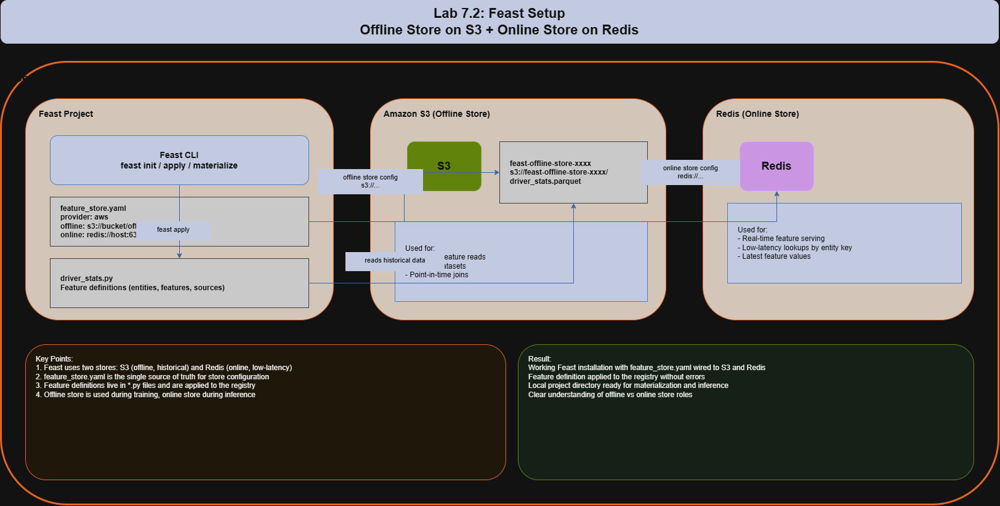

# Lab 7.2: Feast Setup

## Introduction

In modern machine learning systems, the same features need to be available consistently for both training and real-time inference. If your training pipeline computes features one way and your serving system computes them another way, your model will behave unpredictably in production. This is a classic problem known as the **training-serving skew**.

Feast (Feature Store) is an open-source feature store that solves this exact problem. It provides a central, versioned registry for feature definitions, and it can serve features from two complementary stores: an **offline store** (used for training, typically S3 with Parquet files) and an **online store** (used for low-latency inference, typically Redis). This separation lets you train on historical data quickly while still serving fresh features in milliseconds.

In this lab, you will install Feast, configure it to use Amazon S3 as the offline store and Redis as the online store, define a simple feature set, and apply the feature definition. By the end, you will have a working local Feast installation that is ready to be wired into a real ML pipeline.

This is a **beginner-friendly** lab, so every step is spelled out clearly. Even if you have never used Feast before, you will end up with a working feature store configured against S3 and Redis.





### Architecture Explanation

The lab is structured around three connected pieces: your local Feast project, an S3 bucket acting as the offline store, and a Redis instance acting as the online store.

The local Feast project is where the work happens. It contains a `feature_store.yaml` file that describes how Feast should talk to S3 and Redis, plus a Python file that defines the actual features. The Feast CLI reads this configuration, talks to AWS for the offline store, and talks to Redis for the online store.

The S3 bucket stores historical feature data as Parquet files. When you run a training job or build a training dataset, Feast will pull the right rows from S3 and perform a point-in-time join against your labels. This is the "training path" of Feast.

The Redis instance stores the latest feature values keyed by entity. When an inference service needs the most recent features for a specific driver, user, or product, it asks Redis and gets a response in single-digit milliseconds. This is the "serving path" of Feast.

## Learning Objectives

By the end of this lab, you will be able to:

- Install Feast in a Python virtual environment and verify the CLI works.
- Create an S3 bucket and configure an IAM policy that lets Feast read and write feature data.
- Run a local Redis instance and confirm it accepts connections.
- Write a `feature_store.yaml` that wires Feast to S3 (offline) and Redis (online).
- Define a feature set in Python using `Entity`, `FeatureView`, and `FileSource`.
- Apply the feature definition and confirm the registry was updated.

## Prerequisites

- A working Python 3.9+ environment on Linux, macOS, or Windows.
- An AWS account with permission to create an S3 bucket and an IAM user with access keys.
- Docker installed locally (used to run Redis), or a managed Redis endpoint.
- Basic familiarity with the terminal, `pip`, and editing YAML files.
- `aws` CLI installed and configured (for S3 access).
- **Region:** `ap-southeast-1` (Asia Pacific, Singapore). All AWS resources in this lab will be created in this region. The lab uses AZs `ap-southeast-1a`, `ap-southeast-1b`, `ap-southeast-1c` as labels in the architecture; in practice the bucket and IAM are region-wide and not AZ-scoped.

## Prologue

Imagine you work at a ride-hailing company. Your ML team has built a model that predicts whether a driver is likely to accept the next ride offer. The model uses features like average rating, completed trips last 7 days, and current online hours. Right now, the training pipeline computes these features by reading raw data from a data lake, and the inference service computes them again from a different data source. The numbers almost never match, and the model performs worse in production than it did in evaluation.

The fix is to make features a first-class artifact with one definition and two access paths. Feast is the tool that makes this possible. In this lab you will set up that foundation: a central feature registry, an offline store on S3 for training, and an online store on Redis for inference. Once this is in place, the training pipeline and the inference service will read the exact same definitions, and the training-serving skew problem will be largely solved.

## Step-by-Step Implementation

### Step 1: Create a project directory and Python virtual environment

Open a terminal and run:

```bash
mkdir feast-lab
cd feast-lab
python3 -m venv .venv
source .venv/bin/activate   # Windows: .venv\Scripts\activate
python -m pip install --upgrade pip
```

You should now be inside an isolated Python environment. Anything you install will only affect this folder.

### Step 2: Install Feast with AWS and Redis support

Install Feast plus the AWS and Redis extras. This pulls in `boto3`, `redis`, and the S3 file source plugin:

```bash
pip install "feast[aws,redis]==0.36.1"
```

Verify the install:

```bash
feast --version
```

You should see a version like `Feast version: 0.36.1`.

### Step 3: Configure your AWS credentials

Feast reads credentials from the standard AWS chain. Configure the CLI:

```bash
aws configure set region ap-southeast-1
aws configure set output json
```

If you do not already have credentials set, run `aws configure` and enter your `AWS_ACCESS_KEY_ID`, `AWS_SECRET_ACCESS_KEY`, and default region. Make sure the IAM user has permission to read and write to the S3 bucket you will create next.

### Step 4: Create the S3 bucket for the offline store

Pick a globally unique bucket name and create it in `ap-southeast-1`:

```bash
export BUCKET_NAME="feast-offline-store-$(date +%s)"
echo "Bucket name: $BUCKET_NAME"
aws s3api create-bucket \
  --bucket "$BUCKET_NAME" \
  --region ap-southeast-1 \
  --create-bucket-configuration LocationConstraint=ap-southeast-1
```

Confirm it exists:

```bash
aws s3 ls | grep "$BUCKET_NAME"
```

Save the bucket name as a variable for later steps:

```bash
echo "export FEAST_S3_BUCKET=$BUCKET_NAME" >> ~/.bashrc
export FEAST_S3_BUCKET=$BUCKET_NAME
```

### Step 5: Start a local Redis container

Run Redis in Docker. This is the simplest way to get a working online store for development:

```bash
docker run -d --name feast-redis -p 6379:6379 redis:7-alpine
```

Confirm Redis is up:

```bash
docker ps | grep feast-redis
```

Test the connection:

```bash
docker exec -it feast-redis redis-cli ping
```

Expected output: `PONG`.

If you do not have Docker, you can install Redis directly (`apt install redis-server` on Ubuntu, `brew install redis` on macOS) and run `redis-server` in another terminal.

### Step 6: Create the Feast project

Inside the `feast-lab` directory, run the Feast init command with the AWS template:

```bash
feast init feature_repo --template aws
```

This creates a new folder called `feature_repo` containing:

- `feature_store.yaml`: the configuration file we will edit next.
- `example_repo.py`: a starter feature definition.
- `data/`: a small Parquet sample used for testing.

Move into the project folder:

```bash
cd feature_repo
```

### Step 7: Edit `feature_store.yaml`

Open `feature_store.yaml` and replace its contents with the following. Replace `your-unique-bucket-name` with the actual S3 bucket name from Step 4:

```yaml
project: feast_lab
registry: s3://your-unique-bucket-name/registry/registry.db
provider: aws
offline_store:
  type: file
  region: ap-southeast-1
online_store:
  type: redis
  connection_string: localhost:6379
entity_key_serialization_version: 3
```

Notes about this file:

- `project`: a human-readable name for the project. Used in paths and logs.
- `registry`: where Feast stores the metadata about your features. We are putting it on S3 so the registry survives across machines.
- `provider: aws`: tells Feast we want the AWS flavor of the offline store.
- `offline_store.type: file`: tells Feast to use the file-based (S3 + Parquet) offline store.
- `online_store.type: redis`: tells Feast to use Redis for online lookups.
- `connection_string: localhost:6379`: this is the default Redis port on your local machine.

### Step 8: Replace the example feature definition

Open `example_repo.py` and replace its contents with:

```python
from datetime import timedelta

from feast import Entity, FeatureView, FileSource, ValueType
from feast.feature_store import FeatureStore

# Source: a Parquet file we'll generate in the next step
driver_stats_source = FileSource(
    name="driver_stats_source",
    path="data/driver_stats.parquet",
    timestamp_field="event_timestamp",
    created_timestamp_column="created",
)

# Entity: the thing we want to look up features for
driver = Entity(
    name="driver_id",
    description="Driver identifier",
    value_type=ValueType.INT64,
)

# FeatureView: a logical group of features tied to the entity
driver_stats_fv = FeatureView(
    name="driver_stats",
    entities=["driver_id"],
    ttl=timedelta(days=1),
    schema=[
        ("conv_rate", ValueType.FLOAT),
        ("acc_rate", ValueType.FLOAT),
        ("avg_daily_trips", ValueType.INT64),
    ],
    source=driver_stats_source,
    online=True,
)
```

Save the file as `driver_repo.py` so the original `example_repo.py` is preserved:

```bash
mv example_repo.py driver_repo.py
```

Update `feature_store.yaml` to point to the new file by adding a `repo_path` line if it is not already there:

```yaml
repo_path: .
```

### Step 9: Generate a small Parquet sample

Create the `data/` folder if it does not exist, and generate a sample Parquet file:

```bash
mkdir -p data
```

Run this Python one-liner to create a 5-row Parquet file with the right schema:

```bash
python - <<'PY'
import pandas as pd
from datetime import datetime, timezone

df = pd.DataFrame(
    {
        "driver_id": [1001, 1002, 1003, 1004, 1005],
        "conv_rate": [0.82, 0.55, 0.91, 0.40, 0.73],
        "acc_rate": [0.95, 0.88, 0.99, 0.71, 0.84],
        "avg_daily_trips": [28, 14, 35, 7, 22],
        "event_timestamp": [datetime(2026, 1, 1, tzinfo=timezone.utc)] * 5,
        "created": [datetime(2026, 1, 1, tzinfo=timezone.utc)] * 5,
    }
)
df.to_parquet("data/driver_stats.parquet", index=False)
print("Wrote data/driver_stats.parquet")
PY
```

### Step 10: Apply the feature definition

Now run `feast apply`. This validates the definitions, uploads the registry to S3, and registers the feature view:

```bash
feast apply
```

Expected output (truncated):

```text
Registered entity driver_id
Registered feature view driver_stats
Deploying infrastructure for driver_stats
```

If you see errors, jump to the Troubleshooting section.

### Step 11: Verify the registry on S3

Confirm that Feast wrote the registry file to your bucket:

```bash
aws s3 ls s3://$FEAST_S3_BUCKET/registry/
```

You should see `registry.db`. This is the single source of truth for your feature definitions.

## Verification

Run through this checklist to confirm the lab is correctly built:

- `feast --version` returns a version number (no error).
- `feast apply` exits with code 0 and prints "Registered feature view driver_stats".
- `aws s3 ls s3://$FEAST_S3_BUCKET/registry/` shows `registry.db`.
- `docker ps | grep feast-redis` shows a running container.
- `docker exec feast-redis redis-cli ping` returns `PONG`.
- `feast feature-views list` (run from inside `feature_repo`) prints `driver_stats`.

## Testing

Test the configuration by listing entities and feature views from the registry:

```bash
feast entities list
feast feature-views list
feast feature-services list
```

Expected output of `feast feature-views list`:

```text
NAME        ENTITIES     TYPE
driver_stats driver_id  ReadableFeatureView
```

Test the offline store by reading historical features:

```bash
feast materialize-incremental $(date -u +"%Y-%m-%dT%H:%M:%S")
```

Expected output: `Materializing 1 feature view to 1 online store`, followed by a count of entities.

Now read from the online store using a small Python script:

```bash
python - <<'PY'
from feast import FeatureStore
fs = FeatureStore(repo_path=".")
features = fs.get_online_features(
    features=["driver_stats:conv_rate", "driver_stats:acc_rate"],
    entity_rows=[{"driver_id": 1001}, {"driver_id": 1003}],
).to_dict()
print(features)
PY
```

Expected output: a dictionary containing `conv_rate` and `acc_rate` for the two requested drivers, with values matching the Parquet sample (for example, `0.82` for `driver_id=1001`).

## Troubleshooting

**Error: `NoSuchBucket` when running `feast apply`.**
The bucket name in `feature_store.yaml` does not match an actual bucket. Re-check Step 4 and copy the exact name.

**Error: `AccessDenied` on S3 writes.**
The IAM user whose credentials you used in `aws configure` does not have permission to write to the bucket. Add a policy with `s3:PutObject`, `s3:GetObject`, `s3:ListBucket`, and `s3:DeleteObject` on `arn:aws:s3:::your-bucket-name/*` and the bucket itself.

**Error: `redis.exceptions.ConnectionError`.**
Redis is not reachable. Run `docker ps` to confirm the container is up, then `docker logs feast-redis` to see why it might have exited. If you are not using Docker, make sure `redis-server` is running and listening on port 6379.

**Error: `ModuleNotFoundError: No module named 'feast'`.**
You are not inside the virtual environment. Run `source .venv/bin/activate` (or `.venv\Scripts\activate` on Windows) and try again.

**Error: `FileSource path 'data/driver_stats.parquet' not found`.**
The Parquet file was not created. Re-run the Python snippet in Step 9 from inside the `feature_repo` directory.

**Error: `Entity 'driver_id' not registered`.**
This usually means `feast apply` did not complete successfully. Look at the full error message, fix the underlying issue, and re-run `feast apply`.

## Cleanup

Stop Redis and remove the container to free port 6379:

```bash
docker stop feast-redis
docker rm feast-redis
```

Empty and delete the S3 bucket:

```bash
aws s3 rm s3://$FEAST_S3_BUCKET --recursive
aws s3api delete-bucket --bucket $FEAST_S3_BUCKET --region ap-southeast-1
```

Deactivate the virtual environment:

```bash
deactivate
```

Optionally, remove the project folder:

```bash
cd ..
rm -rf feast-lab
```

Remove the saved environment variable from your shell rc file:

```bash
sed -i '/FEAST_S3_BUCKET/d' ~/.bashrc
```

These steps will stop any local resource usage and remove the S3 bucket so you are not billed for storage.

## Epilogue

You now have a working Feast installation. The feature registry lives in S3, the online store is Redis, and the offline store is configured to read from a Parquet file. This is the same basic structure that production Feast deployments use: the only differences are scale, authentication, and the data sources.

The next thing you would normally do is connect a real data source (a Kafka stream, a Snowflake table, or an S3 path updated by an ETL job), populate it with real data, and then have your training pipeline call `get_historical_features` while your inference service calls `get_online_features`. From Feast's perspective, those two calls are symmetric: they read the same feature definitions and return the same feature values.

## Principles

- **Single source of truth for features:** feature definitions live in code, are versioned in git, and are applied to a central registry. This eliminates the training-serving skew problem.
- **Separation of concerns:** the offline store is optimized for large historical scans, the online store is optimized for low-latency point lookups. Each does one job well.
- **Declarative configuration:** `feature_store.yaml` describes what Feast should connect to, not how. The CLI and the SDK handle the mechanics.
- **Reproducibility:** because the registry is stored in S3, the same feature set can be re-applied on any machine that has the same config and credentials.
- **Least privilege:** the IAM user only needs S3 read/write on the specific bucket. No wildcard policies.

## What You Learned

- How to install Feast with AWS and Redis extras in an isolated virtual environment.
- How to create an S3 bucket and use it as a Feast offline store.
- How to run a local Redis container and point Feast at it.
- How to write a `feature_store.yaml` that wires both stores together.
- How to define an `Entity`, a `FileSource`, and a `FeatureView` in Python.
- How to apply feature definitions and verify them with `feast entities list` and `feast feature-views list`.
- How to materialize features and read them back from Redis.

## Next Steps

- Replace the static Parquet sample with a real data source, such as a Kafka topic or a Parquet dataset updated by a daily ETL job.
- Add a feature service that bundles multiple feature views together for easier consumption from inference services.
- Deploy the same configuration against a managed Redis (AWS ElastiCache) instead of a local Docker container.
- Add a second feature view (for example, `driver_activity_7d`) and a `FeatureService` that joins both.
- Wire `get_historical_features` into a training script to produce a point-in-time-correct training dataset.

## Additional Resources

- Feast documentation: https://docs.feast.dev/
- Feast AWS setup guide: https://docs.feast.dev/getting-started/architecture-and-components/registry
- Feast Redis online store: https://docs.feast.dev/reference/online-stores/redis
- boto3 S3 reference: https://boto3.amazonaws.com/v1/documentation/api/latest/reference/services/s3.html
- Redis Docker image: https://hub.docker.com/_/redis

## Conclusion

This lab stood up a complete Feast feature store from scratch: Feast installed in a virtual environment, an S3 bucket configured as the offline store, a Redis container as the online store, and a working `feature_store.yaml` plus feature definition applied to the registry. The key takeaway is the two-store architecture: S3 handles historical, training-time reads while Redis handles low-latency, inference-time reads, and Feast keeps the two in sync through a single feature definition. With this foundation in place, you can now plug in real data sources and connect both training and inference pipelines to the same source of truth.
