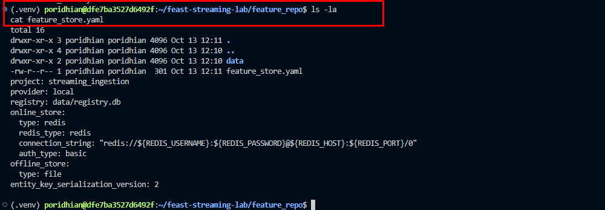
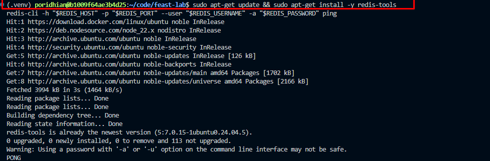

# Lab 7.2: Feast Setup

## Introduction

In production ML systems, training and inference often compute the same features in two different ways, a problem called the **training-serving skew**. Feast is an open-source feature store that fixes this by giving training and serving a single shared definition backed by two stores: an **offline store** (S3, for historical reads) and an **online store** (Redis, for low-latency inference).

In this beginner-friendly lab, you will install Feast on the Poridhi lab VM, wire it to S3 (offline) and the Poridhi managed Redis (online), define a `driver_stats` feature view, and run `feast apply` to register it. By the end you will have a working feature store ready to feed both training jobs and inference services.


### Architecture Explanation

The lab is structured around three connected pieces: your local Feast project on the Poridhi lab VM, an S3 bucket acting as the offline store, and the Poridhi managed Redis acting as the online store.

The local Feast project lives in `~/code/feast-lab/feature_repo`. It contains a `feature_store.yaml` file that describes how Feast should talk to S3 and Redis, plus a Python file that defines the actual features. The Feast CLI reads this configuration, talks to AWS for the offline store, and talks to the managed Redis for the online store.

The S3 bucket stores historical feature data as Parquet files and the Feast registry (`registry.db`). When you run a training job or build a training dataset, Feast will pull the right rows from S3 and perform a point-in-time join against your labels. This is the "training path" of Feast.

The Poridhi managed Redis (endpoint, username, and password are shown in the Cloud Tray Database Servers → Redis panel for this lab session) stores the latest feature values keyed by entity. When an inference service needs the most recent features for a specific driver, user, or product, it asks Redis and gets a response in single-digit milliseconds. This is the "serving path" of Feast. No local Redis container is needed: the Cloud Tray already provides it.

## Learning Objectives

By the end of this lab, you will be able to:

- Install Feast in a Python virtual environment on the Poridhi lab VM and verify the CLI works.
- Generate AWS credentials from the Poridhi Cloud Playground and configure the AWS CLI for `ap-southeast-1`.
- Create an S3 bucket and use it as a Feast offline store and registry.
- Point Feast at the Poridhi managed Redis (endpoint and credentials from the Cloud Tray panel) and confirm the connection.
- Write a `feature_store.yaml` that wires Feast to S3 (offline) and managed Redis (online).
- Define a feature set in Python using `Entity`, `FeatureView`, and `FileSource`.
- Apply the feature definition and confirm the registry was updated on S3.

## Prerequisites

- **Environment:** Poridhi Cloud lab VM with Linux (Debian/Ubuntu shell), VS Code pre-installed, and an active Poridhi Cloud Playground session.
- **Cloud Tray: Redis (managed, already running):** Open the Cloud Tray in the Poridhi lab UI, click **Database**, then click the **Redis** card. The panel shows the actual credentials for this lab session: **Username**, **Password**, **IP Address**, **Port**, and a copy-able **Connection String**. The values can change between lab runs, so always read them from the panel instead of hard-coding them. You will use these in Step 6 and in the `feature_store.yaml` in Step 8.
- **AWS credentials:** Generate a credential from the Poridhi Cloud Playground lab UI (Generate credential button). Region is `ap-southeast-1` (Singapore).
- **Region:** `ap-southeast-1` (Asia Pacific, Singapore). The S3 bucket and IAM are region-wide; the lab references AZs `ap-southeast-1a`, `ap-southeast-1b`, `ap-southeast-1c` in diagrams but does not pin resources to specific AZs.
- **Tools already on the VM:** `python3` (3.9+), `pip`, `aws` CLI, and the `redis` Python client (install with `pip install redis` if missing). The lab uses `vim` (already at `/usr/bin/vim`) to edit `feature_store.yaml` and `example_repo.py`. `code` (VS Code CLI), `nano`, and `xdg-open` are NOT available in the default lab VM, so do not rely on them. `redis-cli` is also NOT pre-installed: use the Python fallback in Step 6 to test the managed Redis.

## Prologue

Imagine you work at a ride-hailing company. Your ML team has built a model that predicts whether a driver is likely to accept the next ride offer. The model uses features like average rating, completed trips last 7 days, and current online hours. Right now, the training pipeline computes these features by reading raw data from a data lake, and the inference service computes them again from a different data source. The numbers almost never match, and the model performs worse in production than it did in evaluation.

The fix is to make features a first-class artifact with one definition and two access paths. Feast is the tool that makes this possible. In this lab you will set up that foundation on the Poridhi lab VM: a central feature registry on S3, an offline store on S3 for training, and an online store on the Poridhi managed Redis for inference. Once this is in place, the training pipeline and the inference service will read the exact same definitions, and the training-serving skew problem will be largely solved.

## Step-by-Step Implementation

### Step 0: Collect all credentials from the Poridhi lab UI

Before you start, collect two sets of credentials from the Poridhi lab UI. You will paste them once, and the rest of the lab will use the resulting env vars.

**A. AWS credential (for S3)**

1. In the Poridhi Cloud Playground, click **Generate credential**.
2. Copy the fields shown: `AccessKey`, `SecretKey`, and `SessionToken` if one is shown.

**B. Managed Redis credential (for the online store)**

1. Open the **Cloud Tray** in the Poridhi lab UI.
2. Click **Database** to open the Database Servers panel.
3. Click the **Redis** card. The panel shows the **Username**, **Password**, **IP Address**, **Port**, and **Connection String** for the current lab session.
4. Copy the **Username**, **Password**, **IP Address**, and **Port** values.

Keep the Cloud Tray panel open in another tab. The endpoint and password can rotate between lab sessions, so always re-read them from the panel if you start a new session.

### Step 1: Generate your AWS credential from the Poridhi lab UI

In the Poridhi Cloud Playground, click **Generate credential**. You will see a console login plus a set of programmatic credentials. Copy the following fields:

- `AccessKey` (used as `AWS_ACCESS_KEY_ID`)
- `SecretKey` (used as `AWS_SECRET_ACCESS_KEY`)
- `SessionToken` (used as `AWS_SESSION_TOKEN`) if Poridhi shows one. Some Poridhi sessions issue only an access key and secret key without a session token, in which case you can skip that variable.

Treat these credentials like a password: do not paste them into shared documents or commit them to git. The lab session credentials are short-lived and stop working when the lab ends.

### Step 2: Create a project directory and Python virtual environment

Open a terminal on the lab VM and run:

```bash
mkdir -p ~/code/feast-lab
cd ~/code/feast-lab
python3 -m venv .venv
source .venv/bin/activate
python -m pip install --upgrade pip
```

You should now be inside an isolated Python environment. Anything you install will only affect this folder.


### Step 3: Install Feast with AWS and Redis support

Install Feast plus the AWS and Redis extras. This pulls in `boto3`, `redis`, and the S3 file source plugin:

```bash
pip install "feast[aws,redis]"
```

Verify the install:

```bash
feast --help
```




You should see the list of Feast subcommands (`apply`, `materialize`, `entities`, etc.) without any import errors. To print the installed package version:

```bash
pip show feast | grep Version
```

### Step 4: Configure AWS credentials

Export the credentials from Step 1 as environment variables so they reach `boto3`:

```bash
export AWS_ACCESS_KEY_ID="<paste-access-key-id>"
export AWS_SECRET_ACCESS_KEY="<paste-secret-access-key>"
export AWS_REGION="ap-southeast-1"

# Only run this if Poridhi issued a session token in Step 1.
# If your credential only had AccessKey and SecretKey, skip this line.
export AWS_SESSION_TOKEN="<paste-session-token>"
```


Then set the default region and output format:

```bash
aws configure set region ap-southeast-1
aws configure set output json
```

If you would rather use the interactive prompt instead of `export`, you can run:

```bash
aws configure
```

and paste `AccessKey` for `AWS Access Key ID`, `SecretKey` for `AWS Secret Access Key`, `ap-southeast-1` for `Default region name`, and `json` for `Default output format`. Leave `Default profile` blank.

Verify that the credentials work:

```bash
aws sts get-caller-identity
```


Expected output: a JSON document with your account ID, an `arn` containing `assumed-role`, and `ap-southeast-1` somewhere in the metadata.

### Step 5: Create the S3 bucket for the offline store

Pick a globally unique bucket name and create it in `ap-southeast-1`:

```bash
export BUCKET_NAME="feast-offline-store-$(date +%s)"
echo "Bucket name: $BUCKET_NAME"
aws s3api create-bucket \
  --bucket "$BUCKET_NAME" \
  --region ap-southeast-1 \
  --create-bucket-configuration LocationConstraint=ap-southeast-1
```

Confirm it exists:

```bash
aws s3 ls | grep "$BUCKET_NAME"
```


Persist the bucket name for later steps:

```bash
echo "export FEAST_S3_BUCKET=$BUCKET_NAME" >> ~/.bashrc
export FEAST_S3_BUCKET=$BUCKET_NAME
```

### Step 6: Confirm the Poridhi managed Redis is reachable

If you skipped Step 0, open the Poridhi Cloud Tray in the lab UI, click **Database**, then click the **Redis** card. Read the **Username**, **Password**, **IP Address**, and **Port** from the panel and export them as shell variables:

```bash
export REDIS_HOST="<paste-ip-from-cloud-tray>"
export REDIS_PORT="<paste-port-from-cloud-tray>"
export REDIS_USERNAME="<paste-username-from-cloud-tray>"
export REDIS_PASSWORD="<paste-password-from-cloud-tray>"
```

The Poridhi lab VM does not have `redis-cli` pre-installed by default, so use the Python client (which Feast already depends on) to ping the Redis:

```bash
python -c "import redis; r=redis.Redis(host='$REDIS_HOST', port=int('$REDIS_PORT'), password='$REDIS_PASSWORD', username='$REDIS_USERNAME'); print(r.ping())"
```

Expected output: `True`. If you see `ModuleNotFoundError: No module named 'redis'`, install it first:


```bash
pip install redis
```

If you would rather use `redis-cli`, install it and ping with the same variables:

```bash
sudo apt-get update && sudo apt-get install -y redis-tools
redis-cli -h "$REDIS_HOST" -p "$REDIS_PORT" --user "$REDIS_USERNAME" -a "$REDIS_PASSWORD" ping
```

Expected output: `PONG`. The lab works either way; pick one and continue.



### Step 7: Create the Feast project

Inside `~/code/feast-lab`, run the Feast init command. Use the **default template**, not the `aws` template, even though the lab uses AWS for the offline store:

```bash
feast init feature_repo
```

If `feast init` asks which template to use, press Enter to accept the default (it does not need Redshift or any other AWS service for this lab).

> **Why not `--template aws`?** That template is for labs that use **Amazon Redshift** as the offline store. The `aws` template prompts for a Redshift cluster ID, Redshift credentials, and a staging S3 bucket, and then it tries to upload a sample dataset to Redshift. The cluster ID must match the regex `[a-z][a-z0-9]*(-[a-z0-9]+)*`, so typing `n/a` or leaving it blank will fail with `RedshiftCredentialsError: Redshift API failed due to incorrect credentials`. Since this lab uses S3 (not Redshift) for the offline store, the default template is the right choice.

This creates a new folder called `feature_repo` containing:

- `feature_store.yaml`: the configuration file we will edit next.
- `example_repo.py`: a starter feature definition.
- `data/`: a small Parquet sample used for testing.

Move into the project folder:

```bash
cd feature_repo
```

### Step 8: Edit `feature_store.yaml`

Open `feature_store.yaml` with `vim`:

```bash
vim feature_store.yaml
```

Inside `vim`:
- Press `i` to enter insert mode.
- Select and delete the existing content (for example, type `ggdG` in normal mode first to delete every line).
- Paste the YAML below.
- Press `Esc` to leave insert mode.
- Type `:wq` and press Enter to save and quit.

Replace the contents with the following. Replace `your-unique-bucket-name` with the S3 bucket name from Step 5, and replace `your-redis-host`, `your-redis-port`, `your-redis-username`, and `your-redis-password` with the values from the Cloud Tray Redis panel in Step 6:

```yaml
project: feast_lab
registry: s3://your-unique-bucket-name/registry/registry.db
provider: aws
offline_store:
  type: file
  region: ap-southeast-1
online_store:
  type: redis
  connection_string: your-redis-host:your-redis-port
  user: your-redis-username
  password: your-redis-password
entity_key_serialization_version: 3
```

Save the file with `:wq`.


Notes about this file:

- `project`: a human-readable name for the project. Used in paths and logs.
- `registry`: where Feast stores the metadata about your features. We are putting it on S3 so the registry survives across machines.
- `provider: aws`: tells Feast we want the AWS flavor of the offline store.
- `offline_store.type: file`: tells Feast to use the file-based (S3 + Parquet) offline store.
- `online_store.type: redis`: tells Feast to use the Poridhi managed Redis for online lookups.
- `connection_string: host:port`: the Poridhi managed Redis host and port from the Cloud Tray panel.
- `user` and `password`: the username and password shown in the Cloud Tray Redis panel for this lab session.

### Step 9: Replace the example feature definition

Open `example_repo.py` with `vim`:

```bash
vim example_repo.py
```

Inside `vim`:
- Press `i` to enter insert mode.
- Select and delete the existing content (for example, type `ggdG` in normal mode first to delete every line).
- Paste the Python code below.
- Press `Esc` to leave insert mode.
- Type `:wq` and press Enter to save and quit.

Paste this Python code:

```python
from datetime import timedelta

from feast import Entity, FeatureView, FileSource, ValueType

# Source: a Parquet file we'll generate in the next step
driver_stats_source = FileSource(
    name="driver_stats_source",
    path="data/driver_stats.parquet",
    timestamp_field="event_timestamp",
    created_timestamp_column="created",
)

# Entity: the thing we want to look up features for
driver = Entity(
    name="driver_id",
    description="Driver identifier",
    value_type=ValueType.INT64,
)

# FeatureView: a logical group of features tied to the entity
driver_stats_fv = FeatureView(
    name="driver_stats",
    entities=["driver_id"],
    ttl=timedelta(days=1),
    schema=[
        ("conv_rate", ValueType.FLOAT),
        ("acc_rate", ValueType.FLOAT),
        ("avg_daily_trips", ValueType.INT64),
    ],
    source=driver_stats_source,
    online=True,
)
```

Save the file as `driver_repo.py` so the original is preserved:

```bash
mv example_repo.py driver_repo.py
```

### Step 10: Generate a small Parquet sample

Create the `data/` folder if it does not exist:

```bash
mkdir -p data
```

Run this Python one-liner to create a 5-row Parquet file with the right schema:

```bash
python - <<'PY'
import pandas as pd
from datetime import datetime, timezone

df = pd.DataFrame(
    {
        "driver_id": [1001, 1002, 1003, 1004, 1005],
        "conv_rate": [0.82, 0.55, 0.91, 0.40, 0.73],
        "acc_rate": [0.95, 0.88, 0.99, 0.71, 0.84],
        "avg_daily_trips": [28, 14, 35, 7, 22],
        "event_timestamp": [datetime(2026, 1, 1, tzinfo=timezone.utc)] * 5,
        "created": [datetime(2026, 1, 1, tzinfo=timezone.utc)] * 5,
    }
)
df.to_parquet("data/driver_stats.parquet", index=False)
print("Wrote data/driver_stats.parquet")
PY
```


### Step 11: Apply the feature definition

Now run `feast apply`. This validates the definitions, uploads the registry to S3, and registers the feature view:

```bash
feast apply
```

Expected output (truncated):

```text
Registered entity driver_id
Registered feature view driver_stats
Deploying infrastructure for driver_stats
```

If you see errors, jump to the Troubleshooting section.

### Step 12: Verify the registry on S3

Confirm that Feast wrote the registry file to your bucket:

```bash
aws s3 ls s3://$FEAST_S3_BUCKET/registry/
```

You should see `registry.db`. This is the single source of truth for your feature definitions.

## Verification

Run through this checklist to confirm the lab is correctly built:

- `pip show feast` returns a non-empty Version (no error).
- `aws sts get-caller-identity` returns a JSON document with your account ID.
- `aws s3 ls s3://$FEAST_S3_BUCKET/registry/` shows `registry.db`.
- `redis-cli -h "$REDIS_HOST" -p "$REDIS_PORT" --user "$REDIS_USERNAME" -a "$REDIS_PASSWORD" ping` returns `PONG` (or the Python ping snippet using the same env vars returns `True`).
- `feast apply` exits with code 0 and prints "Registered feature view driver_stats".
- `feast feature-views list` (run from inside `feature_repo`) prints `driver_stats`.

## Testing

Test the configuration by listing entities and feature views from the registry:

```bash
feast entities list
feast feature-views list
feast feature-services list
```

Expected output of `feast feature-views list`:

```text
NAME        ENTITIES     TYPE
driver_stats driver_id  ReadableFeatureView
```

Test the offline store by reading historical features:

```bash
feast materialize-incremental $(date -u +"%Y-%m-%dT%H:%M:%S")
```

Expected output: `Materializing 1 feature view to 1 online store`, followed by a count of entities.

Now read from the online store using a small Python script:

```bash
python - <<'PY'
from feast import FeatureStore
fs = FeatureStore(repo_path=".")
features = fs.get_online_features(
    features=["driver_stats:conv_rate", "driver_stats:acc_rate"],
    entity_rows=[{"driver_id": 1001}, {"driver_id": 1003}],
).to_dict()
print(features)
PY
```

Expected output: a dictionary containing `conv_rate` and `acc_rate` for the two requested drivers, with values matching the Parquet sample (for example, `0.82` for `driver_id=1001`).

## Troubleshooting

**Error: `NoSuchBucket` when running `feast apply`.**
The bucket name in `feature_store.yaml` does not match an actual bucket. Re-check Step 5 and copy the exact name.

**Error: `AccessDenied` on S3 writes.**
The Poridhi session credentials have expired or do not have permission to write to the bucket. Re-generate a credential from the lab UI and re-export `AWS_ACCESS_KEY_ID`, `AWS_SECRET_ACCESS_KEY`, plus `AWS_SESSION_TOKEN` if Poridhi issued one. Verify with `aws sts get-caller-identity`.

**Error: `redis.exceptions.ConnectionError` or `WRONGPASS`.**
The Poridhi managed Redis is unreachable or the credentials in `feature_store.yaml` are wrong. Re-open the Cloud Tray → Database → Redis panel, copy the **Username**, **Password**, **IP Address**, and **Port** again, and update the `online_store` block in `feature_store.yaml` plus the `REDIS_*` env vars. Test with `redis-cli -h "$REDIS_HOST" -p "$REDIS_PORT" --user "$REDIS_USERNAME" -a "$REDIS_PASSWORD" ping`.

**Error: `ModuleNotFoundError: No module named 'feast'`.**
You are not inside the virtual environment. Run `source ~/code/feast-lab/.venv/bin/activate` and try again.

**Error: `bash: feast: command not found`.**
Same as above: the venv is not active. Run `source ~/code/feast-lab/.venv/bin/activate` and try again. If `which feast` still prints nothing, run `pip install "feast[aws,redis]"` from inside the venv.

**Error: `feast init` keeps asking for a Redshift cluster ID, or fails with `RedshiftCredentialsError: Redshift API failed due to incorrect credentials`.**
You ran `feast init feature_repo --template aws`. That template is for the Redshift offline store, which this lab does not use. Delete the half-created `feature_repo/` and re-run with the default template:

```bash
cd ~/code/feast-lab
rm -rf feature_repo
feast init feature_repo
```

Accept the default template when prompted. The lab overwrites `feature_store.yaml` in Step 8 anyway, so the template choice only affects the initial scaffolding, not the final configuration.

**Error: `bash: redis-cli: command not found`.**
`redis-cli` is not pre-installed on the Poridhi lab VM. Either install it (`sudo apt-get update && sudo apt-get install -y redis-tools`) or skip it and use the Python ping snippet from Step 6.

**Error: `bash: code: command not found` (or `bash: nano: command not found`, `bash: xdg-open: command not found`) when trying to open `feature_store.yaml` or `example_repo.py`.**
The Poridhi lab VM only ships with `vim` for terminal editing; the VS Code CLI, `nano`, and `xdg-open` are not installed. Use `vim feature_store.yaml` (or `vim example_repo.py`) as shown in Step 8 and Step 9.

**Error: `ModuleNotFoundError: No module named 'redis'`.**
You are using the Python fallback but the `redis` package is not installed. Run `pip install redis` from inside the virtual environment, then re-run the ping command.

**Error: `FileSource path 'data/driver_stats.parquet' not found`.**
The Parquet file was not created. Re-run the Python snippet in Step 10 from inside the `feature_repo` directory.

**Error: `Entity 'driver_id' not registered`.**
This usually means `feast apply` did not complete successfully. Look at the full error message, fix the underlying issue, and re-run `feast apply`.


## Epilogue

You now have a working Feast installation on the Poridhi lab VM. The feature registry lives in S3, the online store is the Poridhi managed Redis (endpoint and credentials from the Cloud Tray panel), and the offline store is configured to read from a Parquet file. This is the same basic structure that production Feast deployments use: the only differences are scale, authentication, and the data sources.

The next thing you would normally do is connect a real data source (a Kafka stream, a Snowflake table, or an S3 path updated by an ETL job), populate it with real data, and then have your training pipeline call `get_historical_features` while your inference service calls `get_online_features`. From Feast's perspective, those two calls are symmetric: they read the same feature definitions and return the same feature values.

## Principles

- **Single source of truth for features:** feature definitions live in code, are versioned in git, and are applied to a central registry. This eliminates the training-serving skew problem.
- **Separation of concerns:** the offline store is optimized for large historical scans, the online store is optimized for low-latency point lookups. Each does one job well.
- **Declarative configuration:** `feature_store.yaml` describes what Feast should connect to, not how. The CLI and the SDK handle the mechanics.
- **Reproducibility:** because the registry is stored in S3, the same feature set can be re-applied on any machine that has the same config and credentials.
- **Use the platform's managed services when available:** spinning up a local Redis when the lab provides a managed one wastes time and breaks the lab pattern.
- **Least privilege:** the IAM user only needs S3 read/write on the specific bucket. No wildcard policies.


## Additional Resources

- Feast documentation: https://docs.feast.dev/
- Feast AWS setup guide: https://docs.feast.dev/getting-started/architecture-and-components/registry
- Feast Redis online store: https://docs.feast.dev/reference/online-stores/redis
- Poridhi Cloud Playground documentation: https://poridhi.io/docs
- boto3 S3 reference: https://boto3.amazonaws.com/v1/documentation/api/latest/reference/services/s3.html

## Conclusion

This lab stood up a complete Feast feature store on the Poridhi lab VM: Feast installed in a virtual environment, an S3 bucket in `ap-southeast-1` as the offline store and registry, and the Poridhi managed Redis from the Cloud Tray as the online store, all wired together through a single `feature_store.yaml` plus feature definition applied to the registry. The key takeaway is the two-store architecture: S3 handles historical, training-time reads while the managed Redis handles low-latency, inference-time reads, and Feast keeps the two in sync through one shared feature definition. With this foundation in place, you can now plug in real data sources and connect both training and inference pipelines to the same source of truth.