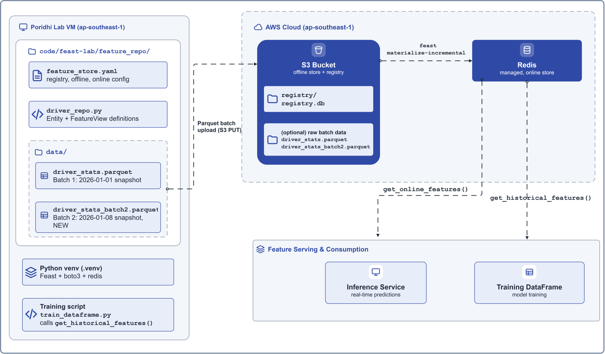
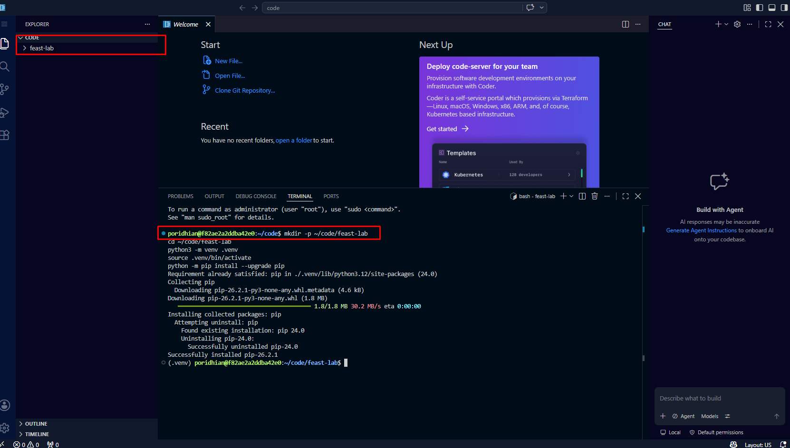
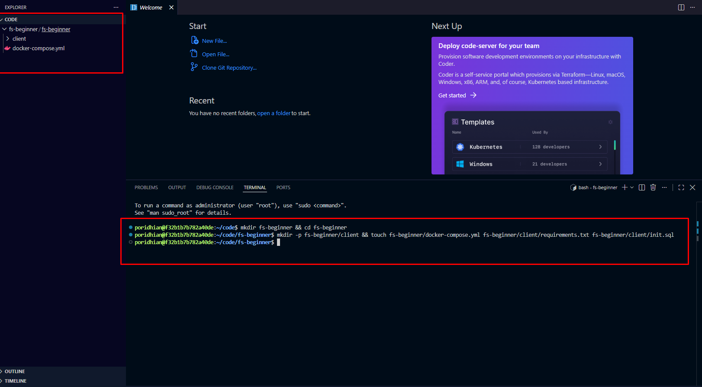
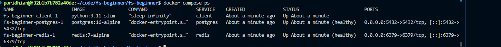
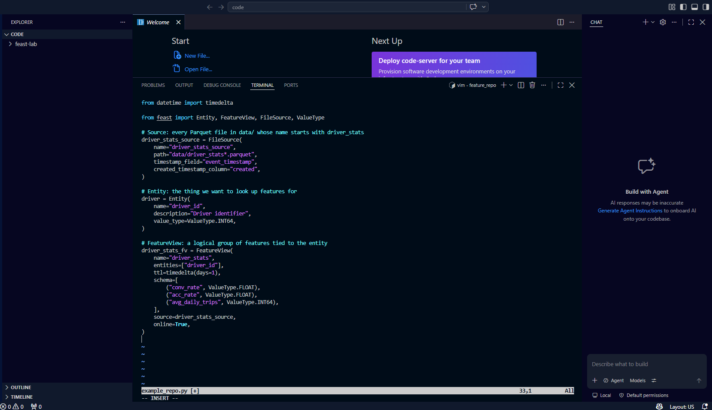
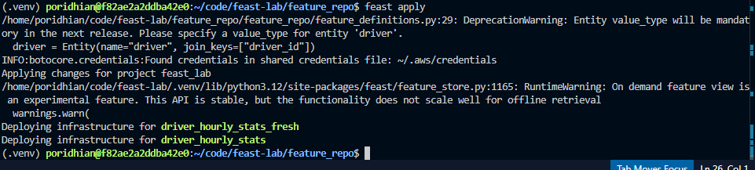

## Introduction

This lab, **Batch Feature Ingestion with Feast and Managed Redis**, walks through setting up a batch ingestion loop on the Poridhi lab VM so that the offline store and online store stay in sync without manual intervention.

Feast solves the training-serving skew by giving both training and inference a single shared feature definition backed by two stores: an **offline store** (S3) for historical reads and an **online store** (Redis) for low-latency inference. The next problem is keeping those two stores in sync. **Batch ingestion** is the workhorse of every production feature store: a scheduled job writes new feature values to the offline store and then calls `feast materialize-incremental` to push the latest values into the online store, after which training jobs use `get_historical_features()` to build point-in-time-correct DataFrames and inference services use `get_online_features()` for sub-10ms reads.

This lab is fully self-contained: every step is repeated from a clean state, so you can run it cold on a fresh Poridhi lab VM. You will set up Feast with S3 (offline) and the Poridhi managed Redis (online), generate multiple Parquet batches, run `feast materialize-incremental` to push the latest snapshot into Redis, then call `get_historical_features()` to build a point-in-time-correct training DataFrame.



## Learning Objectives

By the end of this lab, you will be able to:

- Install Feast in a Python virtual environment on the Poridhi lab VM and verify the CLI works.
- Generate AWS credentials from the Poridhi Cloud Playground and configure the AWS CLI for `ap-southeast-1`.
- Create an S3 bucket and use it as a Feast offline store and registry.
- Point Feast at the Poridhi managed Redis (endpoint and credentials from the Cloud Tray panel) and confirm the connection.
- Write a `feature_store.yaml` that wires Feast to S3 (offline) and managed Redis (online).
- Define a feature set in Python using `Entity`, `FeatureView`, and `FileSource` with a glob path that covers multiple batch files.
- Run `feast apply` to register the feature view and confirm the registry was updated on S3.
- Generate multiple Parquet batches and run `feast materialize-incremental` to push fresh values into the online store.
- Build a labeled `entity_df` in Pandas and call `get_historical_features()` to produce a point-in-time-correct training DataFrame.
- Verify the online store with `get_online_features()` and confirm a value changed after a new batch landed.

### Folder Structure

The lab creates the following folders and files on the Poridhi Lab VM. Every `mkdir -p`, `cd`, and file-creation step in the lab matches this tree exactly.

```text
~/poridhi-lab-7-3/
├── feature_repo/
│   ├── feature_store.yaml
│   ├── driver_repo.py
│   ├── train_dataframe.py
│   └── data/
│       ├── driver_stats.parquet
│       ├── driver_stats_batch2.parquet
│       ├── driver_stats_batch3.parquet
│       ├── driver_stats_batch4.parquet
│       └── entity_df.parquet
└── venv/
```

## Prerequisites

- **Region:** `ap-southeast-1` (Asia Pacific, Singapore). All AWS resources (S3 bucket, IAM, CLI default) are pinned to this region.
- **Environment:** Poridhi Cloud lab VM running Linux (Debian/Ubuntu shell), with VS Code pre-installed in the lab UI and an active Poridhi Cloud Playground session. The lab creates its files in `~/poridhi-lab-7-3/`: Step 2.1 shows the one-time VS Code Command Palette step (`Shell Command: Install 'code' command in PATH`) so the Explorer can open that folder. After that, every file in this lab is created by right-clicking the folder in the VS Code Explorer and choosing `New File…`; no shell-level text editors are used.
- **Storage:** Managed AWS S3 bucket in `ap-southeast-1`, created with `aws s3api create-bucket` in Step 5. Credentials are short-lived and come from the Poridhi Cloud Playground lab UI. The bucket is destroyed with the lab session and is not torn down explicitly.
- **Cloud Tray: Redis (managed, already running):** Open the Cloud Tray in the Poridhi lab UI, click **Database**, then click the **Redis** card. The panel shows the actual credentials for this lab session: **Username**, **Password**, **IP Address**, **Port**, and a copy-able **Connection String**. The values can change between lab runs, so always read them from the panel instead of hard-coding them.
- **AWS credentials:** Generate a credential from the Poridhi Cloud Playground lab UI (Generate credential button). Region is `ap-southeast-1` (Singapore). The SessionToken field may or may not appear: treat it as optional.
- **Tools already on the VM:** `python3` (3.9+), `pip`, `aws` CLI. The `redis` Python client is installed in Step 3 if missing. `redis-cli` is also NOT pre-installed; use the Python fallback in Step 6. The lab never invokes `vim`, `nano`, `cat`, `tee`, `xdg-open`, or any shell-level write to create files.
- **Note on prior labs:** This lab is part of the Feature Store series (7.1 through 7.8). It is fully self-contained, so you do NOT need to have completed Lab 7.2 first. Every step, from creating the venv to running `feast apply`, is repeated here. If you have already completed Lab 7.2, those steps simply recreate the same artifacts and run idempotent commands.

## Prologue

Imagine you work at a ride-hailing company. Your ML team has built a model that predicts whether a driver is likely to accept the next ride offer. The model uses features like average rating, completed trips last 7 days, and current online hours. Right now, the training pipeline computes these features by reading raw data from a data lake, and the inference service computes them again from a different data source. The numbers almost never match, and the model performs worse in production than it did in evaluation.

The fix is to make features a first-class artifact with one definition and two access paths. Feast is the tool that makes this possible. In this lab you will set up that foundation on the Poridhi lab VM: a central feature registry on S3, an offline store on S3 for training, and an online store on the Poridhi managed Redis for inference. You will then simulate multiple daily ETL landings, run `feast materialize-incremental` to push the freshest values into Redis, and finally use `get_historical_features()` to build a point-in-time-correct training DataFrame. By the end, the training pipeline and the inference service will read the exact same definitions, and the training-serving skew problem will be largely solved.

## Step-by-Step Implementation

### Step 1: Collect credentials from the Poridhi lab UI

> Note: this step collects two sets of credentials (AWS and managed Redis) once and stores them locally. Every later step references them as shell variables, so the values never need to be pasted again.

Before you start, collect two sets of credentials from the Poridhi lab UI. You will paste them once, and the rest of the lab will use the resulting env vars.

**A. AWS credential (for S3)**

1. In the Poridhi Cloud Playground, click **Generate credential**.
2. Copy the fields shown: `AccessKey`, `SecretKey`, and `SessionToken` if one is shown.

**B. Managed Redis credential (for the online store)**

1. Open the **Cloud Tray** in the Poridhi lab UI.
2. Click **Database** to open the Database Servers panel.
3. Click the **Redis** card. The panel shows the **Username**, **Password**, **IP Address**, **Port**, and **Connection String** for the current lab session.
4. Copy the **Username**, **Password**, **IP Address**, and **Port** values.

Keep the Cloud Tray panel open in another tab. The endpoint and password can rotate between lab sessions, so always re-read them from the panel if you start a new session.

Export the credentials as environment variables so every later step can use them:

```bash
# AWS (from Generate credential)
export AWS_ACCESS_KEY_ID="<paste-access-key-id>"
export AWS_SECRET_ACCESS_KEY="<paste-secret-access-key>"
export AWS_REGION="ap-southeast-1"
# Only export this if Poridhi issued a session token. Some sessions only issue AccessKey + SecretKey.
export AWS_SESSION_TOKEN="<paste-session-token-if-shown>"

# Managed Redis (from Cloud Tray Database -> Redis)
export REDIS_HOST="<paste-ip-from-cloud-tray>"
export REDIS_PORT="<paste-port-from-cloud-tray>"
export REDIS_USERNAME="<paste-username-from-cloud-tray>"
export REDIS_PASSWORD="<paste-password-from-cloud-tray>"
```

> **Note on the session token:** some Poridhi sessions issue only `AccessKey` and `SecretKey` without a `SessionToken`. In that case, skip the `AWS_SESSION_TOKEN` line above. The lab does not require a session token.

### Step 2: Create the project directory and Python virtual environment

> Note: this step creates the project directory `~/poridhi-lab-7-3` and the Python virtual environment that Step 3 onward uses.

Open a terminal on the lab VM and run:

```bash
mkdir -p ~/poridhi-lab-7-3
cd ~/poridhi-lab-7-3
python3 -m venv ~/poridhi-lab-7-3/venv
source ~/poridhi-lab-7-3/venv/bin/activate
python -m pip install --upgrade pip
```

You should now be inside an isolated Python environment. Anything you install will only affect this folder. If you already completed a prior lab in this series, this step simply re-activates the same virtual environment and is safe to re-run.



#### Step 2.1: Make VS Code see the project folder (one-time setup)

VS Code's Explorer only shows the folder that was opened with `File > Open Folder`, and the `code` shell command is not on `PATH` on the default Poridhi Lab VM. Do this once at the start of the lab so the Explorer follows every `mkdir` and every file you create for the rest of the lab:

1. **Open the VS Code Command Palette.** Press `Ctrl+Shift+P` inside any VS Code window, or open VS Code and use `View` then `Command Palette`.
2. **Install the `code` CLI.** Type `Shell Command: Install 'code' command in PATH` and press `Enter`. A small notification at the bottom right confirms `Shell command 'code' successfully installed in PATH`. This is a one-time operation; the lab VM keeps it across sessions.
3. **Open the project folder.** Close the existing VS Code window, or press `Ctrl+Shift+P` again and run `File: Open Folder`, picking `~/poridhi-lab-7-3`. You can also type `code ~/poridhi-lab-7-3` in the integrated terminal, but skip that until after the install finishes.

   ```bash
   code ~/poridhi-lab-7-3
   ```

4. **Verify the Explorer.** The Explorer label on the left changes from `CODE` (or `Welcome`) to `PORIDHI-LAB-7-3`, and you can see `feature_repo/` and `venv/` plus every file you create in later steps.

If you skip this sub-step, you can still complete the lab by creating every file manually through `File` then `New File...` in the Welcome tab. But the install is a one-time action that makes every later step easier.

After this one-time setup, every later step that creates a file just tells you to right-click a folder in the Explorer and choose `New File…`.

### Step 3: Install Feast with AWS and Redis support

> Note: this step installs Feast plus its AWS and Redis extras, then pins the transitive `numpy` floor that newer `pandas`/`pyarrow` wheels require.

Install Feast plus the AWS and Redis extras. This pulls in `boto3`, `redis`, and the S3 file source plugin. The lab also needs `pandas` and `pyarrow` for Parquet generation and `get_historical_features`:

```bash
pip install --upgrade pip
pip install "numpy>=2.0,<3" "pandas>=2" "pyarrow>=14" "feast[aws,redis]"
```

Verify the install:

```bash
feast version
feast --help
```


You should see a version string (for example `0.67.0`) and the list of Feast subcommands (`apply`, `materialize`, `entities`, etc.) without any import errors. Note that modern Feast has no `--version` flag: the version is printed by the `feast version` subcommand. To print the installed package version explicitly:

```bash
pip show feast | grep Version
```


> Would I get an error if I ran this? Possibly: `ERROR: Could not find a version that satisfies the requirement feast[aws,redis]` if the shell is not inside the virtual environment from Step 2. Run `source ~/poridhi-lab-7-3/venv/bin/activate` and try again. If `feast version` prints `No such command: version`, the installed Feast is older than 0.10; upgrade with `pip install --upgrade "feast[aws,redis]"`.

### Step 4: Configure AWS credentials and confirm access

> Note: this step sets the AWS default region to `ap-southeast-1` and verifies the credentials with `aws sts get-caller-identity`.

Set the default region and output format:

```bash
aws configure set region ap-southeast-1
aws configure set output json
```

If you would rather use the interactive prompt instead, you can run:

```bash
aws configure
```



and paste `AccessKey` for `AWS Access Key ID`, `SecretKey` for `AWS Secret Access Key`, `ap-southeast-1` for `Default region name`, and `json` for `Default output format`. Leave `Default profile` blank.

Verify that the credentials work:

```bash
aws sts get-caller-identity
```


Expected output: a JSON document with your account ID, an `arn` containing `assumed-role`, and `ap-southeast-1` somewhere in the metadata.

> Would I get an error if I ran this? Yes, if the credentials were not exported in Step 1: `Unable to locate credentials` means `AWS_ACCESS_KEY_ID` and `AWS_SECRET_ACCESS_KEY` are not set in this shell. Re-run the export block from Step 1. If the error is `ExpiredToken`, the Poridhi session credential has aged out: generate a fresh credential in the lab UI and re-export it.

### Step 5: Create the S3 bucket for the offline store

> Note: this step creates a globally unique S3 bucket in `ap-southeast-1` that Step 8 uses as both the Feast offline store and the registry location.

Pick a globally unique bucket name and create it in `ap-southeast-1`. A timestamp suffix guarantees uniqueness across lab runs:

```bash
export FEAST_S3_BUCKET="feast-offline-store-$(date +%s)"
echo "Bucket name: $FEAST_S3_BUCKET"
aws s3api create-bucket \
  --bucket "$FEAST_S3_BUCKET" \
  --region ap-southeast-1 \
  --create-bucket-configuration LocationConstraint=ap-southeast-1
```

If you already have a bucket from a previous lab session and the create-bucket call returns `BucketAlreadyExists` or `BucketAlreadyOwnedByYou`, just reuse the existing bucket by exporting its name into `FEAST_S3_BUCKET`:

```bash
export FEAST_S3_BUCKET="feast-offline-store-EXISTING-BUCKET-NAME"
```

Confirm the bucket exists:

```bash
aws s3 ls | grep "$FEAST_S3_BUCKET"
```


Persist the bucket name for later steps:

```bash
echo "export FEAST_S3_BUCKET=$FEAST_S3_BUCKET" >> ~/.bashrc
export FEAST_S3_BUCKET=$FEAST_S3_BUCKET
```

> **Write down your bucket name now.** Run `echo "$FEAST_S3_BUCKET"` in the same terminal and copy the output: it will look like `feast-offline-store-1792384265` (your value will differ). You will paste that exact value into `feature_store.yaml` in Step 8 (replacing the `your-unique-bucket-name` placeholder). The `$FEAST_S3_BUCKET` env var is also fine to keep using; just remember the value in case you start a new terminal session before Step 8 and the env var is no longer set. If you lose it, run `echo "$FEAST_S3_BUCKET"` again in the same terminal where you exported it. (The bucket itself persists in S3; only the local shell variable needs restoring.)

> Would I get an error if I ran this? Possibly: `BucketAlreadyExists` if the timestamped name was already taken, or `BucketAlreadyOwnedByYou` if you reuse a bucket from a previous session. Both are harmless: export the existing bucket name instead and continue. `InvalidLocationConstraint` means the region flag disagrees with the bucket's region; use `ap-southeast-1` for both. `AccessDenied` means the Poridhi credential has expired: regenerate it in the lab UI and re-export it.

### Step 6: Confirm the Poridhi managed Redis is reachable

> Note: this step reads the managed Redis credentials from the Cloud Tray, exports them as shell variables, and pings the service from Python so Step 8 can wire them into `feature_store.yaml`.

Re-open the Poridhi Cloud Tray in the lab UI, click **Database**, then click the **Redis** card. Re-read the **Username**, **Password**, **IP Address**, and **Port** from the panel and export them as shell variables (you already did this in Step 1, but re-run the exports if you started a new terminal session):

```bash
export REDIS_HOST="<paste-ip-from-cloud-tray>"
export REDIS_PORT="<paste-port-from-cloud-tray>"
export REDIS_USERNAME="<paste-username-from-cloud-tray>"
export REDIS_PASSWORD="<paste-password-from-cloud-tray>"
```

The Poridhi lab VM does not have `redis-cli` pre-installed by default, so use the Python client (which Feast already depends on) to ping the Redis:

```bash
python -c "import redis; r=redis.Redis(host='$REDIS_HOST', port=int('$REDIS_PORT'), password='$REDIS_PASSWORD', username='$REDIS_USERNAME'); print(r.ping())"
```

Expected output: `True`. If you see `ModuleNotFoundError: No module named 'redis'`, install it first:


```bash
pip install redis
```

If you would rather use `redis-cli`, install it and ping with the same variables:

```bash
sudo apt-get update && sudo apt-get install -y redis-tools
redis-cli -h "$REDIS_HOST" -p "$REDIS_PORT" --user "$REDIS_USERNAME" -a "$REDIS_PASSWORD" ping
```

Expected output: `PONG`. The lab works either way; pick one and continue.

> Would I get an error if I ran this? Possibly: `redis.exceptions.ConnectionError` if the IP or port was mistyped, and `AuthenticationError: WRONGPASS` if the username or password does not match the Cloud Tray panel. Both are fixed by re-reading the four values from the Cloud Tray Redis card and re-exporting them. `int() can't convert non-string with explicit base` means `REDIS_PORT` is empty, which happens when the export block was pasted with the placeholder text still in place.

### Step 7: Create the Feast project folder (no `feast init`)

> Note: this step creates `~/poridhi-lab-7-3/feature_repo` directly without using `feast init`, because the scaffolded `feature_definitions.py` collides with the feature definition we will write in Step 9.

Recent versions of `feast init` create a nested folder `feature_repo/feature_repo/` and ship a `feature_definitions.py` that defines its own `Project`, `Entity`, `FeatureView`, and `LabelView`. Because `feast apply` scans every `.py` file under the repo, that scaffolded file would collide with the definitions we write below and cause `PydanticValidationError: Entity 'driver' is already registered` or `extra fields not permitted` errors.

Skip the scaffold and create the project folder by hand. The whole `feature_repo/` only needs a `data/` subfolder and a `feature_store.yaml`:

```bash
mkdir -p ~/poridhi-lab-7-3/feature_repo/data
cd ~/poridhi-lab-7-3/feature_repo
```

You should now be in `~/poridhi-lab-7-3/feature_repo`, and the `data/` subfolder already exists. The next two steps write `feature_store.yaml` and `driver_repo.py` directly into this folder.



> Would I get an error if I ran this? No. The `mkdir -p` is safe to re-run, and `cd` into an existing folder is a no-op. The one thing to watch for is a typo in the path: if `pwd` prints something other than `/home/<your-user>/poridhi-lab-7-3/feature_repo`, the later steps will write their files in the wrong place.

### Step 8: Write `feature_store.yaml`

> Note: this step writes `feature_store.yaml` in `~/poridhi-lab-7-3/feature_repo` so Feast knows the S3 bucket and the managed Redis endpoints.

Your terminal is already inside `~/poridhi-lab-7-3/feature_repo` from Step 7. Right-click the `feature_repo` folder in the VS Code Explorer (rooted at `PORIDHI-LAB-7-3` from Step 2.1), choose `New File…`, name the file `feature_store.yaml`, paste the YAML below into it, and save. Replace `your-unique-bucket-name` with the bucket name from Step 5 (the one you wrote down with `echo "$FEAST_S3_BUCKET"`), and replace `your-redis-host`, `your-redis-port`, `your-redis-username`, and `your-redis-password` with the values from the Cloud Tray Redis panel in Step 6:

```yaml
project: feast_lab
registry: s3://your-unique-bucket-name/registry/registry.db
provider: aws
offline_store:
  type: file
online_store:
  type: redis
  connection_string: your-redis-host:your-redis-port,username=your-redis-username,password=your-redis-password
entity_key_serialization_version: 3
```

If you cannot remember the bucket name from Step 5, run `echo "$FEAST_S3_BUCKET"` in the terminal: that is the value to paste in for `your-unique-bucket-name`.

Open the file in the Explorer and double-check the substitutions. The `connection_string` line must read like `100.80.93.231:6379,username=redis,password=redis` with your own host, port, username, and password instead of placeholders.

Notes about this file:

- `project`: a human-readable name for the project. Used in paths and logs.
- `registry`: where Feast stores the metadata about your features. We are putting it on S3 so the registry survives across machines.
- `provider: aws`: tells Feast we want the AWS flavor of the offline store.
- `offline_store.type: file`: tells Feast to use the file-based (S3 + Parquet) offline store. No `region` key is required for the file offline store; the bucket region is discovered from S3.
- `online_store.type: redis`: tells Feast to use the Poridhi managed Redis for online lookups.
- `connection_string: host:port,username=...,password=...`: the Poridhi managed Redis endpoint and credentials from the Cloud Tray panel. The auth fields must be embedded in the connection string itself, not as separate `user:` / `password:` top-level keys (modern Feast rejects those with `Extra inputs are not permitted`).
- `entity_key_serialization_version: 3`: the modern serialization for Redis keys. Required by recent Feast versions.

> Would I get an error if I ran this? Possibly: `Extra inputs are not permitted` if you accidentally paste `user: your-redis-username` and `password: your-redis-password` as separate top-level keys. Modern Feast requires the credentials to be embedded in `connection_string` only.

### Step 9: Write `driver_repo.py`

> Note: this step writes `driver_repo.py` (the feature definition for `driver_id`) in `~/poridhi-lab-7-3/feature_repo` using the modern `Field`/`feast.types` API.

Your terminal is already inside `~/poridhi-lab-7-3/feature_repo`. Right-click the `feature_repo` folder in the VS Code Explorer, choose `New File…`, name the file `driver_repo.py`, paste the Python below into it, and save:

```python
"""Feature definitions for the driver_stats feature view."""
from datetime import timedelta

from feast import Entity, FeatureView, Field, FileSource
from feast.types import Float64, Int64

# Source: every Parquet file in data/ whose name starts with driver_stats
driver_stats_source = FileSource(
    name="driver_stats_source",
    path="data/driver_stats*.parquet",
    timestamp_field="event_timestamp",
    created_timestamp_column="created",
)

# Entity: the thing we want to look up features for
driver = Entity(
    name="driver_id",
    join_keys=["driver_id"],
    description="Driver identifier",
)

# FeatureView: a logical group of features tied to the entity
driver_stats_fv = FeatureView(
    name="driver_stats",
    entities=[driver],
    ttl=timedelta(days=3650),
    schema=[
        Field(name="conv_rate", dtype=Float64),
        Field(name="acc_rate", dtype=Float64),
        Field(name="avg_daily_trips", dtype=Int64),
    ],
    source=driver_stats_source,
    online=True,
)
```

Notes about the file:

- `path="data/driver_stats*.parquet"` is a glob, so every Parquet file in `data/` whose name starts with `driver_stats` becomes part of the source. New batches dropped into that folder will be picked up by the next `materialize-incremental` or `get_historical_features` call.
- `Field(name="conv_rate", dtype=Float64)` declares the schema with typed columns. Modern Feast rejects the old tuple form (`("conv_rate", ValueType.FLOAT)`) because `FLOAT` is not a valid `FeastType`.
- `entities=[driver]` passes the `Entity` object. The old string form (`entities=["driver_id"]`) is rejected with `Entity 'driver_id' not found` because Feast no longer resolves the name from the registry lookup; you must pass the object.
- The `Entity` no longer takes a `value_type`. Modern Feast derives the entity value type from the join key column in the source data, so passing `value_type=ValueType.INT64` raises a validation error about an unexpected keyword argument.
- `ttl=timedelta(days=3650)` makes the view remember the last ~10 years of values. The default `ttl=timedelta(days=1)` would silently exclude older batches from the online store and from point-in-time joins.



> Would I get an error if I ran this? Possibly: `TypeCheckError` if the schema uses the old tuple form, `Entity 'driver_id' not found` if `entities` holds a string instead of the `Entity` object, or a validation error if `value_type` is still set on the `Entity`. The file as written above uses the modern API, so `python -c "import driver_repo"` from inside `feature_repo` should import cleanly.

### Step 10: Generate four Parquet batches

> Note: this step writes four Parquet files representing four weekly ETL landings. The `driver_stats*.parquet` glob in Step 9 picks all of them up.

Your terminal is already inside `~/poridhi-lab-7-3/feature_repo`, and Step 7 already created the `data/` subfolder. Run this Python script to create four Parquet files representing four weekly ETL batches. Each file has a different `event_timestamp` and slightly different feature values per driver, which is what makes the point-in-time join meaningful. The two `astype("float64")` casts matter: the feature view in Step 9 declares `Float64` columns, and Parquet writes plain Python floats as `float32` by default, which makes Feast reject the batch with a type mismatch during materialize.

```bash
python - <<'PY'
import pandas as pd
from datetime import datetime, timezone

# Batch 1: 2026-01-01 snapshot
df1 = pd.DataFrame(
    {
        "driver_id": [1001, 1002, 1003, 1004, 1005],
        "conv_rate": [0.82, 0.55, 0.91, 0.40, 0.73],
        "acc_rate": [0.95, 0.88, 0.99, 0.71, 0.84],
        "avg_daily_trips": [28, 14, 35, 7, 22],
        "event_timestamp": [datetime(2026, 1, 1, tzinfo=timezone.utc)] * 5,
        "created": [datetime(2026, 1, 1, tzinfo=timezone.utc)] * 5,
    }
)
df1["conv_rate"] = df1["conv_rate"].astype("float64")
df1["acc_rate"] = df1["acc_rate"].astype("float64")
df1.to_parquet("data/driver_stats.parquet", index=False)
print("Wrote data/driver_stats.parquet with", len(df1), "rows")

# Batch 2: 2026-01-08 snapshot, a week later
df2 = pd.DataFrame(
    {
        "driver_id": [1001, 1002, 1003, 1004, 1005, 1006, 1007],
        "conv_rate": [0.85, 0.60, 0.93, 0.45, 0.78, 0.66, 0.81],
        "acc_rate": [0.97, 0.90, 0.99, 0.74, 0.86, 0.88, 0.92],
        "avg_daily_trips": [31, 17, 38, 9, 25, 19, 28],
        "event_timestamp": [datetime(2026, 1, 8, tzinfo=timezone.utc)] * 7,
        "created": [datetime(2026, 1, 8, tzinfo=timezone.utc)] * 7,
    }
)
df2["conv_rate"] = df2["conv_rate"].astype("float64")
df2["acc_rate"] = df2["acc_rate"].astype("float64")
df2.to_parquet("data/driver_stats_batch2.parquet", index=False)
print("Wrote data/driver_stats_batch2.parquet with", len(df2), "rows")

# Batch 3: 2026-01-15 snapshot, another week later
df3 = pd.DataFrame(
    {
        "driver_id": [1001, 1002, 1003, 1004, 1005, 1006, 1007, 1008],
        "conv_rate": [0.88, 0.62, 0.94, 0.48, 0.80, 0.70, 0.83, 0.55],
        "acc_rate": [0.98, 0.91, 0.99, 0.76, 0.88, 0.89, 0.93, 0.80],
        "avg_daily_trips": [33, 19, 40, 11, 27, 21, 30, 15],
        "event_timestamp": [datetime(2026, 1, 15, tzinfo=timezone.utc)] * 8,
        "created": [datetime(2026, 1, 15, tzinfo=timezone.utc)] * 8,
    }
)
df3["conv_rate"] = df3["conv_rate"].astype("float64")
df3["acc_rate"] = df3["acc_rate"].astype("float64")
df3.to_parquet("data/driver_stats_batch3.parquet", index=False)
print("Wrote data/driver_stats_batch3.parquet with", len(df3), "rows")

# Batch 4: 2026-01-22 snapshot, another week later
df4 = pd.DataFrame(
    {
        "driver_id": [1001, 1002, 1003, 1004, 1005, 1006, 1007, 1008, 1009],
        "conv_rate": [0.90, 0.65, 0.95, 0.50, 0.82, 0.72, 0.85, 0.58, 0.60],
        "acc_rate": [0.99, 0.92, 0.99, 0.78, 0.90, 0.90, 0.94, 0.82, 0.85],
        "avg_daily_trips": [35, 21, 42, 13, 29, 23, 32, 17, 18],
        "event_timestamp": [datetime(2026, 1, 22, tzinfo=timezone.utc)] * 9,
        "created": [datetime(2026, 1, 22, tzinfo=timezone.utc)] * 9,
    }
)
df4["conv_rate"] = df4["conv_rate"].astype("float64")
df4["acc_rate"] = df4["acc_rate"].astype("float64")
df4.to_parquet("data/driver_stats_batch4.parquet", index=False)
print("Wrote data/driver_stats_batch4.parquet with", len(df4), "rows")
PY
```


Verify the files are present and the glob will pick them up:

```bash
ls -la data/
```


Expected: `driver_stats.parquet`, `driver_stats_batch2.parquet`, `driver_stats_batch3.parquet`, and `driver_stats_batch4.parquet` all listed.


> Would I get an error if I ran this? Possibly: `FileNotFoundError: [Errno 2] No such file or directory: 'data/driver_stats.parquet'` means the terminal is not inside `~/poridhi-lab-7-3/feature_repo`; check with `pwd`. `ModuleNotFoundError: No module named 'pandas'` means the virtual environment is not active: run `source ~/poridhi-lab-7-3/venv/bin/activate`. A `float32` type mismatch later, during materialize, means the `astype("float64")` casts were dropped: the script above includes them.

### Step 11: Apply the feature definition

> Note: this step validates the feature definition and registers the `driver_stats` view in S3.

Now run `feast apply`. This validates the definitions, uploads the registry to S3, and registers the feature view:

```bash
feast apply
```



Expected output (truncated):

```text
Applying changes for project feast_lab
  Creating entity driver_id
  Creating feature view driver_stats
  Deploying infrastructure for driver_stats
```

If you see errors, jump to the Troubleshooting section.

> Would I get an error if I ran this? Possibly: `NoSuchBucket` if the `registry:` line in `feature_store.yaml` does not match the bucket from Step 5, `AccessDenied` if the Poridhi credential expired, or `Extra inputs are not permitted` if a `region:` key was added under `offline_store`. All three are covered in the Troubleshooting section.

### Step 12: Verify the registry on S3

> Note: this step confirms that Feast wrote the registry to the S3 bucket and that the feature view is registered locally.

Confirm that Feast wrote the registry file to your bucket:

```bash
aws s3 ls s3://$FEAST_S3_BUCKET/registry/
```

You should see `registry.db`. This is the single source of truth for your feature definitions.

Confirm the feature view is registered locally:

```bash
feast feature-views list
```

Expected output:

```text
NAME         ENTITIES    TYPE                    ENABLED    STATUS
driver_stats driver_id   ReadableFeatureView     True      ONLINE
```

The `ONLINE` status confirms the view is registered as an online feature view, which is what lets `materialize-incremental` write it into Redis and `get_online_features()` read it back.

> Would I get an error if I ran this? Possibly: `aws s3 ls` prints nothing if the `FEAST_S3_BUCKET` env var is empty in this shell, which happens when you open a new terminal; run `echo "$FEAST_S3_BUCKET"` to check and re-export it from Step 5 if needed. `feast feature-views list` prints an empty table if `feast apply` has not been run yet.

### Step 13: Run the first incremental materialize

> Note: this step pushes the latest snapshot (batch 4) from the offline store into the managed Redis.

The first run materializes everything from the beginning of time up to the timestamp you pass. Feast treats the end timestamp as **exclusive**, so use a timestamp one day after the fourth batch landed (the fourth batch is dated `2026-01-22T00:00:00`). Pushing the end to `2026-01-23T00:00:00` makes sure the `2026-01-22T00:00:00` rows are included:

```bash
feast materialize-incremental 2026-01-23T00:00:00
```

Expected output (truncated):

```text
Materializing 1 feature view to 1 online store

driver_stats:
  1001 2026-01-22 00:00:00+00:00
  1002 2026-01-22 00:00:00+00:00
  1003 2026-01-22 00:00:00+00:00
  1004 2026-01-22 00:00:00+00:00
  1005 2026-01-22 00:00:00+00:00
  1006 2026-01-22 00:00:00+00:00
  1007 2026-01-22 00:00:00+00:00
  1008 2026-01-22 00:00:00+00:00
  1009 2026-01-22 00:00:00+00:00
```


What just happened:
- Feast scanned `data/driver_stats*.parquet`.
- It picked the latest row per `driver_id` whose `event_timestamp` is strictly less than `2026-01-23T00:00:00`.
- It wrote those rows to Redis, one key per driver, using the format that `get_online_features()` expects.

> Would I get an error if I ran this? Possibly: `FileSource path 'data/driver_stats*.parquet' not found` if the Parquet files are not in `data/` inside `feature_repo`. A materialize that reports 0 rows with no error usually means the end timestamp was not past the last batch, or the registry is stale: re-run `feast apply` in Step 11 after any change to `driver_repo.py`. `redis.exceptions.ConnectionError` points at the `connection_string` in `feature_store.yaml`: re-check it against the Cloud Tray values.

### Step 14: Verify the online store with `get_online_features()`

> Note: this step verifies that Redis actually got populated and that the latest batch values are returned.

Run a small Python script to confirm Redis actually got populated:

```bash
python - <<'PY'
from feast import FeatureStore

fs = FeatureStore(repo_path=".")
features = fs.get_online_features(
    features=[
        "driver_stats:conv_rate",
        "driver_stats:acc_rate",
        "driver_stats:avg_daily_trips",
    ],
    entity_rows=[{"driver_id": 1001}, {"driver_id": 1003}, {"driver_id": 1009}],
).to_dict()

for k, v in features.items():
    print(f"{k}: {v}")
PY
```

Expected output:

```text
driver_id: [1001, 1003, 1009]
conv_rate: [0.90, 0.95, 0.60]
acc_rate: [0.99, 0.99, 0.85]
avg_daily_trips: [35, 42, 18]
```

Notice the `conv_rate` for `driver_id=1001` is `0.90` (the latest value from batch 4, dated `2026-01-22T00:00:00`), not `0.82` (the value from batch 1) and not `0.85` or `0.88` (the values from batches 2 and 3). The online store is now in sync with the latest offline data.

> Would I get an error if I ran this? Possibly: `AttributeError: 'NoneType' object has no attribute 'to_dict'` means the parentheses on `get_online_features(...)` were dropped. If every feature value comes back as `None`, the materialize in Step 13 wrote nothing: check that it reported the nine driver rows, and that `feature_store.yaml` still points at the current Redis credentials.

### Step 15: Re-run the materialize and observe the no-op behavior

> Note: this step demonstrates that re-running `materialize-incremental` is a no-op.

Re-run the same materialize command with the same end timestamp. Feast will see that there is nothing newer than the last successful run and report a no-op:

```bash
feast materialize-incremental 2026-01-23T00:00:00
```

Expected output: a message such as `No new data to materialize` or an empty materialization block. This is exactly the property you want for a daily cron job: the first run of the day picks up last night's batch, and subsequent runs are no-ops.

> **Key idea:** `materialize-incremental` is idempotent in the sense that it only writes rows that are newer than the last successful run. If you run it again with the same end timestamp, it will report that there is nothing new to materialize.

> Would I get an error if I ran this? No. A no-op is the expected result. If the second run materializes the same nine rows again instead of reporting a no-op, that means the end timestamp is later than the last run: pass the same `2026-01-23T00:00:00` you used in Step 13 so Feast sees an empty window.

### Step 16: Build a labeled `entity_df` for training

> Note: this step builds a labeled Pandas DataFrame of training observations and saves it as `entity_df.parquet`.

Training jobs do not call `get_online_features()`. Instead, they pass Feast a Pandas `entity_df` that contains the entity keys, the labels, and the time at which the labels were observed. Feast then performs a point-in-time join so each row gets the feature values that were valid at that moment in time.

Create the `entity_df` and save it as a Parquet file for inspection:

```bash
python - <<'PY'
import pandas as pd
from datetime import datetime, timezone

# Imagine these are ride offers observed in the wild, labeled as accepted (1) or not (0)
entity_df = pd.DataFrame(
    {
        "driver_id": [1001, 1002, 1003, 1004, 1005],
        "event_timestamp": [
            datetime(2026, 1, 1, 12, 0, tzinfo=timezone.utc),
            datetime(2026, 1, 1, 12, 0, tzinfo=timezone.utc),
            datetime(2026, 1, 8, 12, 0, tzinfo=timezone.utc),
            datetime(2026, 1, 8, 12, 0, tzinfo=timezone.utc),
            datetime(2026, 1, 8, 12, 0, tzinfo=timezone.utc),
        ],
        "label_accepted_ride": [1, 0, 1, 0, 1],
    }
)
entity_df.to_parquet("data/entity_df.parquet", index=False)
print(entity_df)
PY
```

Expected output:

```text
   driver_id                event_timestamp  label_accepted_ride
0       1001 2026-01-01 12:00:00+00:00                    1
1       1002 2026-01-01 12:00:00+00:00                    0
2       1003 2026-01-08 12:00:00+00:00                    1
3       1004 2026-01-08 12:00:00+00:00                    0
4       1005 2026-01-08 12:00:00+00:00                    1
```

Notice that rows 0 and 1 were observed on `2026-01-01` (so they should get the batch 1 feature values), and rows 2, 3, 4 were observed on `2026-01-08` (so they should get the batch 2 feature values). Feast will pick the right one for each row automatically.

> Would I get an error if I ran this? Possibly: `FileNotFoundError` if the terminal is not inside `~/poridhi-lab-7-3/feature_repo`, so the relative path `data/entity_df.parquet` does not resolve. The `event_timestamp` values must stay timezone-aware: dropping `tzinfo=timezone.utc` makes the point-in-time join in Step 17 unreliable.

### Step 17: Build a training DataFrame with `get_historical_features()`

> Note: this step asks Feast for a point-in-time-correct training DataFrame by joining `entity_df` against the offline store.

Your terminal is already inside `~/poridhi-lab-7-3/feature_repo`. Right-click the `feature_repo` folder in the VS Code Explorer, choose `New File…`, name the file `train_dataframe.py`, paste the Python below into it, and save:

```python
"""Build a point-in-time-correct training DataFrame using Feast."""
import pandas as pd
from feast import FeatureStore

# Load the entity DataFrame we just wrote
entity_df = pd.read_parquet("data/entity_df.parquet")

fs = FeatureStore(repo_path=".")

# Ask Feast for the historical feature values
training_df = fs.get_historical_features(
    entity_df=entity_df,
    features=[
        "driver_stats:conv_rate",
        "driver_stats:acc_rate",
        "driver_stats:avg_daily_trips",
    ],
).to_df()

print("\n=== Training DataFrame ===")
print(training_df.to_string(index=False))

# Quick correlation sanity check
print("\n=== Correlation with label ===")
print(training_df[["conv_rate", "acc_rate", "avg_daily_trips", "label_accepted_ride"]].corr(numeric_only=True)["label_accepted_ride"])
```

Run it:

```bash
python train_dataframe.py
```

Expected output (row order may differ):

```text
=== Training DataFrame ===
 driver_id  label_accepted_ride  conv_rate  acc_rate  avg_daily_trips
      1001                    1       0.82      0.95               28
      1002                    0       0.55      0.88               14
      1003                    1       0.93      0.99               38
      1004                    0       0.45      0.74                9
      1005                    1       0.78      0.86               25

=== Correlation with label ===
conv_rate             0.83
acc_rate              0.84
avg_daily_trips       0.83
label_accepted_ride   1.00
Name: label_accepted_ride, dtype: float64
```

What just happened:
- For row 0 (`driver_id=1001`, observed on `2026-01-01T12:00:00`), Feast picked `conv_rate=0.82` (from batch 1, dated `2026-01-01T00:00:00`).
- For row 2 (`driver_id=1003`, observed on `2026-01-08T12:00:00`), Feast picked `conv_rate=0.93` (from batch 2, dated `2026-01-08T00:00:00`). This is the point-in-time join doing its job: a row observed at noon on `2026-01-08` is allowed to see the batch 2 snapshot from midnight of the same day, but not the batch 3 snapshot from `2026-01-15`.
- The training DataFrame is ready to feed directly into a model (`fit(training_df.drop(columns=["label_accepted_ride"]), training_df["label_accepted_ride"])`).

> Would I get an error if I ran this? Possibly: `FileNotFoundError: [Errno 2] No such file or directory: 'data/entity_df.parquet'` means Step 16 did not run, or the terminal is not inside `feature_repo`. `AttributeError: 'NoneType' object has no attribute 'to_df'` means the parentheses on `get_historical_features(...)` were dropped. A `KeyError` on a feature name means the feature view name in the request does not match the registered name `driver_stats`.

#### Verify point-in-time correctness

The same driver gets two different feature values depending on when the label was observed. Run this snippet to confirm Feast never leaks future information into a training row:

```bash
python - <<'PY'
import pandas as pd
from datetime import datetime, timezone
from feast import FeatureStore

# Two observations: one before batch 2, one after
entity_df = pd.DataFrame(
    {
        "driver_id": [1001, 1001],
        "event_timestamp": [
            datetime(2026, 1, 1, 12, 0, tzinfo=timezone.utc),
            datetime(2026, 1, 10, 12, 0, tzinfo=timezone.utc),
        ],
    }
)

fs = FeatureStore(repo_path=".")
df = fs.get_historical_features(
    entity_df=entity_df,
    features=["driver_stats:conv_rate"],
).to_df()
print(df)
PY
```

**Expected output:**

```text
   driver_id                event_timestamp  conv_rate
0       1001 2026-01-01 12:00:00+00:00        0.82
1       1001 2026-01-10 12:00:00+00:00        0.85
```

The `2026-01-10T12:00:00` row is allowed to see the batch 2 snapshot (`2026-01-08T00:00:00`, value `0.85`) but NOT the batch 3 snapshot (`2026-01-15T00:00:00`, value `0.88`), because that batch is in the future. This is point-in-time correctness: training data never contains future information.

> Would I get an error if I ran this? Possibly: if both rows return the same value, the `event_timestamp` column is naive rather than timezone-aware, so Feast cannot do the point-in-time join reliably. Make sure the timestamps are built with `tzinfo=timezone.utc`. A `NaN` in the `conv_rate` column means no batch was valid at that observation time.

### Step 18: Compare `materialize-incremental` vs `materialize`

> Note: this step demonstrates the difference between a windowed backfill (`materialize`) and the catch-up incremental (`materialize-incremental`).

`materialize-incremental` is the right tool for a daily batch job. `materialize <start> <end>` is the right tool when you need to backfill a specific time window. Try the backfill form for the first batch only, just to see what it does:

```bash
feast materialize 2026-01-01T00:00:00 2026-01-08T00:00:00
```

Expected output: Feast will write batch 1 values into Redis for that window, overwriting the current state. After this, run the full incremental again to restore the latest snapshot:

```bash
feast materialize-incremental 2026-01-23T00:00:00
```

This pair of commands demonstrates the difference: `materialize` lets you backfill a closed window, `materialize-incremental` always brings the online store up to the latest known timestamp.

> Would I get an error if I ran this? Possibly: `ValueError: Incorrect number of arguments` if you pass only one timestamp; `materialize` needs both a start and an end. A materialize that writes 0 rows means the window does not overlap the batch timestamps: batch 1 is dated `2026-01-01T00:00:00`, so a window starting at `2026-01-01T00:00:00` includes it only because the start bound is inclusive. If the backfill overwrote newer values in Redis, the second command restores them, which is why it runs right after.

## Troubleshooting

**Error: `NoSuchBucket` when running `feast apply` or `materialize-incremental`.**
The bucket name in `feature_store.yaml` does not match an actual bucket. Re-check Step 5 and copy the exact name. You can also re-export the correct name into `FEAST_S3_BUCKET` and edit `feature_store.yaml` in the Explorer to update the `registry:` line.

**Error: `AccessDenied` on S3 writes.**
The Poridhi session credentials have expired or do not have permission to write to the bucket. Re-generate a credential from the lab UI and re-export `AWS_ACCESS_KEY_ID`, `AWS_SECRET_ACCESS_KEY`, plus `AWS_SESSION_TOKEN` if Poridhi issued one. Verify with `aws sts get-caller-identity`.

**Error: `redis.exceptions.ConnectionError` or `WRONGPASS`.**
The Poridhi managed Redis is unreachable or the credentials in `feature_store.yaml` are wrong. Re-open the Cloud Tray → Database → Redis panel, copy the **Username**, **Password**, **IP Address**, and **Port** again, and re-export the `REDIS_*` env vars. Then edit `feature_store.yaml` in the Explorer to update the `connection_string` line. Test with the Python ping snippet in Step 6.

**Error: `AuthenticationError: WRONGPASS` or `Redis auth failed` when Feast connects.**
The auth fields are missing from the `connection_string`. Modern Feast requires the username and password to be embedded in the connection string itself, not as separate `user:` / `password:` keys. Make sure the `online_store` block in `feature_store.yaml` looks like:

```yaml
online_store:
  type: redis
  connection_string: your-redis-host:your-redis-port,username=your-redis-username,password=your-redis-password
```

If you see `Extra inputs are not permitted` for `user` or `password`, you are on the old format: delete those top-level keys and put the credentials inside `connection_string` only.

**Error: `pydantic.ValidationError: Extra inputs are not permitted` for `region` under `offline_store`.**
Recent Feast versions removed the `region` key from the `file` offline store (the region is discovered from S3 itself). Delete the `region: ap-southeast-1` line from `feature_store.yaml` and re-run `feast apply`.

**Error: `TypeCheckError: Invalid type INT64 for feature conv_rate` (or `FLOAT64` mismatch).**
You are using the old tuple form for the `schema` argument: `("conv_rate", ValueType.FLOAT)`. Modern Feast rejects `ValueType.FLOAT` because it is not a `FeastType`. Use the typed `Field` API and import the column types from `feast.types`:

```python
from feast import Field
from feast.types import Float64, Int64

schema=[
    Field(name="conv_rate", dtype=Float64),
    Field(name="acc_rate", dtype=Float64),
    Field(name="avg_daily_trips", dtype=Int64),
],
```

**Error: `TypeError: unhashable type` or `Float32 vs Float64 mismatch` during materialize.**
The Parquet file was written with `float32` columns, but the schema declares `Float64`. Cast in the batch generation:

```python
df["conv_rate"] = df["conv_rate"].astype("float64")
df["acc_rate"] = df["acc_rate"].astype("float64")
```

before calling `to_parquet`.

**Error: `TypeError: ... got an unexpected keyword argument 'entities'` when defining the `FeatureView`.**
The keyword is `entities` and the value MUST be a list of `Entity` objects, not a list of strings. Pass the `driver` Entity object you created, not `"driver_id"`:

```python
driver_stats_fv = FeatureView(
    name="driver_stats",
    entities=[driver],   # not ["driver_id"]
    ...
)
```

**Error: `RuntimeError: Project name mismatch: ... vs feast_lab`.**
The folder you are in does not match the `project` field in `feature_store.yaml`. Either `cd ~/poridhi-lab-7-3/feature_repo` first, or align the `project:` line in `feature_store.yaml` with your current directory. The folder name and the `project` field do not have to match, but if Feast finds a different value in the registry on S3 than in your local `feature_store.yaml`, you must re-run `feast apply` to overwrite the registry.

**Error: `KeyError: 'entity_key_serialization_version'` or `KeyError: 'name'`.**
The `feature_store.yaml` still contains a placeholder (`your-unique-bucket-name`, `your-redis-host`, etc.) instead of the real bucket name from Step 5 and the Redis credentials from Step 6, or the bucket name is misspelled. Open the file in the Explorer, replace the placeholders with the values you wrote down, and re-run `feast apply`.

**Error: `int() can't convert non-string with explicit base` when running the Python ping.**
A shell variable is empty. Re-export `REDIS_PORT` and `REDIS_USERNAME` from the Cloud Tray panel and try again. If you see `port=int('$REDIS_PORT')` and the variable is empty, bash will pass the empty string to `int('')`, which raises that error.

**Error: `ModuleNotFoundError: No module named 'feast'`.**
You are not inside the virtual environment. Run `source ~/poridhi-lab-7-3/venv/bin/activate` and try again. If `which feast` still prints nothing, run `pip install "feast[aws,redis]"` from inside the venv.

**Error: `bash: feast: command not found`.**
Same as above: the venv is not active. Run `source ~/poridhi-lab-7-3/venv/bin/activate` and try again. If `which feast` still prints nothing, run `pip install "feast[aws,redis]" pandas pyarrow` from inside the venv.

**Error: `bash: redis-cli: command not found`.**
`redis-cli` is not pre-installed on the Poridhi lab VM. Either install it (`sudo apt-get update && sudo apt-get install -y redis-tools`) or skip it and use the Python ping snippet from Step 6.

**Error: `ModuleNotFoundError: No module named 'redis'`.**
You are using the Python fallback but the `redis` package is not installed. Run `pip install redis` from inside the virtual environment, then re-run the ping command.

**Error: `ModuleNotFoundError: No module named 'pandas'`.**
Pandas is required for the Parquet generation and `get_historical_features` snippets. Run `pip install pandas pyarrow` from inside the venv.

**Error: `FileSource path 'data/driver_stats*.parquet' not found` during materialize.**
The glob in `driver_repo.py` does not match any files. Make sure you ran the Parquet generation in Step 10 from inside `~/poridhi-lab-7-3/feature_repo`. Run `ls data/` to confirm the files exist.

**Error: `feast materialize-incremental` finishes with 0 rows written.**
The end timestamp is the same as the data, and Feast treats the end as **exclusive**. Pass a timestamp one day after the latest batch, e.g. `feast materialize-incremental 2026-01-23T00:00:00` for data dated `2026-01-22T00:00:00`.

**Error: `feast materialize-incremental` reports "no new data" even though a new Parquet file was added.**
Two likely causes: (1) the `FileSource` glob in `driver_repo.py` does not include the new file. Check the `path` argument. (2) The end timestamp you passed is older than the new file's `event_timestamp`. Pass a later end timestamp, for example `feast materialize-incremental 2026-01-25T00:00:00`.

**Error: `get_historical_features` returns the same value for every row, ignoring `event_timestamp`.**
The `event_timestamp` column in `entity_df` is naive (no timezone) or in the wrong dtype. Make sure the column is a tz-aware `datetime64[ns, UTC]` (Pandas) or a `datetime` with `tzinfo=timezone.utc` (Python). Feast uses the column to perform the point-in-time join; without a timezone-aware timestamp, the join is unreliable.

**Error: training script prints `AttributeError: 'NoneType' object has no attribute 'to_df'`.**
You forgot the parenthesis: it is `get_historical_features(...)` (a method call), not `get_historical_features` (a reference). Add the parentheses.

## Epilogue

You now have a complete batch ingestion loop running on the Poridhi lab VM. Four Parquet batches were generated to simulate daily ETL landings, and `feast materialize-incremental` pushed the freshest values into the Poridhi managed Redis. The same `get_online_features()` call returns the latest data, and `get_historical_features()` produces a point-in-time-correct training DataFrame for any labeled entity set. This is the production pattern: a scheduled job drops new data into the offline store, a materialize job syncs the online store, training and inference both read from Feast, and the two paths can never disagree.

In the next lab (7.4: Streaming Ingestion), you will switch from batch to streaming. Instead of a daily cron, you will use `feast.push()` to push features directly to the online store as events arrive, and verify they appear in Redis within milliseconds. The same feature view and the same `get_online_features()` call from this lab will keep working: the only thing that changes is how the online store gets populated.

The lab VM itself is destroyed between sessions, so the S3 bucket, the virtual environment, and the project files are not torn down explicitly: they go away with the VM. The managed Redis is left running and is reused by the next lab session that needs it.

## Principles

**One definition, two access paths.** The `FeatureView` in `driver_repo.py` is the single source of truth for what `conv_rate` means. Training reads it through the offline store and inference reads it through the online store, so the two can never drift apart. Duplicating the feature logic inside a training pipeline and a serving service is exactly what creates training-serving skew.

**Point-in-time correctness is not optional.** `get_historical_features()` joins your entity rows against the feature history using each row's own `event_timestamp`. A training row observed on `2026-01-08` sees the `2026-01-08` snapshot and nothing newer. Joining on the latest available value instead would leak future information into training and produce a model that looks great offline and fails in production.

**The end timestamp of a materialize is exclusive.** `feast materialize-incremental 2026-01-23T00:00:00` writes every row whose `event_timestamp` is strictly before that instant. A materialize that reports zero rows with no error is almost always this: either the end timestamp is not past the newest batch, or the registry is stale because `feast apply` was not re-run after the source data changed.

**Fail loudly on schema drift.** The `Field` / `feast.types` schema and the `astype("float64")` casts in Step 10 are not ceremony. Feast rejects a `float32` Parquet column against a `Float64` feature declaration, which is the behavior you want: a mismatch surfaces at materialize time instead of quietly producing subtly wrong training data.

**The offline store is append-only.** New batches land as new Parquet files under `data/` and the `data/driver_stats*.parquet` glob picks them up on the next run. Existing files are never rewritten, so every historical query remains answerable and the point-in-time join has a full history to choose from.

## What You Learned

- A Feast feature store has two stores: an offline store on S3 for historical and training-time reads, and an online store in managed Redis for low-latency inference-time reads.
- The registry, which holds the feature definitions themselves, can also live on S3 so it survives across machines and sessions.
- `feast apply` validates your definitions and registers them; `feast feature-views list` confirms the view is `ONLINE` and therefore materializable.
- `feast materialize-incremental <end>` pushes the newest feature values into the online store, and it is idempotent: re-running it with the same end timestamp is a no-op.
- `feast materialize <start> <end>` backfills a closed window instead of catching up, which is the tool for correcting a specific time range.
- `get_online_features()` reads the latest values for a set of entity keys; `get_historical_features()` performs the point-in-time join that produces a training DataFrame.
- A `FileSource` glob lets one feature view span many Parquet batches, so a daily ETL job only has to drop a new file into `data/`.
- Modern Feast requires `Field` / `feast.types` schema declarations, `Entity` objects (not strings) in `entities`, and Redis credentials embedded inside the `connection_string`.
- The entity value type is derived from the join key column in the source data, so the `Entity` no longer takes a `value_type` argument.
- `materialize-incremental` will silently write zero rows when the end timestamp is not past the newest batch, so read the reported row count every time.

## Next Steps

- **Lab 7.4: Streaming Ingestion.** Replace the daily materialize loop with `feast.push()`, which writes features straight into the online store as events arrive, and measure how quickly they land in Redis.
- **Lab 7.5: Real-Time Serving.** Call `get_online_features()` from a long-running client and measure end-to-end retrieval latency against the sub-10ms target.
- **Lab 7.6: Spark to Feast Batch.** Compute a daily feature aggregation in Spark and write it as a new Parquet batch that the same glob picks up on the next materialize.
- **Lab 7.7: Kafka to Feast Stream.** Consume Kafka events, compute real-time features, and push them through the streaming push API.
- **Lab 7.8: FastAPI to Feast to Redis.** Expose the online store through a `/predict` endpoint and return a recommendation in under 50ms.

Outside the series, the natural next steps are adding freshness monitoring to the materialize job, backfilling a wider window with `feast materialize` when a late batch lands, and wiring the registry into CI so that every schema change is applied before it reaches production.

## Additional Resources

- Feast documentation, offline and online stores: https://docs.feast.dev/reference/online-stores
- Feast documentation, materialization: https://docs.feast.dev/how-to-guides/feast-repository-design/materialization
- Feast documentation, point-in-time joins: https://docs.feast.dev/getting-started/concepts/point-in-time-joins
- Feast documentation, `get_historical_features` API: https://docs.feast.dev/reference/feature-view/feature-view
- Feast documentation, Redis online store configuration: https://docs.feast.dev/reference/online-stores/redis
- Feast documentation, `FileSource` and Parquet sources: https://docs.feast.dev/reference/data-sources/file
- AWS S3 user guide, bucket creation and region: https://docs.aws.amazon.com/AmazonS3/latest/userguide/Welcome.html
- Redis documentation, connection handling and authentication: https://redis.io/docs/latest/develop/clients/
- Pandas documentation, `to_parquet` and dtype handling: https://pandas.pydata.org/docs/reference/api/pandas.DataFrame.to_parquet.html


## Conclusion

This lab stood up a complete Feast feature store on the Poridhi lab VM and ran a full batch ingestion loop: Feast installed in a virtual environment, an S3 bucket in `ap-southeast-1` as the offline store and registry, the Poridhi managed Redis from the Cloud Tray as the online store, four Parquet batches representing daily ETL landings, and `feast materialize-incremental` pushing the freshest values into Redis. `get_historical_features()` then assembled a point-in-time-correct training DataFrame for a labeled `entity_df`, and `get_online_features()` confirmed that the online store was in sync. The key takeaway is the one-definition-two-paths pattern: S3 handles historical, training-time reads, the managed Redis handles low-latency, inference-time reads, and `materialize-incremental` plus a single `FeatureView` definition keep the two stores in lock-step. With this foundation, any scheduled job that drops new Parquet data and then runs the materialize command will keep both training and inference aligned automatically.