## Introduction

This lab, **Batch Feature Ingestion with Feast and Managed Redis**, walks through setting up a batch ingestion loop on the Poridhi lab VM so that the offline store and online store stay in sync without manual intervention.

Feast solves the training-serving skew by giving both training and inference a single shared feature definition backed by two stores: an **offline store** (S3) for historical reads and an **online store** (Redis) for low-latency inference. The next problem is keeping those two stores in sync. **Batch ingestion** is the workhorse of every production feature store: a scheduled job writes new feature values to the offline store and then calls `feast materialize-incremental` to push the latest values into the online store, after which training jobs use `get_historical_features()` to build point-in-time-correct DataFrames and inference services use `get_online_features()` for sub-10ms reads.

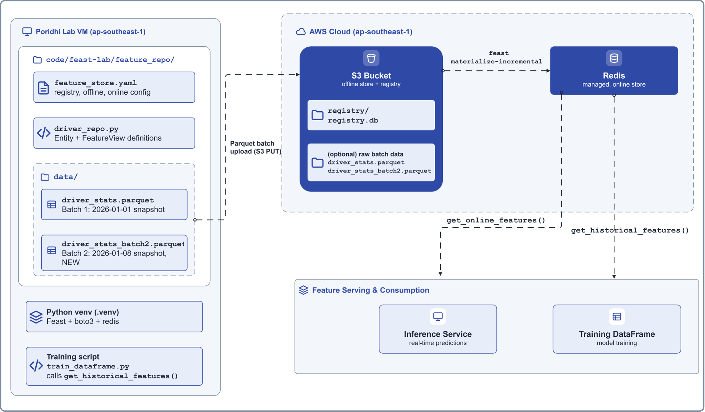

This lab is fully self-contained: every step is repeated from a clean state, so you can run it cold on a fresh Poridhi lab VM. You will set up Feast with S3 (offline) and the Poridhi managed Redis (online), generate multiple Parquet batches, run `feast materialize-incremental` to push the latest snapshot into Redis, then call `get_historical_features()` to build a point-in-time-correct training DataFrame.


## Learning Objectives

By the end of this lab, you will be able to:

- Install Feast in a Python virtual environment on the Poridhi lab VM and verify the CLI works.
- Generate AWS credentials from the Poridhi Cloud Playground and configure the AWS CLI for `ap-southeast-1`.
- Create an S3 bucket and use it as a Feast offline store and registry.
- Point Feast at the Poridhi managed Redis (endpoint and credentials from the Cloud Tray panel) and confirm the connection.
- Write a `feature_store.yaml` that wires Feast to S3 (offline) and managed Redis (online).
- Define a feature set in Python using `Entity`, `FeatureView`, and `FileSource` pointing at a combined Parquet file that covers all four batch files.
- Run `feast apply` to register the feature view and confirm the registry was updated on S3.
- Generate multiple Parquet batches and run `feast materialize-incremental` to push fresh values into the online store.
- Build a labeled `entity_df` in Pandas and call `get_historical_features()` to produce a point-in-time-correct training DataFrame.
- Verify the online store with `get_online_features()` and confirm a value changed after a new batch landed.
- Explain why the Redis online store refuses to let an older backfill overwrite newer values, and how that makes `materialize-incremental` safe to run twice.

### Folder Structure

The lab creates the following folders and files on the Poridhi Lab VM. Every `mkdir -p`, `cd`, and file-creation step in the lab matches this tree exactly.

```text
~/poridhi-lab-7-3/
├── feature_repo/
│   ├── feature_store.yaml
│   ├── driver_repo.py
│   ├── generate_batches.py
│   ├── read_online.py
│   ├── build_entity_df.py
│   ├── train_dataframe.py
│   ├── check_point_in_time.py
│   └── data/
│       ├── driver_stats.parquet
│       ├── driver_stats_batch2.parquet
│       ├── driver_stats_batch3.parquet
│       ├── driver_stats_batch4.parquet
│       ├── driver_stats_all.parquet
│       └── entity_df.parquet
└── venv/
```

## Prerequisites

- **Region:** `ap-southeast-1` (Asia Pacific, Singapore). All AWS resources (S3 bucket, IAM, CLI default) are pinned to this region.
- **Environment:** Poridhi Cloud lab VM running Linux (Debian/Ubuntu shell), with VS Code pre-installed in the lab UI and an active Poridhi Cloud Playground session. The lab creates its files in `~/poridhi-lab-7-3/`: Step 2.1 shows the one-time VS Code Command Palette step (`Shell Command: Install 'code' command in PATH`) so the Explorer can open that folder. After that, every file in this lab is created by right-clicking the folder in the VS Code Explorer and choosing `New File…`; no shell-level text editors are used.
- **Storage:** Managed AWS S3 bucket in `ap-southeast-1`, created with `aws s3api create-bucket` in Step 5. Credentials are short-lived and come from the Poridhi Cloud Playground lab UI. The bucket is destroyed with the lab session and is not torn down explicitly.
- **Cloud Tray: Redis (managed, already running):** Open the Cloud Tray in the Poridhi lab UI, click **Database**, then click the **Redis** card. The panel shows the actual credentials for this lab session: **Username**, **Password**, **IP Address**, **Port**, and a copy-able **Connection String**. The values can change between lab runs, so always read them from the panel instead of hard-coding them.
- **AWS credentials:** Generate a credential from the Poridhi Cloud Playground lab UI (Generate credential button). Region is `ap-southeast-1` (Singapore). The SessionToken field may or may not appear: treat it as optional.
- **Tools already on the VM:** `python3` (3.9+), `pip`, `aws` CLI. The `redis` Python client is installed in Step 3 if missing. `redis-cli` is also NOT pre-installed; use the Python fallback in Step 6. The lab never invokes `vim`, `nano`, `cat`, `tee`, `xdg-open`, or any shell-level write to create files.
- **Note on prior labs:** This lab is part of the Feature Store series (7.1 through 7.8). It is fully self-contained, so you do NOT need to have completed Lab 7.2 first. Every step, from creating the venv to running `feast apply`, is repeated here. If you have already completed Lab 7.2, those steps simply recreate the same artifacts and run idempotent commands.

## Prologue

Imagine you work at a ride-hailing company. Your ML team has built a model that predicts whether a driver is likely to accept the next ride offer. The model uses features like average rating, completed trips last 7 days, and current online hours. Right now, the training pipeline computes these features by reading raw data from a data lake, and the inference service computes them again from a different data source. The numbers almost never match, and the model performs worse in production than it did in evaluation.

The fix is to make features a first-class artifact with one definition and two access paths. Feast is the tool that makes this possible. In this lab you will set up that foundation on the Poridhi lab VM: a central feature registry on S3, an offline store on S3 for training, and an online store on the Poridhi managed Redis for inference. You will then simulate multiple daily ETL landings, run `feast materialize-incremental` to push the freshest values into Redis, and finally use `get_historical_features()` to build a point-in-time-correct training DataFrame. By the end, the training pipeline and the inference service will read the exact same definitions, and the training-serving skew problem will be largely solved.

## Step-by-Step Implementation

### Step 1: Collect credentials from the Poridhi lab UI

> Note: this step collects two sets of credentials (AWS and managed Redis) once and stores them locally. Every later step references them as shell variables, so the values never need to be pasted again.

Before you start, collect two sets of credentials from the Poridhi lab UI. You will paste them once, and the rest of the lab will use the resulting env vars.

**A. AWS credential (for S3)**

1. In the Poridhi Cloud Playground, click **Generate credential**.
2. Copy the fields shown: `AccessKey`, `SecretKey`, and `SessionToken` if one is shown.

**B. Managed Redis credential (for the online store)**

1. Open the **Cloud Tray** in the Poridhi lab UI.
2. Click **Database** to open the Database Servers panel.
3. Click the **Redis** card. The panel shows the **Username**, **Password**, **IP Address**, **Port**, and **Connection String** for the current lab session.
4. Copy the **Username**, **Password**, **IP Address**, and **Port** values.

Keep the Cloud Tray panel open in another tab. The endpoint and password can rotate between lab sessions, so always re-read them from the panel if you start a new session.

Export the credentials as environment variables so every later step can use them:

```bash
# AWS (from Generate credential)
export AWS_ACCESS_KEY_ID="<paste-access-key-id>"
export AWS_SECRET_ACCESS_KEY="<paste-secret-access-key>"
export AWS_REGION="ap-southeast-1"
# Only export this if Poridhi issued a session token. Some sessions only issue AccessKey + SecretKey.
export AWS_SESSION_TOKEN="<paste-session-token-if-shown>"

# Managed Redis (from Cloud Tray Database -> Redis)
export REDIS_HOST="<paste-ip-from-cloud-tray>"
export REDIS_PORT="<paste-port-from-cloud-tray>"
export REDIS_USERNAME="<paste-username-from-cloud-tray>"
export REDIS_PASSWORD="<paste-password-from-cloud-tray>"
```

> **Note on the session token:** some Poridhi sessions issue only `AccessKey` and `SecretKey` without a `SessionToken`. In that case, skip the `AWS_SESSION_TOKEN` line above. The lab does not require a session token.

### Step 2: Create the project directory and Python virtual environment

> Note: this step creates the project directory `~/poridhi-lab-7-3` and the Python virtual environment that Step 3 onward uses.

Open a terminal on the lab VM and run:

```bash
mkdir -p ~/poridhi-lab-7-3
cd ~/poridhi-lab-7-3
python3 -m venv ~/poridhi-lab-7-3/venv
source ~/poridhi-lab-7-3/venv/bin/activate
python -m pip install --upgrade pip
```

You should now be inside an isolated Python environment. Anything you install will only affect this folder. If you already completed a prior lab in this series, this step simply re-activates the same virtual environment and is safe to re-run.


#### Step 2.1: Make VS Code see the project folder (one-time setup)

VS Code's Explorer only shows the folder that was opened with `File > Open Folder`, and the `code` shell command is not on `PATH` on the default Poridhi Lab VM. Do this once at the start of the lab so the Explorer follows every `mkdir` and every file you create for the rest of the lab:

1. **Open the VS Code Command Palette.** Press `Ctrl+Shift+P` inside any VS Code window, or open VS Code and use `View` then `Command Palette`.
2. **Install the `code` CLI.** Type `Shell Command: Install 'code' command in PATH` and press `Enter`. A small notification at the bottom right confirms `Shell command 'code' successfully installed in PATH`. This is a one-time operation; the lab VM keeps it across sessions.
3. **Open the project folder.** Close the existing VS Code window, or press `Ctrl+Shift+P` again and run `File: Open Folder`, picking `~/poridhi-lab-7-3`. You can also type `code ~/poridhi-lab-7-3` in the integrated terminal, but skip that until after the install finishes.

   ```bash
   code ~/poridhi-lab-7-3
   ```

4. **Verify the Explorer.** The Explorer label on the left changes from `CODE` (or `Welcome`) to `PORIDHI-LAB-7-3`, and you can see `feature_repo/` and `venv/` plus every file you create in later steps.

If you skip this sub-step, you can still complete the lab by creating every file manually through `File` then `New File...` in the Welcome tab. But the install is a one-time action that makes every later step easier.

After this one-time setup, every later step that creates a file names the target folder and tells you to create the file in the VS Code Explorer.

### Step 3: Install Feast with AWS and Redis support

> Note: this step installs Feast plus its AWS and Redis extras, then pins the transitive `numpy` floor that newer `pandas`/`pyarrow` wheels require.

Install Feast plus the AWS and Redis extras. This pulls in `boto3`, `redis`, and the S3 file source plugin. The lab also needs `pandas` and `pyarrow` for Parquet generation and `get_historical_features`:

```bash
pip install --upgrade pip
pip install "numpy>=2.0,<3" "pandas>=2" "pyarrow>=14" "feast[aws,redis]"
```

Verify the install:

```bash
feast version
feast --help
```

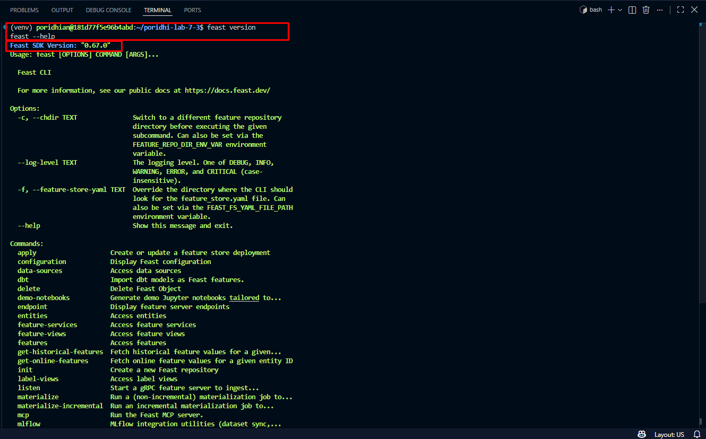

The first line is the SDK version, `Feast SDK Version: "0.67.0"`, followed by the usage line and the full list of Feast subcommands: `apply`, `materialize`, `materialize-incremental`, `entities`, `feature-views`, `get-online-features`, and more. Note that modern Feast has no `--version` flag: the version is printed by the `feast version` subcommand. To print the installed package version explicitly:

```bash
pip show feast | grep Version
```

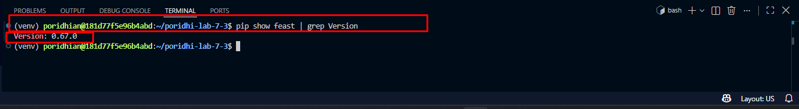

The `pip show` form prints the version on its own line, which is easier to copy into a bug report than the decorated `feast version` banner.

> Would I get an error if I ran this? Possibly: `ERROR: Could not find a version that satisfies the requirement feast[aws,redis]` if the shell is not inside the virtual environment from Step 2. Run `source ~/poridhi-lab-7-3/venv/bin/activate` and try again. If `feast version` prints `No such command: version`, the installed Feast is older than 0.10; upgrade with `pip install --upgrade "feast[aws,redis]"`.

### Step 4: Configure AWS credentials and confirm access

> Note: this step sets the AWS default region to `ap-southeast-1` and verifies the credentials with `aws sts get-caller-identity`.

Set the default region and output format:

```bash
aws configure set region ap-southeast-1
aws configure set output json
```

If you would rather use the interactive prompt instead, you can run:

```bash
aws configure
```

and paste `AccessKey` for `AWS Access Key ID`, `SecretKey` for `AWS Secret Access Key`, `ap-southeast-1` for `Default region name`, and `json` for `Default output format`. Leave `Default profile` blank.

Verify that the credentials work:

```bash
aws sts get-caller-identity
```

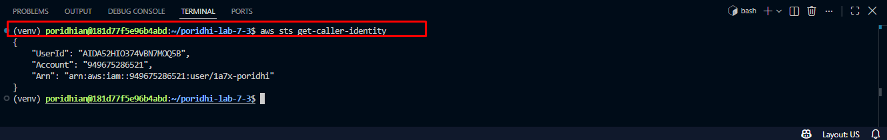

The JSON document shows your `UserId`, your `Account` ID, and an `Arn` identifying the IAM identity the Poridhi credential maps to. The region is not part of this response, because `get-caller-identity` reports the caller rather than the region it is operating in. The region you configured in the previous block is the one every later AWS command uses.

> Would I get an error if I ran this? Yes, if the credentials were not exported in Step 1: `Unable to locate credentials` means `AWS_ACCESS_KEY_ID` and `AWS_SECRET_ACCESS_KEY` are not set in this shell. Re-run the export block from Step 1. If the error is `ExpiredToken`, the Poridhi session credential has aged out: generate a fresh credential in the lab UI and re-export it.

### Step 5: Create the S3 bucket for the offline store

> Note: this step creates a globally unique S3 bucket in `ap-southeast-1` that Step 8 uses as both the Feast offline store and the registry location.

Pick a globally unique bucket name and create it in `ap-southeast-1`. A timestamp suffix guarantees uniqueness across lab runs:

```bash
export FEAST_S3_BUCKET="feast-offline-store-$(date +%s)"
echo "Bucket name: $FEAST_S3_BUCKET"
aws s3api create-bucket \
  --bucket "$FEAST_S3_BUCKET" \
  --region ap-southeast-1 \
  --create-bucket-configuration LocationConstraint=ap-southeast-1
```

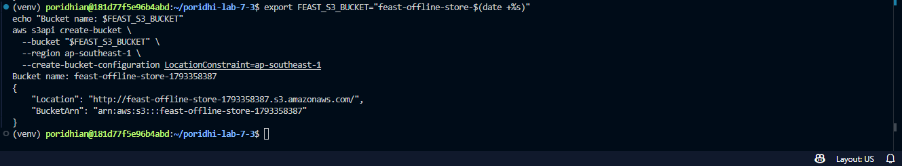

The response echoes back the bucket `Location` and the `BucketArn`, which confirms the bucket landed in `ap-southeast-1` and that your credential has permission to create it.

If you already have a bucket from a previous lab session and the create-bucket call returns `BucketAlreadyExists` or `BucketAlreadyOwnedByYou`, just reuse the existing bucket by exporting its name into `FEAST_S3_BUCKET`:

```bash
export FEAST_S3_BUCKET="feast-offline-store-EXISTING-BUCKET-NAME"
```

Confirm the bucket exists:

```bash
aws s3 ls | grep "$FEAST_S3_BUCKET"
```

Persist the bucket name for later steps:

```bash
echo "export FEAST_S3_BUCKET=$FEAST_S3_BUCKET" >> ~/.bashrc
export FEAST_S3_BUCKET=$FEAST_S3_BUCKET
```

> **Write down your bucket name now.** Run `echo "$FEAST_S3_BUCKET"` in the same terminal and copy the output: it will look like `feast-offline-store-1792384265` (your value will differ). You will paste that exact value into `feature_store.yaml` in Step 8 (replacing the `your-unique-bucket-name` placeholder). The `$FEAST_S3_BUCKET` env var is also fine to keep using; just remember the value in case you start a new terminal session before Step 8 and the env var is no longer set. If you lose it, run `echo "$FEAST_S3_BUCKET"` again in the same terminal where you exported it. (The bucket itself persists in S3; only the local shell variable needs restoring.)

> Would I get an error if I ran this? Possibly: `BucketAlreadyExists` if the timestamped name was already taken, or `BucketAlreadyOwnedByYou` if you reuse a bucket from a previous session. Both are harmless: export the existing bucket name instead and continue. `InvalidLocationConstraint` means the region flag disagrees with the bucket's region; use `ap-southeast-1` for both. `AccessDenied` means the Poridhi credential has expired: regenerate it in the lab UI and re-export it.

### Step 6: Confirm the Poridhi managed Redis is reachable

> Note: this step reads the managed Redis credentials from the Cloud Tray, exports them as shell variables, and pings the service from Python so Step 8 can wire them into `feature_store.yaml`.

Re-open the Poridhi Cloud Tray in the lab UI, click **Database**, then click the **Redis** card. Re-read the **Username**, **Password**, **IP Address**, and **Port** from the panel and export them as shell variables (you already did this in Step 1, but re-run the exports if you started a new terminal session):

```bash
export REDIS_HOST="<paste-ip-from-cloud-tray>"
export REDIS_PORT="<paste-port-from-cloud-tray>"
export REDIS_USERNAME="<paste-username-from-cloud-tray>"
export REDIS_PASSWORD="<paste-password-from-cloud-tray>"
```

The Poridhi lab VM does not have `redis-cli` pre-installed by default, so use the Python client (which Feast already depends on) to ping the Redis:

```bash
python -c "import redis; r=redis.Redis(host='$REDIS_HOST', port=int('$REDIS_PORT'), password='$REDIS_PASSWORD', username='$REDIS_USERNAME'); print(r.ping())"
```

Expected output: `True`. If you see `ModuleNotFoundError: No module named 'redis'`, install it first:

```bash
pip install redis
```

If you would rather use `redis-cli`, install it and ping with the same variables:

```bash
sudo apt-get update && sudo apt-get install -y redis-tools
redis-cli -h "$REDIS_HOST" -p "$REDIS_PORT" --user "$REDIS_USERNAME" -a "$REDIS_PASSWORD" ping
```

Expected output: `PONG`. The lab works either way; pick one and continue.

> Would I get an error if I ran this? Possibly: `redis.exceptions.ConnectionError` if the IP or port was mistyped, and `AuthenticationError: WRONGPASS` if the username or password does not match the Cloud Tray panel. Both are fixed by re-reading the four values from the Cloud Tray Redis card and re-exporting them. `int() can't convert non-string with explicit base` means `REDIS_PORT` is empty, which happens when the export block was pasted with the placeholder text still in place.

### Step 7: Create the Feast project folder (no `feast init`)

> Note: this step creates `~/poridhi-lab-7-3/feature_repo` directly without using `feast init`, because the scaffolded `feature_definitions.py` collides with the feature definition we will write in Step 9.

Recent versions of `feast init` create a nested folder `feature_repo/feature_repo/` and ship a `feature_definitions.py` that defines its own `Project`, `Entity`, `FeatureView`, and `LabelView`. Because `feast apply` scans every `.py` file under the repo, that scaffolded file would collide with the definitions we write below and cause `PydanticValidationError: Entity 'driver' is already registered` or `extra fields not permitted` errors.

Skip the scaffold and create the project folder by hand. The whole `feature_repo/` only needs a `data/` subfolder and a `feature_store.yaml`:

```bash
mkdir -p ~/poridhi-lab-7-3/feature_repo/data
cd ~/poridhi-lab-7-3/feature_repo
```

You should now be in `~/poridhi-lab-7-3/feature_repo`, and the `data/` subfolder already exists. The next two steps write `feature_store.yaml` and `driver_repo.py` directly into this folder.


> Would I get an error if I ran this? No. The `mkdir -p` is safe to re-run, and `cd` into an existing folder is a no-op. The one thing to watch for is a typo in the path: if `pwd` prints something other than `/home/<your-user>/poridhi-lab-7-3/feature_repo`, the later steps will write their files in the wrong place.

### Step 8: Write `feature_store.yaml`

> Note: this step writes `feature_store.yaml` in `~/poridhi-lab-7-3/feature_repo` so Feast knows the S3 bucket and the managed Redis endpoints.

Create a new file called `feature_store.yaml` in `~/poridhi-lab-7-3/feature_repo` and paste the YAML below into it.

```yaml
project: feast_lab
registry: s3://your-unique-bucket-name/registry/registry.db
provider: aws
offline_store:
  type: file
online_store:
  type: redis
  connection_string: your-redis-host:your-redis-port,username=your-redis-username,password=your-redis-password
entity_key_serialization_version: 3
```

If you cannot remember the bucket name from Step 5, run `echo "$FEAST_S3_BUCKET"` in the terminal: that is the value to paste in for `your-unique-bucket-name`.

Open the file in the Explorer and double-check the substitutions. The `connection_string` line must read like `100.80.93.231:6379,username=redis,password=redis` with your own host, port, username, and password instead of placeholders.

Notes about this file:

- `project`: a human-readable name for the project. Used in paths and logs.
- `registry`: where Feast stores the metadata about your features. We are putting it on S3 so the registry survives across machines.
- `provider: aws`: tells Feast we want the AWS flavor of the offline store.
- `offline_store.type: file`: tells Feast to use the file-based (S3 + Parquet) offline store. No `region` key is required for the file offline store; the bucket region is discovered from S3.
- `online_store.type: redis`: tells Feast to use the Poridhi managed Redis for online lookups.
- `connection_string: host:port,username=...,password=...`: the Poridhi managed Redis endpoint and credentials from the Cloud Tray panel. The auth fields must be embedded in the connection string itself, not as separate `user:` / `password:` top-level keys (modern Feast rejects those with `Extra inputs are not permitted`).
- `entity_key_serialization_version: 3`: the modern serialization for Redis keys. Required by recent Feast versions.

> Would I get an error if I ran this? Possibly: `Extra inputs are not permitted` if you accidentally paste `user: your-redis-username` and `password: your-redis-password` as separate top-level keys. Modern Feast requires the credentials to be embedded in `connection_string` only.

### Step 9: Write `driver_repo.py`

> Note: this step writes `driver_repo.py` (the feature definition for `driver_id`) in `~/poridhi-lab-7-3/feature_repo` using the modern `Field`/`feast.types` API.

Create a new file called `driver_repo.py` in `~/poridhi-lab-7-3/feature_repo` and paste the Python below into it.

```python
"""Feature definitions for the driver_stats feature view."""
from datetime import timedelta

from feast import Entity, FeatureView, Field, FileSource
from feast.types import Float64, Int64

# Source: the combined Parquet file that holds all four weekly batches
driver_stats_source = FileSource(
    name="driver_stats_source",
    path="data/driver_stats_all.parquet",
    timestamp_field="event_timestamp",
    created_timestamp_column="created",
)

# Entity: the thing we want to look up features for
driver = Entity(
    name="driver_id",
    join_keys=["driver_id"],
    description="Driver identifier",
)

# FeatureView: a logical group of features tied to the entity
driver_stats_fv = FeatureView(
    name="driver_stats",
    entities=[driver],
    ttl=timedelta(days=3650),
    schema=[
        Field(name="conv_rate", dtype=Float64),
        Field(name="acc_rate", dtype=Float64),
        Field(name="avg_daily_trips", dtype=Int64),
    ],
    source=driver_stats_source,
    online=True,
)
```

Notes about the file:

- `path="data/driver_stats_all.parquet"` points at the single combined Parquet file that Step 10 writes. Modern Feast type-checks `path` as a `str`, so a list of files raises `TypeCheckError: argument "path" (list) is not an instance of str`, and a glob such as `data/driver_stats*.parquet` is not expanded by Feast: the `*` reaches pyarrow literally and fails with `FileNotFoundError`. Step 10 therefore writes the four weekly batches as four separate files for readability and then concatenates them into `driver_stats_all.parquet`, which is what this source reads.
- `Field(name="conv_rate", dtype=Float64)` declares the schema with typed columns. Modern Feast rejects the old tuple form (`("conv_rate", ValueType.FLOAT)`) because `FLOAT` is not a valid `FeastType`.
- `entities=[driver]` passes the `Entity` object. The old string form (`entities=["driver_id"]`) is rejected with `Entity 'driver_id' not found` because Feast no longer resolves the name from the registry lookup; you must pass the object.
- The `Entity` no longer takes a `value_type`. Modern Feast derives the entity value type from the join key column in the source data, so passing `value_type=ValueType.INT64` raises a validation error about an unexpected keyword argument.
- `ttl=timedelta(days=3650)` makes the view remember the last ~10 years of values. The default `ttl=timedelta(days=1)` would silently exclude older batches from the online store and from point-in-time joins.


> Would I get an error if I ran this? Possibly: `TypeCheckError` if the schema uses the old tuple form, `Entity 'driver_id' not found` if `entities` holds a string instead of the `Entity` object, or a validation error if `value_type` is still set on the `Entity`. There is also `typeguard.TypeCheckError: argument "path" (list) is not an instance of str` if you pass a list of files to `FileSource`: modern Feast accepts only a single string path, which is why Step 9 points at the combined `data/driver_stats_all.parquet` file. The file as written above uses the modern API, so `python -c "import driver_repo"` from inside `feature_repo` should import cleanly.

### Step 10: Generate four Parquet batches

> Note: this step writes four Parquet files representing four weekly ETL landings, then concatenates them into the single `driver_stats_all.parquet` file that the `FileSource` in Step 9 reads.

Create a new file called `generate_batches.py` in `~/poridhi-lab-7-3/feature_repo` and paste the Python below into it.

The script creates four Parquet files representing four weekly ETL batches, then combines them into `data/driver_stats_all.parquet`. Each batch has a different `event_timestamp` and slightly different feature values per driver, which is what makes the point-in-time join meaningful. The `astype("float64")` casts matter: the feature view in Step 9 declares `Float64` columns, and Parquet writes plain Python floats as `float32` by default, which makes Feast reject the batch with a type mismatch during materialize.

The combined file matters because modern Feast type-checks `FileSource.path` as a `str`. A list of paths is rejected outright, and a glob is not expanded by Feast, so the four batches have to be concatenated into one file before `feast apply` can read them.

```python
import pandas as pd
from datetime import datetime, timezone


def generate_batches():
    # Batch 1: 2026-01-01 snapshot
    df1 = pd.DataFrame(
        {
            "driver_id": [1001, 1002, 1003, 1004, 1005],
            "conv_rate": [0.82, 0.55, 0.91, 0.40, 0.73],
            "acc_rate": [0.95, 0.88, 0.99, 0.71, 0.84],
            "avg_daily_trips": [28, 14, 35, 7, 22],
            "event_timestamp": [datetime(2026, 1, 1, tzinfo=timezone.utc)] * 5,
            "created": [datetime(2026, 1, 1, tzinfo=timezone.utc)] * 5,
        }
    )
    df1["conv_rate"] = df1["conv_rate"].astype("float64")
    df1["acc_rate"] = df1["acc_rate"].astype("float64")
    df1.to_parquet("data/driver_stats.parquet", index=False)
    print("Wrote data/driver_stats.parquet with", len(df1), "rows")

    # Batch 2: 2026-01-08 snapshot, a week later
    df2 = pd.DataFrame(
        {
            "driver_id": [1001, 1002, 1003, 1004, 1005, 1006, 1007],
            "conv_rate": [0.85, 0.60, 0.93, 0.45, 0.78, 0.66, 0.81],
            "acc_rate": [0.97, 0.90, 0.99, 0.74, 0.86, 0.88, 0.92],
            "avg_daily_trips": [31, 17, 38, 9, 25, 19, 28],
            "event_timestamp": [datetime(2026, 1, 8, tzinfo=timezone.utc)] * 7,
            "created": [datetime(2026, 1, 8, tzinfo=timezone.utc)] * 7,
        }
    )
    df2["conv_rate"] = df2["conv_rate"].astype("float64")
    df2["acc_rate"] = df2["acc_rate"].astype("float64")
    df2.to_parquet("data/driver_stats_batch2.parquet", index=False)
    print("Wrote data/driver_stats_batch2.parquet with", len(df2), "rows")

    # Batch 3: 2026-01-15 snapshot, another week later
    df3 = pd.DataFrame(
        {
            "driver_id": [1001, 1002, 1003, 1004, 1005, 1006, 1007, 1008],
            "conv_rate": [0.88, 0.62, 0.94, 0.48, 0.80, 0.70, 0.83, 0.55],
            "acc_rate": [0.98, 0.91, 0.99, 0.76, 0.88, 0.89, 0.93, 0.80],
            "avg_daily_trips": [33, 19, 40, 11, 27, 21, 30, 15],
            "event_timestamp": [datetime(2026, 1, 15, tzinfo=timezone.utc)] * 8,
            "created": [datetime(2026, 1, 15, tzinfo=timezone.utc)] * 8,
        }
    )
    df3["conv_rate"] = df3["conv_rate"].astype("float64")
    df3["acc_rate"] = df3["acc_rate"].astype("float64")
    df3.to_parquet("data/driver_stats_batch3.parquet", index=False)
    print("Wrote data/driver_stats_batch3.parquet with", len(df3), "rows")

    # Batch 4: 2026-01-22 snapshot, another week later
    df4 = pd.DataFrame(
        {
            "driver_id": [1001, 1002, 1003, 1004, 1005, 1006, 1007, 1008, 1009],
            "conv_rate": [0.90, 0.65, 0.95, 0.50, 0.82, 0.72, 0.85, 0.58, 0.60],
            "acc_rate": [0.99, 0.92, 0.99, 0.78, 0.90, 0.90, 0.94, 0.82, 0.85],
            "avg_daily_trips": [35, 21, 42, 13, 29, 23, 32, 17, 18],
            "event_timestamp": [datetime(2026, 1, 22, tzinfo=timezone.utc)] * 9,
            "created": [datetime(2026, 1, 22, tzinfo=timezone.utc)] * 9,
        }
    )
    df4["conv_rate"] = df4["conv_rate"].astype("float64")
    df4["acc_rate"] = df4["acc_rate"].astype("float64")
    df4.to_parquet("data/driver_stats_batch4.parquet", index=False)
    print("Wrote data/driver_stats_batch4.parquet with", len(df4), "rows")

    # Combine the four batches into the single file the FileSource reads.
    # Feast type-checks path as a str and does not expand globs, so the four
    # weekly snapshots must live in one Parquet file for feast apply to work.
    all_batches = pd.concat([df1, df2, df3, df4], ignore_index=True)
    all_batches.to_parquet("data/driver_stats_all.parquet", index=False)
    print("Wrote data/driver_stats_all.parquet with", len(all_batches), "rows")


# feast apply imports every .py file in this folder, so guard the script body.
if __name__ == "__main__":
    generate_batches()
```

Run it from the terminal, which is already inside `feature_repo`:

```bash
python generate_batches.py
```

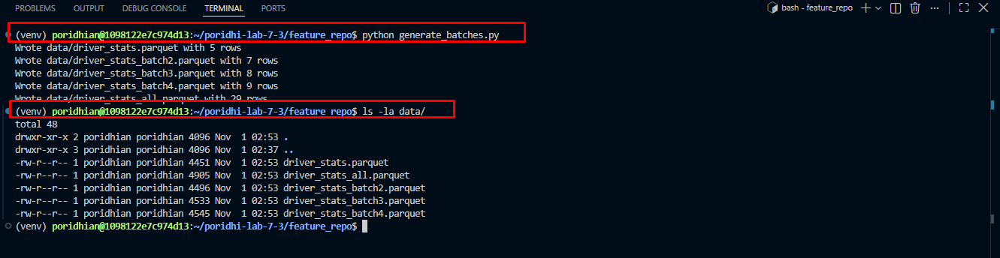

Each batch reports its own row count: 5 rows for the first snapshot, then 7, 8, and 9 as more drivers appear in the later weeks. The final line reports 29 rows for the combined file.

Verify the files are present and the combined file was written:

```bash
ls -la data/
```


Expected: `driver_stats.parquet`, `driver_stats_batch2.parquet`, `driver_stats_batch3.parquet`, `driver_stats_batch4.parquet`, and `driver_stats_all.parquet` all listed.

> Would I get an error if I ran this? Possibly: `FileNotFoundError: [Errno 2] No such file or directory: 'data/driver_stats.parquet'` means the terminal is not inside `~/poridhi-lab-7-3/feature_repo`; check with `pwd`. `ModuleNotFoundError: No module named 'pandas'` means the virtual environment is not active: run `source ~/poridhi-lab-7-3/venv/bin/activate`. A `float32` type mismatch later, during materialize, means the `astype("float64")` casts were dropped: the script above includes them. If `driver_stats_all.parquet` is missing from the listing, the concatenation block at the end of the script did not run: paste it again and re-run.

### Step 11: Apply the feature definition

> Note: this step validates the feature definition and registers the `driver_stats` view in S3.

Now run `feast apply`. This validates the definitions, uploads the registry to S3, and registers the feature view:

```bash
feast apply
```

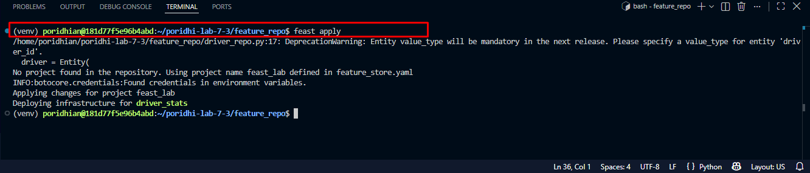

The apply validates the definitions, uploads the registry to S3, and registers the feature view. On a registry that already knows these objects, Feast skips the `Creating entity driver_id` and `Creating feature view driver_stats` lines and prints only `Deploying infrastructure for driver_stats`. Either form is a successful apply. The `DeprecationWarning` about `Entity value_type` is printed on current Feast releases and is harmless.

> Would I get an error if I ran this? Possibly: `NoSuchBucket` if the `registry:` line in `feature_store.yaml` does not match the bucket from Step 5, `AccessDenied` if the Poridhi credential expired, or `Extra inputs are not permitted` if a `region:` key was added under `offline_store`. The most common failure is `FileNotFoundError: .../data/driver_stats_all.parquet`: `feast apply` reads the source data to infer the feature schema, so Step 10 has to have run first. Confirm the file exists with `ls data/` and re-run the Step 10 script if it does not. A `DeprecationWarning` about `Entity value_type` is harmless on current Feast releases and does not stop the apply.

### Step 12: Verify the registry on S3

> Note: this step confirms that Feast wrote the registry to the S3 bucket and that the feature view is registered locally.

Confirm that Feast wrote the registry file to your bucket:

```bash
aws s3 ls s3://$FEAST_S3_BUCKET/registry/
```

Expected output:

```text
2026-11-01 02:59:00       1129 registry.db
```

You should see `registry.db`, a small file that holds the feature definitions in Feast's internal format. This is the single source of truth for your feature definitions, and keeping it on S3 is what lets a second machine (or a CI job) pick up the same registry.

Confirm the feature view is registered locally:

```bash
feast feature-views list
```
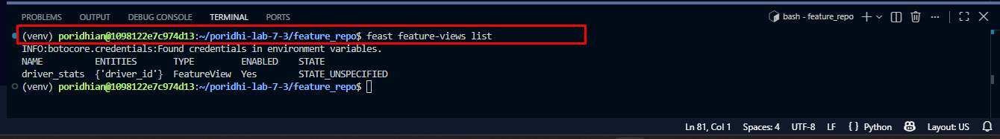

The `ENABLED` column reading `Yes` confirms the view is registered as an online feature view, which is what lets `materialize-incremental` write it into Redis and `get_online_features()` read it back. The `STATE` column reports the materialization state, not the registration state, so it reads `STATE_UNSPECIFIED` until the first materialize in Step 13 populates it.

> Would I get an error if I ran this? Possibly: `aws s3 ls` prints nothing if the `FEAST_S3_BUCKET` env var is empty in this shell, which happens when you open a new terminal. Run `echo "$FEAST_S3_BUCKET"` to check, and re-export the bucket name from Step 5 if it prints nothing. `feast feature-views list` prints an empty table if `feast apply` has not been run yet.

#### Step 12.1: Reset the registry if you are re-running this lab

> Note: this step clears the materialization history from the S3 registry so the first materialize in Step 13 writes rows instead of reporting an empty window.

The registry lives on S3, and S3 outlives the Poridhi lab VM. If you ran this lab before against the same bucket, the registry already records a materialization up to `2026-01-23T00:00:00`. On the next run, `feast materialize-incremental 2026-01-23T00:00:00` sees that nothing is newer, collapses the window to zero width, and writes zero rows. Step 13's banner is how you detect this: a correct run starts from an old timestamp, a zero-width run shows `from 2026-01-23 ... to 2026-01-23 ...`.

The bucket name in Step 5 has a timestamp suffix, so a brand new run normally gets a brand new bucket and a clean registry. You only need this step when you deliberately reuse an existing bucket.

If you are reusing a bucket, delete the old registry file and re-apply before continuing:

```bash
aws s3 rm "s3://$FEAST_S3_BUCKET/registry/registry.db"
feast apply
```

The `feast apply` re-creates the registry from your local `driver_repo.py`, with no materialization history. If `aws s3 rm` reports `NoSuchKey`, the registry was already clean and the apply alone is enough.

> Would I get an error if I ran this? Possibly: `An error occurred (NoSuchBucket)` if `FEAST_S3_BUCKET` points at a bucket that does not exist, which means Step 5 created a different one. Run `echo "$FEAST_S3_BUCKET"` and `aws s3 ls | grep "$FEAST_S3_BUCKET"` to find the real name. Deleting the registry does not delete your Parquet data: `data/driver_stats_all.parquet` lives on the VM, not in S3.

### Step 13: Run the first incremental materialize

> Note: this step pushes the latest snapshot (batch 4) from the offline store into the managed Redis.

The first run materializes everything from the beginning of time up to the timestamp you pass. Feast treats the end timestamp as **exclusive**, so use a timestamp one day after the fourth batch landed (the fourth batch is dated `2026-01-22T00:00:00`). Pushing the end to `2026-01-23T00:00:00` makes sure the `2026-01-22T00:00:00` rows are included:

```bash
feast materialize-incremental 2026-01-23T00:00:00
```

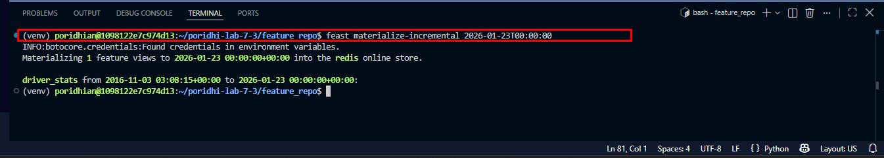

Feast 0.67 prints one banner line per feature view and does not list the individual driver rows, so the block above is the complete output. The banner is your confirmation that the job ran and targeted the Redis online store. To confirm that rows actually landed, check the key count in Redis:

```bash
python -c "import redis; r=redis.Redis(host='$REDIS_HOST', port=int('$REDIS_PORT'), username='$REDIS_USERNAME', password='$REDIS_PASSWORD'); print('keys in Redis:', r.dbsize())"
```

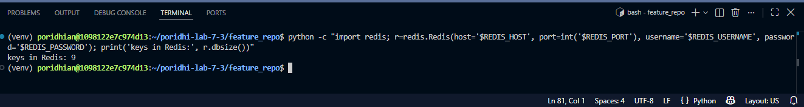

What just happened:
- Feast scanned `data/driver_stats_all.parquet`.
- It picked the latest row per `driver_id` whose `event_timestamp` is strictly less than `2026-01-23T00:00:00`, which is the `2026-01-22T00:00:00` batch.
- It wrote those nine rows to Redis, one key per driver, using the format that `get_online_features()` expects.

> **Important: the start timestamp of the banner tells you whether this step really ran.** The banner reads `driver_stats from <some old timestamp> to 2026-01-23 00:00:00+00:00` on a first run, because Feast starts from the beginning of the feature view's TTL. If the banner instead reads `driver_stats from 2026-01-23 00:00:00+00:00 to 2026-01-23 00:00:00+00:00`, the window is zero-width and **no rows were written**. That happens when the registry on S3 already records a materialization up to `2026-01-23T00:00:00`, which is exactly what happens on a second run of this lab against the same bucket. Step 12.1 below shows how to reset the registry when you see that.

> Would I get an error if I ran this? Possibly: `FileSource path 'data/driver_stats_all.parquet' not found` if the combined Parquet file is not in `data/` inside `feature_repo`. `redis.exceptions.ConnectionError` points at the `connection_string` in `feature_store.yaml`: re-check it against the Cloud Tray values. A zero-width banner is not an error but it does mean zero rows were written: follow Step 12.1.

### Step 14: Verify the online store with `get_online_features()`

> Note: this step verifies that Redis actually got populated and that the latest batch values are returned.

Create a new file called `read_online.py` in `~/poridhi-lab-7-3/feature_repo` and paste the Python below into it.

```python
from feast import FeatureStore


def read_online():
    fs = FeatureStore(repo_path=".")
    features = fs.get_online_features(
        features=[
            "driver_stats:conv_rate",
            "driver_stats:acc_rate",
            "driver_stats:avg_daily_trips",
        ],
        entity_rows=[{"driver_id": 1001}, {"driver_id": 1003}, {"driver_id": 1009}],
    ).to_dict()

    # Print in a fixed order. Feast returns the response as a dict built from
    # concurrent lookups, so its key order changes from run to run.
    for key in ["driver_id", "conv_rate", "acc_rate", "avg_daily_trips"]:
        print(f"{key}: {features[key]}")


# feast apply imports every .py file in this folder, so guard the script body.
if __name__ == "__main__":
    read_online()
```

Run it from the terminal, which is already inside `feature_repo`:

```bash
python read_online.py
```

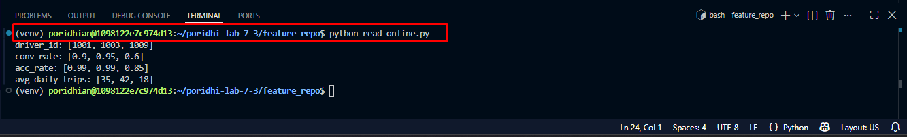

Notice the `conv_rate` for `driver_id=1001` is `0.9` (the latest value from batch 4, dated `2026-01-22T00:00:00`), not `0.82` (the value from batch 1) and not `0.85` or `0.88` (the values from batches 2 and 3). The online store is now in sync with the latest offline data.

> Would I get an error if I ran this? Possibly: `AttributeError: 'NoneType' object has no attribute 'to_dict'` means the parentheses on `get_online_features(...)` were dropped. If every feature value comes back as `None`, the materialize in Step 13 wrote nothing: check that the Redis key count is 9, and that `feature_store.yaml` still points at the current Redis credentials.

### Step 15: Re-run the materialize and observe the no-op behavior

> Note: this step demonstrates that re-running `materialize-incremental` with the same end timestamp is a no-op.

Re-run the same materialize command with the same end timestamp. Feast will see that there is nothing newer than the last successful run and resolve the window to zero width:

```bash
feast materialize-incremental 2026-01-23T00:00:00
```


The start and end of the window are identical, so there was nothing to write. This is exactly the property you want for a daily cron job: the first run of the day picks up last night's batch, and subsequent runs are no-ops.

Confirm the online store was left untouched by checking the key count again:

```bash
python -c "import redis; r=redis.Redis(host='$REDIS_HOST', port=int('$REDIS_PORT'), username='$REDIS_USERNAME', password='$REDIS_PASSWORD'); print('keys in Redis:', r.dbsize())"
```

Expected output: `keys in Redis: 9`. The count is unchanged, which confirms the second run was a genuine no-op rather than a second write of the same rows.

> **Key idea:** `materialize-incremental` is idempotent in the sense that it only writes rows that are newer than the last successful run. If you run it again with the same end timestamp, the window collapses to zero width and nothing is written.

> Would I get an error if I ran this? No. A no-op is the expected result. If the banner instead shows a start timestamp older than `2026-01-23`, then the second run picked up rows again, which means the end timestamp was later than the last run: pass the same `2026-01-23T00:00:00` you used in Step 13 so Feast sees an empty window.

### Step 16: Build a labeled `entity_df` for training

> Note: this step builds a labeled Pandas DataFrame of training observations and saves it as `entity_df.parquet`.

Training jobs do not call `get_online_features()`. Instead, they pass Feast a Pandas `entity_df` that contains the entity keys, the labels, and the time at which the labels were observed. Feast then performs a point-in-time join so each row gets the feature values that were valid at that moment in time.

Create a new file called `build_entity_df.py` in `~/poridhi-lab-7-3/feature_repo` and paste the Python below into it.

```python
import pandas as pd
from datetime import datetime, timezone


def build_entity_df():
    # Imagine these are ride offers observed in the wild, labeled as accepted (1) or not (0)
    entity_df = pd.DataFrame(
        {
            "driver_id": [1001, 1002, 1003, 1004, 1005],
            "event_timestamp": [
                datetime(2026, 1, 1, 12, 0, tzinfo=timezone.utc),
                datetime(2026, 1, 1, 12, 0, tzinfo=timezone.utc),
                datetime(2026, 1, 8, 12, 0, tzinfo=timezone.utc),
                datetime(2026, 1, 8, 12, 0, tzinfo=timezone.utc),
                datetime(2026, 1, 8, 12, 0, tzinfo=timezone.utc),
            ],
            "label_accepted_ride": [1, 0, 1, 0, 1],
        }
    )
    entity_df.to_parquet("data/entity_df.parquet", index=False)
    print(entity_df)


# feast apply imports every .py file in this folder, so guard the script body.
if __name__ == "__main__":
    build_entity_df()
```

Run it from the terminal, which is already inside `feature_repo`:

```bash
python build_entity_df.py
```

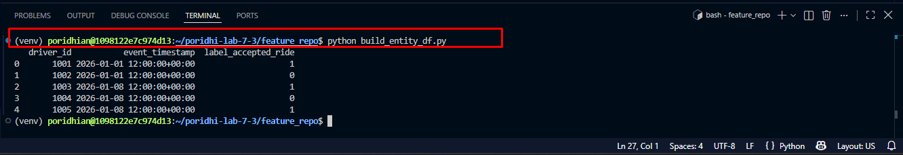

Notice that rows 0 and 1 were observed on `2026-01-01` (so they should get the batch 1 feature values), and rows 2, 3, 4 were observed on `2026-01-08` (so they should get the batch 2 feature values). Feast will pick the right one for each row automatically.

> Would I get an error if I ran this? Possibly: `FileNotFoundError` if the terminal is not inside `~/poridhi-lab-7-3/feature_repo`, so the relative path `data/entity_df.parquet` does not resolve. The `event_timestamp` values must stay timezone-aware: dropping `tzinfo=timezone.utc` makes the point-in-time join in Step 17 unreliable.

### Step 17: Build a training DataFrame with `get_historical_features()`

> Note: this step asks Feast for a point-in-time-correct training DataFrame by joining `entity_df` against the offline store.

Create a new file called `train_dataframe.py` in `~/poridhi-lab-7-3/feature_repo` and paste the Python below into it.

```python
"""Build a point-in-time-correct training DataFrame using Feast."""
import pandas as pd
from feast import FeatureStore


def build_training_dataframe():
    # Load the entity DataFrame we just wrote
    entity_df = pd.read_parquet("data/entity_df.parquet")

    fs = FeatureStore(repo_path=".")

    # Ask Feast for the historical feature values
    training_df = fs.get_historical_features(
        entity_df=entity_df,
        features=[
            "driver_stats:conv_rate",
            "driver_stats:acc_rate",
            "driver_stats:avg_daily_trips",
        ],
    ).to_df()

    print("\n=== Training DataFrame ===")
    print(training_df.to_string(index=False))

    # Quick correlation sanity check
    print("\n=== Correlation with label ===")
    print(training_df[["conv_rate", "acc_rate", "avg_daily_trips", "label_accepted_ride"]].corr(numeric_only=True)["label_accepted_ride"])


# feast apply imports every .py file in this folder, so guard the script body.
if __name__ == "__main__":
    build_training_dataframe()
```

Run it:

```bash
python train_dataframe.py
```

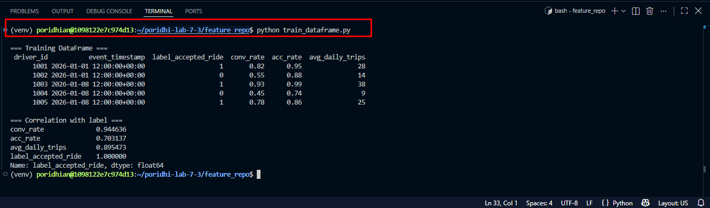

What just happened:
- For row 0 (`driver_id=1001`, observed on `2026-01-01T12:00:00`), Feast picked `conv_rate=0.82` (from batch 1, dated `2026-01-01T00:00:00`).
- For row 2 (`driver_id=1003`, observed on `2026-01-08T12:00:00`), Feast picked `conv_rate=0.93` (from batch 2, dated `2026-01-08T00:00:00`). This is the point-in-time join doing its job: a row observed at noon on `2026-01-08` is allowed to see the batch 2 snapshot from midnight of the same day, but not the batch 3 snapshot from `2026-01-15`.
- The training DataFrame is ready to feed directly into a model (`fit(training_df.drop(columns=["label_accepted_ride"]), training_df["label_accepted_ride"])`).

> Would I get an error if I ran this? Possibly: `FileNotFoundError: [Errno 2] No such file or directory: 'data/entity_df.parquet'` means Step 16 did not run, or the terminal is not inside `feature_repo`. `AttributeError: 'NoneType' object has no attribute 'to_df'` means the parentheses on `get_historical_features(...)` were dropped. A `KeyError` on a feature name means the feature view name in the request does not match the registered name `driver_stats`.

#### Verify point-in-time correctness

The same driver gets two different feature values depending on when the label was observed. Create a new file called `check_point_in_time.py` in `~/poridhi-lab-7-3/feature_repo` and paste the Python below into it.

```python
import pandas as pd
from datetime import datetime, timezone
from feast import FeatureStore


def check_point_in_time():
    # Two observations: one before batch 2, one after
    entity_df = pd.DataFrame(
        {
            "driver_id": [1001, 1001],
            "event_timestamp": [
                datetime(2026, 1, 1, 12, 0, tzinfo=timezone.utc),
                datetime(2026, 1, 10, 12, 0, tzinfo=timezone.utc),
            ],
        }
    )

    fs = FeatureStore(repo_path=".")
    df = fs.get_historical_features(
        entity_df=entity_df,
        features=["driver_stats:conv_rate"],
    ).to_df()
    print(df)


# feast apply imports every .py file in this folder, so guard the script body.
if __name__ == "__main__":
    check_point_in_time()
```

Run it from the terminal, which is already inside `feature_repo`:

```bash
python check_point_in_time.py
```

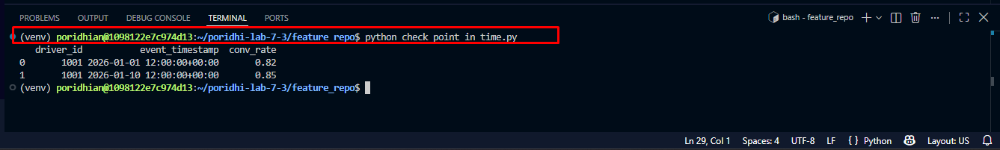

The `2026-01-10T12:00:00` row is allowed to see the batch 2 snapshot (`2026-01-08T00:00:00`, value `0.85`) but NOT the batch 3 snapshot (`2026-01-15T00:00:00`, value `0.88`), because that batch is in the future. This is point-in-time correctness: training data never contains future information.

> Would I get an error if I ran this? Possibly: if both rows return the same value, the `event_timestamp` column is naive rather than timezone-aware, so Feast cannot do the point-in-time join reliably. Make sure the timestamps are built with `tzinfo=timezone.utc`. A `NaN` in the `conv_rate` column means no batch was valid at that observation time.

### Step 18: Compare `materialize-incremental` vs `materialize`

> Note: this step demonstrates the difference between a windowed backfill (`materialize`) and the catch-up incremental (`materialize-incremental`), and shows why the Redis online store refuses to let older data overwrite newer data.

`materialize-incremental` is the right tool for a daily batch job. `materialize <start> <end>` is the right tool when you need to backfill a specific time window.

There is one behavior to know before you run the backfill. The Redis online store keeps the **event timestamp** of every value it holds, and it refuses to write a row whose event timestamp is older than the one already stored. The backfill in this lab selects batch 1 rows dated `2026-01-01T00:00:00`, but Redis already holds batch 4 rows dated `2026-01-22T00:00:00` from Step 13. Feast therefore skips every one of them and the online store keeps the newer values.

To see the backfill actually take effect, clear the online store first:

```bash
python -c "import redis; r=redis.Redis(host='$REDIS_HOST', port=int('$REDIS_PORT'), username='$REDIS_USERNAME', password='$REDIS_PASSWORD'); r.flushall(); print('keys in Redis:', r.dbsize())"
```

Expected output: `keys in Redis: 0`.

Now backfill the first batch only. The `file` offline store treats both ends of the window as **inclusive**, so the window has to stop the day before batch 2 lands:

```bash
feast materialize 2026-01-01T00:00:00 2026-01-07T00:00:00
```

Expected output:

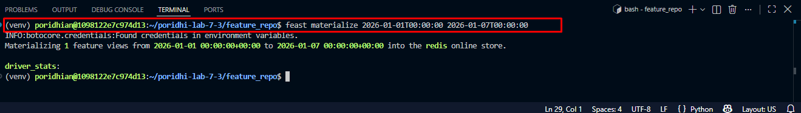

Confirm the backfilled values with the same online read used in Step 14:

```bash
python -c "
from feast import FeatureStore
fs = FeatureStore(repo_path='.')
print(fs.get_online_features(features=['driver_stats:conv_rate'], entity_rows=[{'driver_id': 1001}, {'driver_id': 1002}]).to_dict())
"
```

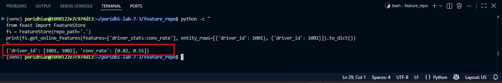

 These are the batch 1 values, not the batch 4 values `0.90` and `0.65` that were there before the flush.

Now bring the online store back to the newest batch by running the backfill form over the full range:

```bash
feast materialize 2026-01-01T00:00:00 2026-01-23T00:00:00
```

Confirm the restore with the same read:

```bash
python -c "
from feast import FeatureStore
fs = FeatureStore(repo_path='.')
print(fs.get_online_features(features=['driver_stats:conv_rate'], entity_rows=[{'driver_id': 1001}, {'driver_id': 1002}, {'driver_id': 1009}]).to_dict())
"
```
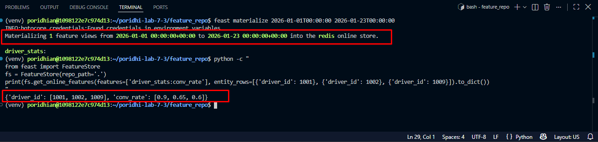 
All nine drivers are back to their batch 4 values, and driver 1009, who only appears in the last batch, is present again.

This pair of commands demonstrates the difference: `materialize` lets you select a closed window of history and write it, `materialize-incremental` always brings the online store up to the latest known timestamp.

> **Why not `materialize-incremental` for the restore?** After the backfill, the registry records a materialization that already reached `2026-01-23T00:00:00`, so `feast materialize-incremental 2026-01-23T00:00:00` resolves to a zero-width window and writes nothing. The online store stays stuck on the backfilled values. Using the explicit `materialize` window for the restore sidesteps that, because it always writes the rows it selects.

> **Why did the flushall matter?** Feast's Redis online store stores an event timestamp next to every value and skips any write whose timestamp is not newer than the stored one. That rule is what makes `materialize-incremental` safe to run twice, and it is also why a backfill of older data cannot overwrite newer data. In a real pipeline you never flush the online store; you point the backfill at a different environment, or you accept that the older window will not be applied.

> Would I get an error if I ran this? Possibly: `ValueError: Incorrect number of arguments` if you pass only one timestamp; `materialize` needs both a start and an end. A backfill that writes 0 rows means the window does not overlap the batch timestamps, or that Redis already holds newer values for those keys. If the backfill window ends on `2026-01-08T00:00:00`, the inclusive end bound pulls in the batch 2 rows as well, and after the dedup you will see batch 2 values (`0.85` and `0.60`) instead of batch 1.

## Conclusion

This lab stood up a complete Feast feature store on the Poridhi lab VM and ran a full batch ingestion loop: Feast installed in a virtual environment, an S3 bucket in `ap-southeast-1` as the offline store and registry, the Poridhi managed Redis from the Cloud Tray as the online store, four Parquet batches representing daily ETL landings, and `feast materialize-incremental` pushing the freshest values into Redis. `get_historical_features()` then assembled a point-in-time-correct training DataFrame for a labeled `entity_df`, and `get_online_features()` confirmed that the online store was in sync. The key takeaway is the one-definition-two-paths pattern: S3 handles historical, training-time reads, the managed Redis handles low-latency, inference-time reads, and `materialize-incremental` plus a single `FeatureView` definition keep the two stores in lock-step. With this foundation, any scheduled job that drops new Parquet data and then runs the materialize command will keep both training and inference aligned automatically.