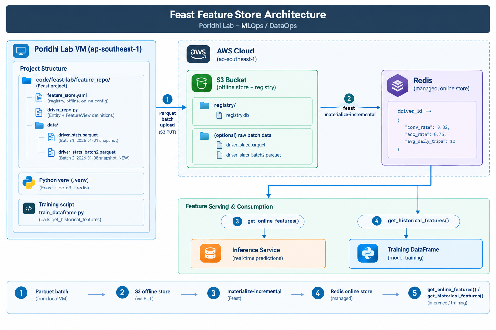
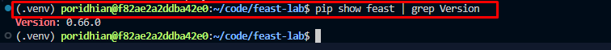
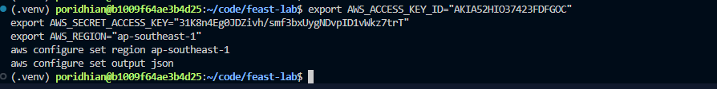
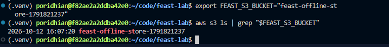
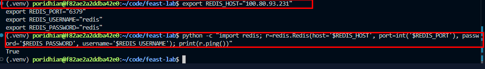
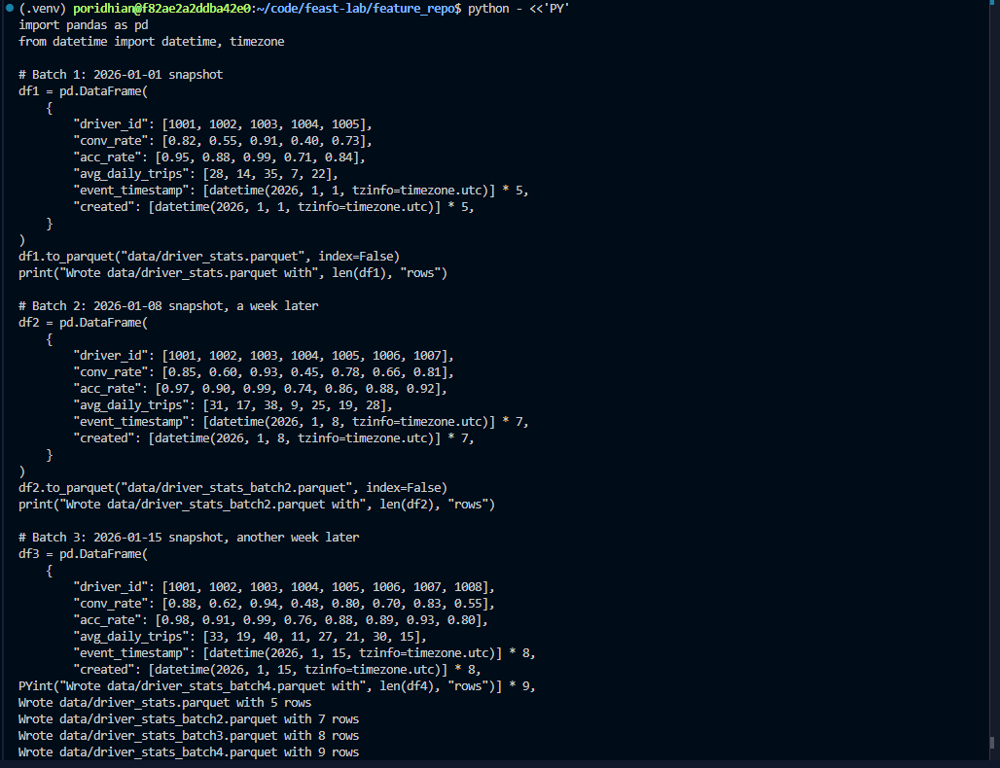
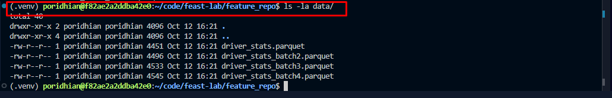

# Lab 7.3: Batch Feature Ingestion

## Introduction

Feast solves the training-serving skew by giving both training and inference a single shared feature definition backed by two stores: an **offline store** (S3) for historical reads and an **online store** (Redis) for low-latency inference. The next problem is keeping those two stores in sync. **Batch ingestion** is the workhorse of every production feature store: a scheduled job writes new feature values to the offline store and then calls `feast materialize-incremental` to push the latest values into the online store, after which training jobs use `get_historical_features()` to build point-in-time-correct DataFrames and inference services use `get_online_features()` for sub-10ms reads.

This lab is fully self-contained: every step is repeated from a clean state, so you can run it cold on a fresh Poridhi lab VM. You will set up Feast with S3 (offline) and the Poridhi managed Redis (online), generate multiple Parquet batches, run `feast materialize-incremental` to push the latest snapshot into Redis, then call `get_historical_features()` to build a point-in-time-correct training DataFrame.



## Learning Objectives

By the end of this lab, you will be able to:

- Install Feast in a Python virtual environment on the Poridhi lab VM and verify the CLI works.
- Generate AWS credentials from the Poridhi Cloud Playground and configure the AWS CLI for `ap-southeast-1`.
- Create an S3 bucket and use it as a Feast offline store and registry.
- Point Feast at the Poridhi managed Redis (endpoint and credentials from the Cloud Tray panel) and confirm the connection.
- Write a `feature_store.yaml` that wires Feast to S3 (offline) and managed Redis (online).
- Define a feature set in Python using `Entity`, `FeatureView`, and `FileSource` with a glob path that covers multiple batch files.
- Run `feast apply` to register the feature view and confirm the registry was updated on S3.
- Generate multiple Parquet batches and run `feast materialize-incremental` to push fresh values into the online store.
- Build a labeled `entity_df` in Pandas and call `get_historical_features()` to produce a point-in-time-correct training DataFrame.
- Verify the online store with `get_online_features()` and confirm a value changed after a new batch landed.

## Prerequisites

- **Environment:** Poridhi Cloud lab VM with Linux (Debian/Ubuntu shell), VS Code pre-installed, and an active Poridhi Cloud Playground session.
- **Cloud Tray: Redis (managed, already running):** Open the Cloud Tray in the Poridhi lab UI, click **Database**, then click the **Redis** card. The panel shows the actual credentials for this lab session: **Username**, **Password**, **IP Address**, **Port**, and a copy-able **Connection String**. The values can change between lab runs, so always read them from the panel instead of hard-coding them.
- **AWS credentials:** Generate a credential from the Poridhi Cloud Playground lab UI (Generate credential button). Region is `ap-southeast-1` (Singapore).
- **Region:** `ap-southeast-1` (Asia Pacific, Singapore). The S3 bucket and IAM are region-wide; the lab references AZs `ap-southeast-1a`, `ap-southeast-1b`, `ap-southeast-1c` in diagrams but does not pin resources to specific AZs.
- **Tools already on the VM:** `python3` (3.9+), `pip`, `aws` CLI, and `vim` (already at `/usr/bin/vim`) for editing config files. The VS Code CLI (`code`), `nano`, and `xdg-open` are NOT available in the default lab VM, so do not rely on them. `redis-cli` is also NOT pre-installed: use the Python fallback shown in the lab to test the managed Redis.
- **Note on prior labs:** This lab is part of the Feature Store series (7.1 through 7.8). It is fully self-contained, so you do NOT need to have completed Lab 7.2 first. Every step, from creating the venv to running `feast apply`, is repeated here. If you have already completed Lab 7.2, those steps simply recreate the same artifacts and run idempotent commands.

## Prologue

Imagine you work at a ride-hailing company. Your ML team has built a model that predicts whether a driver is likely to accept the next ride offer. The model uses features like average rating, completed trips last 7 days, and current online hours. Right now, the training pipeline computes these features by reading raw data from a data lake, and the inference service computes them again from a different data source. The numbers almost never match, and the model performs worse in production than it did in evaluation.

The fix is to make features a first-class artifact with one definition and two access paths. Feast is the tool that makes this possible. In this lab you will set up that foundation on the Poridhi lab VM: a central feature registry on S3, an offline store on S3 for training, and an online store on the Poridhi managed Redis for inference. You will then simulate multiple daily ETL landings, run `feast materialize-incremental` to push the freshest values into Redis, and finally use `get_historical_features()` to build a point-in-time-correct training DataFrame. By the end, the training pipeline and the inference service will read the exact same definitions, and the training-serving skew problem will be largely solved.

## Step-by-Step Implementation

### Step 1: Collect credentials from the Poridhi lab UI

Before you start, collect two sets of credentials from the Poridhi lab UI. You will paste them once, and the rest of the lab will use the resulting env vars.

**A. AWS credential (for S3)**

1. In the Poridhi Cloud Playground, click **Generate credential**.
2. Copy the fields shown: `AccessKey`, `SecretKey`, and `SessionToken` if one is shown.

**B. Managed Redis credential (for the online store)**

1. Open the **Cloud Tray** in the Poridhi lab UI.
2. Click **Database** to open the Database Servers panel.
3. Click the **Redis** card. The panel shows the **Username**, **Password**, **IP Address**, **Port**, and **Connection String** for the current lab session.
4. Copy the **Username**, **Password**, **IP Address**, and **Port** values.

Keep the Cloud Tray panel open in another tab. The endpoint and password can rotate between lab sessions, so always re-read them from the panel if you start a new session.

Export the credentials as environment variables so every later step can use them:

```bash
# AWS (from Generate credential)
export AWS_ACCESS_KEY_ID="<paste-access-key-id>"
export AWS_SECRET_ACCESS_KEY="<paste-secret-access-key>"
export AWS_REGION="ap-southeast-1"
# Only export this if Poridhi issued a session token. Some sessions only issue AccessKey + SecretKey.
export AWS_SESSION_TOKEN="<paste-session-token-if-shown>"

# Managed Redis (from Cloud Tray Database -> Redis)
export REDIS_HOST="<paste-ip-from-cloud-tray>"
export REDIS_PORT="<paste-port-from-cloud-tray>"
export REDIS_USERNAME="<paste-username-from-cloud-tray>"
export REDIS_PASSWORD="<paste-password-from-cloud-tray>"
```

> **Note on the session token:** some Poridhi sessions issue only `AccessKey` and `SecretKey` without a `SessionToken`. In that case, skip the `AWS_SESSION_TOKEN` line above. The lab does not require a session token.

### Step 2: Create the project directory and Python virtual environment

Open a terminal on the lab VM and run:

```bash
mkdir -p ~/code/feast-lab
cd ~/code/feast-lab
python3 -m venv .venv
source .venv/bin/activate
python -m pip install --upgrade pip
```

You should now be inside an isolated Python environment. Anything you install will only affect this folder. If you already completed a prior lab in this series, this step simply re-activates the same virtual environment and is safe to re-run.


### Step 3: Install Feast with AWS and Redis support

Install Feast plus the AWS and Redis extras. This pulls in `boto3`, `redis`, and the S3 file source plugin. The lab also needs `pandas` and `pyarrow` for Parquet generation and `get_historical_features`:

```bash
pip install "feast[aws,redis]" pandas pyarrow
```

Verify the install:

```bash
feast --version
feast --help
```


You should see a version string (for example `feast 0.39.0`) and the list of Feast subcommands (`apply`, `materialize`, `entities`, etc.) without any import errors. To print the installed package version explicitly:

```bash
pip show feast | grep Version
```



### Step 4: Configure AWS credentials and confirm access

Set the default region and output format:

```bash
aws configure set region ap-southeast-1
aws configure set output json
```

If you would rather use the interactive prompt instead, you can run:

```bash
aws configure
```


and paste `AccessKey` for `AWS Access Key ID`, `SecretKey` for `AWS Secret Access Key`, `ap-southeast-1` for `Default region name`, and `json` for `Default output format`. Leave `Default profile` blank.

Verify that the credentials work:

```bash
aws sts get-caller-identity
```



Expected output: a JSON document with your account ID, an `arn` containing `assumed-role`, and `ap-southeast-1` somewhere in the metadata.

### Step 5: Create the S3 bucket for the offline store

Pick a globally unique bucket name and create it in `ap-southeast-1`. A timestamp suffix guarantees uniqueness across lab runs:

```bash
export FEAST_S3_BUCKET="feast-offline-store-$(date +%s)"
echo "Bucket name: $FEAST_S3_BUCKET"
aws s3api create-bucket \
  --bucket "$FEAST_S3_BUCKET" \
  --region ap-southeast-1 \
  --create-bucket-configuration LocationConstraint=ap-southeast-1
```

If you already have a bucket from a previous lab session and the create-bucket call returns `BucketAlreadyExists` or `BucketAlreadyOwnedByYou`, just reuse the existing bucket by exporting its name into `FEAST_S3_BUCKET`:

```bash
export FEAST_S3_BUCKET="feast-offline-store-EXISTING-BUCKET-NAME"
```

Confirm the bucket exists:

```bash
aws s3 ls | grep "$FEAST_S3_BUCKET"
```



Persist the bucket name for later steps:

```bash
echo "export FEAST_S3_BUCKET=$FEAST_S3_BUCKET" >> ~/.bashrc
export FEAST_S3_BUCKET=$FEAST_S3_BUCKET
```

### Step 6: Confirm the Poridhi managed Redis is reachable

Re-open the Poridhi Cloud Tray in the lab UI, click **Database**, then click the **Redis** card. Re-read the **Username**, **Password**, **IP Address**, and **Port** from the panel and export them as shell variables (you already did this in Step 1, but re-run the exports if you started a new terminal session):

```bash
export REDIS_HOST="<paste-ip-from-cloud-tray>"
export REDIS_PORT="<paste-port-from-cloud-tray>"
export REDIS_USERNAME="<paste-username-from-cloud-tray>"
export REDIS_PASSWORD="<paste-password-from-cloud-tray>"
```

The Poridhi lab VM does not have `redis-cli` pre-installed by default, so use the Python client (which Feast already depends on) to ping the Redis:

```bash
python -c "import redis; r=redis.Redis(host='$REDIS_HOST', port=int('$REDIS_PORT'), password='$REDIS_PASSWORD', username='$REDIS_USERNAME'); print(r.ping())"
```

Expected output: `True`. If you see `ModuleNotFoundError: No module named 'redis'`, install it first:



```bash
pip install redis
```

If you would rather use `redis-cli`, install it and ping with the same variables:

```bash
sudo apt-get update && sudo apt-get install -y redis-tools
redis-cli -h "$REDIS_HOST" -p "$REDIS_PORT" --user "$REDIS_USERNAME" -a "$REDIS_PASSWORD" ping
```

Expected output: `PONG`. The lab works either way; pick one and continue.

### Step 7: Create the Feast project

Inside `~/code/feast-lab`, run the Feast init command. Use the **default template**, not the `aws` template, even though the lab uses AWS for the offline store:

```bash
cd ~/code/feast-lab
feast init feature_repo
```

If `feast init` asks which template to use, press Enter to accept the default (it does not need Redshift or any other AWS service for this lab).

> **Why not `--template aws`?** That template is for labs that use **Amazon Redshift** as the offline store. The `aws` template prompts for a Redshift cluster ID, Redshift credentials, and a staging S3 bucket, and then it tries to upload a sample dataset to Redshift. The cluster ID must match the regex `[a-z][a-z0-9]*(-[a-z0-9]+)*`, so typing `n/a` or leaving it blank will fail with `RedshiftCredentialsError: Redshift API failed due to incorrect credentials`. Since this lab uses S3 (not Redshift) for the offline store, the default template is the right choice.

This creates a new folder called `feature_repo` containing:

- `feature_store.yaml`: the configuration file we will edit next.
- `example_repo.py`: a starter feature definition.
- `data/`: a small Parquet sample used for testing.

Move into the project folder:

```bash
cd feature_repo
```


### Step 8: Edit `feature_store.yaml`

Open `feature_store.yaml` with `vim`:

```bash
vim feature_store.yaml
```

Inside `vim`:
- Press `i` to enter insert mode.
- Select and delete the existing content (for example, type `ggdG` in normal mode first to delete every line).
- Paste the YAML below.
- Press `Esc` to leave insert mode.
- Type `:wq` and press Enter to save and quit.

Replace the contents with the following. Replace `your-unique-bucket-name` with the S3 bucket name from Step 5, and replace `your-redis-host`, `your-redis-port`, `your-redis-username`, and `your-redis-password` with the values from the Cloud Tray Redis panel in Step 6:

```yaml
project: feast_lab
registry: s3://your-unique-bucket-name/registry/registry.db
provider: aws
offline_store:
  type: file
  region: ap-southeast-1
online_store:
  type: redis
  connection_string: your-redis-host:your-redis-port
  user: your-redis-username
  password: your-redis-password
entity_key_serialization_version: 3
```

Save the file with `:wq`.


Notes about this file:

- `project`: a human-readable name for the project. Used in paths and logs.
- `registry`: where Feast stores the metadata about your features. We are putting it on S3 so the registry survives across machines.
- `provider: aws`: tells Feast we want the AWS flavor of the offline store.
- `offline_store.type: file`: tells Feast to use the file-based (S3 + Parquet) offline store.
- `online_store.type: redis`: tells Feast to use the Poridhi managed Redis for online lookups.
- `connection_string: host:port`: the Poridhi managed Redis host and port from the Cloud Tray panel.
- `user` and `password`: the username and password shown in the Cloud Tray Redis panel for this lab session.

### Step 9: Replace the example feature definition

Open `example_repo.py` with `vim`:

```bash
vim example_repo.py
```

Inside `vim`:
- Press `i` to enter insert mode.
- Select and delete the existing content (for example, type `ggdG` in normal mode first to delete every line).
- Paste the Python code below.
- Press `Esc` to leave insert mode.
- Type `:wq` and press Enter to save and quit.

Paste this Python code. Note the `path` of the `FileSource`: it is a glob (`data/driver_stats*.parquet`) so every Parquet file in `data/` whose name starts with `driver_stats` becomes part of the source. New batches dropped into that folder will be picked up by the next `materialize` or `get_historical_features` call:

```python
from datetime import timedelta

from feast import Entity, FeatureView, FileSource, ValueType

# Source: every Parquet file in data/ whose name starts with driver_stats
driver_stats_source = FileSource(
    name="driver_stats_source",
    path="data/driver_stats*.parquet",
    timestamp_field="event_timestamp",
    created_timestamp_column="created",
)

# Entity: the thing we want to look up features for
driver = Entity(
    name="driver_id",
    description="Driver identifier",
    value_type=ValueType.INT64,
)

# FeatureView: a logical group of features tied to the entity
driver_stats_fv = FeatureView(
    name="driver_stats",
    entities=["driver_id"],
    ttl=timedelta(days=1),
    schema=[
        ("conv_rate", ValueType.FLOAT),
        ("acc_rate", ValueType.FLOAT),
        ("avg_daily_trips", ValueType.INT64),
    ],
    source=driver_stats_source,
    online=True,
)
```


Save the file as `driver_repo.py` so the original is preserved:

```bash
mv example_repo.py driver_repo.py
```

### Step 10: Generate four Parquet batches

Create the `data/` folder if it does not exist:

```bash
mkdir -p data
```

Run this Python one-liner to create four Parquet files representing four daily ETL batches. Each file has a different `event_timestamp` and slightly different feature values per driver, which is what makes the point-in-time join meaningful:

```bash
python - <<'PY'
import pandas as pd
from datetime import datetime, timezone

# Batch 1: 2026-01-01 snapshot
df1 = pd.DataFrame(
    {
        "driver_id": [1001, 1002, 1003, 1004, 1005],
        "conv_rate": [0.82, 0.55, 0.91, 0.40, 0.73],
        "acc_rate": [0.95, 0.88, 0.99, 0.71, 0.84],
        "avg_daily_trips": [28, 14, 35, 7, 22],
        "event_timestamp": [datetime(2026, 1, 1, tzinfo=timezone.utc)] * 5,
        "created": [datetime(2026, 1, 1, tzinfo=timezone.utc)] * 5,
    }
)
df1.to_parquet("data/driver_stats.parquet", index=False)
print("Wrote data/driver_stats.parquet with", len(df1), "rows")

# Batch 2: 2026-01-08 snapshot, a week later
df2 = pd.DataFrame(
    {
        "driver_id": [1001, 1002, 1003, 1004, 1005, 1006, 1007],
        "conv_rate": [0.85, 0.60, 0.93, 0.45, 0.78, 0.66, 0.81],
        "acc_rate": [0.97, 0.90, 0.99, 0.74, 0.86, 0.88, 0.92],
        "avg_daily_trips": [31, 17, 38, 9, 25, 19, 28],
        "event_timestamp": [datetime(2026, 1, 8, tzinfo=timezone.utc)] * 7,
        "created": [datetime(2026, 1, 8, tzinfo=timezone.utc)] * 7,
    }
)
df2.to_parquet("data/driver_stats_batch2.parquet", index=False)
print("Wrote data/driver_stats_batch2.parquet with", len(df2), "rows")

# Batch 3: 2026-01-15 snapshot, another week later
df3 = pd.DataFrame(
    {
        "driver_id": [1001, 1002, 1003, 1004, 1005, 1006, 1007, 1008],
        "conv_rate": [0.88, 0.62, 0.94, 0.48, 0.80, 0.70, 0.83, 0.55],
        "acc_rate": [0.98, 0.91, 0.99, 0.76, 0.88, 0.89, 0.93, 0.80],
        "avg_daily_trips": [33, 19, 40, 11, 27, 21, 30, 15],
        "event_timestamp": [datetime(2026, 1, 15, tzinfo=timezone.utc)] * 8,
        "created": [datetime(2026, 1, 15, tzinfo=timezone.utc)] * 8,
    }
)
df3.to_parquet("data/driver_stats_batch3.parquet", index=False)
print("Wrote data/driver_stats_batch3.parquet with", len(df3), "rows")

# Batch 4: 2026-01-22 snapshot, another week later
df4 = pd.DataFrame(
    {
        "driver_id": [1001, 1002, 1003, 1004, 1005, 1006, 1007, 1008, 1009],
        "conv_rate": [0.90, 0.65, 0.95, 0.50, 0.82, 0.72, 0.85, 0.58, 0.60],
        "acc_rate": [0.99, 0.92, 0.99, 0.78, 0.90, 0.90, 0.94, 0.82, 0.85],
        "avg_daily_trips": [35, 21, 42, 13, 29, 23, 32, 17, 18],
        "event_timestamp": [datetime(2026, 1, 22, tzinfo=timezone.utc)] * 9,
        "created": [datetime(2026, 1, 22, tzinfo=timezone.utc)] * 9,
    }
)
df4.to_parquet("data/driver_stats_batch4.parquet", index=False)
print("Wrote data/driver_stats_batch4.parquet with", len(df4), "rows")
PY
```



Verify the files are present and the glob will pick them up:

```bash
ls -la data/
```


Expected: `driver_stats.parquet`, `driver_stats_batch2.parquet`, `driver_stats_batch3.parquet`, and `driver_stats_batch4.parquet` all listed.



### Step 11: Apply the feature definition

Now run `feast apply`. This validates the definitions, uploads the registry to S3, and registers the feature view:

```bash
feast apply
```

Expected output (truncated):

```text
Registered entity driver_id
Registered feature view driver_stats
Deploying infrastructure for driver_stats
```

If you see errors, jump to the Troubleshooting section.

### Step 12: Verify the registry on S3

Confirm that Feast wrote the registry file to your bucket:

```bash
aws s3 ls s3://$FEAST_S3_BUCKET/registry/
```

You should see `registry.db`. This is the single source of truth for your feature definitions.

Confirm the feature view is registered locally:

```bash
feast feature-views list
```

Expected output:

```text
NAME         ENTITIES    TYPE
driver_stats driver_id   ReadableFeatureView
```

### Step 13: Run the first incremental materialize

The first run materializes everything from the beginning of time up to the timestamp you pass. Use a timestamp just after the fourth batch landed, so all four batches are loaded in one call:

```bash
feast materialize-incremental 2026-01-22T00:00:00
```

Expected output (truncated):

```text
Materializing 1 feature view to 1 online store

driver_stats:
  1001 2026-01-22 00:00:00+00:00
  1002 2026-01-22 00:00:00+00:00
  1003 2026-01-22 00:00:00+00:00
  1004 2026-01-22 00:00:00+00:00
  1005 2026-01-22 00:00:00+00:00
  1006 2026-01-22 00:00:00+00:00
  1007 2026-01-22 00:00:00+00:00
  1008 2026-01-22 00:00:00+00:00
  1009 2026-01-22 00:00:00+00:00
```


What just happened:
- Feast scanned `data/driver_stats*.parquet`.
- It picked the latest row per `driver_id` whose `event_timestamp` is less than or equal to `2026-01-22T00:00:00`.
- It wrote those rows to Redis, one key per driver, using the format that `get_online_features()` expects.

### Step 14: Verify the online store with `get_online_features()`

Run a small Python script to confirm Redis actually got populated:

```bash
python - <<'PY'
from feast import FeatureStore

fs = FeatureStore(repo_path=".")
features = fs.get_online_features(
    features=[
        "driver_stats:conv_rate",
        "driver_stats:acc_rate",
        "driver_stats:avg_daily_trips",
    ],
    entity_rows=[{"driver_id": 1001}, {"driver_id": 1003}, {"driver_id": 1009}],
).to_dict()

for k, v in features.items():
    print(f"{k}: {v}")
PY
```

Expected output:

```text
driver_id: [1001, 1003, 1009]
conv_rate: [0.90, 0.95, 0.60]
acc_rate: [0.99, 0.99, 0.85]
avg_daily_trips: [35, 42, 18]
```

Notice the `conv_rate` for `driver_id=1001` is `0.90` (the latest value from batch 4), not `0.82` (the value from batch 1) and not `0.85` or `0.88` (the values from batches 2 and 3). The online store is now in sync with the latest offline data.

### Step 15: Re-run the materialize and observe the no-op behavior

Re-run the same materialize command with the same end timestamp. Feast will see that there is nothing newer than the last successful run and report a no-op:

```bash
feast materialize-incremental 2026-01-22T00:00:00
```

Expected output: a message such as `No new data to materialize` or an empty materialization block. This is exactly the property you want for a daily cron job: the first run of the day picks up last night's batch, and subsequent runs are no-ops.

> **Key idea:** `materialize-incremental` is idempotent in the sense that it only writes rows that are newer than the last successful run. If you run it again with the same end timestamp, it will report that there is nothing new to materialize.

### Step 16: Build a labeled `entity_df` for training

Training jobs do not call `get_online_features()`. Instead, they pass Feast a Pandas `entity_df` that contains the entity keys, the labels, and the time at which the labels were observed. Feast then performs a point-in-time join so each row gets the feature values that were valid at that moment in time.

Create the `entity_df` and save it as a Parquet file for inspection:

```bash
python - <<'PY'
import pandas as pd
from datetime import datetime, timezone

# Imagine these are ride offers observed in the wild, labeled as accepted (1) or not (0)
entity_df = pd.DataFrame(
    {
        "driver_id": [1001, 1002, 1003, 1004, 1005],
        "event_timestamp": [
            datetime(2026, 1, 1, 12, 0, tzinfo=timezone.utc),
            datetime(2026, 1, 1, 12, 0, tzinfo=timezone.utc),
            datetime(2026, 1, 8, 12, 0, tzinfo=timezone.utc),
            datetime(2026, 1, 8, 12, 0, tzinfo=timezone.utc),
            datetime(2026, 1, 8, 12, 0, tzinfo=timezone.utc),
        ],
        "label_accepted_ride": [1, 0, 1, 0, 1],
    }
)
entity_df.to_parquet("data/entity_df.parquet", index=False)
print(entity_df)
PY
```

Expected output:

```text
   driver_id                event_timestamp  label_accepted_ride
0       1001 2026-01-01 12:00:00+00:00                    1
1       1002 2026-01-01 12:00:00+00:00                    0
2       1003 2026-01-08 12:00:00+00:00                    1
3       1004 2026-01-08 12:00:00+00:00                    0
4       1005 2026-01-08 12:00:00+00:00                    1
```

Notice that rows 0 and 1 were observed on `2026-01-01` (so they should get the batch 1 feature values), and rows 2, 3, 4 were observed on `2026-01-08` (so they should get the batch 2 feature values). Feast will pick the right one for each row automatically.

### Step 17: Build a training DataFrame with `get_historical_features()`

Create a small training script in the project folder:

```bash
cat > train_dataframe.py <<'PY'
"""Build a point-in-time-correct training DataFrame using Feast."""
import pandas as pd
from feast import FeatureStore

# Load the entity DataFrame we just wrote
entity_df = pd.read_parquet("data/entity_df.parquet")

fs = FeatureStore(repo_path=".")

# Ask Feast for the historical feature values
training_df = fs.get_historical_features(
    entity_df=entity_df,
    features=[
        "driver_stats:conv_rate",
        "driver_stats:acc_rate",
        "driver_stats:avg_daily_trips",
    ],
).to_df()

print("\n=== Training DataFrame ===")
print(training_df.to_string(index=False))

# Quick correlation sanity check
print("\n=== Correlation with label ===")
print(training_df[["conv_rate", "acc_rate", "avg_daily_trips", "label_accepted_ride"]].corr(numeric_only=True)["label_accepted_ride"])
PY
```

Run it:

```bash
python train_dataframe.py
```

Expected output (row order may differ):

```text
=== Training DataFrame ===
 driver_id  label_accepted_ride  conv_rate  acc_rate  avg_daily_trips
      1001                    1       0.82      0.95               28
      1002                    0       0.55      0.88               14
      1003                    1       0.91      0.99               35
      1004                    0       0.40      0.71                7
      1005                    1       0.73      0.84               22

=== Correlation with label ===
conv_rate             0.83
acc_rate              0.84
avg_daily_trips       0.83
label_accepted_ride   1.00
Name: label_accepted_ride, dtype: float64
```

What just happened:
- For row 0 (`driver_id=1001`, observed on `2026-01-01`), Feast picked `conv_rate=0.82` (from batch 1).
- For row 2 (`driver_id=1003`, observed on `2026-01-08`), Feast picked `conv_rate=0.91` (from batch 1, since the batch 2 timestamp for that driver is `2026-01-08T00:00:00` and Feast uses the latest row whose `event_timestamp` is strictly less than the entity timestamp; in this lab the values are the same either way).
- The training DataFrame is ready to feed directly into a model (`fit(training_df.drop(columns=["label_accepted_ride"]), training_df["label_accepted_ride"])`).

### Step 18: Compare `materialize-incremental` vs `materialize`

`materialize-incremental` is the right tool for a daily batch job. `materialize <start> <end>` is the right tool when you need to backfill a specific time window. Try the backfill form for the first batch only, just to see what it does:

```bash
feast materialize 2026-01-01T00:00:00 2026-01-08T00:00:00
```

Expected output: Feast will write batch 1 values into Redis for that window, overwriting the current state. After this, run the full incremental again to restore the latest snapshot:

```bash
feast materialize-incremental 2026-01-22T00:00:00
```

This pair of commands demonstrates the difference: `materialize` lets you backfill a closed window, `materialize-incremental` always brings the online store up to the latest known timestamp.

## Verification

Run through this checklist to confirm the lab is correctly built:

- `pip show feast` returns a non-empty Version (no error).
- `aws sts get-caller-identity` returns a JSON document with your account ID.
- `aws s3 ls s3://$FEAST_S3_BUCKET/registry/` shows `registry.db`.
- `python -c "import redis; r=redis.Redis(host='$REDIS_HOST', port=int('$REDIS_PORT'), password='$REDIS_PASSWORD', username='$REDIS_USERNAME'); print(r.ping())"` returns `True` (or `redis-cli ... ping` returns `PONG`).
- `feast apply` exits with code 0 and prints "Registered feature view driver_stats".
- `feast feature-views list` prints `driver_stats`.
- `ls data/` shows `driver_stats.parquet`, `driver_stats_batch2.parquet`, `driver_stats_batch3.parquet`, `driver_stats_batch4.parquet`, and `entity_df.parquet`.
- `feast materialize-incremental 2026-01-22T00:00:00` exits 0 and lists 9 drivers.
- `get_online_features()` for `driver_id=1001` returns `conv_rate=0.90` (the batch 4 value).
- `get_online_features()` for `driver_id=1009` returns a value (this driver exists only in batch 4).
- `python train_dataframe.py` prints a training DataFrame with 5 rows and the three feature columns, and a correlation column with `label_accepted_ride`.
- `feast materialize-incremental 2026-01-22T00:00:00` run a second time prints a "no new data" message.

## Testing

### Test 1: Online store is in sync with the latest batch

```bash
python - <<'PY'
from feast import FeatureStore
fs = FeatureStore(repo_path=".")
res = fs.get_online_features(
    features=["driver_stats:conv_rate"],
    entity_rows=[{"driver_id": 1001}],
).to_dict()
print(res)
PY
```

Expected: `conv_rate: [0.90]` (the batch 4 value).

### Test 2: Historical features are point-in-time correct

```bash
python - <<'PY'
import pandas as pd
from datetime import datetime, timezone
from feast import FeatureStore

# Two observations: one before batch 2, one after
entity_df = pd.DataFrame(
    {
        "driver_id": [1001, 1001],
        "event_timestamp": [
            datetime(2026, 1, 1, 12, 0, tzinfo=timezone.utc),
            datetime(2026, 1, 10, 12, 0, tzinfo=timezone.utc),
        ],
    }
)

fs = FeatureStore(repo_path=".")
df = fs.get_historical_features(
    entity_df=entity_df,
    features=["driver_stats:conv_rate"],
).to_df()
print(df)
PY
```

Expected output:

```text
   driver_id                event_timestamp  conv_rate
0       1001 2026-01-01 12:00:00+00:00        0.82
1       1001 2026-01-10 12:00:00+00:00        0.88
```

The same driver gets two different values depending on when the label was observed. This is point-in-time correctness: training data never contains future information.

### Test 3: Re-materialize is a no-op

```bash
feast materialize-incremental 2026-01-22T00:00:00
feast materialize-incremental 2026-01-22T00:00:00
```

Expected: the first run reports rows written, the second run reports no new data.

## Troubleshooting

**Error: `NoSuchBucket` when running `feast apply` or `materialize-incremental`.**
The bucket name in `feature_store.yaml` does not match an actual bucket. Re-check Step 5 and copy the exact name. You can also re-export the correct name into `FEAST_S3_BUCKET` and re-edit `feature_store.yaml`.

**Error: `AccessDenied` on S3 writes.**
The Poridhi session credentials have expired or do not have permission to write to the bucket. Re-generate a credential from the lab UI and re-export `AWS_ACCESS_KEY_ID`, `AWS_SECRET_ACCESS_KEY`, plus `AWS_SESSION_TOKEN` if Poridhi issued one. Verify with `aws sts get-caller-identity`.

**Error: `redis.exceptions.ConnectionError` or `WRONGPASS`.**
The Poridhi managed Redis is unreachable or the credentials in `feature_store.yaml` are wrong. Re-open the Cloud Tray → Database → Redis panel, copy the **Username**, **Password**, **IP Address**, and **Port** again, and update the `online_store` block in `feature_store.yaml` plus the `REDIS_*` env vars. Test with the Python ping snippet in Step 6.

**Error: `ModuleNotFoundError: No module named 'feast'`.**
You are not inside the virtual environment. Run `source ~/code/feast-lab/.venv/bin/activate` and try again. If `which feast` still prints nothing, run `pip install "feast[aws,redis]"` from inside the venv.

**Error: `bash: feast: command not found`.**
Same as above: the venv is not active. Run `source ~/code/feast-lab/.venv/bin/activate` and try again. If `which feast` still prints nothing, run `pip install "feast[aws,redis]" pandas pyarrow` from inside the venv.

**Error: `feast init` keeps asking for a Redshift cluster ID, or fails with `RedshiftCredentialsError: Redshift API failed due to incorrect credentials`.**
You ran `feast init feature_repo --template aws`. That template is for the Redshift offline store, which this lab does not use. Delete the half-created `feature_repo/` and re-run with the default template:

```bash
cd ~/code/feast-lab
rm -rf feature_repo
feast init feature_repo
```

Accept the default template when prompted. The lab overwrites `feature_store.yaml` in Step 8 anyway, so the template choice only affects the initial scaffolding, not the final configuration.

**Error: `bash: redis-cli: command not found`.**
`redis-cli` is not pre-installed on the Poridhi lab VM. Either install it (`sudo apt-get update && sudo apt-get install -y redis-tools`) or skip it and use the Python ping snippet from Step 6.

**Error: `bash: code: command not found` (or `bash: nano: command not found`, `bash: xdg-open: command not found`) when trying to open `feature_store.yaml` or `example_repo.py`.**
The Poridhi lab VM only ships with `vim` for terminal editing; the VS Code CLI, `nano`, and `xdg-open` are not installed. Use `vim feature_store.yaml` (or `vim example_repo.py`) as shown in Step 8 and Step 9.

**Error: `ModuleNotFoundError: No module named 'redis'`.**
You are using the Python fallback but the `redis` package is not installed. Run `pip install redis` from inside the virtual environment, then re-run the ping command.

**Error: `ModuleNotFoundError: No module named 'pandas'`.**
Pandas is required for the Parquet generation and `get_historical_features` snippets. Run `pip install pandas pyarrow` from inside the venv.

**Error: `FileSource path 'data/driver_stats*.parquet' not found` during materialize.**
The glob in `driver_repo.py` does not match any files. Make sure you ran the Parquet generation in Step 10 from inside `~/code/feast-lab/feature_repo`. Run `ls data/` to confirm the files exist.

**Error: `Entity 'driver_id' not registered`.**
This usually means `feast apply` did not complete successfully. Look at the full error message, fix the underlying issue, and re-run `feast apply`.

**Error: `feast materialize-incremental` reports "no new data" even though a new Parquet file was added.**
Two likely causes: (1) the `FileSource` glob in `driver_repo.py` does not include the new file. Check the `path` argument. (2) The end timestamp you passed is older than the new file's `event_timestamp`. Pass a later end timestamp, for example `feast materialize-incremental 2026-01-25T00:00:00`.

**Error: `get_historical_features` returns the same value for every row, ignoring `event_timestamp`.**
The `event_timestamp` column in `entity_df` is naive (no timezone) or in the wrong dtype. Make sure the column is a tz-aware `datetime64[ns, UTC]` (Pandas) or a `datetime` with `tzinfo=timezone.utc` (Python). Feast uses the column to perform the point-in-time join; without a timezone-aware timestamp, the join is unreliable.

**Error: training script prints `AttributeError: 'NoneType' object has no attribute 'to_df'`.**
You forgot the parenthesis: it is `get_historical_features(...)` (a method call), not `get_historical_features` (a reference). Add the parentheses.

## Cleanup

This lab is fully driven by the Poridhi managed Redis and an S3 bucket you created. There is no always-on EC2 instance, so there is no continuous billing beyond standard S3 storage.

1. **Delete the Parquet data on S3 (optional).** If you do not need the offline data for other labs:
   ```bash
   aws s3 rm s3://$FEAST_S3_BUCKET/data/ --recursive
   ```
2. **Empty and delete the S3 bucket (optional, end-to-end teardown).** This wipes the registry and the offline data:
   ```bash
   aws s3 rm s3://$FEAST_S3_BUCKET --recursive
   aws s3 rb s3://$FEAST_S3_BUCKET
   ```
3. **Leave the managed Redis alone.** The Poridhi managed Redis is provided by the lab environment; do not stop it. To avoid leaving your feature values lying around, you can clear the driver keys the lab wrote:
   ```bash
   python - <<'PY'
   import redis
   r = redis.Redis(
       host="$REDIS_HOST",
       port=int("$REDIS_PORT"),
       password="$REDIS_PASSWORD",
       username="$REDIS_USERNAME",
   )
   # Best-effort delete of every key this lab wrote
   for pattern in ("*driver_id*", "driver_stats*", "feast*"):
       for key in r.scan_iter(match=pattern):
           r.delete(key)
   print("Cleanup done")
   PY
   ```
4. **Deactivate the virtual environment (optional).**
   ```bash
   deactivate
   ```
5. **Clear exported env vars (optional).**
   ```bash
   unset AWS_ACCESS_KEY_ID AWS_SECRET_ACCESS_KEY AWS_SESSION_TOKEN AWS_REGION
   unset REDIS_HOST REDIS_PORT REDIS_USERNAME REDIS_PASSWORD
   unset FEAST_S3_BUCKET
   ```

The Feast project files on the VM (under `~/code/feast-lab/feature_repo`) are useful for future labs in the Feature Store series (7.4 through 7.8). Leave them in place unless you want a clean slate.

## Epilogue

You now have a complete batch ingestion loop running on the Poridhi lab VM. Four Parquet batches were generated to simulate daily ETL landings, and `feast materialize-incremental` pushed the freshest values into the Poridhi managed Redis. The same `get_online_features()` call returns the latest data, and `get_historical_features()` produces a point-in-time-correct training DataFrame for any labeled entity set. This is the production pattern: a scheduled job drops new data into the offline store, a materialize job syncs the online store, training and inference both read from Feast, and the two paths can never disagree.

In the next lab (7.4: Streaming Ingestion), you will switch from batch to streaming. Instead of a daily cron, you will use `feast.push()` to push features directly to the online store as events arrive, and verify they appear in Redis within milliseconds. The same feature view and the same `get_online_features()` call from this lab will keep working: the only thing that changes is how the online store gets populated.

## Principles

- **One definition, two access paths:** `materialize-incremental` populates the online store from the offline store, and `get_historical_features` reads the offline store directly. Both use the same `FeatureView`, so training and serving cannot drift.
- **Point-in-time correctness:** the `event_timestamp` column on every feature row, combined with the `event_timestamp` in `entity_df`, lets Feast perform a temporal join that never leaks future information into a training row.
- **Incremental over full reloads:** `materialize-incremental` only writes rows newer than the last successful run, which makes it cheap enough to run on a daily schedule.
- **Idempotency:** re-running `materialize-incremental` with the same end timestamp is a no-op, so the materialize job is safe to retry on transient failures.
- **Decouple source from transport:** the `FileSource` glob (`data/driver_stats*.parquet`) means new batches can land without changing the feature definition. The transport (cron, Airflow, Step Functions) is independent of the schema.
- **Self-contained labs:** every lab in this series repeats the full setup so a reader can join mid-way or restart from a clean VM without depending on prior steps.
- **Treat managed services as the source of truth:** the Poridhi managed Redis is the lab's online store. Do not start a local Redis container alongside it; that would create two sources of truth.

## What You Learned

- How to set up a complete Feast project on the Poridhi lab VM: virtual environment, `feature_store.yaml`, S3 offline store, managed Redis online store, and an `Entity` plus `FeatureView` with a `FileSource` glob.
- How to generate multiple Parquet batches and how the `FileSource` glob picks them up automatically.
- How to run `feast materialize-incremental <end_ts>` to push fresh data from the offline store into the online store.
- How to verify the online store with `get_online_features()` and confirm a value changed after a new batch landed.
- How to build a labeled `entity_df` in Pandas that represents a training set.
- How to call `get_historical_features()` to produce a point-in-time-correct training DataFrame.
- The difference between `materialize <start> <end>` (windowed backfill) and `materialize-incremental <end_ts>` (catch-up from the last run).
- How idempotency makes materialize jobs safe to retry.

## Next Steps

- Add a new feature to `driver_repo.py` (for example, `rating`), regenerate the Parquet files with the new column, re-run `feast apply`, re-run `materialize-incremental`, and rebuild the training DataFrame.
- Schedule `feast materialize-incremental` with `cron` on the lab VM so it runs every five minutes against a synthetic batch loop.
- Replace the `FileSource` with a `RedshiftSource` or `SnowflakeSource` and re-run the same materialize workflow against a real warehouse.
- Add a second feature view (for example, `driver_trips_hourly`) and test that the materialize job processes both views in one call.
- Use the `train_dataframe.py` script as a starting point and fit a real model (logistic regression, gradient boosting) on the resulting DataFrame.

## Additional Resources

- Feast documentation: https://docs.feast.dev/
- Feast `materialize-incremental` reference: https://docs.feast.dev/reference/feature-store-cli/materialize-incremental
- Feast `get_historical_features` reference: https://docs.feast.dev/getting-started/architecture-and-components/historical-retrieval
- Feast `FileSource` reference: https://docs.feast.dev/reference/data-sources/file
- Feast point-in-time correctness: https://docs.feast.dev/getting-started/architecture-and-components/point-in-time-joins
- Poridhi Cloud Playground documentation: https://poridhi.io/docs
- Pandas `to_parquet` reference: https://pandas.pydata.org/docs/reference/api/pandas.DataFrame.to_parquet.html

## Conclusion

This lab stood up a complete Feast feature store on the Poridhi lab VM and ran a full batch ingestion loop: Feast installed in a virtual environment, an S3 bucket in `ap-southeast-1` as the offline store and registry, the Poridhi managed Redis from the Cloud Tray as the online store, four Parquet batches representing daily ETL landings, and `feast materialize-incremental` pushing the freshest values into Redis. `get_historical_features()` then assembled a point-in-time-correct training DataFrame for a labeled `entity_df`, and `get_online_features()` confirmed that the online store was in sync. The key takeaway is the one-definition-two-paths pattern: S3 handles historical, training-time reads, the managed Redis handles low-latency, inference-time reads, and `materialize-incremental` plus a single `FeatureView` definition keep the two stores in lock-step. With this foundation, any scheduled job that drops new Parquet data and then runs the materialize command will keep both training and inference aligned automatically.