## Introduction

This lab, **Spark to Feast Batch**, shows how a nightly batch job and a feature store fit together. You will run a PySpark job that computes daily driver features from raw trip events, writes the result as Parquet into an S3-compatible bucket, and let Feast treat that Parquet output as its offline store. Then you will run `feast materialize-incremental` to push the freshest values into the online store.

In most production ML platforms, features are not computed inside the feature store. A batch engine such as Spark does the heavy aggregation, and the feature store registers, versions, and serves the output. Learning this hand-off is what lets you scale feature computation without changing how models read features.

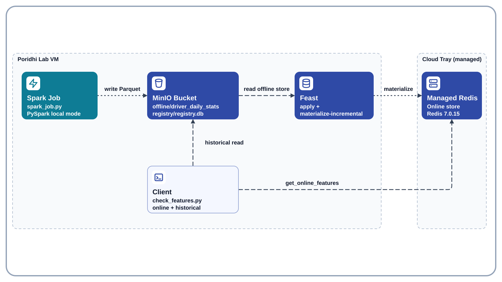

Storage in this lab is **MinIO-compatible object storage** (the SILO fork, run as a Docker container on the Poridhi Lab VM), so no AWS credentials are needed. The online store is the managed Redis from the Poridhi Cloud Tray. The object-store data disappears when the VM is destroyed. The managed Redis keeps running outside the VM, so the features you materialize stay there until the lab session ends.

## Learning Objectives

- Run a PySpark job in local mode that computes daily aggregates and writes Parquet to an S3-compatible bucket through `s3a://`.
- Run the MinIO-compatible SILO container from Docker Hub and use it as the offline store and registry location for Feast.
- Point a Feast `FileSource` at Spark output and register the feature view with `feast apply`.
- Materialize the latest Spark-computed features into managed Redis with `feast materialize-incremental`.
- Read the same features back from the online store and from the offline store.

### Folder Structure

```text
~/poridhi-lab-7-6/
├── feature_repo/
│   ├── .feastignore
│   ├── feature_store.yaml
│   ├── spark_job.py
│   ├── driver_repo.py
│   └── check_features.py
└── venv/
```

## Prerequisites

- **Region:** `ap-southeast-1` (Asia Pacific, Singapore). No availability zones are used. The S3-compatible store runs on the lab VM, and the lab sets the same region on the container and on the AWS CLI so the S3 requests sign correctly. No AWS account or AWS resource is involved.
- **Environment:** Poridhi Lab VM running Linux, with VS Code available in the lab UI for creating and editing files. The managed Redis from the Cloud Tray is the online store. Docker is available on the VM.
- **Storage:** SILO (a maintained MinIO-compatible fork) from Docker Hub, running on the Poridhi Lab VM at `http://127.0.0.1:9000` (access key `minioadmin`, secret key `minioadmin` for the lab). The step automatically falls back to Chainguard's MinIO image if the SILO tag is unavailable. Data is lost when the VM is destroyed.
- **Knowledge:** basic Python, basic SQL-style aggregation, and a first pass through the earlier Feast labs in the 7.x series helps but is not required.

## Prologue

Earlier labs in this series defined features directly on pre-made Parquet files. Real teams rarely work that way. Raw events pile up, a scheduled Spark job turns them into daily features, and the feature store picks up whatever the job produced. This lab builds that exact loop on a single VM: compute with Spark, land the result in object storage, register it in Feast, and materialize it so the next serving request sees fresh values.

You will leave with a working pipeline you can re-run any time: run Spark, run materialize, read the new values.

## Step-by-Step Implementation

### Step 1: Create the project directory and the Python virtual environment

> Note: this step creates the project folders, the virtual environment, and installs Feast, PySpark, and the data libraries.

```bash
mkdir -p ~/poridhi-lab-7-6/feature_repo
cd ~/poridhi-lab-7-6/feature_repo
python3 -m venv ~/poridhi-lab-7-6/venv
source ~/poridhi-lab-7-6/venv/bin/activate
pip install --upgrade pip
pip install "numpy>=2.0,<3" "pandas>=2" "pyarrow>=16.1.0" "feast[redis,aws]" s3fs "pyspark==3.5.1"
command -v aws >/dev/null 2>&1 || pip install awscli
```

`s3fs` is installed explicitly on purpose. Feast reads a `file` offline store through `dask`, which uses `s3fs` to reach S3, but the `feast[aws]` extra does not pull it in. Without it, the read in Step 12 fails with `ImportError: Install s3fs to access S3`. The `awscli` line is there because every later step that touches MinIO runs `aws s3 ...`, and the VM does not ship the AWS CLI.

That is the only `cd` and the only `source` you need for the whole lab. From here on the terminal stays in `~/poridhi-lab-7-6/feature_repo` with the virtual environment active, so every later step runs directly.

The exact version numbers depend on the Python version on the VM, so read the package names rather than the numbers. Your prompt now starts with `(venv)`.

> Would I get an error if I ran this? Possibly. If pip reports a dependency conflict about `numpy`, re-run only the last `pip install` line without the `"numpy>=2.0,<3"` pin. A `python3: No module named venv` message means the `python3-venv` package is missing: run `sudo apt install -y python3-venv` and repeat the block.

#### Step 1.1: Make VS Code see the project folder (one-time setup)

> Note: this sub-step makes the VS Code Explorer show every folder and file you create in the rest of the lab.

VS Code's Explorer only shows the folder that was opened with `File > Open Folder`, and the `code` shell command is not on `PATH` on the default lab VM. Do this once so the Explorer follows every file you create:

1. In the VS Code window, press **`Ctrl+Shift+P`** to open the Command Palette.
2. Type `Shell Command: Install 'code' command in PATH` and press **`Enter`**. A small notification at the bottom right confirms `Shell command 'code' successfully installed in PATH`. This is a one-time operation; the lab VM keeps it across sessions.
3. Run `code ~/poridhi-lab-7-6` in the integrated terminal, or press **`Ctrl+Shift+P`** again and run **`File: Open Folder`**, picking `~/poridhi-lab-7-6`.
4. The Explorer label changes from `CODE` (or `Welcome`) to `PORIDHI-LAB-7-6`, and you can see `feature_repo/`, `venv/`, and every file you create in later steps.

If you skip this sub-step, you can still finish the lab by creating each file through `File > New File...` in the Welcome tab, but the install makes every later step easier.

### Step 2: Install Java for Spark

> Note: this step installs the Java runtime that Spark needs and confirms it works.

```bash
sudo apt update
sudo apt install -y openjdk-17-jre-headless
java -version
```

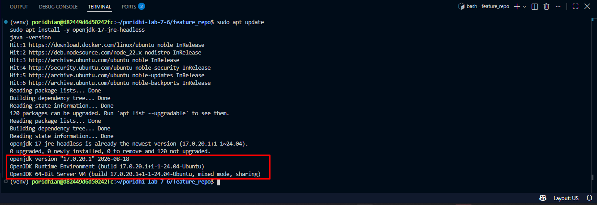

> Would I get an error if I ran this? Possibly. If Java 17 is already installed, `apt` simply reports it is up to date. A `Unable to locate package` message means `sudo apt update` did not finish, so run it again.

### Step 3: Read the managed Redis credentials from the Cloud Tray

> Note: this step exports the Redis connection values for the current lab session so later commands can use them.

Open the Poridhi Cloud Tray in the lab UI, click **Database**, then click the **Redis** card. Copy the **Username**, **Password**, **IP Address**, and **Port** from the panel. The values can change between lab runs, so always read them from the panel.

```bash
export REDIS_HOST="<paste-ip-from-cloud-tray>"
export REDIS_PORT="<paste-port-from-cloud-tray>"
export REDIS_USERNAME="<paste-username-from-cloud-tray>"
export REDIS_PASSWORD="<paste-password-from-cloud-tray>"
```

**Write this down:** run `echo "$REDIS_HOST:$REDIS_PORT"` to print the endpoint. It will look like `100.80.215.5:6379`. You need the same four values again in Step 6, where they go into `feature_store.yaml`. If you opened a new terminal since this step and the command prints only a colon, re-run the four `export` lines above with the values from the Cloud Tray Redis panel.

> Would I get an error if I ran this? No. Exports only set variables. Wrong values show up in Step 5.

### Step 4: Pull the object store image

> Note: this step removes any old container and pulls the MinIO-compatible SILO image, falling back to Chainguard's image if it is unavailable.

```bash
docker rm -f minio >/dev/null 2>&1 || true
MINIO_IMAGE="docker.io/pgsty/silo:RELEASE.2026-10-26T00-00-00Z"
if ! docker pull "$MINIO_IMAGE" >/dev/null 2>&1; then
  echo "SILO image unavailable; falling back to Chainguard's MinIO image."
  MINIO_IMAGE="cgr.dev/chainguard/minio:latest"
  docker pull "$MINIO_IMAGE"
  docker run --rm -v minio-data:/data mirror.gcr.io/library/busybox:1.37 chown -R 65532:65532 /data
fi
echo "Using image: $MINIO_IMAGE"
```

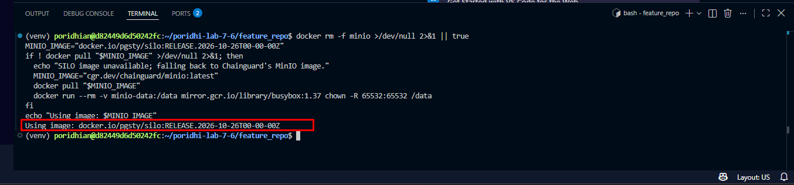

MinIO stopped publishing its community image, so `minio/minio` no longer exists on Docker Hub and `quay.io/minio/minio` refuses anonymous pulls. This step pulls **SILO**, a community-maintained fork of the MinIO server, from `docker.io/pgsty/silo`. SILO keeps the same S3 API, the same `MINIO_*` environment variables, the same `/minio/health` routes, and the same on-disk format, so the `docker run` command and the rest of the lab are unchanged. If the SILO tag ever disappears, the block falls back to Chainguard's MinIO image and fixes ownership on the `minio-data` volume first, because that image runs as user `65532`. The `docker rm -f minio` line makes the step safe to re-run: it clears any container left over from a previous attempt while the `minio-data` volume keeps the bucket data.

**Record this:** the block ends by printing `Using image: ...`, for example `Using image: docker.io/pgsty/silo:RELEASE.2026-10-26T00-00-00Z`. That value is stored in `MINIO_IMAGE` and is used again in Step 4.1. You can print it any time with `echo "$MINIO_IMAGE"`. If it is empty, re-run this block.

> Would I get an error if I ran this? Possibly. `docker: permission denied` means your user is not in the Docker group: prefix the Docker commands with `sudo`. If both images fail to pull, the VM has no route to Docker Hub or Chainguard: check with `curl -sI https://registry-1.docker.io/v2/` and `curl -sI https://cgr.dev/v2/`, then retry.

#### Step 4.1: Start the container and wait for it to be healthy

> Note: this step starts the object store container from the image pulled in Step 4 and waits until the health endpoint answers.

```bash
MINIO_IMAGE="${MINIO_IMAGE:-docker.io/pgsty/silo:RELEASE.2026-10-26T00-00-00Z}"
docker run -d --name minio -p 9000:9000 -p 9001:9001 \
  -e MINIO_ROOT_USER=minioadmin \
  -e MINIO_ROOT_PASSWORD=minioadmin \
  -e MINIO_REGION=ap-southeast-1 \
  -v minio-data:/data \
  "$MINIO_IMAGE" server /data --console-address ":9001"
until curl -s -o /dev/null -w "%{http_code}" http://127.0.0.1:9000/minio/health/ready | grep -q 200; do sleep 1; done
```
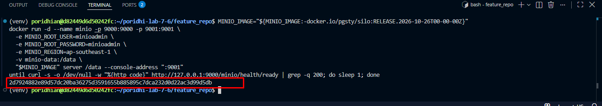

The first line falls back to the SILO tag only if `MINIO_IMAGE` is empty, so the image chosen in Step 4 is the one that actually runs. The `until` loop blocks until `/minio/health/ready` returns `200`, which means the bucket API is ready for the next step.

> Would I get an error if I ran this? Possibly. `The container name "/minio" is already in use` means a container from an earlier attempt is still around: run `docker rm -f minio` and repeat this block. If the command hangs in the health loop, check the container logs with `docker logs minio`.

#### Step 4.2: Verify the object store container is running

> Note: this step confirms the container is up and shows which image it is actually running.

```bash
docker ps
```

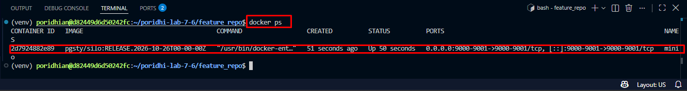

Read the `IMAGE` column to confirm which image is running. It shows `pgsty/silo:RELEASE.2026-10-26T00-00-00Z` on the normal path, or `cgr.dev/chainguard/minio:latest` if the SILO tag was unavailable and the fallback ran. Docker strips the `docker.io/` prefix in `docker ps`, so the tag appears without it. Either way the container name is `minio` and its status is `Up`.

#### Step 4.3: Export the object store credentials

> Note: this step exports the object store credentials and the Feast S3 endpoint for the current session.

```bash
export AWS_ACCESS_KEY_ID="minioadmin"
export AWS_SECRET_ACCESS_KEY="minioadmin"
export AWS_DEFAULT_REGION="ap-southeast-1"
export AWS_ENDPOINT_URL="http://127.0.0.1:9000"
export FEAST_S3_ENDPOINT_URL="http://127.0.0.1:9000"
echo 'export AWS_ACCESS_KEY_ID=minioadmin' >> ~/.bashrc
echo 'export AWS_SECRET_ACCESS_KEY=minioadmin' >> ~/.bashrc
echo 'export AWS_DEFAULT_REGION=ap-southeast-1' >> ~/.bashrc
echo 'export AWS_ENDPOINT_URL=http://127.0.0.1:9000' >> ~/.bashrc
echo 'export FEAST_S3_ENDPOINT_URL=http://127.0.0.1:9000' >> ~/.bashrc
```

Those exports exist for a reason. `AWS_DEFAULT_REGION` is the region the AWS CLI and boto3 sign their requests with, and `MINIO_REGION` is the region the MinIO server advertises. The two must be the same: MinIO validates the signature before it looks at anything else, and a request signed for one region is rejected when the server runs in another. `AWS_ENDPOINT_URL` points PyArrow at MinIO, because PyArrow ignores `s3_endpoint_override` when it validates a data source path, and a warning about an unreadable path is printed on every `feast apply` without it. `FEAST_S3_ENDPOINT_URL` is the one Feast reads when it reaches the registry in S3.

> Would I get an error if I ran this? No. Exports and appends only change the shell environment; wrong values show up in Step 4.4 and Step 5.

#### Step 4.4: Create the bucket

> Note: this step creates the bucket that Spark writes to and where Feast stores its registry.

```bash
aws --endpoint-url http://127.0.0.1:9000 s3api head-bucket --bucket feast-spark-lab 2>/dev/null || aws --endpoint-url http://127.0.0.1:9000 s3 mb s3://feast-spark-lab
```

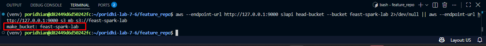

`head-bucket` succeeds when the bucket already exists, so the `mb` command is skipped. On a fresh store the first command fails and `mb` creates the bucket, which prints `make_bucket`.

> Would I get an error if I ran this? Possibly. `aws: command not found` means the AWS CLI is missing: run the `pip install awscli` line from Step 1 and repeat the last line. `AuthorizationHeaderMalformed` means the CLI region and the container region do not match: check that `AWS_DEFAULT_REGION` and the `MINIO_REGION` value in the `docker run` command are both `ap-southeast-1`, then remove the container with `docker rm -f minio`, start it again with Step 4.1, and repeat this block.

### Step 5: Test the connections to Redis and MinIO

> Note: this step proves that the venv can reach both the managed Redis and the MinIO bucket before any Spark or Feast work starts.

```bash
python -c "import os, redis; r = redis.Redis(host=os.environ['REDIS_HOST'], port=int(os.environ['REDIS_PORT']), username=os.environ['REDIS_USERNAME'], password=os.environ['REDIS_PASSWORD'], decode_responses=True); print(r.ping())"
aws --endpoint-url http://127.0.0.1:9000 s3 ls
```

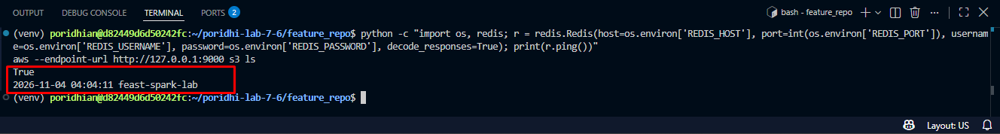

The `aws s3 ls` line prints the bucket creation time and the bucket name. A bucket has no size of its own, so there is no size column here.

> Would I get an error if I ran this? Possibly. `AuthenticationError` or `Connection refused` from Redis means a value from Step 3 is wrong or empty: print them with `echo "$REDIS_HOST:$REDIS_PORT"` and fix the exports. An empty bucket listing or a connection error from the second command means MinIO is not running: check with `docker ps`.

### Step 6: Create the Feast configuration file

> Note: this step writes `feature_store.yaml`, which tells Feast where the registry, offline store, and online store live.

Create a new file called `feature_store.yaml` in `~/poridhi-lab-7-6/feature_repo` and paste the YAML below into it. Then replace the four `<...>` values in `connection_string` by hand with the same values you exported in Step 3, so no real credential is stored anywhere else.

```yaml
project: spark_feast_batch
provider: local
registry: s3://feast-spark-lab/registry/registry.db
online_store:
  type: redis
  connection_string: "<REDIS_HOST>:<REDIS_PORT>,username=<REDIS_USERNAME>,password=<REDIS_PASSWORD>"
offline_store:
  type: file
entity_key_serialization_version: 3
```

> Would I get an error if I ran this? No, saving a file cannot fail. A wrong `connection_string` only shows up as a Redis error in Step 12.

### Step 7: Create the Feast feature definitions

> Note: this step registers the Spark output as the offline source of a Feast feature view.

Create a new file called `driver_repo.py` in `~/poridhi-lab-7-6/feature_repo` and paste the code below into it.

```python
from datetime import timedelta

from feast import Entity, FeatureView, Field, FileSource, ValueType
from feast.types import Float64, Int64

driver = Entity(name="driver", join_keys=["driver_id"], value_type=ValueType.INT64)

driver_daily_source = FileSource(
    name="driver_daily_source",
    path="s3://feast-spark-lab/offline/driver_daily_stats",
    timestamp_field="event_timestamp",
    created_timestamp_column="created",
    s3_endpoint_override="http://127.0.0.1:9000",
)

driver_daily_stats = FeatureView(
    name="driver_daily_stats",
    entities=[driver],
    ttl=timedelta(days=30),
    schema=[
        Field(name="daily_trips", dtype=Int64),
        Field(name="avg_rating", dtype=Float64),
        Field(name="total_distance_km", dtype=Float64),
    ],
    source=driver_daily_source,
    online=True,
)
```

The `ttl` of 30 days is what makes `materialize-incremental` work on the first run. With a `ttl` of zero, Feast has no start time to read from and refuses to materialize.

> Would I get an error if I ran this? No. Saving a file cannot fail. A wrong import or a wrong argument surfaces in Step 11, where `feast apply` loads this file.

### Step 8: Tell Feast to ignore the two helper scripts

> Note: this step keeps `feast apply` from trying to load the Spark job and the check script as feature definitions.

`feast apply` imports every `.py` file in the feature repository. The Spark job and the check script are not definitions, and importing them runs them. Create a new file called `.feastignore` in `~/poridhi-lab-7-6/feature_repo` and paste the two names below into it, one per line.

```text
spark_job.py
check_features.py
```

> Would I get an error if I ran this? No. If a name is misspelled, `feast apply` in Step 11 fails with an error that names the script it tried to import, which tells you which line to fix.

### Step 9: Create the Spark job

> Note: this step writes the PySpark job that computes daily driver features and saves them to MinIO as Parquet.

Create a new file called `spark_job.py` in `~/poridhi-lab-7-6/feature_repo` and paste the code below into it. Paste it into the editor, not into the terminal. The job builds raw trip events, aggregates them per driver per day, and writes a single Parquet dataset to `s3a://feast-spark-lab/offline/driver_daily_stats`.

```python
from pyspark.sql import SparkSession, functions as F

BUCKET = "feast-spark-lab"
OUTPUT_PATH = f"s3a://{BUCKET}/offline/driver_daily_stats"

spark = (
    SparkSession.builder.appName("daily-driver-features")
    .master("local[2]")
    .config("spark.sql.session.timeZone", "UTC")
    .config("spark.sql.parquet.outputTimestampType", "TIMESTAMP_MICROS")
    .config(
        "spark.jars.packages",
        "org.apache.hadoop:hadoop-aws:3.3.4,com.amazonaws:aws-java-sdk-bundle:1.12.262",
    )
    .config("spark.hadoop.fs.s3a.endpoint", "http://127.0.0.1:9000")
    .config("spark.hadoop.fs.s3a.endpoint.region", "ap-southeast-1")
    .config("spark.hadoop.fs.s3a.access.key", "minioadmin")
    .config("spark.hadoop.fs.s3a.secret.key", "minioadmin")
    .config("spark.hadoop.fs.s3a.path.style.access", "true")
    .config("spark.hadoop.fs.s3a.connection.ssl.enabled", "false")
    .config("spark.hadoop.fs.s3a.impl", "org.apache.hadoop.fs.s3a.S3AFileSystem")
    .getOrCreate()
)
spark.sparkContext.setLogLevel("WARN")

# Raw trip events for the last 5 days, spread across 5 drivers
raw_trips = (
    spark.range(0, 500)
    .withColumn("driver_id", (F.col("id") % 5 + 1001).cast("long"))
    .withColumn("day_offset", F.floor(F.rand(7) * 5).cast("int"))
    .withColumn("trip_day", F.expr("date_sub(current_date(), day_offset)"))
    .withColumn("distance_km", F.round(F.rand(11) * 20 + 1, 2))
    .withColumn("rating", F.round(F.rand(13) * 2 + 3, 2))
)

# Daily features per driver, with UTC timestamps for Feast
daily_features = (
    raw_trips.groupBy("driver_id", "trip_day")
    .agg(
        F.count("*").cast("long").alias("daily_trips"),
        F.round(F.avg("rating"), 2).alias("avg_rating"),
        F.round(F.sum("distance_km"), 2).alias("total_distance_km"),
    )
    .withColumn("event_timestamp", F.to_timestamp(F.date_format("trip_day", "yyyy-MM-dd 00:00:00")))
    .withColumn("created", F.current_timestamp())
    .drop("trip_day")
)

daily_features.coalesce(1).write.mode("overwrite").parquet(OUTPUT_PATH)

print("Rows written:", daily_features.count())
daily_features.orderBy("driver_id", "event_timestamp").show(10, truncate=False)

spark.stop()
```

Three details make this work. `event_timestamp` is built from the trip day at midnight rather than from `to_timestamp` on a date column, because Feast compares event timestamps against your query timestamps and a bare date is ambiguous about its timezone. The Spark session timezone is `UTC`, so every timestamp written to Parquet is UTC. The `fs.s3a.endpoint.region` setting is the one that trips people up: the S3A connector signs every request with a region, and it does not read the region out of the shell environment the way the AWS CLI does. MinIO rejects a request whose signing region does not match its own, so the connector has to be told the same region the MinIO container was started with.

> Would I get an error if I ran this? No, saving a file cannot fail. Runtime errors are covered in Step 10.

### Step 10: Run the Spark job and check the output in MinIO

> Note: this step runs the Spark job inside the virtual environment and confirms the Parquet output landed in the bucket.

Your terminal is already inside `~/poridhi-lab-7-6/feature_repo` with the virtual environment active.

```bash
python spark_job.py
aws --endpoint-url http://127.0.0.1:9000 s3 ls s3://feast-spark-lab/offline/driver_daily_stats/
```

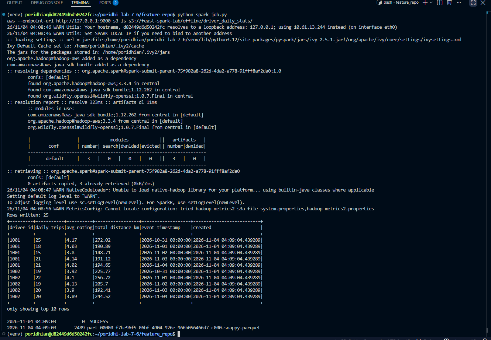

The first run downloads the `hadoop-aws` and AWS SDK jars from Maven Central, so it takes a minute or two before Spark prints anything. Later runs reuse the cached jars in `~/.ivy2` and start immediately.

> Would I get an error if I ran this? Possibly. `JAVA_HOME is not set` or `java: command not found` means Step 2 did not finish. `Connection refused` from `s3a` means MinIO is not running. `UnknownStoreException: Bucket does not exist` means the bucket name in `OUTPUT_PATH` does not match the one you created in Step 4. `can't open file '.../spark_job.py': [Errno 2] No such file or directory` means the shell is not inside `feature_repo` (often because a new terminal was opened): run `cd ~/poridhi-lab-7-6/feature_repo` and confirm the prompt shows `(venv)`. Pasting the Python code into the terminal does not create the file; create `spark_job.py` in the editor first.

### Step 11: Apply the feature definitions to the registry

> Note: this step registers the entity and feature view, which writes `registry.db` into the MinIO bucket.

```bash
feast apply
aws --endpoint-url http://127.0.0.1:9000 s3 ls s3://feast-spark-lab/registry/
```

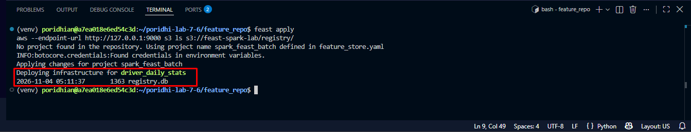

The registry size shifts by a few bytes from run to run because Feast stamps the registry with a UUID and a timestamp. Read the file name, not the byte count.

> Would I get an error if I ran this? Possibly. `NoCredentialsError` or an endpoint error means `AWS_ACCESS_KEY_ID` or `FEAST_S3_ENDPOINT_URL` is not exported in this terminal: re-run the exports from Step 4. A `ModuleNotFoundError` means the virtual environment is not active: run `source ~/poridhi-lab-7-6/venv/bin/activate`. `S3RegistryBucketNotExist` means the bucket name in `feature_store.yaml` does not match the bucket you created in Step 4.

### Step 12: Materialize the Spark features into Redis

> Note: this step copies the newest rows from the offline store into the managed Redis online store.

```bash
feast materialize-incremental $(date -u +"%Y-%m-%dT%H:%M:%S")
```

The end timestamp is a positional argument in ISO 8601 format, and `date -u` produces exactly that shape.

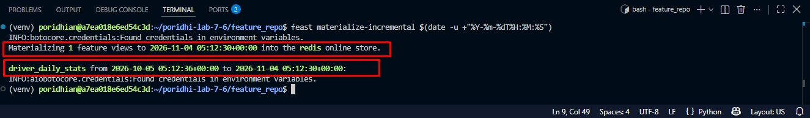

The start time is 30 days earlier than the end time because that is the `ttl` on the feature view. Feast reads the offline rows inside that window and writes the newest value per driver into Redis.

> Would I get an error if I ran this? Possibly. `No start time found for feature view driver_daily_stats` means the `ttl` in `driver_repo.py` is zero or missing. `AuthenticationError` or `WRONGPASS` from Redis means the `connection_string` in `feature_store.yaml` has a wrong host, username, or password: compare all four values against the Cloud Tray Redis panel, fix the file, and re-run the command.

### Step 13: Create and run the feature check script

> Note: this step reads the same features from Redis (online) and from MinIO (offline) to confirm that the Spark output reaches both stores.

Create a new file called `check_features.py` in `~/poridhi-lab-7-6/feature_repo` and paste the code below into it.

```python
from datetime import datetime, timezone

import pandas as pd
from feast import FeatureStore

store = FeatureStore(repo_path=".")

features = [
    "driver_daily_stats:daily_trips",
    "driver_daily_stats:avg_rating",
    "driver_daily_stats:total_distance_km",
]

print("Online features from Redis:")
online = store.get_online_features(
    features=features,
    entity_rows=[{"driver_id": 1001}, {"driver_id": 1002}],
).to_dict()
print(online)

print("Historical features from the Spark output in MinIO:")
entity_df = pd.DataFrame(
    {
        "driver_id": [1001, 1002, 1003],
        "event_timestamp": [datetime.now(timezone.utc)] * 3,
    }
)
historical = store.get_historical_features(
    entity_df=entity_df, features=features
).to_df()
print(historical)
```

Run it from the same terminal:

```bash
python check_features.py
```

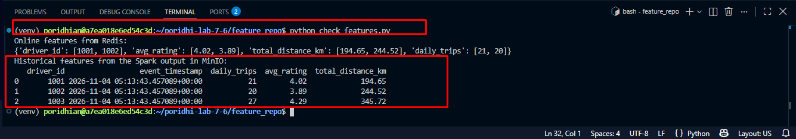

The key order inside the printed dictionary follows the order Feast resolved the feature references, so it can differ from the order they are listed in the script. The exact counts and averages depend on the random values Spark generated, so compare the shape rather than the numbers. What matters is that no value is `None` and that the historical row for a driver carries the same values as the online row for that driver.

> Would I get an error if I ran this? Possibly. `None` values in the online result mean the materialize step in Step 12 did not run or wrote nothing: repeat Step 12. `ImportError: Install s3fs to access S3` in the historical part means `s3fs` is not installed: re-run the `pip install` line from Step 1. An S3 or endpoint error means `FEAST_S3_ENDPOINT_URL` is not exported in this terminal.

### Step 14: Run the Spark job again and materialize the new run

> Note: this step regenerates the batch and pushes the new values into Redis.

```bash
python spark_job.py
feast materialize-incremental $(date -u +"%Y-%m-%dT%H:%M:%S")
```

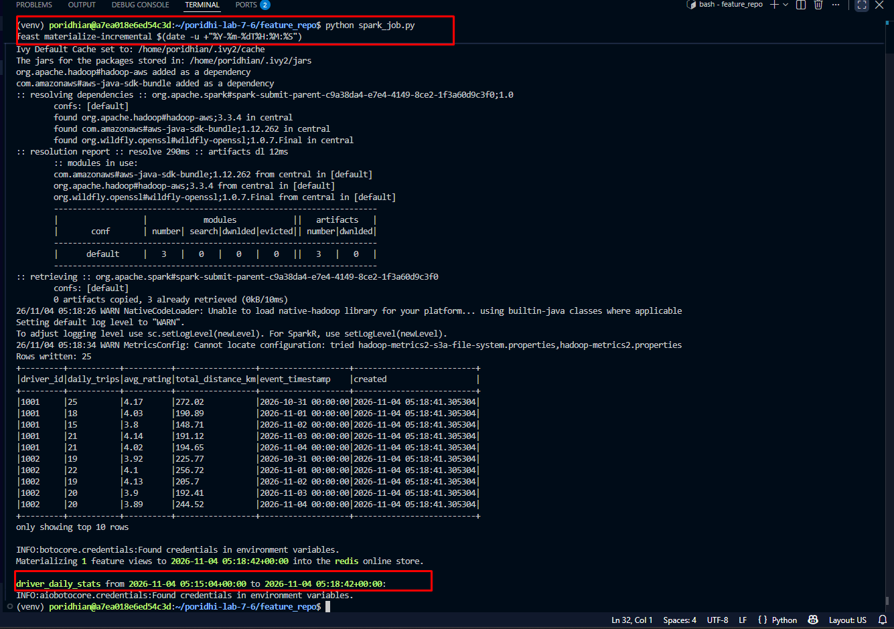

> Would I get an error if I ran this? No, if Steps 10 and 12 passed. The Spark job uses fixed random seeds, so the values stay stable between runs and only the dates move forward with the calendar.

### Step 15: Confirm the refreshed features

> Note: this step reads the new values back from Redis and the offline store.

```bash
python check_features.py
```

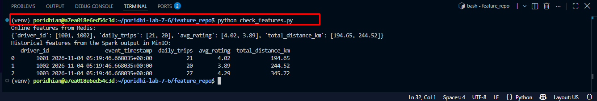

> Would I get an error if I ran this? No, if Step 13 passed.

### Step 16: Expose the MinIO console through the Poridhi Load Balancer

> Note: this step makes the MinIO web console reachable from your browser through the Poridhi Load Balancer.

The console listens on port `9001` inside the VM, but the VM is reachable only from inside the lab network. The **Load Balancer** panel in the lab UI publishes a VM port to a public URL. First read the VM's internal IP:

```bash
hostname -I
```

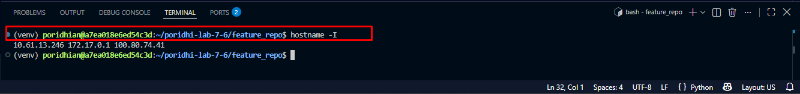

**Record this:** open the **Load Balancer** panel, put the first IP in **Enter IP** and `9001` in **Enter Port**, then click **Expose**. The panel lists a `Node Endpoint` (`10.61.13.246:9001` in this example) and a public `URL` shaped like `http://6932b4db068c684dd55b0c6d-ce55c712.lb.poridhi.io`. Write the URL down. If you lose it, the panel still lists it until you click the trash icon; removing the entry revokes the URL immediately.

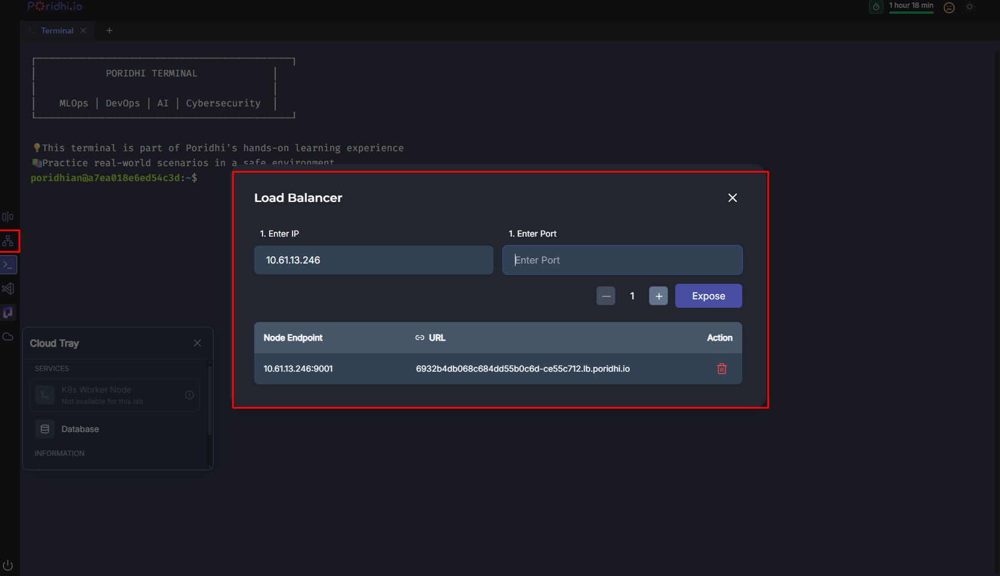

Expose `9001`, not `9000`. Port `9000` is the S3 API that Spark and Feast talk to, and a browser gets an XML error there; `9001` is the console.

> Would I get an error if I ran this? Possibly. A link that never loads means the IP is wrong: `127.0.0.1` and `172.17.0.1` cannot be routed by the balancer, so use the first `hostname -I` address, or the `100.x` one if the first fails.

If the console page loads but login or browsing hangs, the console is building links for `127.0.0.1:9001`. Restart it with the exposed URL as its public address; the `minio-data` volume keeps the bucket, the Parquet output, and the registry:

```bash
PUBLIC_URL="<paste-exposed-url-here>"
docker rm -f minio
MINIO_IMAGE="${MINIO_IMAGE:-docker.io/pgsty/silo:RELEASE.2026-10-26T00-00-00Z}"
docker run -d --name minio -p 9000:9000 -p 9001:9001 \
  -e MINIO_ROOT_USER=minioadmin \
  -e MINIO_ROOT_PASSWORD=minioadmin \
  -e MINIO_REGION=ap-southeast-1 \
  -e MINIO_BROWSER_REDIRECT_URL="$PUBLIC_URL" \
  -v minio-data:/data \
  "$MINIO_IMAGE" server /data --console-address ":9001"
until curl -s -o /dev/null -w "%{http_code}" http://127.0.0.1:9000/minio/health/ready | grep -q 200; do sleep 1; done
```

The health loop exits silently and `docker ps --filter name=minio` shows the container `Up` again. Open the same public URL after the restart.

### Step 17: Browse the features in the MinIO console

> Note: this step uses the console to see the Parquet output and the Feast registry created in the previous steps.

Open the exposed URL from Step 16 and sign in with `minioadmin` / `minioadmin`.

1. Click **Buckets** in the left sidebar.
2. Click `feast-spark-lab`.
3. Open `offline/driver_daily_stats/` to see `part-00000-....snappy.parquet` and `_SUCCESS`, the files Spark wrote in Step 10 and rewrote in Step 14.
4. Open `registry/registry.db`, the Feast registry that `feast apply` wrote in Step 11.
5. Click **Monitoring** then **Metrics** to watch live request and bandwidth charts for the store.

The console reads the same `minio-data` volume that the S3 API serves, so what you see here is exactly what Spark and Feast read and write. Hovering a file offers **Download** and **Preview**, a quick way to inspect the Parquet output without another CLI command.

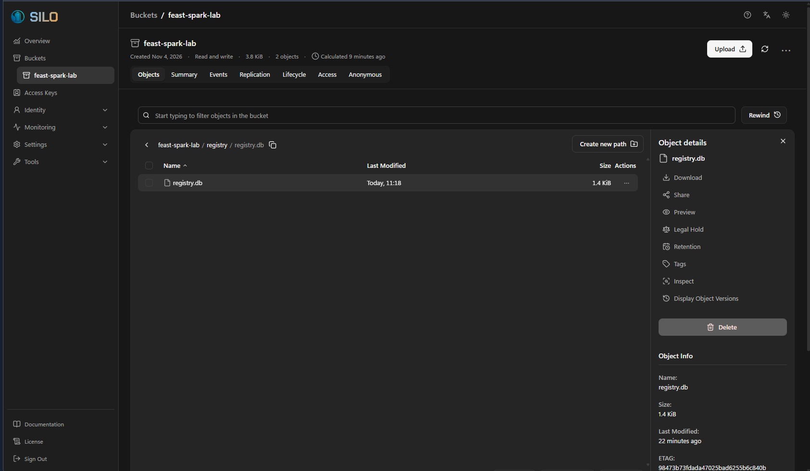

> Would I get an error if I ran this? Possibly. `Access Denied` means you signed in with different credentials; use `minioadmin` / `minioadmin`. An empty bucket right after Step 4 is expected: the Parquet appears only after Step 10 and the registry only after Step 11. If the page logs you out on every click, set `MINIO_BROWSER_REDIRECT_URL` as shown in Step 16.

## Epilogue

You built the standard batch hand-off between a compute engine and a feature store. Spark computed daily driver features and wrote them to object storage, Feast registered that output as its offline store, and a single materialize command made the newest values available from Redis in milliseconds.

The same shape works at any scale. Swap local Spark for a cluster, MinIO for a managed bucket, and the manual commands for a scheduler, and nothing in the Feast definitions has to change.

## Conclusion

This lab connected a Spark batch job to Feast through an S3-compatible bucket. Spark computed daily driver features and wrote Parquet to MinIO, Feast registered that output as its offline store, and `feast materialize-incremental` moved the latest values into managed Redis. The key takeaway is that Spark owns computation while Feast owns registration, retrieval, and serving, so each can scale and change independently.
