## Introduction

This lab, **Kafka → Feast Stream**, shows how to turn a live stream of events into fresh features. You will run Apache Kafka on the lab VM, publish driver trip events to a topic, consume them with a stream processor that computes rolling-window features in real time, and push every result into Feast through the streaming push API. The push writes to the online store (managed Redis) and to the offline store (a Parquet file) in one call.

Batch pipelines refresh features once per day, which is too slow for use cases such as fraud checks, dynamic pricing, or driver matching. A stream processor keeps the online store current within a second of each event, and the push API keeps the offline history consistent so training data matches what was served.

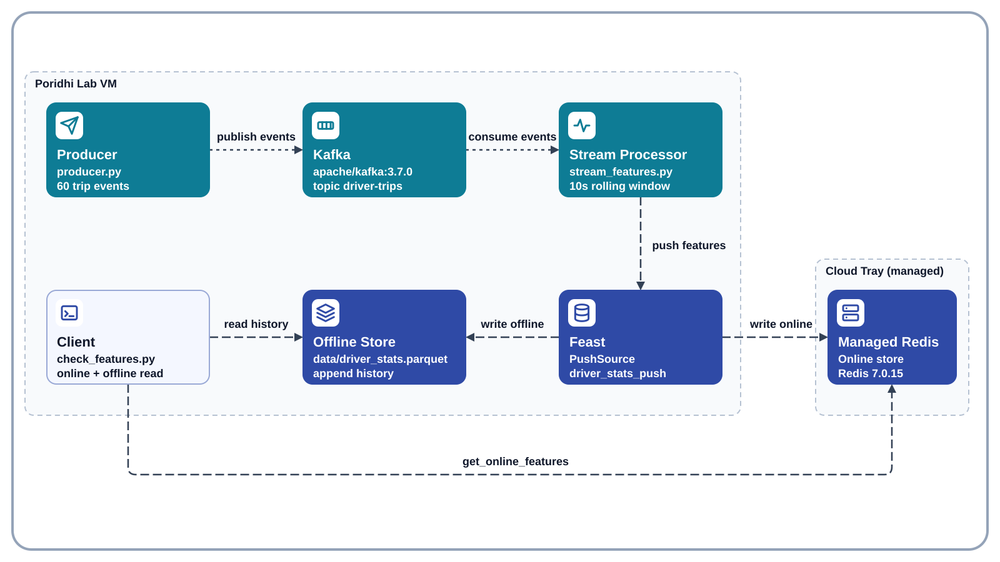

No object storage is needed in this lab. The Feast registry and the offline Parquet file are local files on the VM, Kafka runs as a Docker container on the VM, and the online store is the managed Redis from the Poridhi Cloud Tray. Kafka data and local files disappear when the VM is destroyed. The managed Redis keeps running outside the VM, so the pushed features stay there until the lab session ends.


## Learning Objectives

- Run a single-node Apache Kafka broker from Docker Hub on the lab VM and create a topic.
- Publish JSON events with a Kafka producer and consume them with a consumer group.
- Compute rolling-window features per entity in a stream processor.
- Define a Feast `PushSource` and a feature view that uses it.
- Push features to the online and offline stores in one call with `store.push` and verify both.
- Start the Feast UI dashboard, expose it with the Cloud Tray Load Balancer, and inspect the registered entities and feature views.

### Folder Structure

```text
~/poridhi-lab-7-7/
├── feature_repo/
│   ├── feature_store.yaml
│   ├── .feastignore
│   ├── seed_data.py
│   ├── driver_repo.py
│   ├── stream_features.py
│   ├── producer.py
│   ├── check_features.py
│   └── data/
│       ├── driver_stats.parquet
│       └── registry.db
└── venv/
```

## Prerequisites

- **Region:** `ap-southeast-1` (Asia Pacific, Singapore). No availability zones are used. This lab needs no AWS resources.
- **Environment:** Poridhi Lab VM running Linux, with VS Code available in the lab UI for creating and editing files. The managed Redis from the Cloud Tray is the online store. Docker is available on the VM and runs Kafka.
- **Knowledge:** basic Python and a first pass through the earlier Feast labs in the 7.x series helps but is not required.

## Prologue

Earlier labs in this series loaded features in batches. This lab closes the freshness gap. Events arrive one at a time, a stream processor turns them into features, and Feast makes those features available online and offline without a separate batch job.

You will build the full loop on one VM: start Kafka, define a push-based feature view, run the stream processor, send events, and read back the fresh features.

## Step-by-Step Implementation

### Step 1: Create the project folder and the virtual environment

> Note: this step creates the project folders and a Python virtual environment, then activates it.

```bash
mkdir -p ~/poridhi-lab-7-7/feature_repo/data
cd ~/poridhi-lab-7-7/feature_repo
python3 -m venv ~/poridhi-lab-7-7/venv
source ~/poridhi-lab-7-7/venv/bin/activate
```

That is the only `cd` and the only `source` you need for the whole lab. From here on the terminal stays in `~/poridhi-lab-7-7/feature_repo` with the virtual environment active, so every later step runs directly.

Expected output: the commands print nothing. Your prompt now starts with `(venv)`.

> Would I get an error if I ran this? Possibly. `No module named venv` means the package is missing: run `sudo apt install -y python3-venv` and repeat the block.

#### Step 1.1: Make VS Code see the project folder (one-time setup)

> Note: this sub-step makes the VS Code Explorer show every folder and file you create in the rest of the lab.

VS Code's Explorer only shows the folder that was opened with `File > Open Folder`, and the `code` shell command is not on `PATH` on the default lab VM. Do this once so the Explorer follows every file you create:

1. In the VS Code window, press **`Ctrl+Shift+P`** to open the Command Palette.
2. Type `Shell Command: Install 'code' command in PATH` and press **`Enter`**. A small notification at the bottom right confirms `Shell command 'code' successfully installed in PATH`. This is a one-time operation; the lab VM keeps it across sessions.
3. Run `code ~/poridhi-lab-7-7` in the integrated terminal, or press **`Ctrl+Shift+P`** again and run **`File: Open Folder`**, picking `~/poridhi-lab-7-7`.
4. The Explorer label changes from `CODE` (or `Welcome`) to `PORIDHI-LAB-7-7`, and you can see `feature_repo/`, `venv/`, and every file you create in later steps.

If you skip this sub-step, you can still finish the lab by creating each file through `File > New File...` in the Welcome tab, but the install makes every later step easier.

### Step 2: Install the Python dependencies

> Note: this step installs Feast with Redis support, the Kafka client, and the data libraries into the active virtual environment.

```bash
pip install --upgrade pip
pip install "numpy>=2.0,<3" "pandas>=2" "pyarrow>=14" "feast[redis]" "confluent-kafka"
```

Expected output: the last lines of pip end with `Successfully installed ...` and list `feast`, `confluent-kafka`, `numpy`, `pandas`, and `pyarrow`.

> Would I get an error if I ran this? Possibly. A `numpy` conflict means the pin is too tight: drop `"numpy>=2.0,<3"` and let pip choose.

### Step 3: Read the managed Redis credentials from the Cloud Tray

> Note: this step exports the Redis connection values for the current lab session so you can copy them into the Feast configuration and test the connection.

Open the Poridhi Cloud Tray in the lab UI, click **Database**, then click the **Redis** card. Copy the **Username**, **Password**, **IP Address**, and **Port** from the panel. The values can change between lab runs, so always read them from the panel.

```bash
export REDIS_HOST="<paste-ip-from-cloud-tray>"
export REDIS_PORT="<paste-port-from-cloud-tray>"
export REDIS_USERNAME="<paste-username-from-cloud-tray>"
export REDIS_PASSWORD="<paste-password-from-cloud-tray>"
```

**Write this down:** run `echo "$REDIS_HOST:$REDIS_PORT"` to print the endpoint. It will look like `100.80.215.5:6379`. If you opened a new terminal since this step and the command prints only a colon, re-run the four `export` lines above with the values from the Cloud Tray Redis panel.

> Would I get an error if I ran this? No. Exports only set variables; wrong values show up in Step 6.

### Step 4: Start the Kafka broker

> Note: this step pulls the Kafka image and starts a single-node broker as a Docker container on the lab VM.

```bash
docker pull apache/kafka:3.7.0
docker run -d --name kafka -p 9092:9092 apache/kafka:3.7.0
until docker exec kafka /opt/kafka/bin/kafka-broker-api-versions.sh --bootstrap-server localhost:9092 > /dev/null 2>&1; do sleep 2; done
```

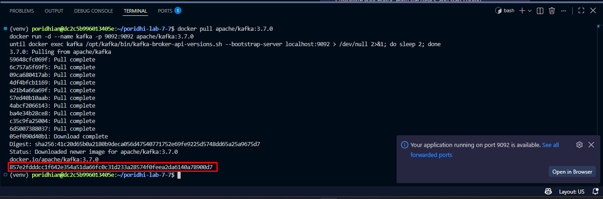

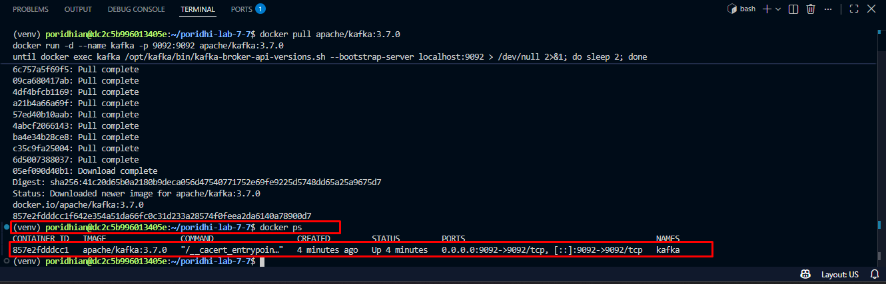

> Would I get an error if I ran this? Possibly. `permission denied` means you need `sudo`; `container name already in use` means run `docker start kafka` instead.

### Step 5: Create the `driver-trips` topic

> Note: this step creates the single-partition topic that the producer writes to and the stream processor reads from.

```bash
docker exec kafka /opt/kafka/bin/kafka-topics.sh --create --topic driver-trips --bootstrap-server localhost:9092 --partitions 1 --replication-factor 1
```

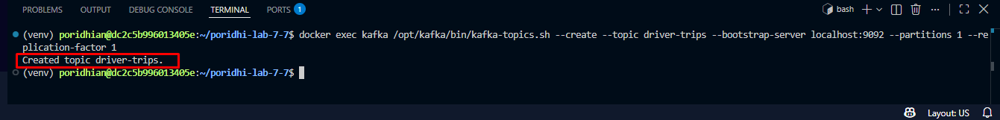

> Would I get an error if I ran this? Possibly. `Topic already exists` is harmless; the topic is ready either way.

### Step 6: Test the connections to Redis and Kafka

> Note: this step proves that the virtual environment can reach both the managed Redis and the Kafka broker before any Feast work starts.

```bash
python -c "import os, redis; r = redis.Redis(host=os.environ['REDIS_HOST'], port=int(os.environ['REDIS_PORT']), username=os.environ['REDIS_USERNAME'], password=os.environ['REDIS_PASSWORD'], decode_responses=True); print(r.ping())"
python -c "from confluent_kafka.admin import AdminClient; print(list(AdminClient({'bootstrap.servers': 'localhost:9092'}).list_topics(timeout=10).topics))"
```
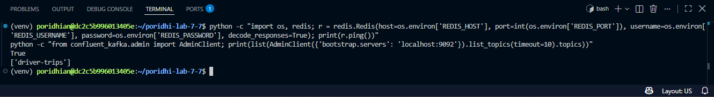

> Would I get an error if I ran this? Possibly. `AuthenticationError` means a Step 3 value is wrong: re-check the exports. A Kafka timeout means the container is down: check `docker ps`.

### Step 7: Create the Feast configuration file

> Note: this step writes `feature_store.yaml`, which tells Feast where the registry, offline store, and online store live.

Create a new file called `feature_store.yaml` in `~/poridhi-lab-7-7/feature_repo` and paste the YAML below into it.

```yaml
project: kafka_feast_stream
provider: local
registry: data/registry.db
online_store:
  type: redis
  redis_type: redis
  connection_string: "${REDIS_HOST}:${REDIS_PORT},username=${REDIS_USERNAME},password=${REDIS_PASSWORD},db=0"
offline_store:
  type: file
entity_key_serialization_version: 3
```

Feast expands the `${REDIS_*}` placeholders itself when it loads this file, so the four values from Step 3 are filled in at run time. Do not paste the credentials into the file.

> Would I get an error if I ran this? No. A wrong value shows up as a Redis error in Step 17.

### Step 8: Create the Feast ignore file

> Note: this step writes `.feastignore`, which stops `feast apply` from running the helper scripts in this folder.

Create a new file called `.feastignore` in `~/poridhi-lab-7-7/feature_repo` and paste the contents below into it, one filename per line.

```text
seed_data.py
stream_features.py
producer.py
check_features.py
```

`feast apply` imports every `.py` file in the repository folder to collect the feature definitions, which also runs each script's top-level code. Without this file, `feast apply` would re-seed the Parquet file and start the stream processor and the producer on every apply. `driver_repo.py` is deliberately not listed: it holds the entity, the push source, and the feature view, so `feast apply` must read it. Add any other helper script's filename here before applying.

> Would I get an error if I ran this? No. The effect shows up in Step 12.

### Step 9: Create the seed data script

> Note: this step writes a small script that creates the offline Parquet file, which Feast needs to exist before it can append pushed rows to it.

Create a new file called `seed_data.py` in `~/poridhi-lab-7-7/feature_repo` and paste the code below into it. The `data/` folder already exists from Step 1.

The seed rows are stamped one hour old on purpose. The feature view in Step 11 sets `ttl=timedelta(days=1)`, and Feast applies that TTL when it joins historical feature values, so the seed rows need to sit comfortably inside the window or a historical read would drop them. The online path does not apply the TTL, so the Redis values stay readable regardless of age. The rows the stream processor pushes later carry the Kafka event time, so they are always fresh either way.

```python
from datetime import timedelta

import pandas as pd

one_hour_ago = pd.Timestamp.now(tz="UTC") - timedelta(hours=1)

seed = pd.DataFrame(
    {
        "driver_id": [1001, 1002, 1003],
        "event_timestamp": pd.to_datetime([one_hour_ago] * 3, utc=True).astype(
            "datetime64[ns, UTC]"
        ),
        "trips_in_window": [0, 0, 0],
        "avg_speed_kmh": [0.0, 0.0, 0.0],
        "distance_in_window_km": [0.0, 0.0, 0.0],
    }
)

seed.to_parquet("data/driver_stats.parquet", index=False)
print(seed.dtypes)
print("Wrote data/driver_stats.parquet with", len(seed), "rows")
```

> Would I get an error if I ran this? No. Runtime errors are covered in Step 10.

### Step 10: Run the seed data script

> Note: this step creates `data/driver_stats.parquet` with three starting rows, one per driver.

Your terminal is already inside `~/poridhi-lab-7-7/feature_repo` with the virtual environment active.

```bash
python seed_data.py
```

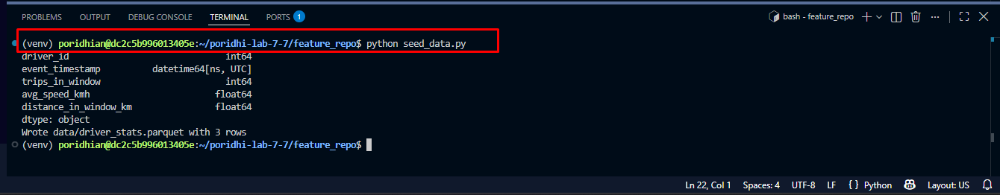

> Would I get an error if I ran this? Possibly. `FileNotFoundError` means you are not inside `feature_repo`: move in and re-run.

### Step 11: Create the Feast feature definitions

> Note: this step defines the entity, the push source, and the feature view that the stream processor will push into.

Create a new file called `driver_repo.py` in `~/poridhi-lab-7-7/feature_repo` and paste the code below into it.

```python
from datetime import timedelta

from feast import Entity, FeatureView, Field, FileSource, PushSource
from feast.types import Float64, Int64, ValueType

driver = Entity(name="driver", join_keys=["driver_id"], value_type=ValueType.INT64)

driver_stats_batch_source = FileSource(
    name="driver_stats_batch_source",
    path="data/driver_stats.parquet",
    timestamp_field="event_timestamp",
)

driver_stats_push_source = PushSource(
    name="driver_stats_push",
    batch_source=driver_stats_batch_source,
)

driver_stats_stream = FeatureView(
    name="driver_stats_stream",
    entities=[driver],
    ttl=timedelta(days=1),
    schema=[
        Field(name="trips_in_window", dtype=Int64),
        Field(name="avg_speed_kmh", dtype=Float64),
        Field(name="distance_in_window_km", dtype=Float64),
    ],
    source=driver_stats_push_source,
    online=True,
)
```

> Would I get an error if I ran this? No. Import errors appear in Step 12.

### Step 12: Apply the feature definitions to the registry

> Note: this step registers the entity, the push source, and the feature view, which creates `data/registry.db`.

```bash
feast apply
```

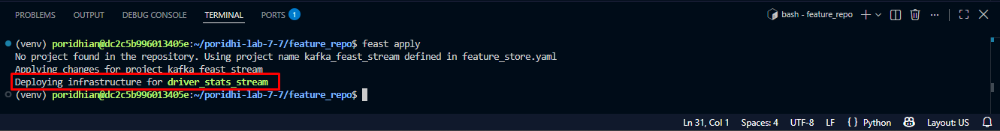

> Would I get an error if I ran this? Possibly. `ModuleNotFoundError` means the venv is not active. Output containing `Wrote data/driver_stats.parquet` means `.feastignore` is missing a script name.

### Step 13: Inspect the registered objects

> Note: this step lists the feature views and entities so you can confirm the registry holds what you defined.

```bash
feast feature-views list
feast entities list
```

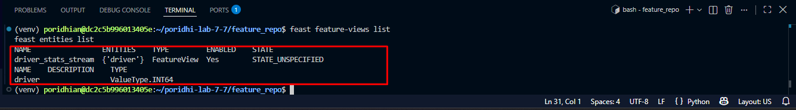

> Would I get an error if I ran this? Possibly. An empty table means Step 12 did not finish: re-run `feast apply`.

### Step 14: Create the stream processor

> Note: this step writes the consumer that computes rolling-window features from Kafka events and pushes them to Feast.

Create a new file called `stream_features.py` in `~/poridhi-lab-7-7/feature_repo` and paste the code below into it. The job stops by itself 15 seconds after the last event, so you do not need to interrupt it.

```python
import json
import time
from collections import defaultdict, deque
from datetime import timedelta

import pandas as pd
from confluent_kafka import Consumer
from feast import FeatureStore
from feast.data_source import PushMode

TOPIC = "driver-trips"
PUSH_SOURCE = "driver_stats_push"
WINDOW_SECONDS = 10
IDLE_STOP_SECONDS = 15
MAX_WAIT_SECONDS = 600

store = FeatureStore(repo_path=".")

consumer = Consumer(
    {
        "bootstrap.servers": "localhost:9092",
        "group.id": "feast-stream",
        "auto.offset.reset": "earliest",
    }
)
consumer.subscribe([TOPIC])

windows = defaultdict(deque)
pushed = 0
started = time.time()
last_message = None

print("Waiting for events on topic", TOPIC)
try:
    while True:
        msg = consumer.poll(1.0)
        now = time.time()
        if msg is None:
            if last_message is not None and now - last_message > IDLE_STOP_SECONDS:
                break
            if last_message is None and now - started > MAX_WAIT_SECONDS:
                break
            continue
        if msg.error():
            print("Kafka error:", msg.error())
            continue

        last_message = now
        event = json.loads(msg.value())
        event_time = pd.Timestamp(event["event_time"])
        driver_id = int(event["driver_id"])

        window = windows[driver_id]
        window.append(
            (event_time, float(event["distance_km"]), float(event["speed_kmh"]))
        )
        cutoff = event_time - timedelta(seconds=WINDOW_SECONDS)
        while window and window[0][0] < cutoff:
            window.popleft()

        speeds = [item[2] for item in window]
        features = pd.DataFrame(
            {
                "driver_id": [driver_id],
                "event_timestamp": pd.to_datetime([event_time], utc=True).astype(
                    "datetime64[ns, UTC]"
                ),
                "trips_in_window": [len(window)],
                "avg_speed_kmh": [round(sum(speeds) / len(speeds), 2)],
                "distance_in_window_km": [round(sum(i[1] for i in window), 2)],
            }
        )
        store.push(PUSH_SOURCE, features, to=PushMode.ONLINE_AND_OFFLINE)
        pushed += 1
        print(
            f"driver {driver_id}: trips={len(window)} "
            f"avg_speed={features['avg_speed_kmh'][0]} "
            f"distance={features['distance_in_window_km'][0]}"
        )
finally:
    consumer.close()

print("Done. Pushed", pushed, "feature rows to Feast")
```

> Would I get an error if I ran this? No. Runtime errors are covered in Step 17.

### Step 15: Create the event producer

> Note: this step writes the producer that sends 60 simulated trip events to the Kafka topic.

Create a new file called `producer.py` in `~/poridhi-lab-7-7/feature_repo` and paste the code below into it.

```python
import json
import random
import time
from datetime import datetime, timezone

from confluent_kafka import Producer

TOPIC = "driver-trips"
EVENT_COUNT = 60

producer = Producer({"bootstrap.servers": "localhost:9092"})
random.seed(42)

for i in range(EVENT_COUNT):
    driver_id = 1001 + (i % 3)
    event = {
        "driver_id": driver_id,
        "distance_km": round(random.uniform(0.5, 6.0), 2),
        "speed_kmh": round(random.uniform(20.0, 70.0), 2),
        "event_time": datetime.now(timezone.utc).isoformat(),
    }
    producer.produce(TOPIC, key=str(driver_id), value=json.dumps(event))
    producer.poll(0)
    time.sleep(0.5)

producer.flush()
print("Sent", EVENT_COUNT, "events to", TOPIC)
```

> Would I get an error if I ran this? No. Runtime errors are covered in Step 17.

### Step 16: Start the stream processor

> Note: this step starts the consumer in the current terminal so it is ready to receive events before any are produced.

Start the stream processor in your current terminal (already inside `~/poridhi-lab-7-7/feature_repo` with the virtual environment active):

```bash
python stream_features.py
```

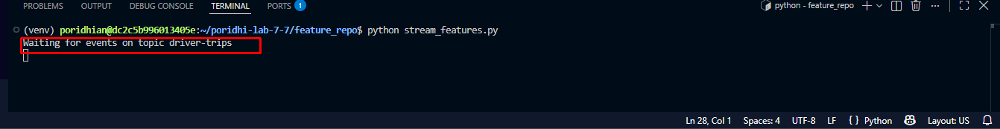

> Would I get an error if I ran this? Possibly. `ModuleNotFoundError` means the venv is not active: run `source ~/poridhi-lab-7-7/venv/bin/activate`.

### Step 17: Send the first burst of events

> Note: this step opens a second terminal, activates the same virtual environment, and runs the producer so you can watch the stream processor compute and push features live.

1. In the VS Code window, open a **second terminal** with the terminal panel's `+` button. Leave the first terminal running; it is busy with the stream processor.
2. In the new terminal, activate the virtual environment you created in Step 1:
   ```bash
   source ~/poridhi-lab-7-7/venv/bin/activate
   ```
   Your prompt now starts with `(venv)`. The new terminal starts in your home folder, so use the full path to the producer script.
3. Run the producer:
   ```bash
   python ~/poridhi-lab-7-7/feature_repo/producer.py
   ```

   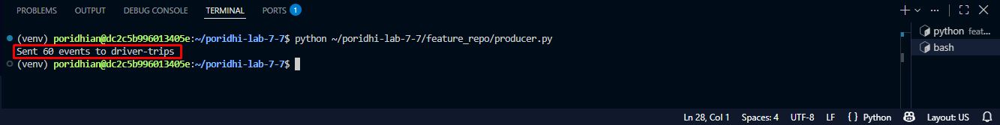

   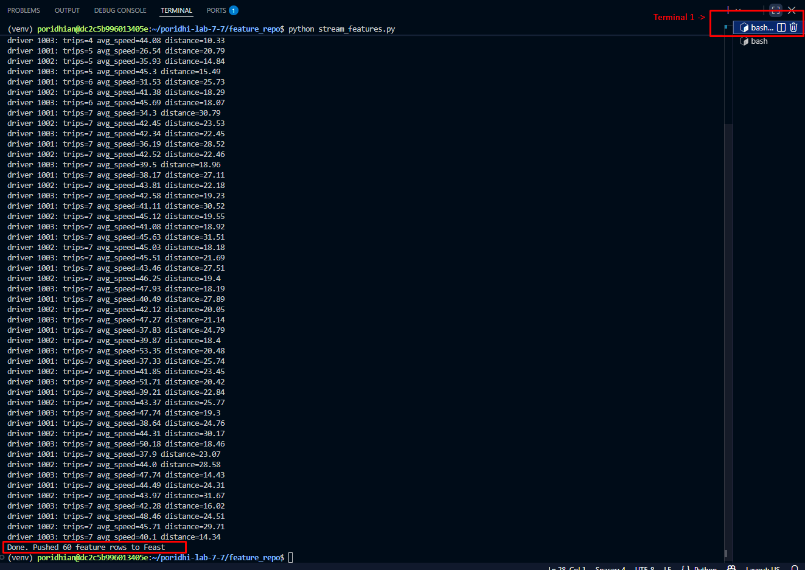

> Would I get an error if I ran this? Possibly. `can't open file` means a wrong path. `ModuleNotFoundError` means the venv is not active in that terminal. A Redis `WRONGPASS` means the Step 7 connection string is wrong.

### Step 18: Verify the online and offline stores

> Note: this step reads the pushed features from Redis (online) and from the Parquet file (offline) to confirm one push call fed both.

Create a new file called `check_features.py` in `~/poridhi-lab-7-7/feature_repo` and paste the code below into it.

```python
import pandas as pd
from feast import FeatureStore

store = FeatureStore(repo_path=".")

features = [
    "driver_stats_stream:trips_in_window",
    "driver_stats_stream:avg_speed_kmh",
    "driver_stats_stream:distance_in_window_km",
]

print("Online features from Redis:")
online = store.get_online_features(
    features=features,
    entity_rows=[{"driver_id": 1001}, {"driver_id": 1002}, {"driver_id": 1003}],
).to_dict()
print(pd.DataFrame(online))

print("Offline history in data/driver_stats.parquet:")
offline = pd.read_parquet("data/driver_stats.parquet")
print("Rows:", len(offline))
print(offline.sort_values("event_timestamp").tail(5))
```

Run it from the first terminal:

```bash
python check_features.py
```

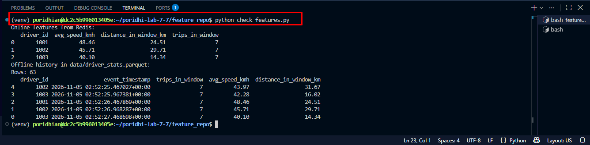

> Would I get an error if I ran this? Possibly. `None` columns mean the Step 17 push did not finish: repeat Step 17. `Rows: 3` means the offline writes never landed.

### Step 19: Send a second burst and watch the store update

> Note: this step repeats the stream loop to show that a second burst of events reaches both stores without a restart.

```bash
python stream_features.py
```

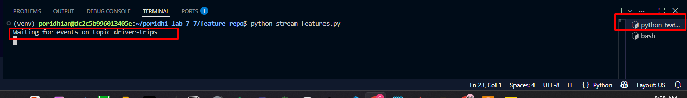

In the second terminal from Step 17, run the producer again. That terminal should still have the virtual environment active (the prompt starts with `(venv)`). If you closed it, open a new terminal with the `+` button and run `source ~/poridhi-lab-7-7/venv/bin/activate` first:

```bash
python ~/poridhi-lab-7-7/feature_repo/producer.py
```

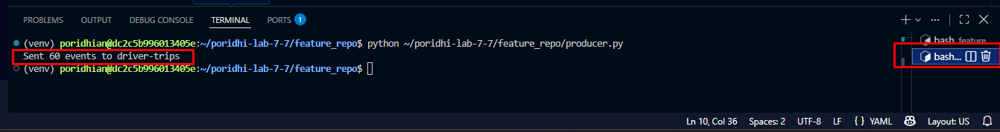

When the consumer finishes, run the verification again in the first terminal:

```bash
python check_features.py
```

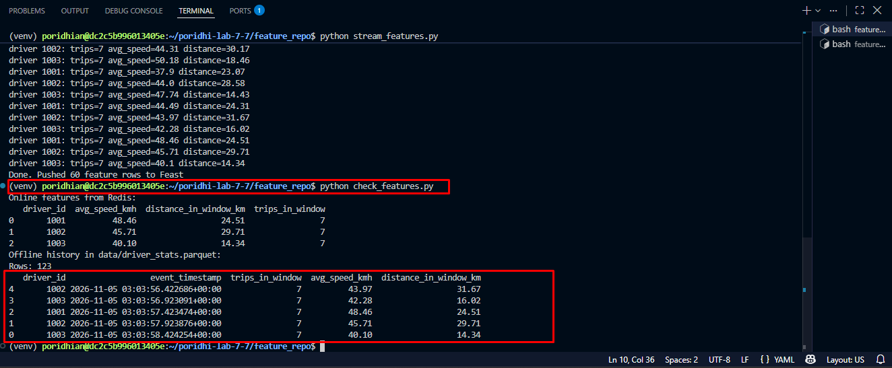

The offline row count has grown to 123, so the second burst was consumed and pushed on top of the first one.

> Did the online values change? The producer seeds its random number generator with `random.seed(42)`, so it sends the same 60 events with the same speeds and distances every time it runs. The window features are therefore identical in both bursts, and the online values look the same. That is the seeded generator at work, not a stale read. Remove the `random.seed(42)` line from `producer.py` and run the burst again to see fresh numbers.

> Would I get an error if I ran this? No, if Steps 17 and 18 passed. The consumer group already read the first 60 events, so this run only processes the new burst.

### Step 20: Start the Feast UI dashboard

> Note: this step installs and starts the built-in Feast UI, a read-only dashboard over the registry you created.

The Feast UI reads `data/registry.db` and shows the project, entities, feature views, and data sources. It runs as a small web server, so start it in a terminal that is free (the first terminal is free after Step 19).

1. Install the gRPC libraries that the UI server needs into the same virtual environment:
   ```bash
   pip install "feast[grpcio]"
   ```
   This is a one-time install and can take a minute. The Feast UI ships with the base `feast` package, but its REST registry layer imports `grpc`, `grpc_health`, and related modules, which the base install does not always pull in.

2. Start the UI server from the feature repository folder:
   ```bash
   cd ~/poridhi-lab-7-7/feature_repo
   feast ui --host 0.0.0.0 --port 8888
   ```
   Expected output: a line like `Uvicorn running on http://0.0.0.0:8888` followed by `Application startup complete.` Leave this terminal running while you browse.

3. If the VM has a browser, open `http://127.0.0.1:8888` to check that the dashboard loads. If you are reading the lab on your own machine, skip this and continue to Step 21, which exposes the same port through the Cloud Tray Load Balancer.

> Would I get an error if I ran this? Possibly. `No module named 'grpc'` means run `pip install "feast[grpcio]"`. `Address already in use` means use port 8889.

### Step 21: Expose the Feast UI with the Cloud Tray Load Balancer

> Note: this step makes the UI server running inside the VM reachable from your own browser through the Poridhi Cloud Tray Load Balancer.

The UI listens on port `8888` inside the VM, but the VM is reachable only from inside the lab network. The **Load Balancer** panel in the lab UI publishes a VM port to a public URL. In the free second terminal (not the one running the UI), read the VM's internal IP:

```bash
hostname -I
```

**Write this down:** the first address in the output is the VM IP. It will look like `10.61.13.246`. If you lost it, run `hostname -I` again.

1. Keep the terminal from Step 20 running. It must still show the `feast ui` server output.
2. Open the Poridhi Cloud Tray in the lab UI and click **Load Balancer**.
3. Put the first `hostname -I` address in **Enter IP** and `8888` in **Enter Port**. Leave the protocol at its default (TCP) and click **Expose**. Do not use `127.0.0.1` here; the balancer cannot route it.
4. The panel lists the exposed entry with a public `URL` shaped like `http://<public-id>.lb.poridhi.io`. Open that URL in your local browser; the exact value is the one the panel shows.
5. Browse the registry and confirm what you built:
   - Project: `kafka_feast_stream`.
   - Entities: `driver` with join key `driver_id`.
   - Feature views: `driver_stats_stream` with `trips_in_window`, `avg_speed_kmh`, and `distance_in_window_km`, TTL of 1 day.
   - Data sources: `driver_stats_batch_source` (the Parquet file) and `driver_stats_push` (the stream source).

The UI reads the registry metadata only. It does not display the live Redis values; use `check_features.py` for those. Press **`Ctrl+C`** in the UI terminal to stop the server when you are done.

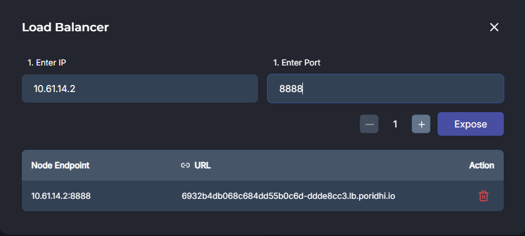

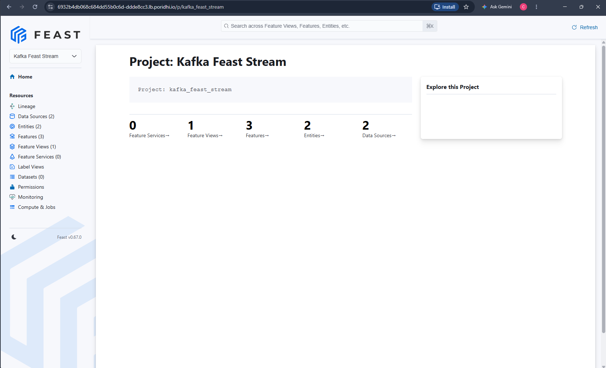

> Would I get an error if I ran this? Possibly. A link that never loads means the IP was wrong: use the first `hostname -I` address, not `127.0.0.1`.

## Epilogue

You built the real-time half of a feature platform. Kafka carried events, a stream processor turned them into rolling-window features, and one `store.push` call per event kept both the online store and the offline history up to date. The same push path works for any source that can produce a DataFrame, not only Kafka.

In production the single consumer becomes several partitions with a scalable stream framework, and the local Parquet file becomes a warehouse table. The Feast definitions stay almost identical.
