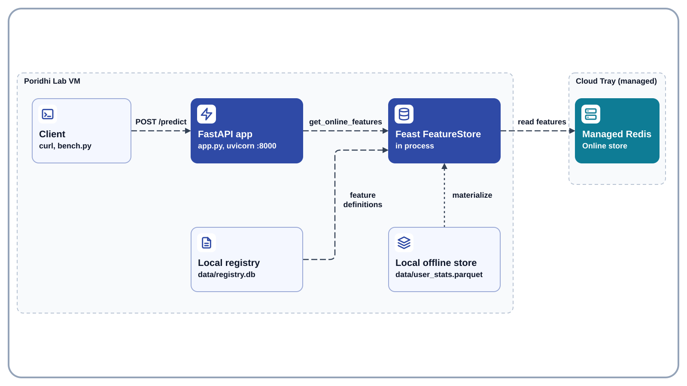
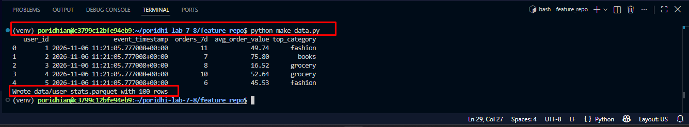
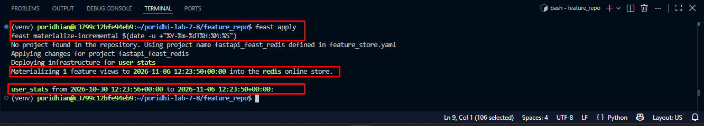
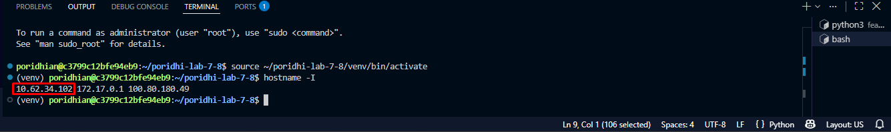
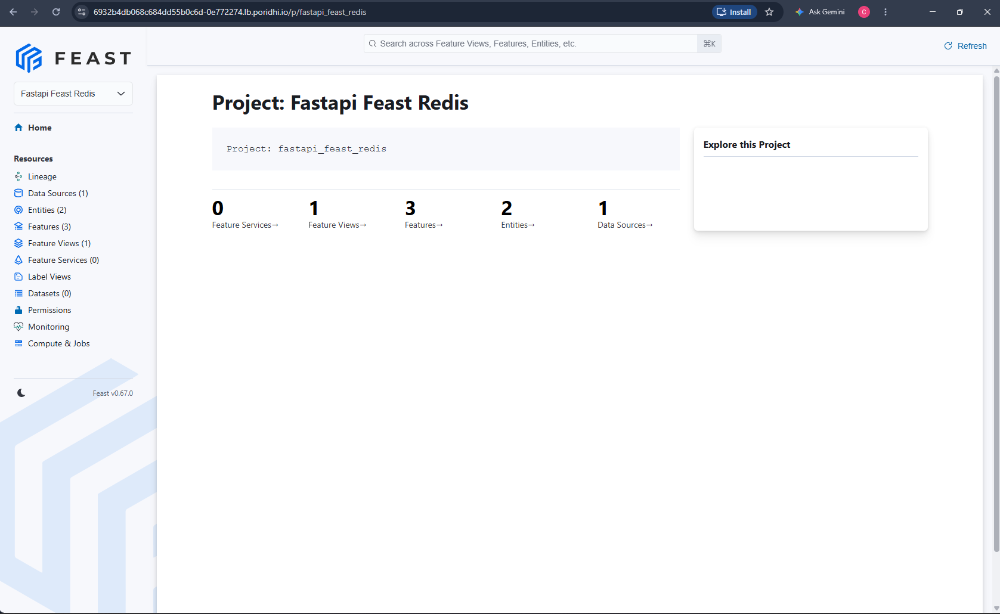
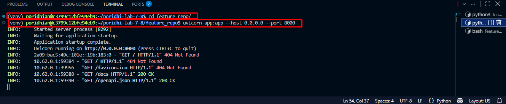
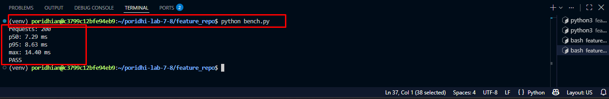
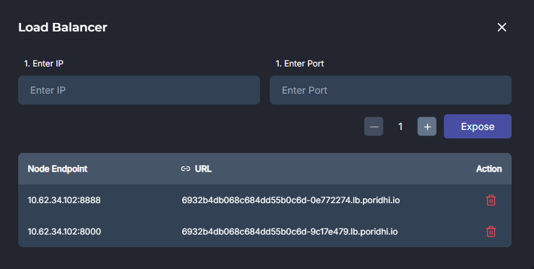

## Introduction

This lab, **FastAPI ↔ Feast → Redis**, shows how to serve ML features at request time. You will materialize user features into the managed Redis, build a FastAPI service with a `/predict` endpoint that reads those features through Feast's online store, turn them into a product recommendation, and measure the response time against a 50 millisecond target.

Online serving is where feature stores earn their keep. A recommendation request cannot wait for a batch job or a warehouse query, so the features must already sit in a fast key-value store and the service must read them with one cheap lookup. Feast gives the service a stable API for that lookup, and Redis gives it low latency.



No object storage is needed in this lab. The Feast registry and the offline Parquet file are local files on the VM, and the online store is the managed Redis from the Poridhi Cloud Tray. Local files disappear when the VM is destroyed. The managed Redis keeps running outside the VM, so the materialized features stay there until the lab session ends.

## Learning Objectives

- Define a user entity and a feature view, and register them with `feast apply`.
- Materialize features from an offline Parquet file into the managed Redis.
- Build a FastAPI `/predict` endpoint that creates the `FeatureStore` once and reuses it for every request.
- Turn online features into a recommendation, with a safe fallback for unknown users.
- Measure p50 and p95 request latency and compare them with a 50 millisecond target.

### Folder Structure

```text
~/poridhi-lab-7-8/
├── feature_repo/
│   ├── feature_store.yaml
│   ├── make_data.py
│   ├── user_repo.py
│   ├── app.py
│   ├── bench.py
│   └── data/
│       ├── user_stats.parquet
│       └── registry.db
└── venv/
```

## Prerequisites

- **Level:** Advanced. You should be comfortable with Python, HTTP APIs, and a Linux terminal.
- **Region:** `ap-southeast-1` (Asia Pacific, Singapore). No availability zones are used. This lab needs no AWS resources.
- **Environment:** Poridhi Lab VM running Linux, with VS Code available in the lab UI for creating and editing files. The managed Redis from the Cloud Tray is the online store, and the Cloud Tray Load Balancer can expose the API publicly in the optional last step.
- **Knowledge:** basic Python and HTTP, and a first pass through the earlier Feast labs in the 7.x series helps but is not required.

## Prologue

Earlier labs in this series computed features in batch with Spark and in real time with Kafka. This lab covers the last mile: a model service that needs those features in a few milliseconds. You will seed a small user dataset, materialize it, and put a FastAPI service in front of it.

The recommendation logic is a simple rule on purpose. The point of the lab is the serving path, so you can later swap the rule for any trained model without touching the Feast lookup.

## Step-by-Step Implementation

### Step 1: Create the project directory and the Python virtual environment

> Note: this step creates the project folders, the virtual environment, and installs Feast, FastAPI, and the supporting libraries.

```bash
mkdir -p ~/poridhi-lab-7-8/feature_repo/data
cd ~/poridhi-lab-7-8/feature_repo
python3 -m venv ~/poridhi-lab-7-8/venv
source ~/poridhi-lab-7-8/venv/bin/activate
pip install --upgrade pip
pip install "numpy>=2.0,<3" "pandas>=2" "pyarrow>=14" "feast[redis]" "fastapi" "uvicorn" "httpx"
```

Expected output: the last lines of pip end with `Successfully installed ...` and list `feast`, `fastapi`, `uvicorn`, `httpx`, `numpy`, `pandas`, and `pyarrow`. Your prompt starts with `(venv)`.

> Would I get an error if I ran this? Possibly. If pip reports a dependency conflict about `numpy`, re-run only the last `pip install` line without the `"numpy>=2.0,<3"` pin and let pip choose the version Feast supports. A `python3: No module named venv` message means the `python3-venv` package is missing: run `sudo apt install -y python3-venv` and repeat the block.

#### Step 1.1: Make VS Code see the project folder (one-time setup)

> Note: this sub-step makes the VS Code Explorer show every folder and file you create in the rest of the lab.

VS Code's Explorer only shows the folder that was opened with `File > Open Folder`, and the `code` shell command is not on `PATH` on the default lab VM. Do this once so the Explorer follows every file you create:

1. In the VS Code window, press **`Ctrl+Shift+P`** to open the Command Palette.
2. Type `Shell Command: Install 'code' command in PATH` and press **`Enter`**. A small notification at the bottom right confirms `Shell command 'code' successfully installed in PATH`. This is a one-time operation; the lab VM keeps it across sessions.
3. Run `code ~/poridhi-lab-7-8` in the integrated terminal, or press **`Ctrl+Shift+P`** again and run **`File: Open Folder`**, picking `~/poridhi-lab-7-8`.
4. The Explorer label changes from `CODE` (or `Welcome`) to `PORIDHI-LAB-7-8`, and you can see `feature_repo/`, `venv/`, and every file you create in later steps.

If you skip this sub-step, you can still finish the lab by creating each file through `File > New File...` in the Welcome tab, but the install makes every later step easier.

### Step 2: Read the managed Redis credentials from the Cloud Tray

> Note: this step exports the Redis connection values for the current lab session so you can copy them into the Feast configuration and test the connection.

Open the Poridhi Cloud Tray in the lab UI, click **Database**, then click the **Redis** card. Copy the **Username**, **Password**, **IP Address**, and **Port** from the panel. The values can change between lab runs, so always read them from the panel.

```bash
export REDIS_HOST="<paste-ip-from-cloud-tray>"
export REDIS_PORT="<paste-port-from-cloud-tray>"
export REDIS_USERNAME="<paste-username-from-cloud-tray>"
export REDIS_PASSWORD="<paste-password-from-cloud-tray>"
```

**Write this down:** run `echo "$REDIS_HOST:$REDIS_PORT"` to print the endpoint. It will look like `100.80.215.5:6379`. If you opened a new terminal since this step and the command prints only a colon, re-run the four `export` lines above with the values from the Cloud Tray Redis panel.

> Would I get an error if I ran this? No. Exports only set variables. Wrong values show up in Step 3.

### Step 3: Test the connection to Redis

> Note: this step proves that the virtual environment can reach the managed Redis before any Feast work starts.

```bash
python -c "import os, redis; r = redis.Redis(host=os.environ['REDIS_HOST'], port=int(os.environ['REDIS_PORT']), username=os.environ['REDIS_USERNAME'], password=os.environ['REDIS_PASSWORD'], decode_responses=True); print(r.ping())"
```

Expected output: `True`

> Would I get an error if I ran this? Possibly. `AuthenticationError` or `Connection refused` means a value from Step 2 is wrong or empty: print them with `echo "$REDIS_HOST:$REDIS_PORT"` and fix the exports.

### Step 4: Create the Feast configuration file

> Note: this step writes `feature_store.yaml`, which tells Feast where the registry, offline store, and online store live.

Create a new file called `feature_store.yaml` in `~/poridhi-lab-7-8/feature_repo`: right-click `feature_repo` in the Explorer, choose `New File...`, name it `feature_store.yaml`, paste the YAML below, and save. Then replace the four `<...>` values in `connection_string` by hand with the same values you used in Step 2.

```yaml
project: fastapi_feast_redis
provider: local
registry: data/registry.db
online_store:
  type: redis
  connection_string: "<REDIS_HOST>:<REDIS_PORT>,username=<REDIS_USERNAME>,password=<REDIS_PASSWORD>"
offline_store:
  type: file
entity_key_serialization_version: 3
```

> Would I get an error if I ran this? No, saving a file cannot fail. A wrong `connection_string` only shows up as a Redis error in Step 8.

### Step 5: Create the data generation script

> Note: this step writes a small script that creates the offline Parquet file with features for 100 users.

Create a new file called `make_data.py` in `~/poridhi-lab-7-8/feature_repo` and paste the code below into it. The `data/` folder already exists from Step 1.

```python
import numpy as np
import pandas as pd

def main():
    rng = np.random.default_rng(7)
    user_count = 100
    categories = ["electronics", "books", "fashion", "grocery"]

    one_hour_ago = pd.Timestamp.now(tz="UTC") - pd.Timedelta(1, "h")

    users = pd.DataFrame(
        {
            "user_id": np.arange(1, user_count + 1, dtype="int64"),
            "event_timestamp": pd.to_datetime(
                [one_hour_ago] * user_count, utc=True
            ).astype("datetime64[ns, UTC]"),
            "orders_7d": rng.integers(0, 12, size=user_count).astype("int64"),
            "avg_order_value": np.round(rng.uniform(10, 120, size=user_count), 2),
            "top_category": rng.choice(categories, size=user_count),
        }
    )

    users.to_parquet("data/user_stats.parquet", index=False)
    print(users.head())
    print("Wrote data/user_stats.parquet with", len(users), "rows")

if __name__ == "__main__":
    main()
```

> Would I get an error if I ran this? No, saving a file cannot fail. Runtime errors are covered in Step 6.

### Step 6: Run the data generation script

> Note: this step creates `data/user_stats.parquet`, the offline store file that Feast will materialize from.

Your terminal is already inside `~/poridhi-lab-7-8/feature_repo` with the virtual environment active.

```bash
python make_data.py
```



The script prints the first five rows of the generated dataset and confirms the file was written with 100 rows. The `event_timestamp` column carries the timezone-aware UTC timestamp that Feast uses for the point-in-time join.

> Would I get an error if I ran this? Possibly. `OSError` or `No such file or directory: data/user_stats.parquet` means you are not inside `feature_repo`, or the `data/` folder from Step 1 is missing. Move into `feature_repo` and re-run the command.

### Step 7: Create the Feast feature definitions

> Note: this step defines the user entity and the feature view that the API will read.

Create a new file called `user_repo.py` in `~/poridhi-lab-7-8/feature_repo` and paste the code below into it.

```python
from datetime import timedelta

from feast import Entity, FeatureView, Field, FileSource, ValueType
from feast.types import Float64, Int64, String

user = Entity(name="user", join_keys=["user_id"], value_type=ValueType.INT64)

user_stats_source = FileSource(
    name="user_stats_source",
    path="data/user_stats.parquet",
    timestamp_field="event_timestamp",
)

user_stats = FeatureView(
    name="user_stats",
    entities=[user],
    ttl=timedelta(days=7),
    schema=[
        Field(name="orders_7d", dtype=Int64),
        Field(name="avg_order_value", dtype=Float64),
        Field(name="top_category", dtype=String),
    ],
    source=user_stats_source,
    online=True,
)
```

> Would I get an error if I ran this? No, saving a file cannot fail. Import errors appear in Step 8.

### Step 8: Apply the definitions and materialize the features into Redis

> Note: this step registers the feature view and copies the latest feature values for all 100 users into the managed Redis.

```bash
feast apply
feast materialize-incremental $(date -u +"%Y-%m-%dT%H:%M:%S")
```



Feast reports that it found no existing project, then applies the changes for the `fastapi_feast_redis` project and deploys the `user_stats` feature view. The materialization banner confirms the window it wrote into the Redis online store, from the first event timestamp in the Parquet file up to the current time.

> Would I get an error if I ran this? Possibly. `ModuleNotFoundError` means the virtual environment is not active: run `source ~/poridhi-lab-7-8/venv/bin/activate`. `Error 99`, `Connection refused`, or `WRONGPASS` from Redis means the `connection_string` in Step 4 has a wrong value: compare it with the Cloud Tray Redis panel, fix the file, and re-run only the `materialize-incremental` line.

#### Step 8.1: View the feature repository in the Feast UI (optional)

> Note: this sub-step starts the Feast web UI so you can see the entity, feature view, and data source that `feast apply` registered after the materialization.

The Feast UI is an experimental dashboard that reads `data/registry.db`. It shows the feature repository metadata, not the 100 materialized feature values. The values from Step 8 are written to Redis, and Step 11's `/predict` response shows them for one user.

Install the gRPC packages that the UI server needs:

```bash
pip install grpcio grpcio-reflection grpcio-health-checking
```

Expected output: `Successfully installed grpcio... grpcio-reflection... grpcio-health-checking...`. If the packages are already present, pip prints `Requirement already satisfied` for them instead.

> Would I get an error if I ran this? Possibly. A network timeout means the VM cannot reach PyPI: re-run the command. A dependency conflict means another package pins an incompatible `protobuf`: re-run the command after activating the virtual environment from Step 1.

Start the UI server and leave this terminal open:

```bash
feast ui --host 0.0.0.0 --port 8888
```

Expected output: Feast prints that the UI is experimental, then uvicorn prints `Uvicorn running on http://0.0.0.0:8888`.

> Would I get an error if I ran this? Possibly. `ModuleNotFoundError: No module named 'grpc'` or `No module named 'grpc_health'` means the install block above did not finish: run it again. `Address already in use` means port 8888 is taken: stop the other process or use `--port 8889` and expose that port instead.

The UI lists the `fastapi_feast_redis` project, the `user` entity, the `user_stats` feature view, and the `user_stats_source` file source. It confirms that `feast apply` wrote the definitions to `data/registry.db`. It does not show the rows from `data/user_stats.parquet` or the values in Redis.

To open the UI from your laptop, print the VM's internal IP:

```bash
hostname -I
```



The first address is the VM's internal IP. The Load Balancer runs outside the VM, so it has to target this address rather than loopback.



The Feast UI home page lists the `fastapi_feast_redis` project with one feature view, three features, two entities, and one data source. The sidebar links to the `user` entity, the `user_stats` feature view, and the `user_stats_source` file source that `feast apply` registered.

Open the Poridhi Cloud Tray in the lab UI, click **Load Balancer**, enter that IP in **Enter IP**, enter `8888` in **Enter Port**, and click **Expose**. Open the public URL from the panel in a normal browser tab.

Expected output: the Feast UI home page loads with the `fastapi_feast_redis` project. Open `user_stats` under the feature views to see the entity, the three features, the TTL, and the file source.

> Would I get an error if I ran this? Possibly. A blank page in the VS Code forwarded port at `/proxy/8888/` is expected: the UI loads its assets from root paths, so use the Load Balancer URL instead. A timeout or `connection refused` means port 8888 was not exposed or the `feast ui` server stopped: check the **Expose** list and the server terminal. Entering `127.0.0.1` or `172.17.0.1` fails because the balancer cannot route to the VM's loopback or Docker bridge.

When you are done browsing, press `Ctrl+C` in the `feast ui` terminal and continue with Step 9. The UI reads the registry only; it does not change the API, the data, or the Redis values.

### Step 9: Create the FastAPI app

> Note: this step writes the API that reads online features through Feast and returns a recommendation with timing details.

Create a new file called `app.py` in `~/poridhi-lab-7-8/feature_repo` and paste the code below into it. The `FeatureStore` is created once at startup and a warm-up lookup runs before the first request, so no request pays for the one-time setup.

```python
import time
from contextlib import asynccontextmanager

from fastapi import FastAPI
from pydantic import BaseModel
from feast import FeatureStore

FEATURES = [
    "user_stats:orders_7d",
    "user_stats:avg_order_value",
    "user_stats:top_category",
]

CATEGORY_ITEMS = {
    "electronics": ["wireless-earbuds", "usb-c-hub"],
    "books": ["bestseller-novel", "ebook-reader"],
    "fashion": ["canvas-sneakers", "denim-jacket"],
    "grocery": ["organic-coffee", "pantry-bundle"],
}
FALLBACK_ITEMS = ["popular-gift-card", "weekly-deals-pack"]

store = None

@asynccontextmanager
async def lifespan(app: FastAPI):
    global store
    store = FeatureStore(repo_path=".")
    store.get_online_features(
        features=FEATURES, entity_rows=[{"user_id": 1}]
    ).to_dict()
    yield

app = FastAPI(title="Feast recommendation API", lifespan=lifespan)

class PredictRequest(BaseModel):
    user_id: int

def first_value(result: dict, feature_name: str):
    for key, values in result.items():
        if key == feature_name or key.endswith(f"__{feature_name}"):
            return values[0]
    return None

def recommend(features: dict) -> list:
    items = list(CATEGORY_ITEMS.get(features["top_category"], FALLBACK_ITEMS))
    if features["orders_7d"] >= 5:
        items.append("loyalty-bundle")
    if features["avg_order_value"] >= 60:
        items.append("premium-pick")
    return items

@app.post("/predict")
def predict(request: PredictRequest):
    started = time.perf_counter()

    feast_started = time.perf_counter()
    result = store.get_online_features(
        features=FEATURES, entity_rows=[{"user_id": request.user_id}]
    ).to_dict()
    feast_ms = (time.perf_counter() - feast_started) * 1000

    features = {
        "orders_7d": first_value(result, "orders_7d"),
        "avg_order_value": first_value(result, "avg_order_value"),
        "top_category": first_value(result, "top_category"),
    }
    known_user = features["orders_7d"] is not None

    if known_user:
        recommendations = recommend(features)
    else:
        recommendations = FALLBACK_ITEMS

    total_ms = (time.perf_counter() - started) * 1000
    return {
        "user_id": request.user_id,
        "known_user": known_user,
        "recommendations": recommendations,
        "features": {
            "orders_7d": features["orders_7d"],
            "avg_order_value": features["avg_order_value"],
            "top_category": features["top_category"],
        },
        "feast_ms": round(feast_ms, 2),
        "total_ms": round(total_ms, 2),
    }
```

> Would I get an error if I ran this? No, saving a file cannot fail. Runtime errors are covered in Step 10.

### Step 10: Start the API server

> Note: this step starts the FastAPI server in the current terminal so it can answer requests on port 8000.

Your terminal is already inside `~/poridhi-lab-7-8/feature_repo` with the virtual environment active.

```bash
uvicorn app:app --host 0.0.0.0 --port 8000
```


Uvicorn reports the app started and is listening on `http://0.0.0.0:8000`. The requests that follow in the log are the browser fetching the OpenAPI schema and the interactive docs, which is normal once the port is reachable.

> Would I get an error if I ran this? Possibly. `ModuleNotFoundError: No module named 'fastapi'` means the virtual environment is not active or Step 1 did not finish. `Address already in use` means another process holds port 8000: stop it, or change `--port 8000` to another port and use that port in later steps. A Redis error at startup comes from the warm-up lookup and means the `connection_string` in Step 4 is wrong.

### Step 11: Send a prediction request

> Note: this step calls the endpoint once for a known user and once for an unknown user so you can see both response shapes.

Open a second terminal in the VS Code window (the terminal panel's `+` button). A new terminal is a fresh shell, so it needs its own directory and environment:

```bash
cd ~/poridhi-lab-7-8/feature_repo
source ~/poridhi-lab-7-8/venv/bin/activate
curl -s -X POST http://127.0.0.1:8000/predict -H "Content-Type: application/json" -d '{"user_id": 1}'
curl -s -X POST http://127.0.0.1:8000/predict -H "Content-Type: application/json" -d '{"user_id": 9999}'
```

Expected output: the first response has `"known_user": true`, a `recommendations` list built from the user's top category, the three feature values, and `feast_ms` and `total_ms` values. The second response has `"known_user": false`, the fallback items `popular-gift-card` and `weekly-deals-pack`, and `null` feature values.

> Would I get an error if I ran this? Possibly. `curl: (7) Failed to connect` means the server from Step 10 is not running. A response with `"known_user": false` for user 1 means the materialize step in Step 8 wrote nothing: repeat Step 8. An `Internal Server Error` means the server terminal shows the Python error: read it there.

### Step 12: Create and run the latency benchmark

> Note: this step sends 200 requests, measures the round-trip time of each one, and compares the 95th percentile with the 50 millisecond target.

Create a new file called `bench.py` in `~/poridhi-lab-7-8/feature_repo` and paste the code below into it.

```python
import statistics
import time

import httpx

URL = "http://127.0.0.1:8000/predict"
WARMUP_REQUESTS = 10
REQUESTS = 200
TARGET_MS = 50

def main():
    latencies = []

    with httpx.Client(timeout=5.0) as client:
        for i in range(WARMUP_REQUESTS):
            client.post(URL, json={"user_id": (i % 100) + 1}).raise_for_status()

        for i in range(REQUESTS):
            user_id = (i % 100) + 1
            started = time.perf_counter()
            response = client.post(URL, json={"user_id": user_id})
            latencies.append((time.perf_counter() - started) * 1000)
            response.raise_for_status()

    latencies.sort()
    p50 = statistics.median(latencies)
    p95 = latencies[int(len(latencies) * 0.95) - 1]

    print(f"requests: {REQUESTS}")
    print(f"p50: {p50:.2f} ms")
    print(f"p95: {p95:.2f} ms")
    print(f"max: {latencies[-1]:.2f} ms")
    print("PASS" if p95 < TARGET_MS else f"FAIL: p95 is above {TARGET_MS} ms")

if __name__ == "__main__":
    main()
```

Run it from the second terminal:

```bash
python bench.py
```



The benchmark sends 200 requests and reports the percentiles. The 95th percentile comes in well under the 50 millisecond target, so the run ends with a `PASS` line.

> Would I get an error if I ran this? Possibly. `httpx.ConnectError` means the server from Step 10 is not running. A `FAIL` result is a measurement, not an error: the latency depends on the network distance between the VM and the managed Redis. Compare `feast_ms` in the Step 11 responses with `total_ms` to see whether the time goes into the Redis lookup or into the rest of the request.

### Step 13: Expose the API publicly (optional)

> Note: this step publishes the API running inside the VM to a public address with the Cloud Tray Load Balancer.

First, print the VM's internal IP. The Load Balancer runs outside the VM, so it must target this address instead of loopback:

```bash
hostname -I
```



The Load Balancer panel lists the exposed entries, each with the VM address and port on the left and the public URL on the right. Use the entry for port `8000` when calling the API from outside the VM.

Use the first address printed (ignore `172.17.0.1` and any `100.x` address unless the first one fails). Open the Poridhi Cloud Tray in the lab UI, click **Load Balancer**, enter that IP in **Enter IP**, enter `8000` in **Enter Port**, and click **Expose**. The exposed public URL appears in the panel. Then call the API through it from any machine, replacing the address with the one the panel shows:

```bash
curl -s -X POST http://<exposed-address>/predict -H "Content-Type: application/json" -d '{"user_id": 1}'
```

Expected output: the same JSON response as in Step 11. The `feast_ms` value stays small, but the time the caller sees now also includes the trip over the internet.

The exposed URL also serves the interactive API docs. Open `http://<exposed-address>/docs`, expand `POST /predict`, and click **Try it out** to send `{"user_id": 1}`. This works because the Load Balancer forwards requests to the app root, so Swagger can load `/openapi.json`; the VS Code proxy path does not, which is why `/docs` returns `Failed to load API definition` there.

> Would I get an error if I ran this? Possibly. A timeout or `connection refused` means the port was not exposed or the server from Step 10 stopped: check the **Expose** list in the Load Balancer panel and confirm `uvicorn` is still running. Entering `127.0.0.1` or `172.17.0.1` fails because the balancer cannot route to the VM's loopback or Docker bridge.

## Epilogue

You built the serving path of an ML system: features materialized into Redis ahead of time, a FastAPI service that reads them through Feast with one lookup, and a recommendation returned with timing details attached. The benchmark gives you a repeatable way to check the latency target every time something changes.

The same structure works for a trained model. Replace the `recommend` function with a model call and keep everything around it, because the Feast lookup, the startup warm-up, and the fallback for unknown users stay exactly the same.

## Conclusion

This lab connected a FastAPI service to Feast and the managed Redis to serve recommendations at request time. Features were materialized from a Parquet file into Redis, the API read them with a single `get_online_features` call on a store created once at startup, and a benchmark measured the result against a 50 millisecond target. The key takeaway is that fast online serving comes from precomputed features in a key-value store and a lookup path with no per-request setup.